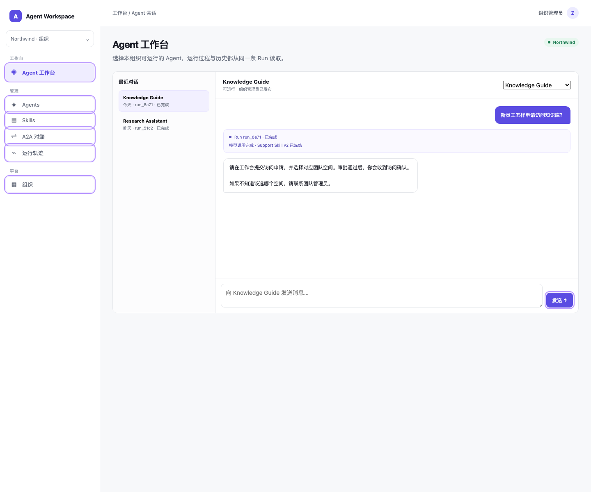
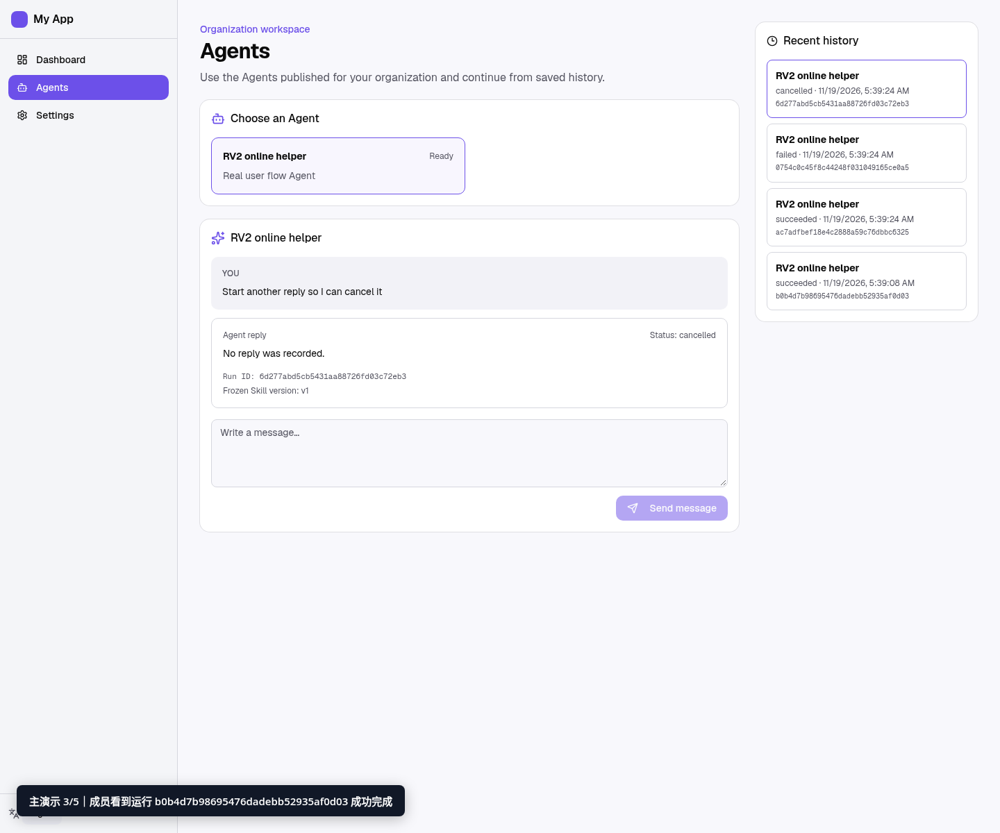
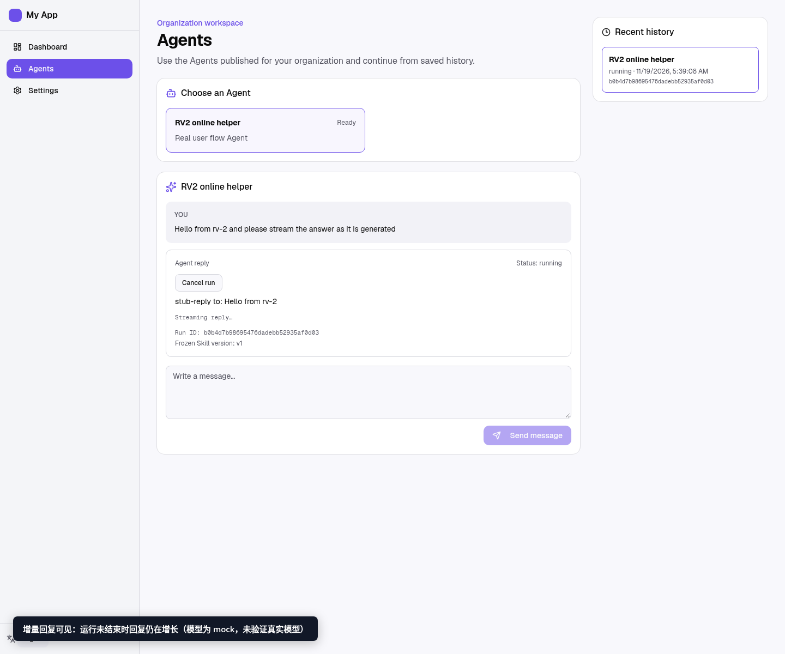
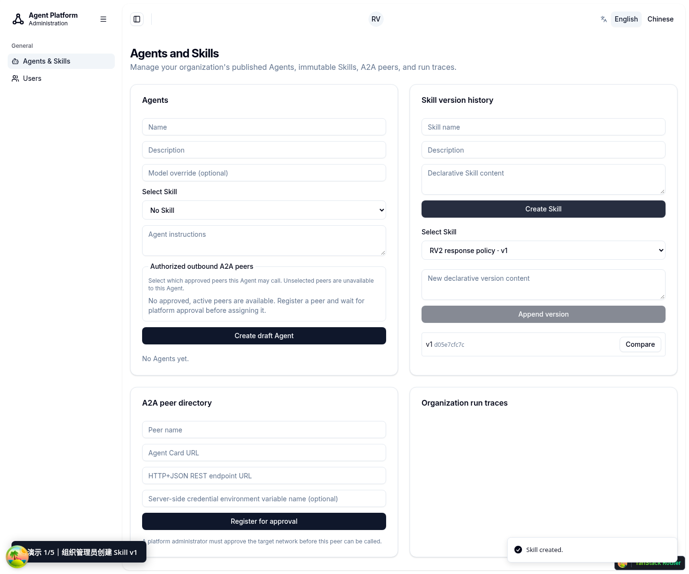
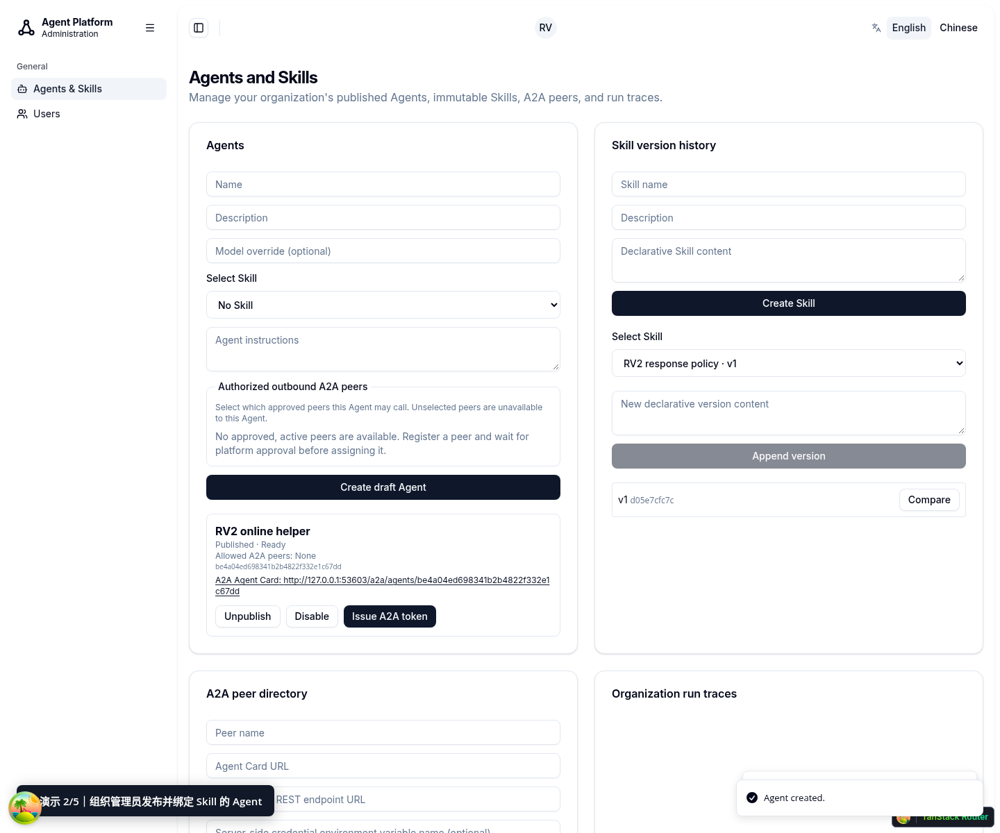
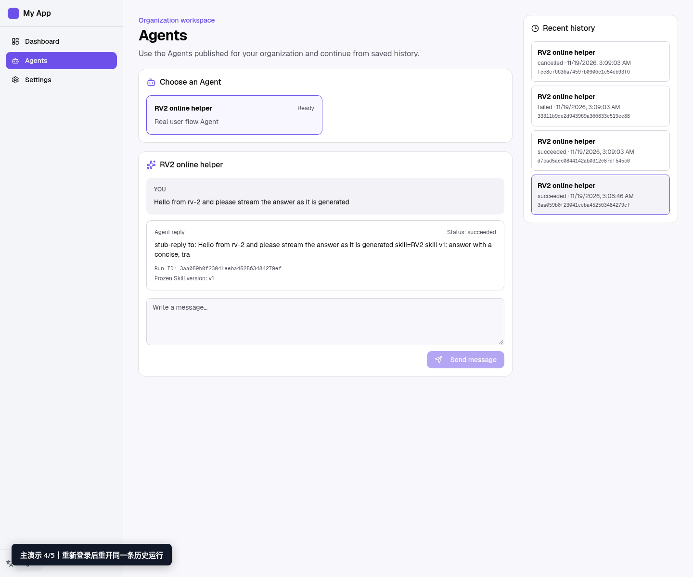
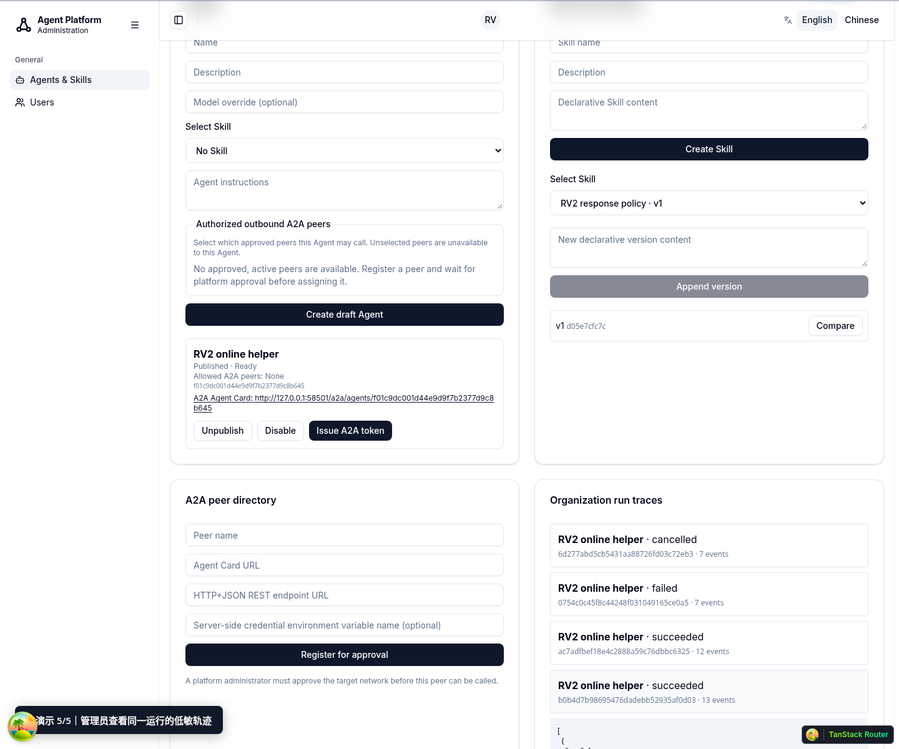
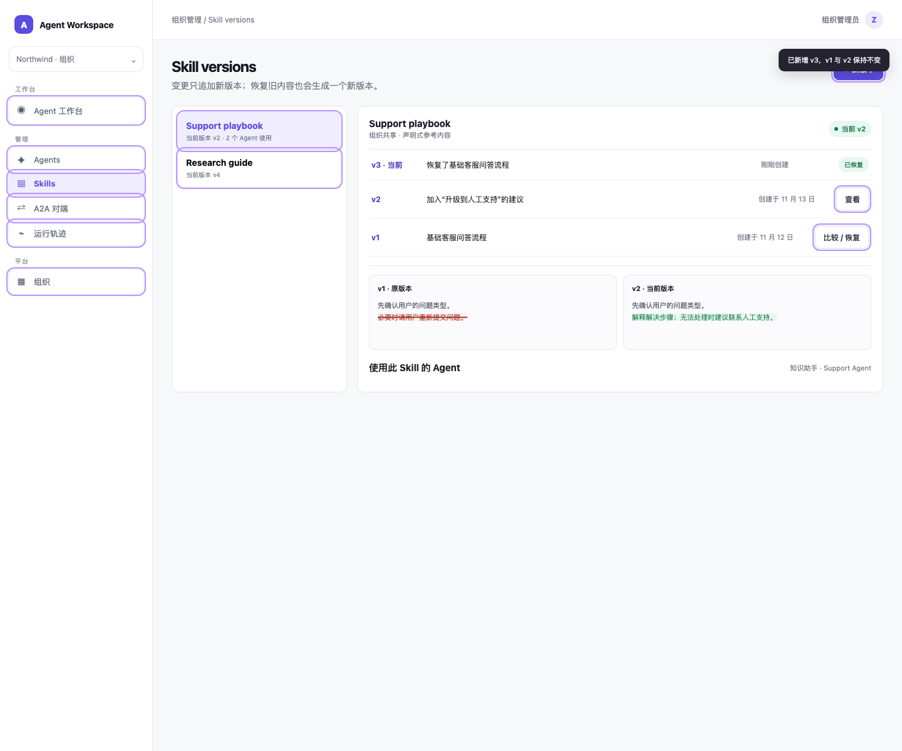
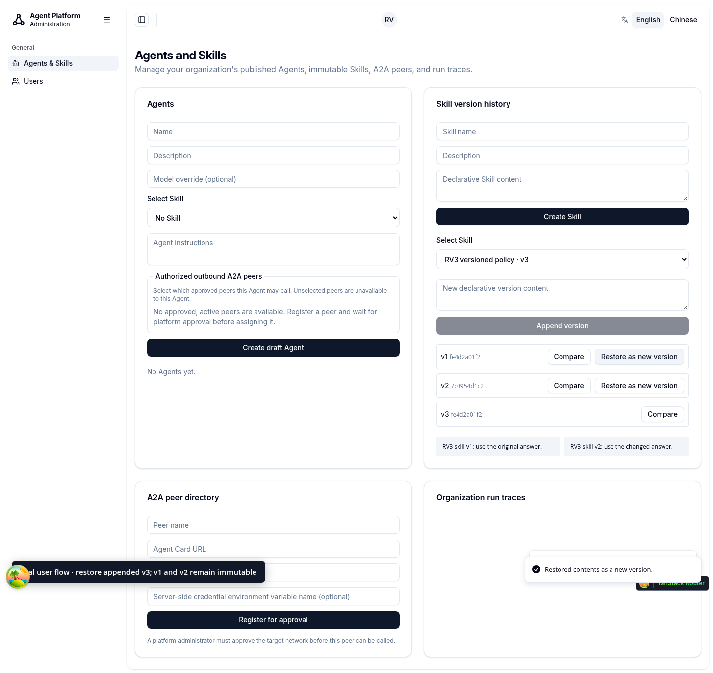

## 人审导航 / Human Review Navigation

### Current delivery status (2026-11-19)

- Verified HEAD: `1f0e635a47c8abdab1ed010226f128f3ea3317fa`; verified source tree with delivery records, generated Playwright files, and local package cache excluded: `33a6ed4205fae48c94da25940609fedc564e2e86`.
- The official `kc evidence check` completed 7/7 with no failures or timeouts. All seven negative controls on that identity produced their expected failures. Independent verifier verdict: **PASS, risk=yellow**, with no unresolved product blocker; see [the verifier report](P1-FEAT-20260928-115856-multi-organization-online-agent-base.verifier-report.md). The verified source tree passed GitHub CI run [44462357584](https://github.com/ZataZhang/zata-codes-template/actions/runs/44462357584); after the delivery-record commit, final PR head run [44467737473](https://github.com/ZataZhang/zata-codes-template/actions/runs/44467737473) also passed all four required jobs. `just test` passed (540 passed, 1 skipped; local OIDC package 17 passed).
- The separate real-browser primary demo was recorded on this identity: 169.48 seconds, six clips for the five scripted steps; caption frame inspection passed with each caption visible for 5–18 seconds. SHA-256: `cbf7b94e858cf79cf0a9445abe9941dbde558acfd54b67fbdd5746b33477b6b8`.
- Limits: the model transport is a local OpenAI-compatible fixture; no live paid model, public third-party Agent, or public deployment is claimed. RV-5 used the local worktree as its sync upstream after GitHub fetches ended early. The independent verifier noted a non-blocking approval UX risk: private peer addresses can be registered, but outbound policy rejects private DNS results before HTTP.
- PR #62 merged on 2026-11-19. Merge commit `55174cbfb02bec30a4d5073ac0dcadd0a2763e16` has the same delivery-record-excluded source tree `33a6ed4205fae48c94da25940609fedc564e2e86` as the verified implementation. The five Human-Confirmed decisions were then recorded as accepted in PRD §9.2, and the banner is now `✅ 已验收`. The report's dated sections below preserve historical snapshots and are superseded where their status differs from this section.

### Historical verification snapshots

Historical verified implementation tree: `afe83d98ac0026fd15794ccd9794b5385a9bd20c` (PRD/evidence delivery records, generated Playwright files, and local package cache excluded). Baseline HEAD: `66f6c4d024fac115e1f31606accdb92992ad44ca`. KedaCode re-executed all seven manifest commands against that tree with `kc evidence check`; all 7 passed, 0 failed, and 0 timed out. The tree identity helper removes excluded committed paths from its temporary index before applying source changes. RV-2's separate primary-demo run was also recaptured on that tree and used temporary Playwright staging files that are not part of the verified tree. The 2026-11-18 continuation below records later migration and Admin UI changes; historical RV-7 PASS evidence does not cover those changes.

Latest recovery re-execution (2026-11-18): RV-2, RV-3, and RV-6 negative controls and positive commands all completed on source tree `41486d970b6d44610c2343ae09a8f6ffd36bafe8`, HEAD `39a3024c200437f6ed9ad3bc8ffb3ce0e09d2076`. RV-2 and RV-3 use the real browser/UI/API/database path with a local model transport fixture; RV-6 builds and starts the production Compose stack. The RV-6 build uses a temporary alternate lock whose 158 package versions and all distribution hashes were checked against `uv.lock`; only download URLs differ. These KedaCode re-executions are not an independent verifier verdict, and no Human-Confirmed item was changed.

Final recovery rerun (HEAD `c233281de8f7537f4444bc3054a31397e327a537`): first, each of the seven registered negative controls was re-executed on tree `afe83d98ac0026fd15794ccd9794b5385a9bd20c` and captured its expected failure. The exact manifest command `kc evidence check --evidence tasks/evidence/P1-FEAT-20260928-115856-multi-organization-online-agent-base --worktree .` then completed **7/7 passed**, 0 failed, 0 timed out; each positive record is later than its item's negative control. RV-2's separate five-step primary demo was recorded on the same source tree: six real-browser clips, 75.52 seconds total, with each result frame held at least 3.5 seconds. `UV_CACHE_DIR=/tmp/uv-cache-issue58 just test` then passed (540 passed, 1 skipped; local OIDC package 17 passed). An initial `just test` attempt failed before tests started because the default `/Users/zata/.cache/uv` cache was outside the writable sandbox; rerunning with the task-local `/tmp` cache passed, including full lint.

**This tree contains the repair for the independent verifier's BLOCKER.** The verifier's RED verdict on the previous tree was that the member UI showed no partial reply while the model was responding: the page polled `GET /agent-runs/{id}` and rendered `assistant_message` or a placeholder, and the executor used a non-streaming completion. The repair streams the model response (`stream: true`, SSE), persists each text fragment as `message.delta` on the one canonical Run/Event chain, and has the member page poll `GET /agent-runs/{id}/events?after_seq=` so the reply grows while the Run is still `running`. `rv-2-incremental-reply.txt` records the partial reply captured mid-run and `rv-2-streaming-reply.png` is that live screen; the RV-2 workflow now fails unless a non-empty partial reply is seen while the Run is running and the final reply starts with it.

The primary demo was re-recorded and now follows the PRD's five-step script exactly, including the previously missing Skill update/compare/restore and the second Run with frozen versions; `rv-2-caption-trace.txt` lists every on-screen caption with its bounding box, and `scripts/inspect_primary_demo.py` (its output is appended to `rv-2-primary-demo.txt`) confirms each step's caption stays visible for at least five seconds and that the steps are visually distinct.

At the time of this historical snapshot, the KedaCode re-execution was not an independent verifier verdict and a fresh verdict was still required. That gate was later closed by the PASS recorded in Current delivery status.

Re-execution was repeated at this tree after the repair: `kc evidence check --evidence tasks/evidence/P1-FEAT-20260928-115856-multi-organization-online-agent-base --worktree .` reported **7/7 passed**. One earlier attempt lost rv-6 because the image build could not reach `fonts.googleapis.com` (`Failed to fetch 'Geist' from Google Fonts`); the same registered rv-6 command passed on an identical tree, so the production frontend build still needs outbound access to Google Fonts at build time — an external dependency, not a defect introduced here.

Historical publication snapshot: [GitHub Issue #58](https://github.com/ZataZhang/zata-codes-template/issues/58) and [PR #62](https://github.com/ZataZhang/zata-codes-template/pull/62). At that snapshot the PR still pointed to an earlier WIP head and its database CI jobs had failed; the current head and CI status are recorded above. The listed presentations were cross-checked against their corresponding evidence reports.

| Outcome | Presentation and open command | Expected value |
|---|---|---|
| Agent publication → member Run → fresh-session history → admin trace (rv-2) | `tasks/evidence/P1-FEAT-20260928-115856-multi-organization-online-agent-base/rv-2-prototype.png` + `tasks/evidence/P1-FEAT-20260928-115856-multi-organization-online-agent-base/rv-2-agent-run.png` + `tasks/evidence/P1-FEAT-20260928-115856-multi-organization-online-agent-base/rv-2-demo-multi-organization-agent.mp4`; `open "tasks/evidence/P1-FEAT-20260928-115856-multi-organization-online-agent-base/rv-2-demo-multi-organization-agent.mp4"` | Prototype and real page are paired below; video shows the same Run ID, successful reply, reopened history, and low-sensitivity admin trace. Captions disclose the mock model. |
| Skill v1 → v2 comparison → restored v3 and frozen Run versions (rv-3) | `tasks/evidence/P1-FEAT-20260928-115856-multi-organization-online-agent-base/rv-3-prototype.png` + `tasks/evidence/P1-FEAT-20260928-115856-multi-organization-online-agent-base/rv-3-skill-version.png`; `open "tasks/evidence/P1-FEAT-20260928-115856-multi-organization-online-agent-base/rv-3-skill-version.png"` | Prototype and real management page are paired below; linear v1/v2/v3 history, restored body equals v1, old Run remains v1 and new Run freezes v3. |

### rv-2 target prototype and real user flow

Target prototype (`interactive prototype / component preview`, 1440×1200):

Local image: `open "tasks/evidence/P1-FEAT-20260928-115856-multi-organization-online-agent-base/rv-2-prototype.png"`

Real implementation (`real user flow`, 1440×1200, English, light theme; model transport mock, not a live model claim):

Local image: `open "tasks/evidence/P1-FEAT-20260928-115856-multi-organization-online-agent-base/rv-2-agent-run.png"`

The comparison checks Agent selection, persisted reply/status, Run ID, and recent history. Layout differs intentionally: production uses the existing Next.js sidebar/card system rather than the prototype’s custom shell.

The separate primary recording is a real-browser walkthrough of the PRD's five scripted steps, not the regression-test recording: publish a model-configured Agent, member Run with a visibly growing reply, reopen the same Run and inspect the admin trace, update/compare/restore the Skill, then a second Run that freezes the restored version while the old Run stays on v1. `rv-2-caption-trace.txt` lists each on-screen caption with its timestamp and box, `rv-2-primary-demo-clips.json` records the clip durations, and `scripts/inspect_primary_demo.py` (output in `rv-2-primary-demo.txt`) reports that every step's caption stayed visible for at least five seconds and that no two steps share the same caption frame. The model steps are labelled as mock on screen; real model behaviour is not claimed.

<video controls src="rv-2-demo-multi-organization-agent.mp4"></video>

Local image, `real user flow`: `open "tasks/evidence/P1-FEAT-20260928-115856-multi-organization-online-agent-base/rv-2-streaming-reply.png"` — captured by the RV-2 workflow while the status line still read `Status: running`; the same moment is logged in `rv-2-incremental-reply.txt`.

#### RV-2 workflow screenshots (local-only evidence)

Each screenshot is a real rendered browser step with its Chinese caption. The MP4 above is the presentation; these frames provide still-image review.

Local image, `real user flow`: `open "tasks/evidence/P1-FEAT-20260928-115856-multi-organization-online-agent-base/rv-2-demo-step-1-skill.png"`

Local image, `real user flow`: `open "tasks/evidence/P1-FEAT-20260928-115856-multi-organization-online-agent-base/rv-2-demo-step-2-publish.png"`

Local image, `real user flow`: `open "tasks/evidence/P1-FEAT-20260928-115856-multi-organization-online-agent-base/rv-2-demo-step-3-run.png"`

Local image, `real user flow`: `open "tasks/evidence/P1-FEAT-20260928-115856-multi-organization-online-agent-base/rv-2-demo-step-4-history.png"`

Local image, `real user flow`: `open "tasks/evidence/P1-FEAT-20260928-115856-multi-organization-online-agent-base/rv-2-demo-step-5-trace.png"`

### rv-3 target prototype and real user flow

Target prototype (`interactive prototype / component preview`, 1440×1200):

Local image: `open "tasks/evidence/P1-FEAT-20260928-115856-multi-organization-online-agent-base/rv-3-prototype.png"`

Real implementation (`real user flow`, 1440×1200, English, light theme):

Local image: `open "tasks/evidence/P1-FEAT-20260928-115856-multi-organization-online-agent-base/rv-3-skill-version.png"`

The comparison checks v1/v2/v3 ordering, v1/v2 comparison text, restored-current version, and A2A publication status. The production page additionally exposes the approved-peer directory and real Run list.

## Evidence by oracle

### rv-1 — organization isolation and dual-database migration: PASS

- `rv-1-org-isolation-pg.txt` and `rv-1-org-isolation-mysql.txt`: real `uvicorn backend.main:app`, real login cookies, server-derived organization scope, and fresh HTTP/SQL reads.
- Both databases prove `upgrade head` with a pre-existing Run and two events, backfill to the default organization, downgrade to `b93aa5cf0228`, and re-upgrade to single head `26e8967fcd01`; Run/Event counts and foreign-key relationships remain intact.
- Organization B member/admin exact-ID reads of A Agent, Run, events, assets, Skill, credentials, and management traces return 403/404 without A names, content, credentials, or existence leaks.
- Platform admin has no default member-content access. Request-body organization IDs are not trusted.
- After a platform-admin organization move, the member and new org admin cannot read old data or append to the old conversation; old org admin still sees its low-sensitivity trace.
- `rv-1-negative-control-pg.txt`: a temporary source mutant with organization/owner filtering removed returns HTTP 200 and the A payload, producing the expected red result. No production fault-injection switch exists.

### rv-2 — real Agent Run workflow: PASS

- `rv-2-browser-handshake.txt`: the host Playwright client connects to the isolated Chromium service through the published loopback endpoint before starting the real UI flow.
- `rv-2-real-user-flow.txt`: `just e2e tests/rv58-workflows/agent-run.auth.spec.ts`, two tests passed. The spec is staged from the evidence scripts into a visible, temporary Playwright test directory and removed after each run.
- `rv-2-incremental-reply.txt` + `rv-2-streaming-reply.png`: while the Run status line still read `Status: running`, the reply paragraph already showed a 30-character partial reply; the workflow asserts the terminal reply starts with that partial text and grew, and that the page requested `/api/agent-runs/{id}/events`.
- `rv-2-negative-control.txt`: a malformed streamed model response makes the real UI show `failed`; the expected `succeeded` assertion goes red before the corrected flow passes.
- Browser requests use `POST /api/agent-runs`, never `/api/api/agent-runs`. The displayed Agent ID and Run ID are used for subsequent reads.
- The fresh browser context reopens the same Run and sees the terminal reply and frozen Skill v1. Admin sees `model.call.completed` without the original message.
- `rv-2-demo-multi-organization-agent.mp4` is the separate primary demo, following the PRD's five scripted steps with Chinese captions; `rv-2-primary-demo.txt` records the assembly and the `scripts/inspect_primary_demo.py` verdict (`PRIMARY_DEMO_INSPECTION: PASS`), and `rv-2-caption-trace.txt` maps each caption to its on-screen box. The model transport is mocked; no live model behavior is claimed.

### rv-3 — Skill version and Run snapshots: PASS

- `rv-3-real-user-flow.txt`: `just e2e tests/rv58-workflows/skill-version.auth.spec.ts`, two tests passed.
- `rv-3-negative-control.txt`: a temporary altered v1 response makes the immutable-history assertion fail; the green flow then verifies exact v1/v2/v3 content and Run snapshots.
- The real admin page appends v2, compares v1/v2, and restores v1 as new v3 without modifying v1 or v2.
- The original Run remains frozen on v1; the post-restore Run displays frozen v3 and reads the restored v1 body. A fresh browser context confirms it.
- Repeated Skill creation with one `Idempotency-Key` returns the same ID and `current_version=1`.

### rv-4 — neutral distribution audit: PASS

- `rv-4-distribution-audit.txt`: the actual `just copy` output contains 889 files; the scan includes source/config/docs, media metadata, binary/package inventory, and Git-history review.
- `rv-4-negative-control.txt`: the same copy auditor rejects a deliberately injected CargoX marker in the actual copied output.
- No CargoX/Outlook/freight/cost-rate/vendor text remains in the publish surface. Legacy freight test/prototype names were replaced with generic support examples.
- No archive or binary package is tracked. No source-repository migration, lockfile, font, image, brand package, or credential was imported.
- FreshAI/ai-assistant references are provenance only, not runtime dependencies. The distribution decision is a clean history for the audited current tree, not an unreviewed full-history publication.

### rv-5 — actual template copy and sync: PASS

- `rv-5-template-copy.txt`: real `just copy`, Alembic migration, sync clone/compare, and copied backend `/health` = 200. Sync found one changed shared file (`tests/playwright-e2e/playwright.config.ts`) and zero new entries.
- `rv-5-negative-control.txt`: removing the copied backend entry point prevents startup and `/health`, which makes the startup check red.
- Copied output excludes `.agent-runner/` and `.env.view-state`. Nested copies do not install hooks, stage, or commit in the parent repository; standalone behavior is unchanged.
- Two GitHub fetches failed with early EOF. The final proof therefore uses the real sync script with this worktree as `SYNC_TEMPLATE_TEMPLATE_REPO`; clone/compare completed and listed one changed candidate. This is not a claim that GitHub connectivity was verified.

### rv-6 — production Compose and secret boundary: PASS

- `rv-6-production-compose.txt`: all three images build and all three containers start. Backend `/health` returns 200. The recorded run is the successful re-execution after a first attempt failed while the image build fetched `fonts.googleapis.com`; that dependency on outbound font access is listed under limits.
- `rv-6-negative-control.txt`: the real production frontend fails its login assertion when the upstream base is faulted with a duplicated `/api` prefix.
- Public `/api/auth/login` and `/api/agent-runs` return 200; admin `/api/admin/auth/login` and `/api/admin/auth/me` return 200. `/api/api/agent-runs` returns 404 and the A2A proxy preserves its independent route.
- The production Dockerfile supplies `API_BASE_URL` at build time; Next.js no longer serializes `localhost:8000`.
- Admin `dist` (96 files) and public `.next` (2031 files) contain zero model-key markers. Browser-facing responses contain no model key. No public deployment was performed.

### rv-7 — official A2A interoperability and failure closure: PASS

- `rv-7-a2a-admin.png`: a real organization administrator publishes an Agent, issues its inbound credential, and registers the external peer; a separate platform-admin session approves the peer on the actual review page. The same UI flow exposed a Vite proxy collision, fixed by limiting the dev proxy to `^/a2a/`; `/a2a-approvals/` now remains a frontend route.
- `rv-7-negative-control.txt`, `rv-7-a2a-bidirectional.txt`, and `rv-7-official-client.json`: independent official `a2a-sdk[all]==1.0.0` client and server. A temporary source mutant disables credential-Agent and Task organization/Agent/owner checks; B's credential then reads A's exact Task and input, making the isolation oracle red. The unmutated tree returns 404 with no task content.
- Inbound: Agent Card, send, same-message retry, fresh get, list, subscribe, cancel, and fresh cancel-state read. Retry returns the same Run/Task ID.
- Organization B credentials cannot read A’s exact Task ID; responses do not reveal its existence.
- Outbound: the UI-approved peer is called from the formal member Run API; the parent Run links its remote Task and contains the remote result in canonical events.
- Skill append/restore retries return the first version IDs and preserve `[1,2,3]`; same-key different content returns 422.
- Unsafe tool and unregistered-peer Runs fail without `run.completed`; redirect targets are not followed; disabled Agent and missing model return 409 without new success records; organization shutdown returns 401 for browser and 404 for A2A.
- `tests/backend/test_a2a_outbound_policy.py`: card shape, no-DNS/no-HTTP rejection for unlisted and loopback targets, private DNS rebinding, public allowlist acceptance, and cross-organization rejection before HTTP construction.

## Architecture and transaction evidence

- `rv-7-run-a2a-architecture.txt`: one `RunModel`, one `RunEventModel`, one canonical Run transaction, and one `append_skill_revision` write path. No A2A Task ORM model or second task/asset state store exists. Its captured source tree is recorded inside the file; the official protocol run and final tree are independently reported in the rv-7 files.
- Run/Event commits use the existing repository. Skill create/append/restore serializes through row locks and unique idempotency constraints. A2A tasks are projections of those same Runs; remote Task IDs are metadata in canonical tool events.
- `just lint --reuse`: jscpd, pylint duplicate-code, architecture, guideline consistency, and max-file-lines all pass on the current tree.
- `just lint --full`: PASS on the current tree, including whitespace, Ruff, PRD checklist, archive, architecture, and migration/schema guards.
- `uv run alembic heads`: exactly `26e8967fcd01 (head)`.

## Repository validation summary

- `just test`: **540 passed, 1 skipped**; local OIDC package **17 passed** on the final recovery tree, using an isolated temporary PostgreSQL database. The three new cases are `tests/backend/test_agent_streaming_deltas.py`: SSE fragments reach the delta callback in order, a non-streaming endpoint is reported as not streamed, and fragments are batched into `message.delta` events. The changed Vite proxy was exercised by the RV-7 real admin UI flow.
- Re-execution in this round: `git diff --check`, `uv run mkdocs build --strict`, `just test` (540 passed, 1 skipped plus 17 OIDC) and `SKIP=check-test-flag uv run pre-commit run --all-files` all pass on the same tree, alongside `kc evidence check` 7/7.
- `just test` re-run after the lint-gate repair (see the PRD Change Log entry on `.pnpm-store`): **543 passed, 1 skipped** and local OIDC package **17 passed** again; `just lint --full` now passes on the current tree instead of failing on the accidentally committed local pnpm cache.
- Historical cache incident resolved by runner checkpoint: current HEAD tracks zero .pnpm-store files (git ls-files .pnpm-store). Earlier residual-cache warning no longer applies.
- `pnpm build` in `frontend-admin` and `frontend-public`: PASS. The current admin build completed; Vite reports the existing large-chunk advisory.
- Playwright package `pnpm exec tsc --noEmit`: PASS.
- `uv run mkdocs build --strict`: PASS on the current tree, with existing informational notices for unlisted pages and unresolved anchors.
- `scripts/shared/just/scan_evidence_secrets.sh`: no credential-shaped strings found.
- Focused Run trace tests: `tests/backend/test_run_trace_projection.py` and `tests/backend/test_run_trace_export.py`, **23 passed**.
- `skills/prd/scripts/check_prd_acceptance_checklist.py --check-provided`: PASS; all required PRD/oracle structures parse.
- `skills/prd/scripts/check_human_review_checklist.py --fail-on-warning`: PASS; the HTML checklist also passed an isolated real-browser check with zero `pageerror`, a visible first decision, visible primary demo, and navigation through all five decisions.
- `evidence.json` manifest structure check: seven numbered RV groups, all required fields and referenced evidence files present, five primary-demo steps, and every still image embedded in the PRD/report.
- `just test-changed`: 126 passed and one failure in `tests/backend/test_admin_user_management.py::test_admin_api_rejects_disabling_the_last_enabled_platform_admin`, outside the changed files. This report does not claim that failure is pre-existing; it remains disclosed and is not used to waive feature gates.

## Limits and unresolved external dependencies

- Real paid model behavior is **not verified**; only the OpenAI-compatible request construction and controlled transport fixture were exercised.
- Real public external Agent connectivity is **not verified**; A2A interoperability used the independent official local SDK client/server, which is the PRD’s permitted substitute.
- GitHub-hosted sync fetching failed twice; local-upstream sync behavior is proven instead. No external credential is required to finish the local gates.
- The production public frontend build fetches Google Fonts (`next/font`) at image-build time; one rv-6 attempt failed on that network call and the successful re-run is what is recorded. A build host without outbound access to `fonts.googleapis.com` will fail rv-6 for environmental reasons.
- At the time of this historical report snapshot, the independent verifier verdict and runner-owned PR/archive gates were pending. Current status is recorded at the top of this report. Human-Confirmed items remain open by design until merge reconciliation.

## Pre-PR review repair (2026-11-17)

- SECURITY / high: outbound credential aliases previously accepted arbitrary environment variable names. Registration and rotation now require a deployment grant bound to organization and exact endpoint; empty grants deny all references.
- BLOCKER / high: SSE previously defaulted finish_reason to stop, allowing a normal EOF after partial text to become successful output. Missing finish_reason now raises model_stream_incomplete and follows the Run failure path.
- Five focused tests passed: successful SSE, non-streaming fallback, delta batching, truncated SSE rejection, and credential scope rejection/authorized reads.
- RV-2 repeated the real admin/member browser, API, database, incremental reply, reopened history and trace flow successfully; model transport alone is stubbed. RV-7 repeated real admin UI and official a2a-sdk==1.0.0 interoperability with added HTTP 422 assertions for B referencing platform/A credentials. See each raw file for its captured tree identity. Historical evidence retains its original tree and is not claimed as recaptured on this repair tree.
- Existing configuration documentation was updated; no new page or navigation entry was added. Runner must apply independent verification and final RV gates to this repair tree; prior verdicts do not cover these edits.

- Repair verification on the previous repair tree: just test passed (545 passed, 1 skipped; OIDC 17 passed); just lint --full and mkdocs build --strict passed; git diff --check HEAD and manifest naming/reference checks passed. RV-2 and RV-7 passed on source tree 7255cbdd1bb9168b3deccd7d54002cbb5be1665f. The current recovery tree is recorded above with its complete RV rerun and updated demo.

## Pre-PR review repair round 2 (2026-11-17)

- A2A task projection: a running Task snapshot now carries the `message.delta` text already persisted, `message.completed` emits a replacing `append=false` / `lastChunk=true` artifact, and the subscription cursor advances past events included in the snapshot. Covered by `tests/backend/test_a2a_10_contract.py` — 7 passed on this tree.
- Member UI: the public agent page gained a cancel action backed by the existing owner-and-organization-scoped `POST /agent-runs/{run_id}/cancel`; `frontend-public` `tsc --noEmit` passes.
- Container secret boundary: the public frontend services in `docker-compose.yml` and `deploy/vps-traefik/docker-compose.yml` no longer load the backend `app.env`; only the build-time `API_BASE_URL` proxy target is provided.
- Documentation: README, `docs/index.md`, `docs/guides/deployment.md`, `docs/architecture/multi-org-agent.md` and the English/Chinese UI copy now describe the organization-scoped Agent workspace instead of claiming the template ships no business domain.
- Validation on this tree: `git diff --check`, `uv run mkdocs build`, `just test` (warm flag valid for tree `f8950ab7`), `just lint --full`, focused A2A contract tests and the public frontend typecheck all pass.
- Evidence scope limitation: the RV-2 and RV-7 raw evidence files still carry the tree identity captured before this repair. They are not re-collected or re-signed here; the runner-owned final-tree gate must repeat RV-2 and RV-7 (including the cancel action and the streaming artifact shape) before this repair can be treated as verified.

### 当前树预 PR 复核（2026-11-17）

按 code-reviewer 技能聚焦上一轮修复：RV-2 与 RV-7 已在 HEAD cfe8313362559d32e7c9e435ea1fd97825e99275、源码树 a24a2597190b811b952602c369326585615e963d 重新执行，均退出 0，原始记录已刷新。模型仍使用本地替身。git diff --check 通过。独立 verifier-response.txt 仍绑定 82d484ae7，不能作为当前树的独立 PASS；需要 runner 对当前树重新独立验证。未勾选人工项，未移动 PRD。

## 2026-11-18 recovery continuation

Current source tree for this continuation: `bb466e196805668e0fd07d0bc743d6371307bf30`; HEAD is the existing WIP checkpoint `1f221304e52a8cfb92854b2e076c15288aa0aa08`. Delivery records and ignored verification scripts are excluded from the source-tree identity.

- The new `agent.allowed_peer_ids` migration now tightens nullability through `op.batch_alter_table`, which lets SQLite rebuild the table while PostgreSQL and MySQL use their native column alteration. `rv-1-org-isolation-pg.txt` and `rv-1-org-isolation-mysql.txt` were rerun on this source tree. Both passed with a pre-existing Run and two events, default-organization backfill, downgrade/re-upgrade, one Alembic head `8b3c6eee34c1`, and the real two-organization/member-move isolation probes.
- `just test`: 548 passed, 1 skipped; local OIDC package: 17 passed. This includes the SQLite migration path that failed in the prior handoff. `just lint --full`, `git diff --check`, `pnpm build` in `frontend-admin`, `uv run mkdocs build --strict`, and `uv run alembic heads` also passed on this continuation. The admin build retains its existing large-chunk advisory; MkDocs reports existing navigation/anchor warnings.
- The Admin Agent form now allows an organization admin to bind an Agent to approved, enabled A2A peers and displays the saved peer names. Agent enable/disable updates preserve the saved peer IDs. The API and frontend build pass, but the real-browser RV-7 interaction that selects a peer and verifies the persisted binding is not verified on this tree.
- RV-7 was attempted with the official `a2a-sdk[all]==1.0.0` flow, but the local Playwright Chromium process exited with `SIGTRAP` before opening the application: macOS denied `bootstrap_check_in org.chromium.Chromium.MachPortRendezvousServer` (`Permission denied (1100)`). The CUA browser host also reported unavailable. The run therefore did not reach a product assertion; it is an environment blocker, not a product PASS or failure. Raw attempt: `rv-7-local-playwright.log`. Historical RV-7 PASS records above are from an earlier source tree and do not cover the per-Agent binding UI change.
- No Acceptance Checklist item was newly checked, no Human-Confirmed item was changed, and no independent verifier verdict was produced. The runner-owned verifier and fresh RV-7 browser verification remain outstanding.

## 2026-11-18 failed-command recovery

Final source tree for this re-execution: `41486d970b6d44610c2343ae09a8f6ffd36bafe8`; HEAD `39a3024c200437f6ed9ad3bc8ffb3ce0e09d2076`.

- RV-2: `rv-2-negative-control.txt` records the malformed model response and the real page's failed state; its `succeeded` assertion fails as expected. `rv-2-real-user-flow.txt` records the repaired real flow with two Playwright tests passed in 2.0 minutes, including an incremental reply while running and reopening the same Run in a fresh context.
- RV-3: `rv-3-negative-control.txt` records the altered version-history response causing the immutable-history assertion to fail. `rv-3-real-user-flow.txt` records two Playwright tests passed in 2.6 minutes, including v1/v2 comparison, restoring v1 as v3, and fresh-context checks of old and new Run snapshots.
- RV-6: `rv-6-negative-control.txt` records the expected duplicated-prefix 404 from the real production public login proxy. `rv-6-production-compose.txt` records successful backend/admin/public image builds and container startup; backend health, public/admin login and API checks, the duplicate-prefix 404, A2A unauthorized 401, and the static-bundle secret-marker scan passed.
- RV-6 build dependencies: the Dockerfile retains the normal repository `uv.lock` default, uses BuildKit's uv cache, and caps concurrent downloads at 4. For this runner only, the RV script writes a temporary lock under `scripts/` with Tsinghua mirror URLs, then compares every package name, version, and distribution hash to the repository lock before Compose uses it. The temporary lock and all RV scripts are ignored delivery evidence and are not in the code diff.
- The earlier `just test` diagnostic named direct SQLite `ALTER COLUMN ... SET NOT NULL`; the committed migration now uses `op.batch_alter_table` as described in the recovery continuation above. This follow-up has not changed the migration. A focused SQLite migration check will be run against the current tree before handoff.
- No PRD checklist or Human-Confirmed item was changed. The independent verifier and runner-owned final review gates remain outstanding.

## 2026-11-18 bounded-validation recovery

Final source tree for the rerun: `e4b8c8896fd8c6d6edbc1eb26faedebde8371aa2`; HEAD remains `39a3024c200437f6ed9ad3bc8ffb3ce0e09d2076`. Delivery records, ignored RV scripts, and generated browser artifacts are excluded from the source-tree identity.

- RV-2 negative control and positive command were rerun on this tree. The malformed local model response makes the real UI's success assertion fail as expected; the positive flow passes 2/2 Playwright tests in 2.3 minutes. The flow reopens the final trace view in a fresh page within the same authenticated admin context after a remote Chromium renderer crash was observed on the long-lived tab.
- RV-3 negative control and positive command were rerun on this tree. The modified version-history response triggers the immutable-version assertion; the positive flow passes 2/2 Playwright tests in 2.7 minutes and confirms v1/v2 comparison, v1 restoration as v3, and old/new Run snapshots.
- RV-6 negative control and positive command were rerun on this tree. The duplicated API prefix makes public login return 404 in the negative case; the positive three-service Compose build and probes pass. PyPI wheel downloads timed out in the runner, so the evidence script selected a temporary Tsinghua URL lock after verifying all 158 package versions and distribution hashes match the repository lock. The Dockerfile still defaults to root `uv.lock` and now uses BuildKit package caching with four concurrent downloads.
- Verification on this tracked tree: `just test` passes (540 passed, 1 skipped; local OIDC package 17 passed), `uv run --no-sync mkdocs build --strict` exits 0 with existing informational warnings, `uv run --no-sync alembic heads` reports one head (`8b3c6eee34c1`), and `git diff --check` passes.
- The standalone primary demo is retained from the earlier implementation evidence; this recovery only changes Docker dependency build behavior and its deployment guidance. No Human-Confirmed checklist items were modified. Independent verifier verdict and runner-owned final review gates remain outstanding.

## 2026-11-19 final recovery validation

Final source tree for this re-execution: `137e5c9f66335f4b01cad1aaff8b0b53397cad24`; HEAD remains `39a3024c200437f6ed9ad3bc8ffb3ce0e09d2076`. RV scripts and generated artifacts remain under the ignored evidence directory and are excluded from this source-tree identity.

- The runner re-executed `kc evidence check --evidence tasks/evidence/P1-FEAT-20260928-115856-multi-organization-online-agent-base --worktree . --json`: **7/7 passed**, zero failures or timeouts. PostgreSQL/MySQL organization isolation, real RV-2 and RV-3 browser flows, distribution audit, template copy/start/sync, production Compose, and official A2A 1.0 interoperability all passed on this tree.
- RV-2 positive and its malformed-model negative control both passed their intended outcomes. The positive flow completed via `just e2e` with 2/2 Playwright tests, observed an incremental reply, retained `cancelled` after the late event poll, reopened the same successful Run in a fresh session, and inspected the low-sensitivity trace. The negative control failed the required `succeeded` assertion and was recorded as `EXPECTED_FAIL`.
- RV-7 positive and its cross-organization Task disclosure mutant both passed their intended outcomes. The positive flow used actual organization and platform admin pages, verified peer approval through the POST response and UI toast, then passed official SDK inbound/outbound, fresh Task reads, cross-organization 404, redirect rejection, and fail-closed checks. The mutant returned 200 with organization A's Task input and was recorded as `EXPECTED_FAIL`.
- RV-7’s ignored browser workflow now checks admin-session readiness every 250 ms, reuses one page across sequential roles, and waits for the actual approval API response plus the visible toast. These changes remove renderer/navigation timing flakiness without changing product code or relaxing an assertion.
- `git diff --check` passes, and `scripts/shared/just/scan_evidence_secrets.sh` reports no credential-shaped strings in the evidence package. Earlier `just lint --repo` on this same source tree passed, including `just test` (540 passed, 1 skipped), local OIDC tests (17 passed), frontend checks, and strict MkDocs build; no product source changed after that run.
- No Acceptance Checklist or Human-Confirmed item was changed. The independent verifier and runner-owned final review gates remain outstanding.

## 2026-11-19 verifier blocker repair (recovery attempt 2)

### Finding and repair

The independent verifier reproduced a BLOCKER in the member Run page: if `run.started` and a terminal event arrived in one event batch, applying the active status changed the `activeRun` object and re-ran the polling effect. The old poll was cancelled after its event cursor had advanced, so the API held the terminal state while the page stayed on `running`.

`frontend-public/app/(app)/app/agents/page.tsx` now keys the polling lifecycle to the Run ID and whether the Run remains pollable. It fetches the terminal Run before applying a batch or advancing its cursor; a failed terminal read retries the same events. The architecture page and navigation now describe this live Run behavior.

### Current-tree red/green evidence

Source tree: `e8e09ccf2a19c8dc7f0b6645c8cb323ba8c88903`; HEAD: `75459f4e64127183fd1ebf410903fe07873dcd72`.

- `rv-2-negative-control.txt` and `rv-2-negative-terminal-probe.txt`: a temporary production build restores the old cursor/update ordering and full-object effect dependency. The real production page remains `Status: running` after a fresh API read reports `succeeded`; the required UI assertion fails and the script records `EXPECTED_FAIL`. The temporary source mutation is restored after the build.
- `rv-2-real-user-flow.txt` and `rv-2-fast-terminal-states.txt`: the repaired real public page passes the slow SSE incremental reply, immediate success and immediate failure paths; each fast terminal status matches a fresh same-origin API read. Cancellation, fresh-session history reopen, and low-sensitivity admin trace also pass (2/2 Playwright tests).
- `kc evidence check --evidence tasks/evidence/P1-FEAT-20260928-115856-multi-organization-online-agent-base --worktree . --json`: **7/7 passed**, 0 failed, 0 timed out, 0 manifest errors, after the current-tree negative controls were recorded.
- The separate five-step real-browser primary demo was recaptured on this tree. `rv-2-demo-multi-organization-agent.mp4` is 169.12 seconds; the caption trace and clip inspection show six clips and each result step held at least 3.5 seconds. Model interactions are labelled mock and do not claim live-model validation.

### Final checks and limits

- `UV_CACHE_DIR=/tmp/uv-cache-issue58 just lint --reuse`: PASS.
- `UV_CACHE_DIR=/tmp/uv-cache-issue58 just test`: 540 passed, 1 skipped; local OIDC package 17 passed.
- `UV_CACHE_DIR=/tmp/uv-cache-issue58 just lint --full`: PASS after refreshing the stale test flag.
- `UV_CACHE_DIR=/tmp/uv-cache-issue58 uv run --no-sync mkdocs build --strict`: PASS with the repository's existing informational unlisted-page/anchor notices.
- `scripts/shared/just/scan_evidence_secrets.sh tasks/evidence/P1-FEAT-20260928-115856-multi-organization-online-agent-base`: no credential-shaped strings found.
- The local macOS Chromium checklist smoke could not start because the sandbox denies `bootstrap_check_in org.chromium.Chromium.MachPortRendezvousServer`; it exited before loading the page. The same updated HTML passed `human_review_checklist_remote_smoke.py` in isolated Linux Chromium: zero page errors, visible first decision and demo video, and navigation through all five decisions.

The archived PRD was not edited or moved. Human-Confirmed items remain unchecked. This recovery proves the prior BLOCKER is fixed and the registered oracles are green; the runner must still obtain a fresh independent verifier verdict on this tree before presenting acceptance.

## 2026-11-19 pre-PR review repair

Source tree for this review repair: `17229bc4e836efa304b7cba997a0c84e94d136eb`; HEAD: `c34b821676f6b5c166ff087c6f91f0e9ad7c62a2`.

- Review found that peer registration persisted credential-bearing or cross-origin URLs before the outbound client rejected them. Registration now rejects userinfo, query/fragment values, malformed/non-HTTP URLs, and Card/REST origin mismatches before persistence; outbound calls apply the same check to legacy records before DNS/network access. Regression tests cover registration and the outbound fail-closed boundary.
- Same-tree RV-7 positive flow passed with the official `a2a-sdk[all]==1.0.0` client and actual organization/platform admin UI. The organization B credential received 404 for organization A's task, outbound A2A completed through the independent official server and remained associated with the parent Run, and unsafe/unbound destinations failed closed. Raw output: `rv-7-a2a-bidirectional.txt`.
- Same-tree RV-7 negative control detected the expected cross-organization task disclosure after a temporary mutant bypassed the access checks (`EXPECTED_FAIL`). Raw output: `rv-7-negative-control.txt`.
- `UV_CACHE_DIR=/tmp/uv-cache-issue58 just test`: 570 passed, 1 skipped; local OIDC package: 17 passed. `just lint --reuse`, `just lint --full`, `uv run mkdocs build`, and `git diff --check` passed on the repaired tree.
- These results cover the A2A repair tree; the runner-owned independent verifier and final review gates still require a fresh verdict. No PRD acceptance checkbox or Human-Confirmed item was changed.

## 2026-11-19 final-tree verification and independent review

- Final source identity: HEAD `1f0e635a47c8abdab1ed010226f128f3ea3317fa`, verified tree `33a6ed4205fae48c94da25940609fedc564e2e86` (delivery records, generated Playwright files, and local package cache excluded).
- Official `kc evidence check` on that identity: **7/7 passed**, zero failures and timeouts. All seven negative controls were rerun on the same identity and produced their expected failures. The independent verifier's verdict is **PASS — risk=yellow**, with no unresolved product-level blocker; see [verifier-report.md](verifier-report.md).
- RV-2 primary demo: real-browser recording 2/2 passed; six clips cover the five scripted steps, total 169.48 seconds. `inspect_primary_demo.py` passed; captions were distinct and visible for 5–18 seconds. Video SHA-256: `cbf7b94e858cf79cf0a9445abe9941dbde558acfd54b67fbdd5746b33477b6b8`.
- Required local gate `just test`: 540 passed, 1 skipped; local OIDC package 17 passed. `just lint --reuse`, `just lint --full`, strict MkDocs build and `git diff --check` passed. GitHub CI run [44462357584](https://github.com/ZataZhang/zata-codes-template/actions/runs/44462357584) passed Frontend Build, Playwright E2E (no-auth), PostgreSQL, and MySQL.
- Remaining disclosed limits: model calls use a local OpenAI-compatible fixture; public third-party Agent connectivity and public deployment were not tested. RV-5 used the local worktree as sync upstream after GitHub fetches ended early. The verifier noted a non-blocking approval UX issue: private peer addresses can be registered, but outbound policy rejects private DNS results before HTTP.
- The verifier also noted RV-2 negative-control cleanup relies on `finally`; forced termination could leave its temporary source mutation behind. The recorded run completed, the final source identity matches the verified tree, and the working source file is restored. Historical debug artifacts are not used as current evidence.
- PR #62 is merged and the merged-tree check matches the verifier tree; all five Human-Confirmed decisions are recorded as accepted in the archived PRD. The earlier dated sections preserve prior attempts and are superseded by this final status.
