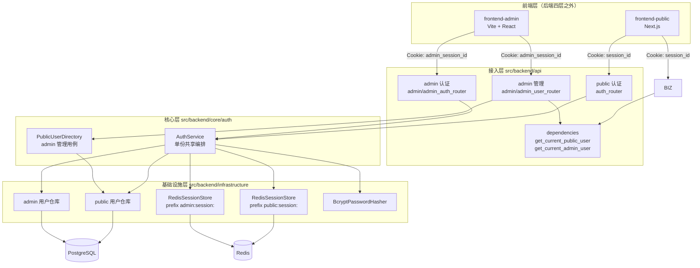
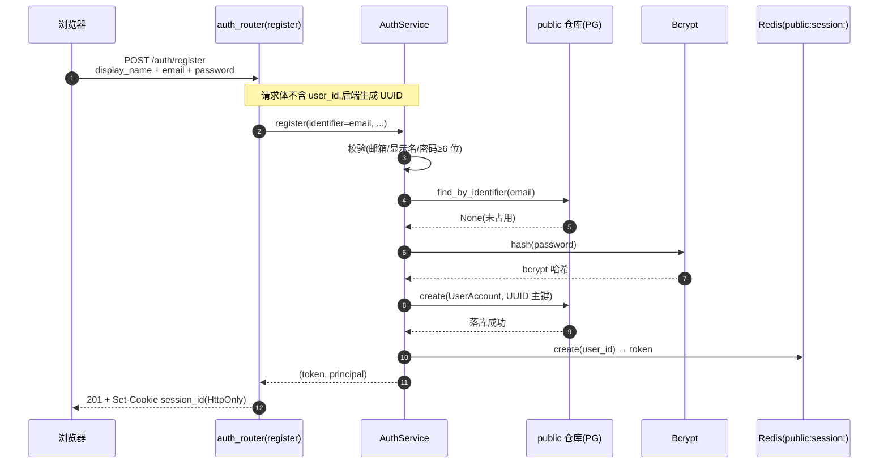
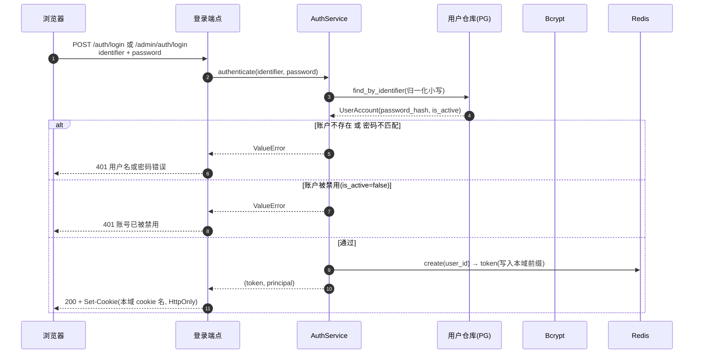
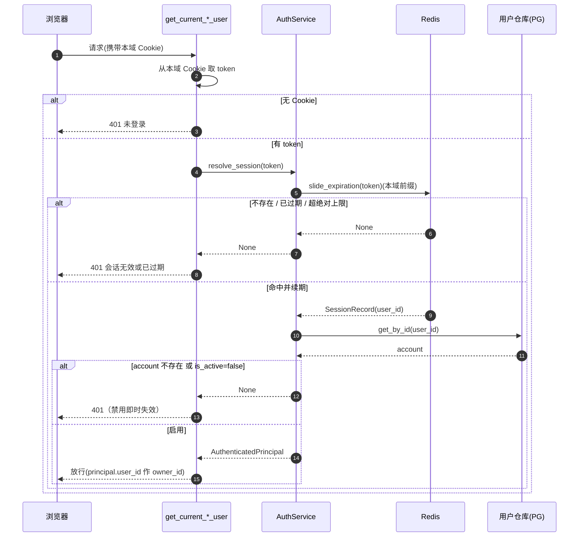
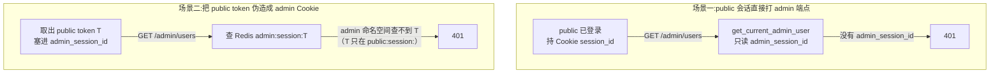
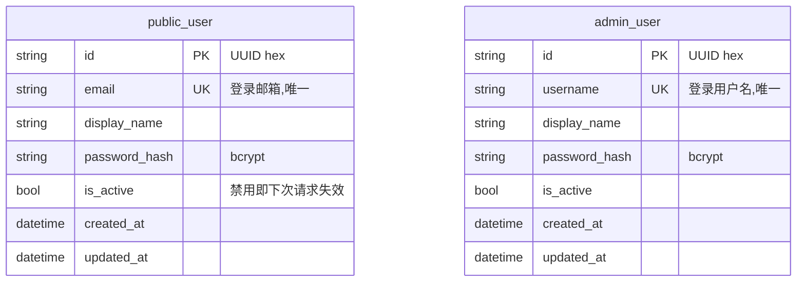

# 认证与会话逻辑

本页完整说明本仓库的认证实现:**两套物理隔离的认证域 + 服务端 Session(Redis) + HttpOnly Cookie**。public 与 admin 均可在配置完整时使用 OIDC；admin 还提供平台/组织两级角色。本页是[系统架构](system-design.md)中“认证与会话域”一节的展开版。OIDC 配置、包接入和边界见[OIDC 企业账号登录指南](../guides/oidc.md)。

!!! info "一句话概览"
    不是 JWT、也不是 access/refresh 双 token。后端为每次登录签发一个**不透明随机 token**(uuid),存进 **Redis**,通过 **HttpOnly Cookie** 下发;每个请求回查 Redis 才有效。public 与 admin 是**两个独立认证域**,各有独立的用户表、Cookie 与 Redis 命名空间。OIDC 只提供身份认证入口，不替换本地账户、授权和会话机制。

---

## 1. 整体架构



要点:

- **共享认证编排**：密码登录、登出、会话解析和注册由 `AuthService` 复用；OIDC 登录由 `OidcLoginService` 复用协议网关，并注入对应认证域的账户解析规则。
- **两域在数据层物理隔离**:不同用户表、不同 Cookie、不同 Redis 命名空间。
- admin 用户使用 `platform` 或 `org` 角色；普通用户恰属于一个组织。模板不内置业务资源；业务模块由派生项目添加，其资源归属 public 用户（`owner_id = public_user.id`），admin 域只做管理，不拥有业务资源。

---

## 2. 两个认证域对照

| 维度 | public 域(C 端用户) | admin 域(内部管理员) |
|---|---|---|
| 用户表 | `public_user`（按注册策略开放自助注册） | `admin_user`（由种子或平台管理员创建，不开放自助注册） |
| 主键 | UUID(`str`),用作业务 `owner_id` | UUID(`str`) |
| 登录标识 | 邮箱 `email` | 用户名 `username` |
| 端点 | `/auth/login` `/auth/register` `/auth/logout` `/auth/me`；可选 OIDC start/callback | `/admin/auth/login` `/admin/auth/logout` `/admin/auth/me`；可选 OIDC start/callback |
| 会话 Cookie | `session_id` | `admin_session_id` |
| Redis 命名空间 | `public:session:<token>` | `admin:session:<token>` |
| 鉴权依赖 | `get_current_public_user` | `get_current_admin_user` |
| 权限与注册 | 注册方式由平台管理员设置为 `both` / `oidc_only` / `closed` | `platform` 管理全局；`org` 仅访问本组织白名单接口 |
| 业务能力 | `/auth/*`（无内置业务资源） | 平台管理员管理组织、管理员及 public 用户；组织管理员只管理本组织用户 |
| 前端 | `frontend-public` | `frontend-admin` |

---

## 3. 会话机制

### 3.1 token 与存储

会话 token 是 `uuid.uuid4().hex` 生成的**不透明随机串**(不是自包含的 JWT)。它本身不含信息,必须回查 Redis 才能解析出用户。

每条会话在 Redis 中的形态:

```text
key   = "{prefix}{token}"          # 例 public:session:9df9880fde8a...
value = {"user_id", "created_at", "expires_at"}   # JSON
TTL   = 滑动窗口秒数
```

!!! note "为什么是 Session 而不是 JWT"
    - **即时吊销**:禁用用户、登出时删一条 Redis 记录即可让会话立刻失效;JWT 无状态,需额外维护黑名单。
    - **安全**:token 放 HttpOnly Cookie,前端 JS 读不到(防 XSS),浏览器自动携带,前端零 token 管理。
    - **沿用现状**:项目原本就是 session 设计(内存版),本次只是落地到 Redis 并拆成双域。

### 3.2 滑动窗口续期

没有 refresh token——"保持登录"靠**滑动窗口**实现:

- **滑动窗口 15 天**:每次活跃请求(经 `/me` 或业务调用解析会话时)续期 15 天。
- **绝对上限 60 天**:自创建起最多存活 60 天,到顶即失效,需重新登录。
- 每次续期 `new_expires = min(now + 15天, created_at + 60天)`,并据此重设 Redis TTL。

### 3.3 命名空间前缀隔离

`RedisSessionStore` 只有一份实现,实例化两次、注入不同前缀:

```text
public:session:<token>     ← public 域
admin:session:<token>      ← admin 域
```

同一个 Redis 实例,但两域的 key 空间互不重叠——这是越权隔离的物理基础(见 §5)。

---

## 4. 核心流程(时序图)

### 4.1 注册(仅 public)



### 4.2 登录



### 4.3 会话解析(每个受保护请求)+ 禁用即时失效



!!! tip "禁用即时失效"
    每次解析会话都会回查账户状态。管理员或普通用户被本地禁用后，其**下一次请求**会返回 `401`；组织被停用时，该组织普通用户与组织管理员的下一次请求也返回 `401`。平台管理员不受组织状态影响。管理员禁用会同时阻断密码与 OIDC 新登录。

### 4.4 登出

登出调用本域 `AuthService.logout(token)` → 删除该 Redis 会话记录,并清除 Cookie。只影响当前域。

### 4.5 OIDC 企业账号登录

OIDC 在密码登录旁提供可选入口。浏览器通过 `/api/admin/auth/oidc/start` 或 `/api/auth/oidc/start` 开始授权码流程，再访问对应 callback。独立协议包负责发现、授权 URL/PKCE、换取 token 和验证 ID Token；账户解析和会话签发由宿主应用完成。

应用每次登录都会生成 `state`、`nonce` 和 PKCE verifier，将它们写入按认证域隔离的 Redis 一次性事务；事务十分钟后过期，回调原子消费事务并核对 `state`。之后验证签名、issuer、audience、时效、subject、nonce，并按宿主规则匹配账户。成功后仍签发对应认证域现有的 Redis 会话与 HttpOnly Cookie。详细边界、配置和错误状态见[OIDC 企业账号登录指南](../guides/oidc.md)。

admin 首绑只允许身份中心已验证邮箱匹配一条启用中、尚未绑定的本地管理员；admin 不会由 OIDC 自动创建。绑定后只按 `(issuer, subject)` 识别，邮箱变化不会自动改绑。public 通过注册策略决定 OIDC 是否可建号；已有但尚未绑定的同邮箱 public 账户不会自动关联。

---

## 5. 越权隔离(为什么 public 进不了 admin)



两层保障:

1. **Cookie 维度**:admin 守卫只认 `admin_session_id`,public 会话的 `session_id` 根本不被读取。
2. **命名空间维度**:即使把 public 的 token 值塞进 `admin_session_id`,admin 域查的是 `admin:session:<token>` 命名空间,而该 token 只存在于 `public:session:`——查不到,依然 `401`。

反方向同理:admin 会话访问业务 API(走 `get_current_public_user`)也是 `401`。

!!! warning "前端隔离不是安全边界"
    "哪个前端登录的"不能作为权限依据——同域部署时不同端口共享 Cookie domain。真正的边界在后端:两套独立 Cookie + 两套 Redis 命名空间 + 两套用户表。

---

## 6. 数据模型



- 会话**不落 PG**——它在 Redis。PG 只存用户。
- 模板不内置业务实体；派生项目添加的业务资源以 `owner_id`（`String` 类型、应用层关联）归属 public 用户。

---

## 7. Admin 管理 public 用户

`frontend-admin` 的 `users` 页经 `/admin/users` 管理 C 端用户:

| 操作 | 端点 | 说明 |
|---|---|---|
| 列表 | `GET /admin/users?page=&page_size=&status=&keyword=` | 分页 + 按状态(active/disabled)/关键字过滤 |
| 详情 | `GET /admin/users/{id}` | 单个用户 |
| 启用 | `POST /admin/users/{id}/enable` | 恢复登录 |
| 禁用 | `POST /admin/users/{id}/disable` | 即时失效其会话 |

这些端点由 `PublicUserDirectory`（core 用例）操作 public 用户仓库。平台管理员可跨组织筛选并调整归属；组织管理员只能读取和管理本组织用户，跨组织用户按 404 处理。组织、管理员、注册策略等平台管理入口仅开放给平台管理员。

管理员的 `platform` / `org` 角色与 `organization_id` 由服务端会话解析，不接受请求方指定。组织管理员只能使用显式白名单的本组织用户功能。组织停用会阻止该组织普通用户与组织管理员登录，并使其既有会话在下次请求失效。

---

## 8. 配置与运维

```bash
# .env / .env.local
REDIS_URL=redis://:password@localhost:6379/0    # 会话存储,必需

# 初始管理员种子(后端启动时按用户名幂等创建;明文仅用于首次创建,库中只存哈希)
AUTH_ADMIN_BOOTSTRAP_USERNAME=admin
AUTH_ADMIN_BOOTSTRAP_PASSWORD=change-me-please
AUTH_ADMIN_BOOTSTRAP_EMAIL=admin@example.com

# 可选 OIDC；enabled 默认为 true，但必须填齐以下连接参数才会显示入口。
ADMIN_OIDC_ENABLED=true
ADMIN_OIDC_ISSUER=https://auth.example.com/realms/example
ADMIN_OIDC_CLIENT_ID=admin-portal
ADMIN_OIDC_CLIENT_SECRET=<由密钥管理系统提供>
ADMIN_OIDC_CALLBACK_URI=https://admin.example.com/api/admin/auth/oidc/callback
USER_OIDC_ENABLED=true
USER_OIDC_ISSUER=https://auth.example.com/realms/example
USER_OIDC_CLIENT_ID=public-portal
USER_OIDC_CLIENT_SECRET=<由密钥管理系统提供>
USER_OIDC_CALLBACK_URI=https://app.example.com/api/auth/oidc/callback
```

- **种子 admin**：`src/backend/composition/bootstrap.py` 按用户名创建或同步管理员；配置 `AUTH_ADMIN_BOOTSTRAP_EMAIL` 可提供管理员 OIDC 首次绑定邮箱。
- **OIDC**：`ADMIN_OIDC_ENABLED` 与 `USER_OIDC_ENABLED` 默认为 `true`；缺 issuer、client id、client secret 或 callback URI 时对应入口不可用，不阻断服务启动，也不影响现有密码登录。密钥存入环境或密钥管理系统。
- **注册策略**：平台管理员可将 public 注册设置为 `both`、`oidc_only` 或 `closed`。只缺少策略记录时使用 `both` 且不限域名；损坏记录或存储异常时注册 fail closed，不创建账户。
- **Cookie 安全**:生产 Compose 默认启用 `Secure`，本地 HTTP 开发由 `config.toml` 显式设为 `false`。生产使用 Compose 以外的启动方式时，应设置 `AUTH_COOKIE_SECURE=true`。Cookie 名是接入层常量(`session_id` / `admin_session_id`),会话窗口天数、Cookie 安全选项与 admin 种子来自 `AuthSettings`。
- **会话窗口**:`AUTH_SESSION_SLIDING_DAYS`(默认 15)、`AUTH_SESSION_ABSOLUTE_DAYS`(默认 60)。

!!! danger "本地直接运行需注意"
    `RedisSettings` / `AuthSettings` 会从 `.env` / `.env.local` 读取。务必在其中配置可达的 `REDIS_URL`(本地可用 `docker-compose.testing.yml` 的 redis,带密码 `redis123`),否则登录 / 注册会因连不上 Redis 而 500。

---

## 9. 关键代码位置

| 关注点 | 位置 |
|---|---|
| 密码认证编排 | `src/backend/core/auth/service.py`(`AuthService`) |
| OIDC 账户与会话编排 | `src/backend/core/auth/oidc_login.py`(`OidcLoginService`) |
| OIDC 协议包 | `packages/oidc-client/src/zata_oidc/`（独立可安装包 `zata-oidc`） |
| OIDC 事务存储 | `src/backend/infrastructure/auth/redis_oidc_transaction_store.py` |
| 注册策略 | `src/backend/core/auth/registration_policy*.py` |
| 组织与管理员目录 | `src/backend/core/auth/{organization_directory,admin_directory}.py` |
| admin 管理用例 | `src/backend/core/auth/directory.py`(`PublicUserDirectory`) |
| 领域模型 | `src/backend/core/auth/models.py`、`src/backend/core/shared/models/user_account.py` |
| 抽象端口 | `src/backend/core/shared/interfaces/{user_account_repository,password_hasher,session_store}.py` |
| Redis 会话 | `src/backend/infrastructure/auth/redis_session_store.py` |
| 密码哈希 | `src/backend/infrastructure/auth/bcrypt_password_hasher.py` |
| 用户仓库(统一) | `src/backend/infrastructure/persistence/repos/user_account_repo.py` |
| ORM 模型 | `src/backend/infrastructure/persistence/models/{public_user,admin_user}.py` |
| 鉴权依赖 | `src/backend/api/dependencies.py` |
| public 路由 | `src/backend/api/auth_router.py` |
| admin 路由 | `src/backend/api/admin/` |
| 装配 + 种子 | `src/backend/composition/{auth_wiring,bootstrap,app_factory}.py` |
| 迁移 | `alembic/versions/20260625-182322-auth_domains_init.py` |

---

## 10. 验证覆盖

| 层级 | 覆盖 |
|---|---|
| 单元 / 集成 | `tests/backend/`:双向越权 401、密码与 OIDC 登录、注册策略、组织范围、禁用即时失效、bcrypt、Redis 前缀隔离、管理 API |
| 迁移 | `alembic upgrade head` / `downgrade base` 往返 |
| 浏览器端到端 | `tests/playwright-e2e/`:真实浏览器→public/admin 前端→`/api` 代理→后端；OIDC 仅替换为本地身份中心，Redis 与数据库真实运行 |

详见 [测试规范](../ai-standards/testing.md)。
