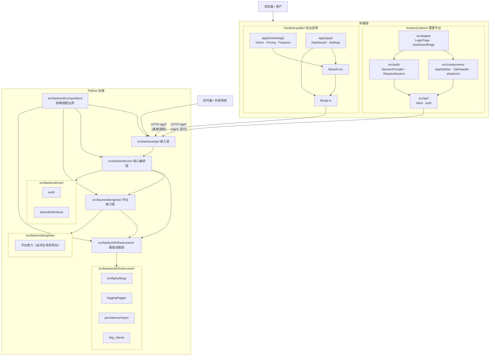

# 系统架构

本仓库遵循 **DDD 边界意识 + Clean Architecture 依赖方向 + 模块化单体** 的设计理念，目标是把模板演进为一个可长期维护的四层项目骨架，而不是把所有能力堆在一个扁平工具目录里。模板刻意不内置业务域，业务模块由派生项目自行添加。

## 架构原则

- **依赖向内**：外层可以依赖内层，内层不能反向依赖外层。
- **按职责分层**：按变化率和业务边界分层，而不是按技术栈堆目录。
- **模块化单体**：保持一个仓库、一个部署单元，但内部按层隔离。
- **可替换实现**：模型、存储、HTTP、日志、配置等都放在基础设施层，核心层只依赖接口。

## 目标分层

### `src/backend/api/` 请求接入层

- 接收 HTTP、WebSocket、CLI 等请求。
- 只负责参数校验、DTO 转换、调用用例。
- 不写业务规则。

### `src/backend/core/` 核心编排层

- 放置用例、Orchestrator、Planner、Memory 和领域契约。
- 负责业务规则和任务编排。
- 不直接依赖具体 SDK、数据库或 HTTP 客户端。

### `src/backend/engines/` 平台能力层

- 放置可插拔的平台能力（如检索、爬虫、OCR 等）。
- 实现 `src/backend/core/` 定义的端口。
- 不承担基础设施细节。

### `src/backend/infrastructure/` 基础设施层

- 放置模型客户端、数据库、HTTP 客户端、配置和日志实现。
- 对接外部 API、物理数据库和文件系统。
- 只提供可被内层调用的具体实现。

## 当前目录

- `src/backend/composition/`：后端真实 composition root，按认证、业务运行依赖、
  启动数据和 FastAPI 应用工厂拆分装配。
- `src/backend/composition/app_factory.py`：汇总路由、中间件和各领域组件，
  不承载业务规则。
- `src/backend/main.py`：兼容导出与进程启动薄入口。
- `main.py`：根目录兼容启动包装器，转发到 `backend.main`。
- `src/backend/infrastructure/config/`：承接配置管理。
- `src/backend/infrastructure/config/providers/`：承接平台无关的运行时配置 provider 契约，以及本地 TOML、Nacos 等适配器。
- `src/backend/infrastructure/logging/`：承接日志实现。
- `src/backend/infrastructure/persistence/`：承接数据库与持久化实现。
- `src/backend/infrastructure/helpers.py`：承接通用无状态辅助函数。
- `packages/oidc-client/`：与四层 backend 边界分离的可安装 `zata-oidc` Python 包，只提供 OIDC 协议客户端与协议契约，不依赖 `src/backend/`。
- `src/backend/engines/`：承接项目特定的平台能力（如爬虫、OCR 等）和 MCP server（由派生项目扩展）。
- `tests/`：用于验证边界、用例和适配器行为。

## 模块关系图



## 前端分层说明

本仓库包含两个独立前端项目，分别服务不同场景：

### 管理平台 `frontend-admin/`

| 层 | 路径 | 职责 |
|---|---|---|
| 页面层 | `src/pages/` | 路由级页面组件（登录、Dashboard） |
| 布局层 | `src/components/` | Sidebar、Header、shadcn/ui 基础组件 |
| 认证层 | `src/auth/` | SessionProvider 上下文、RequireSession 路由守卫 |
| API 层 | `src/api/` | API 客户端封装、会话缓存，与后端唯一通信入口 |

### 前台官网 `frontend-public/`

| 层 | 路径 | 职责 |
|---|---|---|
| 营销页面 | `app/(marketing)/` | 首页、功能、授权、关于等落地页 |
| 应用页面 | `app/(app)/` | 登录后的 Dashboard、Settings（仅认证骨架，无业务域） |
| 认证层 | `lib/auth.tsx` | 会话状态、受保护布局 |
| API 层 | `lib/api.ts` | axios/fetch 封装、环境基址、错误处理 |

前端与后端之间**仅通过 `/api/*` HTTP 接口通信**：

- `frontend-admin/` 开发时由 Vite 代理转发，生产时由 Nginx `/api/*` 反代到后端。
- `frontend-public/` 开发时直接请求 `http://localhost:8000`，生产时通过 `API_BASE_URL` 指向后端。

两侧无任何代码直接依赖。

## 为什么前端不属于四层

本仓库的四层架构用于约束 Python 后端内部的依赖方向：

```text
src/backend/api/ → src/backend/core/ → src/backend/engines/ → src/backend/infrastructure/
```

该规则同样适用于 `src/` 下所有遵循相同四层结构的其他模块。

这里的 `src/backend/api/` 指后端请求接入层，不等于浏览器前端。

- `frontend-admin/` 与 `frontend-public/` 都是系统边界外的 Web 客户端。
- 它们负责路由、页面渲染、会话状态和接口调用。
- 它们通过 HTTP 或 WebSocket 调用 `src/backend/api/` 暴露的后端入口。
- 它们不参与后端内部的依赖传递，因此不应被硬塞进四层中的任意一层。

如果需要讨论前端自身的模块拆分，应使用单独的前端内部架构文档，而不是混入后端四层依赖规则。详见 [`frontend-architecture.md`](frontend-architecture.md)。

## 依赖规则

1. `src/backend/api/` 只能调用 `src/backend/core/` 暴露的用例和 DTO。
2. `src/backend/core/` 只能依赖抽象接口和纯业务模型。
3. `src/backend/engines/` 只能实现 `src/backend/core/` 定义的契约。
4. `src/backend/infrastructure/` 负责具体集成，不包含业务编排。
5. 配置、日志、数据库和通用辅助函数位于 `src/backend/infrastructure/` 下的正式模块。
6. `src/backend/composition/` 位于四层之外，只负责创建并连接对象；四层模块不得反向依赖它。

### 运行时配置 provider

应用启动配置通过 `infrastructure/config/startup.py` 在全局 Settings 创建前合并。
优先级为进程环境变量 > `.env.local` > `.env` > Nacos JSON > TOML > 代码默认值。
连接参数由本地配置独立提供；读取 Nacos 后才初始化 Settings、数据库引擎和迁移等依赖。
Nacos 顶层 JSON 使用大写环境变量名，可选的 `runtime_config` 对象由 composition root 暴露为
`app.state.runtime_config`。本地模式仍读取 TOML `[runtime_config]`。
启动配置更新需重启进程；当前 composition root 不订阅远端更新。provider 的订阅能力仅作为
派生项目显式实现热更新的适配接口，业务代码不直接导入平台 SDK。

## 认证与会话域

系统采用**两套物理隔离的认证域**，互不穿透；两域均可配置 OIDC 登录，成功后仍使用既有 Redis Session 与 Cookie。完整账户规则、回调配置及组织权限见[认证与会话逻辑](authentication.md)和[OIDC 企业账号登录指南](../guides/oidc.md)：

| 维度 | public 域（C 端用户） | admin 域（内部管理员） |
|---|---|---|
| 用户表 | `public_user`（按注册策略自助注册，UUID 主键） | `admin_user`（由种子或平台管理员创建，不开放自助注册） |
| 登录端点 | `/auth/*`（login/register/logout/me）及可选 OIDC start/callback | `/admin/auth/*`（login/logout/me）及可选 OIDC start/callback |
| 会话 Cookie | `session_id` | `admin_session_id` |
| 会话存储 | Redis，key 前缀 `public:session:` | Redis，key 前缀 `admin:session:` |
| 鉴权依赖 | `get_current_public_user` | `get_current_admin_user` |
| 权限 | 用户由所属组织归类 | `platform` 管理全局；`org` 只能访问白名单中的本组织用户接口 |
| 主要 API | `/auth/*`（无内置业务资源） | 平台管理员管理组织、管理员和 public 用户 |
| 前端 | `frontend-public` | `frontend-admin` |

### 隔离保证

- 两域各自独立的用户表、Cookie 与 Redis 命名空间；一个域的会话 token 在另一域命名空间中查不到，因此 public 会话无法通过 admin 守卫（反之亦然），均返回 401。
- admin 专属路由集中在 `src/backend/api/admin/`；仅平台管理员可用的入口经 `get_current_platform_admin` 守卫，组织管理员仅由明确白名单放行。
- 模板不内置业务资源，业务模块由派生项目添加；admin 域仅用于管理，不拥有业务资源。
- 被本地禁用（`is_active=false`）的 public/admin 账户，其既有会话在下次请求解析时立即失效；管理员密码与 OIDC 新登录同时拒绝。组织停用会阻止其普通用户和组织管理员登录，并令已有会话下次请求失效，平台管理员不受影响。

### 共享编排（避免重复）

密码登录 / 登出 / 会话解析 / 注册的编排集中在 `core/auth/AuthService`；OIDC 登录由 `core/auth/OidcLoginService` 复用协议网关和一次性事务流程，并注入不同认证域的账户匹配规则。注册策略由宿主应用保存到系统设置，缺少策略记录时使用 `both` 与空域名白名单；记录损坏或存储故障时拒绝创建账户。`UserAccount` 领域模型位于 `core/shared/models/`，作为跨层契约被基础设施层仓库实现引用。

### OIDC 协议包边界

`packages/oidc-client/` 的分发名为 `zata-oidc`，公开导入为 `zata_oidc`。它负责 OIDC discovery、授权 URL、PKCE、token endpoint 请求、JWKS 与 ID Token 验证；宿主 backend 负责登录事务、账号匹配/首绑/注册策略、角色与组织授权、会话 Cookie、持久化和路由。`core/auth/` 依赖包的公开协议契约，基础设施装配并注入 `HttpOidcClient`。应用仍是模块化单体，不新增身份中心服务或部署进程。

登录事务由宿主以 `state`、`nonce` 和 PKCE verifier 组成，按认证域保存到 Redis 一次性记录，十分钟过期；callback 消费后完成匹配并签发原有 admin/public Session。管理员首次绑定要求身份中心邮箱已验证且与一条启用、未绑定的本地管理员邮箱唯一匹配。绑定后按 `(issuer, subject)` 识别。解绑仅清除本地绑定，不会停用身份中心身份、清除其邮件或密码、也不会执行全局登出；仍符合规则的原身份可以再次绑定。需要阻止全部本地登录时，应由平台管理员禁用该管理员，这会拒绝密码与 OIDC 新登录，并令已有会话在下一次 API 请求失效。完整说明见[OIDC 企业账号登录指南](../guides/oidc.md)。

### 关键实现位置

- 领域编排：`core/auth/`（`service.py` / `directory.py` / `models.py`）、`core/shared/models/user_account.py`
- OIDC 协议包：`packages/oidc-client/src/zata_oidc/`；宿主登录编排：`core/auth/oidc_login.py`
- 抽象端口：`core/shared/interfaces/`（`user_account_repository.py` / `password_hasher.py` / `session_store.py`）
- 基础设施实现：`infrastructure/auth/`（`redis_session_store.py` / `bcrypt_password_hasher.py` / `redis_client.py`）、`infrastructure/persistence/repos/user_account_repo.py`、`infrastructure/persistence/models/{public_user,admin_user}.py`
- 接入层：`api/auth_router.py`、`api/admin/`、`api/dependencies.py`
- 初始管理员：`composition/bootstrap.py` 启动时按
  `AUTH_ADMIN_BOOTSTRAP_*` 幂等种子创建或同步；首次企业账号绑定可配置
  `AUTH_ADMIN_BOOTSTRAP_EMAIL`
- OIDC：`packages/oidc-client/` 提供独立可安装协议客户端；宿主应用持有账户匹配、Redis 一次性事务、注册策略、角色、组织、会话与 Cookie。默认开关为 true，缺少连接参数时只关闭对应 OIDC 入口，不阻断启动或密码登录。
- 运行依赖：Redis（`REDIS_URL`）；密码以 bcrypt 哈希持久化；OIDC 只在配置完整且启用时请求外部 OIDC issuer
