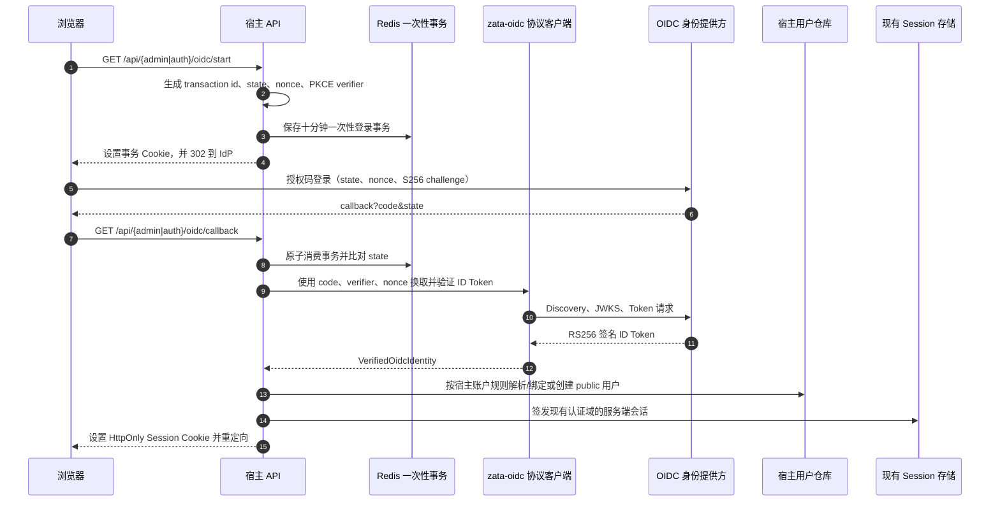

# OIDC 企业账号登录

本仓库在 public 和 admin 两个认证域提供可选的 OpenID Connect 登录入口。OIDC 只证明身份；账户匹配、注册策略、权限、组织归属和本地会话仍由宿主应用控制。成功登录后继续使用现有 Redis Session 与 HttpOnly Cookie，不向浏览器发放 ID Token 或 access token。

身份提供方需支持 OIDC 授权码流程、confidential client、RS256 ID Token 和 PKCE S256。Keycloak 是可选的身份提供方实现；应用不依赖 Keycloak SDK、FreshAI 或 zata-ops 运行。FreshAI 代码与 zata-ops 的身份中心运维资料只是实现/运维参考，不是本仓库的运行依赖，也不会由本仓库启动身份中心。

## 独立协议包与宿主边界

协议能力位于 backend 四层之外的 `packages/oidc-client/`，分发名是 `zata-oidc`，Python 导入名是 `zata_oidc`。包只依赖 `httpx` 与 `joserfc`，提供发现、授权 URL 与 PKCE、token endpoint 请求、JWKS 获取、ID Token 验证和已验证身份值对象。它不读取环境变量，也不依赖本仓库的 backend。

本仓库通过根 `pyproject.toml` 的本地路径源接入该包，且 `editable=false`；生产镜像会在依赖安装前复制包目录。其他仓库可以直接安装本地构建的 wheel，不必复制 `src/backend/`：

```sh
uv build --project packages/oidc-client
uv pip install ./dist/zata_oidc-0.1.0-py3-none-any.whl
```

消费者应固定 wheel 版本或 artifact hash。仓库当前不发布公网包；私有 registry 或其他发布渠道属于另一个发布决策。

包的核心公开入口如下：

| 符号 | 用途 |
|---|---|
| `OidcClientSettings(issuer, client_id, client_secret, callback_uri, scope="openid email")` | 宿主显式提供的客户端配置；密钥字段是普通字符串，包本身不读环境变量 |
| `HttpOidcClient(settings, http_client=None)` | OIDC 协议网关；宿主通常在应用启动时构造一次并在应用关闭时释放 |
| `generate_pkce_verifier()`、`build_pkce_s256_challenge(verifier)` | 生成 verifier 与 S256 challenge |
| `build_authorization_url(*, state, nonce, code_verifier)` | 创建授权码流程的身份提供方 URL |
| `exchange_and_verify_authorization_code(*, code, code_verifier, nonce)` | 服务端换码并返回 `VerifiedOidcIdentity` |
| `OidcAuthenticationError.reason` | 安全失败类别，不携带完整 token 或身份声明 |

应用启动前由宿主配置系统读取 issuer/client/callback，并从密钥存储读取 secret；开始登录时由宿主生成随机 `state`、`nonce` 与 verifier，调用 `build_authorization_url` 后把它们保存为一次性事务。callback 消费事务后再调用 `exchange_and_verify_authorization_code`。`HttpOidcClient` 自建的默认 HTTP client 由 `close()` 或上下文管理器关闭；若通过 `http_client` 注入共享的 `httpx.Client`，生命周期仍由注入方负责。仓库中的 `packages/oidc-client/README.md` 列有同一套公开入口和示例。

协议验证成功只会得到 `VerifiedOidcIdentity`，不代表此身份有权使用本地应用。宿主必须继续按本地账户与授权规则决策，不能把 IdP 中的角色、组或邮箱直接当作本地管理员权限。

## 登录流程与安全边界



事务按认证域分别保存在 Redis，默认有效十分钟，callback 只能成功消费一次。`state` 防止回调串换，`nonce` 绑定 ID Token 与此次登录，PKCE 使用 S256 保护授权码；客户端还会检查 discovery issuer、ID Token 的 RS256 签名、issuer、audience、过期时间、签发时间、subject 与 nonce。多 audience token 还校验 authorized party。

应用日志只记录安全失败类别（例如 `transaction_invalid`、`identity_conflict`），不得记录授权码、ID Token、完整身份声明或 client secret。浏览器收到的是通用错误页状态，不应显示协议内部异常。

## 两个认证域与账户规则

| 认证域 | Callback URI | 登录后会话 | OIDC 账户规则 |
|---|---|---|---|
| admin | `https://<admin-origin>/api/admin/auth/oidc/callback` | `admin_session_id`，Redis `admin:session:` | 不自动创建管理员；首次绑定要求 `email_verified=true`、邮箱匹配唯一一条启用且未绑定的本地管理员。之后只按 `(issuer, subject)` 识别。 |
| public | `https://<public-origin>/api/auth/oidc/callback` | `session_id`，Redis `public:session:` | 已绑定身份按 `(issuer, subject)` 登录；未绑定身份必须有已验证邮箱并满足当前注册策略才可建号。已有同邮箱但未绑定的 public 账户不自动关联。 |

Admin 首绑由部署者配置的 `AUTH_ADMIN_BOOTSTRAP_EMAIL` 或平台管理员创建的账户邮箱提供匹配目标，系统不从用户名推导管理员身份。成功绑定后，即使 IdP 返回的邮箱变化，也按原 `(issuer, subject)` 查找；邮箱不会自动换绑。一个本地管理员同时只能绑定一个 OIDC 身份。

平台管理员 `platform` 可管理全局组织、管理员与用户；组织管理员 `org` 只访问明确允许的本组织用户功能。角色与 `organization_id` 从服务端账户和会话解析，不能由请求体覆盖。组织停用会阻止该组织普通用户及组织管理员新登录，并使已有会话在下一次 API 请求返回 401；平台管理员不受影响。

### 解绑与本地禁用

- **解绑 OIDC**：只清除本地管理员的 `oidc_issuer` 与 `oidc_subject`，保留邮箱、密码和账户启用状态。它不是 IdP 禁用，不会全局登出，也不阻止仍满足邮箱首绑条件的原身份再次绑定。同邮箱其他身份也可能在无人绑定时竞争首绑；先成功者绑定，之后的身份因冲突被拒。需要阻止特定 IdP 身份时，须在身份提供方停用它。
- **本地禁用管理员**：平台管理员不能禁用自己，也不能禁用最后一个启用中的平台管理员。禁用会同时阻断目标账号的密码与 OIDC 新登录；其既有 admin Session 在下一次 API 请求解析时返回 401。重新启用后按正常规则恢复。这是本地应用停用，不代替身份中心中的全局身份停用。
- **种子应急恢复**：在启动配置中指定 `AUTH_ADMIN_BOOTSTRAP_USERNAME` 与 `AUTH_ADMIN_BOOTSTRAP_PASSWORD` 时，应用启动会创建或同步该管理员；若用户名已存在，会更新密码、恢复启用并确保 `platform` 角色。配置 `AUTH_ADMIN_BOOTSTRAP_EMAIL` 时同时同步邮箱。仅在需要种子管理员或应急恢复时配置这些启动变量。

上述边界不改变 public/admin 两个 Cookie 与 Redis 命名空间的隔离，也不创建新的 SSO Session 服务。

## 配置

admin 与 public OIDC 分别使用自己的环境变量前缀：

| 环境变量 | 作用 | 默认/要求 |
|---|---|---|
| `ADMIN_OIDC_ENABLED` | 管理端入口开关 | 默认 `true`；显式 `false` 时禁用 |
| `ADMIN_OIDC_ISSUER` | 管理端 OIDC issuer | 必填 |
| `ADMIN_OIDC_CLIENT_ID` | 管理端 client ID | 必填 |
| `ADMIN_OIDC_CLIENT_SECRET` | 管理端 client secret | 必填，使用部署密钥 |
| `ADMIN_OIDC_CALLBACK_URI` | 管理端回调 URI | 必须逐字与 IdP 客户端登记值一致 |
| `USER_OIDC_ENABLED` | public 入口开关 | 默认 `true`；显式 `false` 时禁用 |
| `USER_OIDC_ISSUER` | public OIDC issuer | 必填 |
| `USER_OIDC_CLIENT_ID` | public client ID | 必填 |
| `USER_OIDC_CLIENT_SECRET` | public client secret | 必填，使用部署密钥 |
| `USER_OIDC_CALLBACK_URI` | public 回调 URI | 必须逐字与 IdP 客户端登记值一致 |
| `AUTH_ADMIN_BOOTSTRAP_EMAIL` | 种子平台管理员邮箱 | 可选；要给该种子管理员首次绑定 OIDC 时必填 |

`config.toml` 对应 `[admin_oidc]`、`[user_oidc]`，支持 `enabled`、`issuer`、`client_id`、`client_secret` 与 `callback_uri`。secret 留空在模板文件中，通过 `.env.local`、容器环境或密钥管理系统注入；不要把有效凭据提交到仓库或粘贴进日志。

开关默认开启不代表默认已有 IdP。只要开关关闭或上述任一连接参数缺失，status 就报告不可用，前端不显示登录按钮，start 接口返回服务不可用；应用仍能启动，密码登录继续工作。生产环境需把真实 HTTPS origin、callback URI、代理路由和 `Secure` Cookie 配套设置。完整配置变量与优先级见[配置说明](configuration.md)。

## Public 注册策略

平台管理员在管理端“注册设置”页面选择渠道模式与邮箱域名白名单。设置立即保存到应用系统设置，后续请求马上按新值判断：

| 模式 | 新 public 账户可用渠道 | 页面表现 |
|---|---|---|
| `both` | 密码注册与 OIDC 注册 | 保留密码注册表单；若 public OIDC 可用则显示企业账号入口 |
| `oidc_only` | 仅 OIDC 注册 | 隐藏密码注册表单，显示组织账号注册说明与入口 |
| `closed` | 不允许新建账户 | 显示注册关闭状态；已有用户仍可登录 |

空域名白名单表示不限制域名；非空时仅允许精确匹配规范化后的邮箱域名（ASCII 小写/IDNA）。这条白名单本身**不验证邮箱所有权**：密码注册只检查输入的邮箱地址格式和域名，不会发送验证邮件；OIDC 首绑/建号则要求身份提供方声明 `email_verified=true`。同邮箱已存在但未关联的 public 账户必须拒绝 OIDC 自动关联，避免用另一个 IdP 主体取得已有密码账户。

如果数据库里还没有 `registration_policy` 记录，为兼容既有部署使用 `both` 和空白名单。若记录存在但 JSON/schema 损坏，或读取/写入存储失败，不得回退到开放默认值：策略读取异常返回 503 `registration_policy_unavailable`，新建账户失败且不签发会话。该策略只约束新注册；它不会关闭已存在用户的密码或 OIDC 登录。

前台使用现有英文与中文 i18n 资源显示状态和错误：

| 状态 | English UI | 中文 UI |
|---|---|---|
| OIDC 通用失败 | “Organization sign-in failed. Please contact your administrator.” | “企业账号登录失败，请联系管理员。” |
| 该邮箱已有账户，不能 OIDC 自动关联 | “An account already exists for this email. Please sign in with your password.” | “该邮箱已注册，请使用密码登录。” |
| 策略存储/读取不可用 | “Registration is temporarily unavailable. Please try again later.” | “注册服务暂时不可用，请稍后重试。” |
| 注册关闭 | “Registration is currently closed.” | “当前未开放注册。” |
| 仅 OIDC 注册 | “Registration is available through your organization account only.” | “当前仅支持使用企业账号注册。” |
| OIDC 未配置/不可用 | “Organization sign-in is currently unavailable. Please contact your administrator.” | “企业账号登录暂不可用，请联系管理员。” |
| 邮箱域不允许 | “Registration is not available for this email domain.” | “该邮箱域名暂不允许注册。” |
| 当前策略不允许密码注册 | “Registration is currently unavailable. Please contact your administrator.” | “当前不允许密码注册，请联系管理员。” |
| 新密码少于六位 | “Password must be at least 6 characters” | “密码长度至少 6 位” |

前端根据稳定的 API 错误码和注册模式选择 i18n 文案，不匹配后端提示文本。admin OIDC 回调失败会重定向到 `/sign-in?sso_error=1` 并显示通用提示；public 回调失败显示通用 OIDC 提示，账户已存在时显示“请用密码登录”提示。接口与配置细节见[认证与会话逻辑](../architecture/authentication.md)。

## 验证与排错

本地与 CI 使用 `tests/playwright-e2e/scripts/oidc-test-issuer.mjs` 提供的 loopback 身份中心替身。它通过真实 HTTP discovery、JWKS、authorize、token 端点与 RS256 签名 ID Token，替代外部身份中心本身；应用 callback、Redis 事务、SQL 数据库、前端按钮和 `/api` 代理仍是真实组件。替身不访问外部 Keycloak，也不更改生产代码开关。

排错顺序：

1. 核对 `*_OIDC_ENABLED` 与四项连接参数是否完整，避免把默认 `true` 误认为已接入 IdP。
2. 将应用实际 callback URI 与 IdP 登记值逐字比较，并检查反向代理是否保留 `/api` 路径。
3. 确认后端在始终可用的 Redis 上保存了 OIDC 事务；浏览器必须携带 start 返回的事务 Cookie 再访问 callback。
4. 查看 `auth.oidc` 的安全失败类别（例如 `email_unverified`、`identity_not_mapped`、`identity_conflict`、`admin_inactive`、`organization_inactive`）。不要记录或分享 authorization code、ID Token、完整声明、Cookie 或 client secret。
5. public 注册失败时先从管理端重新读取当前策略；只有缺少记录才按默认开放策略处理。损坏记录或存储故障应保持 fail closed 并返回 `registration_policy_unavailable`。
