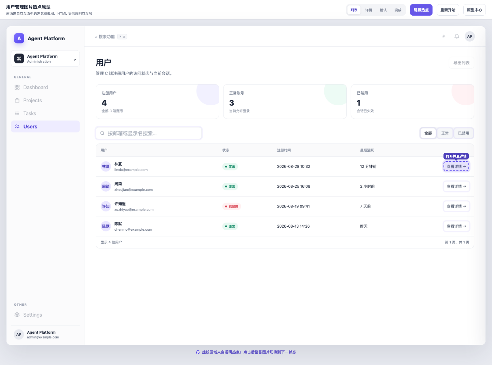

# 用户管理图片热点原型

[打开图片热点原型](admin-users-image-hotspot.html)



四张状态图由 [`admin-users-interactive.html`](admin-users-interactive.html) 在 Chromium 中实际渲染并截图，页面再叠加透明热点以演示列表、详情、确认和完成状态之间的切换。

```text
用户列表截图
→ 用户详情截图
→ 禁用确认截图
→ 状态更新完成截图
```

截图来源与状态准备步骤见 [`users-image-hotspot.source.md`](assets/users-image-hotspot.source.md)。这是 **interactive prototype / component preview**，不连接真实 API，也不构成功能验收或 E2E 证据。
