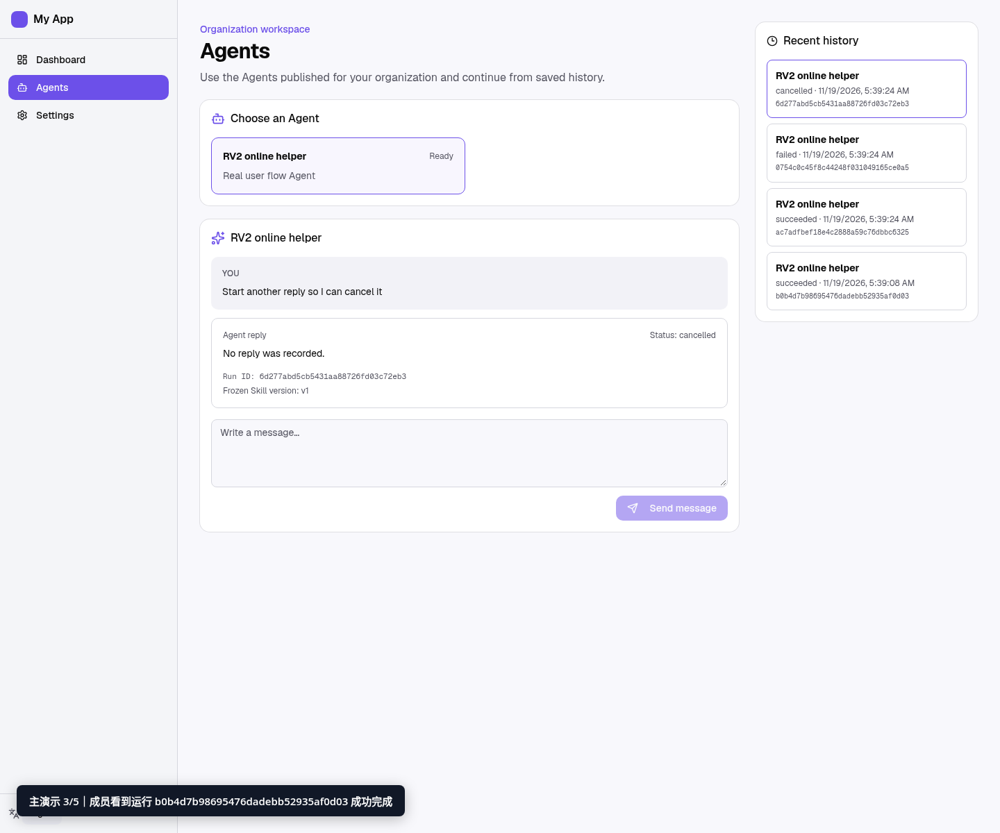
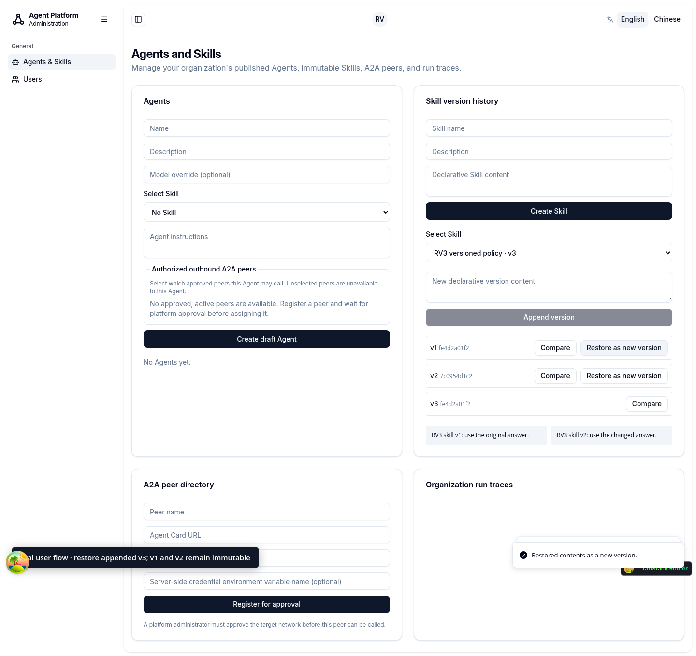
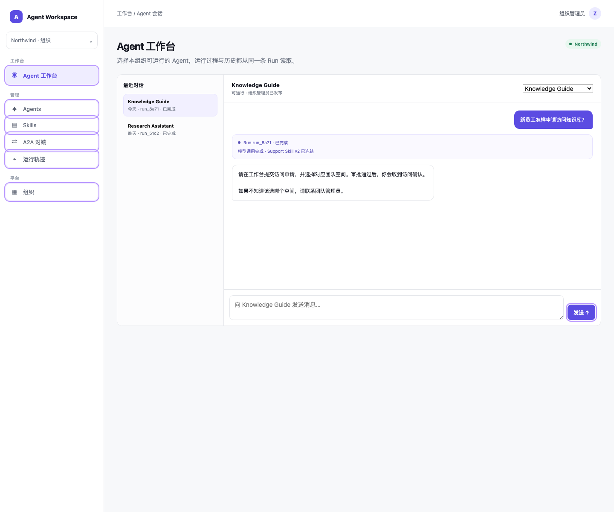
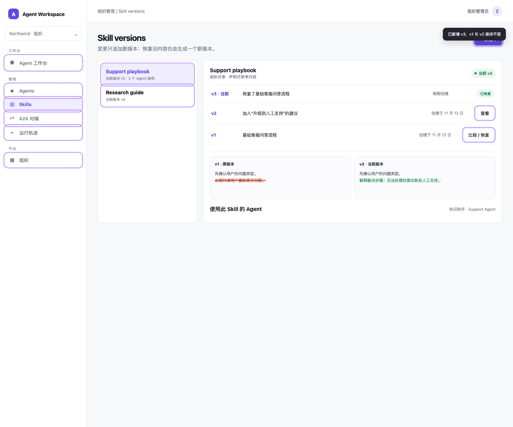

# 人工审查清单 · 多组织通用在线 Agent 底座

共 5 项决定。PR #62 已于 2026-11-19 合并即接受，PRD §9.2 Human-Confirmed 已回填；此清单保留已接受决定的审查呈现，无需再回答。PRD 已归档：`tasks/archive/P1-FEAT-20260928-115856-multi-organization-online-agent-base.md`。

验收记录：PR [#62](https://github.com/ZataZhang/zata-codes-template/pull/62) 于 2026-11-19 合并，merge commit `55174cbfb02bec30a4d5073ac0dcadd0a2763e16` 排除交付记录后的源码树 `33a6ed4205fae48c94da25940609fedc564e2e86` 与 verifier 验收树一致；PR 正文声明合并即接受，PRD §9.2 五项已回填。官方 `kc evidence check` RV-1–RV-7 全部通过；七项负控均在同一身份触发预期失败；独立 verifier **PASS（risk=yellow）**；最终 PR head 的 GitHub CI run [44467737473](https://github.com/ZataZhang/zata-codes-template/actions/runs/44467737473) 四个必需任务全绿。真实模型、公网外部 Agent 与公网部署未验证；模型使用本地传输替身，A2A 使用官方 1.0 SDK 本地独立实现。以下页面保留被接受决策的呈递记录，无需再提交答案。

## 第 1 项 · 数据是否固定属于创建它的组织？

**决定与风险：** 同意组织归属在创建时写入且之后不改。若判断错误，成员调组织会把历史数据泄露给新组织。

PRD §9.2 Human-Confirmed 第 1 条原文：

> 确认 §2 的业务数据组织范围决定（组织与管理员本身由上游 PRD 验收）；证据为 `rv-1` 两组织负控、迁移前后数据对账和独立 verifier 结论。

白话：成员换组织后，本人和新组织管理员看不到旧组织数据；原组织管理员仍可审计。平台管理员身份本身不能读取成员正文。

证据：`rv-1-org-isolation-pg.txt`、`rv-1-org-isolation-mysql.txt` 的真实 Cookie、正式调组织接口、新请求读取；两库迁移保留 1 个历史 Run 和 2 个事件。`rv-1-negative-control-pg.txt` 删除过滤的临时源码变体实际返回 200 和私有标记，证明负控有效。

**回复格式：** 同意 / 不同意并指出具体越权场景。

## 第 2 项 · 是否接受单一 Run 事实源与失败闭合？

**决定与风险：** 同意所有在线运行使用同一 Run/Event 存储，缺模型、停用组织/Agent 或未审核工具不得伪成功。若判断错误，界面状态和实际执行会分叉，或租户获得命令执行能力。

PRD §9.2 Human-Confirmed 第 2 条原文：

> 确认 §2 的稳定 Agent/单一 Run 事实源与失败闭合决定；证据为 `rv-2` 真实页面、历史和轨迹呈递。

白话：管理员发布 Agent，成员看到增量状态、最终回复，关闭页面后仍能重开同一 Run；不可运行时不创建成功记录。

证据：`rv-2-real-user-flow.txt`（2 tests passed）、`rv-2-incremental-reply.txt` 与 `rv-2-streaming-reply.png`（运行未结束时回复已在增长）、`rv-2-fast-terminal-states.txt`（快速成功/失败均由页面与新 API 读取确认）和 `rv-2-negative-terminal-probe.txt`（旧轮询变体下 API 为 succeeded、页面仍 running）；另有单独录制的 `rv-2-demo-multi-organization-agent.mp4` 和 `rv-2-agent-run.png`。`rv-7-a2a-bidirectional.txt` 中未审核工具、未登记对端、停用组织/Agent、无模型均失败闭合。

<video controls preload="metadata" width="100%" src="rv-2-demo-multi-organization-agent.mp4">主演示录像：rv-2-demo-multi-organization-agent.mp4</video>

本地录像（169.48 秒），按 PRD 五步脚本：发布 Agent → 运行中可见增量回复 → 重开历史与管理轨迹 → Skill 更新/比较/恢复为 v3 → 恢复后再运行冻结 v3、旧运行仍为 v1；逐帧检查的六段字幕可见 5–18 秒，画面互不相同。模型步骤注明 mock、未验证真实模型。SHA-256：`cbf7b94e858cf79cf0a9445abe9941dbde558acfd54b67fbdd5746b33477b6b8`。字幕原文见 `rv-2-caption-trace.txt`：`open "tasks/evidence/P1-FEAT-20260928-115856-multi-organization-online-agent-base/rv-2-demo-multi-organization-agent.mp4"`

本地图片，验证层级 `real user flow`：`open "tasks/evidence/P1-FEAT-20260928-115856-multi-organization-online-agent-base/rv-2-agent-run.png"`

**回复格式：** 同意 / 不同意并列出状态或执行边界差异。

## 第 3 项 · 是否接受 Skill 线性版本与恢复快照？

**决定与风险：** 同意更新只追加版本，恢复旧内容也生成新版本，Run 冻结当时版本。若判断错误，旧历史会被改写，旧 Run 的含义无法追溯。

PRD §9.2 Human-Confirmed 第 3 条原文：

> 确认 §2 的 Skill 线性版本与恢复决定；证据为 `rv-3` 差异、版本链和两个 Run 快照呈递。

白话：v1 更新为 v2，恢复 v1 时得到 v3；旧 Run 仍显示 v1，新 Run 显示 v3。重试同一写入键不会多出重复版本。

证据：`rv-3-real-user-flow.txt`（2 tests passed）、`rv-3-skill-version.png`、`rv-7-a2a-bidirectional.txt` 的幂等重试结果。

本地图片，验证层级 `real user flow`：`open "tasks/evidence/P1-FEAT-20260928-115856-multi-organization-online-agent-base/rv-3-skill-version.png"`

**回复格式：** 同意 / 不同意并指出版本号或快照差异。

## 第 4 项 · 是否接受双向 A2A 与受控对端？

**决定与风险：** 同意外部授权客户端可调用本组织 Agent，本组织 Agent 只能调用已登记批准的外部 Agent。若判断错误，可能跨组织读取任务、泄露凭据或触发 SSRF（服务端请求伪造，即服务端被诱导访问内网地址）。

PRD §9.2 Human-Confirmed 第 4 条原文：

> 确认 §2 的 A2A 双向互通与受控对端决定；证据为 `rv-7` 双向协议、跨组织和受限地址负控及 Run/Task 对账。

白话：入站 Task 就是现有 Run；出站远端 Task ID 写入父 Run 事件，不另建状态库。其他组织凭据不能读取，未登记地址、私网 DNS、重定向和跨组织凭据都在网络调用前失败。

证据：官方 `a2a-sdk[all]==1.0.0` 的 `rv-7-official-client.json` 与 `rv-7-a2a-bidirectional.txt`。入站完成发送、重试、查询、列表、订阅、取消；出站父 Run `a72a4c0565104c86b39513076e18fabc` 关联远端 Task `7c401cfe-cb27-401d-93be-68f26c33bd46`。`tests/backend/test_a2a_outbound_policy.py` 覆盖 DNS 与零 HTTP 负控。

**回复格式：** 同意 / 不同意并指出协议、授权或网络边界差异。

## 第 5 项 · 是否接受真实界面与披露差异？

**决定与风险：** 审阅双前端真实入口、原型对照和披露差异。若只看原型或组件预览，可能误判真实页面、代理和历史流程可用。

PRD §9.2 Human-Confirmed 第 5 条原文：

> 审阅 §9.1 的真实前台与管理后台图、原型对照及披露差异；证据为最终可打开的人审呈递页或 PR 证据评论。

白话：原型只表达设计意图；真实截图来自生产路由、真实登录和 API，不来自临时组件页。模型传输是 mock，真实模型未验证。

证据：`P1-FEAT-20260928-115856-multi-organization-online-agent-base.evidence-report.md` 开头的人审导航；`rv-2-prototype.png` 对 `rv-2-agent-run.png`，`rv-3-prototype.png` 对 `rv-3-skill-version.png`，均为 1440×1200、英文、浅色主题。

原型，验证层级 `interactive prototype`：`open "tasks/evidence/P1-FEAT-20260928-115856-multi-organization-online-agent-base/rv-2-prototype.png"`

真实实现，验证层级 `real user flow`：`open "tasks/evidence/P1-FEAT-20260928-115856-multi-organization-online-agent-base/rv-2-agent-run.png"`

原型，验证层级 `interactive prototype`：`open "tasks/evidence/P1-FEAT-20260928-115856-multi-organization-online-agent-base/rv-3-prototype.png"`

真实实现，验证层级 `real user flow`：`open "tasks/evidence/P1-FEAT-20260928-115856-multi-organization-online-agent-base/rv-3-skill-version.png"`

披露差异：生产沿用现有 Next/TanStack 布局，不复制原型定制外壳；增加真实对端目录与运行列表。GitHub 同步抓取两次失败，最终用本地 upstream 完成真实 clone/compare；无公网部署或真实外部服务声明。

**回复格式：** 同意当前界面与披露 / 不同意并列出需补图、补测或修正的地方。
