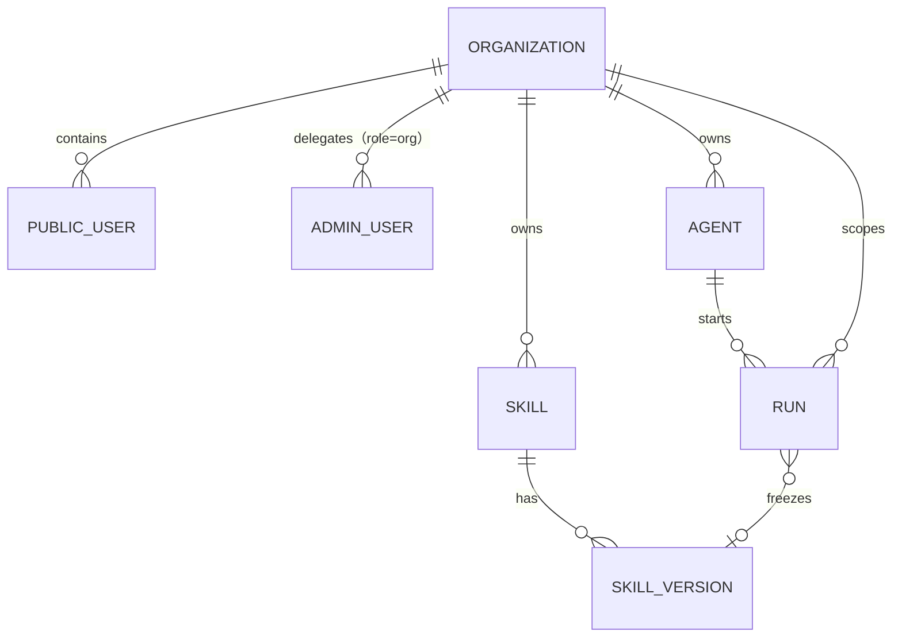
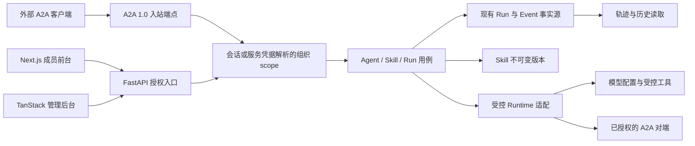

# PRD: 多组织通用在线 Agent 底座

- GitHub Issue: https://github.com/ZataZhang/zata-codes-template/issues/58

> ✅ **交付前置**：无待完成依赖，可立即开工。组织表、普通用户归属与平台/组织两级管理员已由 `P1-FEAT-20261112-142923-organizations-and-two-tier-admins` 交付；本 PRD 可复用该组织范围与角色模型。
> 结构化声明见 §8 Delivery Dependencies，**那里是唯一事实源**。

> 🧍 **验收状态**：待人工验收 — 执行侧验收证据绑定最终源码树，7 项 RV 命令由 KedaCode 在该树复跑 7/7 通过，独立 verifier 对相同 HEAD/tree 给出 PASS（risk=yellow），GitHub CI 必需任务全绿；只剩 5 项 Human-Confirmed 待随 PR 合并接受并完成合并后树核对。限制与非阻塞风险见 Final Reconciliation。
> 本行是 §9 Acceptance Checklist 的投影，**那里是唯一事实源**。

> 本 PRD 分为 Part A 人审层和 Part B 执行器层。Part A 用于确认目标行为和关键取舍；Part B 记录实现路径与验证证据。
> 组织与两级管理员已拆至上游 PRD `P1-FEAT-20261112-142923-organizations-and-two-tier-admins`；本 PRD 在其地基上落地 Agent / Run / Skill / A2A 的组织范围。

## Feature Overview (功能一览)

> 本块是 §10 Functional Requirements 的简明投影；行为验收以 §1 行为样例为准。

- **同一部署服务多个组织**（FR-1、FR-2）：组织与两级管理员由上游 PRD 交付；本 PRD 让组织成员只能看到本组织授权的 Agent、运行、Skill 与资产。
- **从创建到运行的在线闭环**（FR-3、FR-4）：管理员发布 Agent，成员从浏览器选择 Agent、发起运行、查看增量结果和历史记录。
- **可追溯的 Skill 变更**（FR-5）：授权人员更新 Skill 时生成不可变新版本，可比较并以新版本恢复旧内容。
- **明确的执行边界**（FR-6）：本地执行只开放模型调用与平台审核的受控工具，Agent 间调用按 FR-11 走 A2A；缺失必需能力时清楚显示不可运行，不执行租户代码、宿主命令或跨组织调用。
- **中性、可分发的仓库**（FR-7、FR-8）：移入能力后保留模板复制与同步流程，发布内容不含来源产品的私有资料、商标素材或不明分发权的构建包。
- **真实入口与证据**（FR-9）：从公开前台、管理后台和 API 走完整链路，并用独立读取证明持久化与隔离。
- **可部署的在线入口**（FR-10）：沿用已有双前端和后端容器部署方式，浏览器经同源代理访问 API，线上密钥留在服务端。
- **Agent 间 A2A 双向互通**（FR-11）：外部获授权的 A2A 客户端可调用本平台发布的 Agent；本平台 Agent 可调用组织已授权的外部 Agent，两种方向都使用同一运行与授权边界。

# Part A · 人审层 (Review Layer)

## 1. Introduction & Goals

### Problem Statement

仓库目前有双域认证、通用 Run 事件和沙箱端口，但用户登录后没有可创建、选择和运行 Agent 的在线闭环。`ai-assistant` 已实现稳定 Agent 身份和运行内核，`freshai` 已实现 Skill 版本管理；两者也各自带有产品业务和不同的前台实现。直接复制两个仓库会把不同的认证、迁移链、前台与品牌资产一起带入，使模板的分发结果无法明确保证通用性与组织隔离。

仓库可观察事实：当前 Run 仅有用户 `owner_id`，应用装配只注册认证、执行轨迹和健康检查入口；现有模板说明也明确写着“模板不内置业务域”。因此目标改变需要正式定义产品边界，不能只靠批量拷贝目录。

### Interpretation (解读回显)

**行为样例**（每一行都成为 §7.6 的验收 oracle；修改表格中的结果就等于修改验收标准）：

| 验证方式 | 输入 / 操作 | 期望观察到的结果 |
|---|---|---|
| 👀 人审 + 自动验证 | 组织管理员创建并发布一个已配置模型的 Agent；本组织成员在前台选择它并提交消息 | 成员看到逐步更新的运行状态、最终回复和可重新打开的历史；管理端能查看同一运行的低敏轨迹 |
| 🤖 自动验证 | 组织 B 的成员或管理员尝试读取组织 A 的 Agent、运行、事件、Skill 或资产 | 所有请求均被拒绝或返回不可见；响应和轨迹不泄露组织 A 的名称、内容、凭据或存在性 |
| 👀 人审 + 自动验证 | 授权人员更新 Skill，比较两个版本，再选择旧版本内容作为新的当前版本 | 版本历史保持线性且旧记录不变；新运行冻结所选版本，旧运行仍指向原版本 |
| 🤖 自动验证 | Agent 缺少可用模型、被禁用，或尝试使用未审核工具/执行命令；成员尝试运行 | 前台显示不可运行原因，API 拒绝创建运行，不产生成功事件，也不执行命令 |
| 🤖 自动验证 | 维护者复制模板创建新项目 | 新项目可启动底座、保留模板同步入口，且不包含来源仓库的品牌包、私有样例和凭据 |
| 🤖 自动验证 | 外部 A2A 客户端调用组织 A 发布的 Agent，并查询、订阅或取消该任务；组织 B 的凭据尝试读取同一任务 | 授权客户端拿到对应 Run 的任务状态与结果，取消和重新查询一致；组织 B 无法获知任务内容或存在性 |
| 🤖 自动验证 | 组织 A 的 Agent 调用已登记且授权的外部 A2A Agent；用户要求改用未登记地址或组织 B 的凭据 | 已授权调用经真实 A2A 客户端边界完成并归入原 Run 的轨迹；未登记目标或跨组织凭据在发起网络请求前被拒绝 |

**我默默定了这些**

- 组织表、普通用户归属（一人一个组织）与平台/组织两级管理员由上游 PRD `P1-FEAT-20261112-142923-organizations-and-two-tier-admins` 交付，本 PRD 直接复用其组织归属与角色模型。
- 组织管理员管理本组织 Agent 和 Skill；普通成员只能使用被授权能力；平台管理员管理组织与管理员（经上游 PRD 的页面）。
- 迁移采用当前模板的目录、认证和 Run 契约作为目标形态；来源仓库是可挑选的实现参考，不整体覆盖目标仓库。
- 现有 Run 数据归入上游 PRD 创建的显式默认组织，迁移不删除历史运行或事件。
- 业务数据的组织归属**在创建时写入、之后不改**：root Run、会话、资源、Skill、Agent 取创建者此刻所在组织；委派子 Run 与远端 A2A Task 继承 root Run；产物继承所属 Run。读取不按「当前成员名下的数据」反推。
- 归属为空表示无法归属（迁移找不到依据），对任何人不可见、不删除，迁移日志按表输出数量供复核。
- `just copy` 与 `sync-template` 继续是正式能力，派生项目收到可运行的中性底座。
- 默认模型仍由现有三项环境配置提供；不把来源仓库的供应商目录当成平台事实。
- 首版的本地执行只开放模型与平台审核的受控工具，Agent 间调用只走受权 A2A；租户不能上传代码运行或请求执行命令。现有沙箱端口保留为工程能力，但不对在线租户开放。
- 首版支持 A2A 双向互通，使用官方 1.0 的 HTTP+JSON/REST 绑定；每个可对外发布的 Agent 有独立的 Agent Card 与端点，组织授权决定谁能发现和调用。外部 Agent 地址由组织管理员登记并经平台策略批准，不接受运行时任意 URL。
- “在线版”指可经现有生产容器入口部署并使用，本 PRD 的实施不擅自部署到真实公网域名。

**我理解为不做**

- 不复制 Outlook/Office 宿主、货运任务、CargoX 设计包、FreshAI 积分/市场/社交/博客，也不导入两个来源仓库的 Git 历史。
- 不在首版提供任意第三方 Runtime 协议、模型供应商管理后台或跨组织共享市场；Agent 间互通协议明确定位为 A2A。
- 不开放租户代码、Shell/容器命令或用户上传 Skill 包的执行；有强隔离需求时另立 PRD。
- 不把“去商标”理解为仅替换界面文字；发布资产、示例、文档和分发权都必须检查。

本 PRD 把需求读成一个能在线创建、运行、治理并通过 A2A 与独立 Agent 协作的**多组织模板底座**。组织归属必须在登录、查询、运行、A2A、工具和持久化路径一致生效；失败必须显式返回。模板复制和同步能力属于交付的一部分。只有证据证明可独立迁移的通用实现才从两个来源迁入。

- [ ] 我确认这段解读与行为样例准确表达了我的需求。

### What The User Gets

组织管理员能设置本组织的 Agent 与 Skill、授权 A2A 对端；成员能在浏览器中使用 Agent、回看历史；外部获授权的 Agent 能通过 A2A 调用本平台 Agent，本平台 Agent 也能调用已授权的外部 Agent；平台维护者能用同一部署服务多个互相隔离的组织，并继续从仓库复制出中性的派生项目。

### Measurable Objectives

- 两个组织的真实入口交叉读取和运行请求都不能越权，且失败响应无目标组织内容。
- 一个已配置的 Agent 从发布到运行、重开历史和管理轨迹形成闭环，Run 与事件在新请求中可读。
- Skill 更新、比较、恢复保留完整版本链；运行记录能定位当时使用的版本。
- 缺失模型或执行能力时，启动或操作给出确定的不可用状态，没有宿主机执行回退。
- 复制得到的新项目通过启动检查和中性内容审计；模板同步仍可识别共享文件与项目文件。
- 生产构建和本地容器入口下，两个前端都能经各自 `/api` 代理完成登录与授权请求；模型密钥不出现在浏览器响应或静态包中。
- A2A 入站与出站各有一条真实协议入口证据；任务状态、流、取消、重试与 Run 对应一致，跨组织调用和未经批准的对端均失败闭合。

## 2. Human Review Map (介入与风险地图)

### 决策一：业务数据的组织范围（组织与管理员本身已移交上游 PRD）

组织表、普通用户归属、平台/组织两级管理员及其创建、启停、解绑，已整体移交 `P1-FEAT-20261112-142923-organizations-and-two-tier-admins`。原已确认决策（首版一个普通用户归属一个组织；平台管理员接触组织业务数据必须经显式授权和审计）已原样搬入该 PRD §2 并保留已确认状态，本 PRD 不再重复决策。

本 PRD 在该地基上落地业务数据的组织范围：Agent、Run/event、Skill、资产按组织隔离；组织管理员管理本组织 Agent 与 Skill；平台管理员不因平台身份自动浏览成员内容。组织身份由服务端会话解析，不能由请求方任意指定；存量 Run 归入上游创建的默认组织，事件与历史不得丢失。错误的归属会造成跨组织数据暴露，属于本 PRD 最重要的安全决定。

**已确认（2026-11-13 对话）：数据属于产生它的组织，不随人走。** 上游 PRD 允许平台管理员调整普通用户的所属组织。若组织范围按「这个组织**当前**有哪些成员、取这些人名下的全部数据」计算，用户从 A 调到 B 后，A 期间的运行、资源和产物会整体出现在 B 的视图里，A 反而看不到——这是派生项目里实际复现过的跨组织泄露。因此：每条业务数据创建时记录组织；成员本人读取要求「本人所有**且**产生于本人当前所在组织」，调组织后在新组织里看不到旧数据，也不能往旧组织的会话或运行里追加任务；组织管理员读取按「产生于本组织」过滤，可查看已调走成员在本组织期间的数据（沿用审计要求），看不到成员在别的组织产生的数据。

**请确认：** 业务数据（Agent / Run / Skill / 资产）按上述组织范围隔离，是否同意？

- [ ] 同意（推荐）

**验收：** 用两个真实组织的账号互相读取 Agent、运行、Skill 和资产都失败；迁移后原账号仍能读取自己的历史；平台管理员把成员从 A 调到 B 后，成员本人和 B 的管理员都看不到 A 期间的数据，A 的管理员仍能看到。



组织与管理员的表结构细节见上游 PRD §2 决策一。

### 决策二：Agent 运行与可用性

建议保留稳定 Agent 身份，运行开始时冻结 Agent、模型和 Skill 的有效版本；状态和增量事件只走一条持久化链。本地执行仅允许模型与平台审核的受控工具，Agent 间委派使用已授权 A2A 对端；租户不能提交可执行代码或命令。模型或必需工具不可用时，Agent 显示不可运行并拒绝启动，不能暗中换另一个执行方式。

**已确认（2026-09-28，原样保留）：** 稳定 Agent 身份、单一运行事实源和失败闭合的可用性规则。

**请确认：** 沿用上述已确认结论，是否同意？

- [ ] 同意沿用（推荐）

**验收：** 用户从前台提交一次运行，能看到同一运行的过程、最终结果与历史；关闭页面后重新进入，状态和内容仍一致；不可用时不会产生伪成功。

### 决策三：Skill 版本与来源取舍

建议把声明式 Skill 的正文与版本治理作为通用能力纳入，但只迁入独立于市场、积分和社交的路径。Skill 可以包含说明与非可执行参考资料，不能包含租户可运行脚本或上传代码包。恢复旧内容应追加一个新版本，不能修改或删除既有历史；运行必须记录实际采用的 Skill 版本。否则源仓库的多条写入入口会形成不同的版本事实。

**已确认（2026-09-28，原样保留）：** Skill 保留线性版本历史，恢复旧内容生成新版本；首版不包含 Skill 市场交易。

**请确认：** 沿用上述已确认结论，是否同意？

- [ ] 同意沿用（推荐）

**验收：** 管理员在浏览器里查看差异并恢复旧内容后，历史顺序和两个已完成运行所引用的版本均可核对。

### 决策四：Agent 间 A2A 互通

首版采用 A2A 双向互通：获授权的外部客户端可发现并调用本组织发布的 Agent；本组织 Agent 可调用已登记、已授权的外部 Agent。独立 Agent 之间使用 A2A；Agent 使用模型与受控工具仍走原有内部接口。外部任务与平台运行记录要能一一追溯，组织边界必须在两个方向成立。管理员能清楚看到对外发布状态和已授权对端，不能由普通消息临时指定未知地址。

**已确认（2026-09-28，原样保留）：** 首版交付双向互通；以受控对端目录和组织授权限制流量，不开放任意 URL 调用。

**请确认：** 沿用上述已确认结论，是否同意？

- [ ] 同意沿用（推荐）

**验收：** 外部客户端可用 A2A 发消息、看状态、订阅结果与取消任务；本平台 Agent 能调用已授权外部 Agent，并将结果和失败归入同一运行历史。其他组织的凭据及未登记对端均不能访问或触发请求。

### 自动门禁，不需要逐项人工审阅

前后端契约、迁移双数据库验证、品牌与敏感内容扫描、模板复制和同步行为，由执行器和独立 verifier 用可复现证据核验。两条守卫测试防回归：带 `owner_id` 的业务表必须记录组织归属（或写明豁免原因）；每个 HTTP 接口必须挂鉴权依赖（或在写明原因的公开名单里）。

### 本次明确不涉及

不迁入来源仓库的产品业务或现成二进制设计包；无凭据的外部服务不作为本地测试的假成功。

## 3. Usage And Impact After Implementation

### 组织成员

从公开前台登录、选择本组织可见 Agent、发送消息，看到实时状态和结果；再次打开历史可读到同一次运行的内容。注册和登录入口继续使用既有 public 会话；组织停用时收到明确的不可用提示（组织归属由上游 PRD 保证，默认组织兜底）。

### 组织管理员与平台管理员

组织管理员从管理后台发布 Agent、管理 Skill 版本、管理 A2A 发布与对端授权、查看本组织运行轨迹；平台管理员经上游 PRD 的组织与管理员页创建或停用组织、分配组织管理员，不因平台身份自动浏览成员内容。既有 admin 登录域保持独立。A2A 调用方使用专门的组织范围服务凭据，不能复用管理员浏览器 Cookie。

### 部署者与派生项目维护者

部署者填入现有模型三件套和数据库/会话配置后，用既有后端加两个前端的容器配置启动服务；无模型时健康检查仍可工作，但 Agent 标为不可运行。浏览器通过同源 `/api` 代理访问后端，密钥只留服务端。A2A 路由由后端独立暴露并校验服务凭据，出站目标须通过注册目录和平台网络策略；每组织/对端的凭据只在服务端安全存储或按密钥引用获取，不进入 Agent Card、浏览器或日志。受控工具由部署方审核和注册，不接受租户提交可执行代码。维护者复制模板后得到中性配置和可运行入口，并继续使用同步机制接收共享工程更新。

### Impact On Existing Behavior

- 既有 public/admin 登录、健康检查、Run 轨迹查询路径继续工作；新增组织归属后，历史数据通过迁移保持可读。
- 新配置默认不携带真实密钥；缺少模型配置不会让基础应用启动失败，但运行入口明确拒绝。
- 既有模板分发命令保留，项目专属代码仍遵循原有同步排除规则。

## 4. Requirement Shape

| 维度 | 目标 |
|---|---|
| Actor | 组织成员、组织管理员、平台管理员、部署者、派生项目维护者、获授权的 A2A 调用方 |
| Trigger | 登录并管理/使用 Agent、更新 Skill、运行 Agent、通过 A2A 调用或被调用、复制或同步模板 |
| Expected behavior | 同一部署内组织隔离、持久 Run 闭环、A2A 双向互通、可追溯 Skill 版本、双前端可部署和中性可分发项目 |
| Explicit scope boundary | 只迁移通用内核与必要 UI；不引入来源仓库的独立产品业务和商标资产 |

# Part B · 执行器层 (Build Layer)

## 5. Repository Context And Architecture Fit

现有近路：`src/backend/core/shared/models/run.py`、`interfaces/run_repository.py`、`infrastructure/persistence/models/run.py` 已提供 Run/event/trace；`core/auth/`、`composition/auth_wiring.py` 已提供双域登录；`core/shared/interfaces/sandbox_provider.py` 与 `infrastructure/sandbox/` 已提供沙箱端口；`composition/app_factory.py` 是唯一应用装配入口。`frontend-public/` 是 Next.js 公开站点与应用壳，`frontend-admin/` 是 Vite/TanStack 管理后台。

复用来源：`../ai-assistant/src/backend/core/agent/`、`core/organization/`、`core/skill/`、`engines/agent_adapters/` 与相关 API/仓库实现供语义对照（「数据不随人走」的写入盖章与员工可见条件见 `infrastructure/persistence/repos/organization_data_scope.py`，两条守卫见 `tests/guards/test_tenant_owned_tables_have_organization.py` 与 `tests/guards/test_routes_require_authentication.py`；注意其组织模型是独立成员关系表，与本模板的 `public_user.organization_id` 不同，只对照规则不搬实现）；`../freshai/src/backend/core/use_cases/user_skills/version_history.py`、`import_export.py` 与相应持久化路径供 Skill 版本规则对照。迁入前逐项确认依赖闭包、版权/分发权和目标仓库现有实现；不复制两个来源的迁移文件或 package lock。

架构约束：保持 `api → core`，跨层通过 `core/shared/interfaces/`，由 `composition/` 装配；`infrastructure/` 不反向导入 core；已有 Run/event 是唯一事实源。独立 Agent 之间采用 A2A 作为外部互通协议，入站 A2A Task 映射到既有 Run，出站远端 Task ID 关联父 Run，不能另建第二套运行事实源；MCP/受控工具仍是 Agent 使用工具的边界，不替代 A2A。A2A 协议适配放在 API 与 engine/infrastructure 边界，由 core 用例执行授权与运行；只选官方 1.0 HTTP+JSON/REST 绑定，避免同时维护 JSON-RPC/gRPC 适配。新 Alembic 文件只用 `just new-migration <slug>` 生成，验证唯一 head。`just copy` 保留，`sync-template` 默认仍跳过项目特定目录。来源仓库的 `/api/agent-runs` 前缀不能原样搬入：目标前端客户端已有 `/api` baseURL，浏览器请求应为 `/api/agent-runs`，后端实际路由应为 `/agent-runs`，避免 `/api/api/agent-runs`。

前端影响：`frontend-public/app/(app)/` 增加 Agent 目录、会话/运行页面和状态组件，经 `frontend-public/lib/api/` 调用新 API；`frontend-admin/src/routes/_authenticated/`、`features/` 与 `api/` 增加组织、Agent、Skill 管理，复用现有运行轨迹入口。前台使用 `just run frontend-public` / `pnpm build`，后台使用 `just run frontend` / `pnpm build`，真实 UI 使用 `just e2e` 和独立 Playwright 包；先按该包 `README.md` 适配用例。部署沿用 `docker-compose.yml`、`deploy/vps-traefik/docker-compose.yml` 和 `docs/guides/deployment.md` 的三服务形态，检查生产 Next rewrite 与后台 Nginx `/api` 转发。

现有 PRD 关系：硬依赖 `tasks/archive/P1-FEAT-20261112-142923-organizations-and-two-tier-admins.md`（组织表、用户归属、两级管理员与权限基线，见 §8）；与 `P1-SECURITY-20261112-134527-admin-oidc-sign-in.md`、`P1-FEAT-20261112-134527-registration-policy-and-user-oidc.md` 无顺序依赖，但都改 `core/auth/`，后合者解决冲突。归档的 `20260518-164340-prd-decouple-template-from-business.md` 曾明确将模板定位为无业务骨架，本 PRD 经用户新目标批准后取代这项**产品定位**，但保留其避免厂商硬编码和分发污染的原则。归档的双域认证 PRD 继续作为认证兼容依据。

主要重复风险：三套 Run/会话状态、两个 Skill 版本写入口、把 Next 前台整体换成 Vite、源仓库迁移链并入模板、复制品牌包。各项均须禁止。

## 6. Recommendation

### Recommended Approach

在现有模板上完成一个可运行的 Agent 闭环及 A2A 双向互通，以 `ai-assistant` 为 Run/Agent/组织规则参考，以 `freshai` 为 Skill 版本语义参考，只移入独立且获得分发确认的代码。两份来源均无可直接迁入的 A2A 实现；按目标仓库四层边界新增薄协议适配，保持当前前端框架和模板分发流程。

### Proposed Solution Summary (实现机制)

组织身份由现有 public/admin 会话经服务端解析；A2A 入站由服务凭据解析组织、调用方及目标 Agent 权限；组织、Agent、Skill 和 Run 仓库查询都接受已解析 scope。Agent 创建时只绑定模型、已批准 A2A 对端和平台审核的工具目录，Run 创建时冻结 Agent 与 Skill 版本快照，事件在既有 Run 事务链追加；浏览器从 canonical Run API 订阅/查询状态。A2A 入站消息经过相同 Run 用例生成任务视图，出站调用经已登记 Agent Card 与受控客户端，将远端任务状态/结果归入父 Run 事件；出站凭据以组织与对端为作用域安全存储、轮换和读取，只向该对端发送，不写入卡片/轨迹。模型客户端作为基础设施适配现有 `load_primary_model_settings()`，缺配置则登记不可运行。在线 API 不暴露沙箱命令或用户代码执行入口。Skill 所有写入统一经过串行版本创建用例；旧版恢复也是一次新写入。前后端分别接到现有 Next/TanStack 应用壳，模板复制只接收审计后的中性资产。

### Alternatives Considered

| 方案 | 结论 |
|---|---|
| 整仓覆盖 `ai-assistant` 与 `freshai` | 拒绝；Run、认证、迁移、前台与产品业务会冲突，且品牌构建包需要单独处置。 |
| 新建微服务/第二套 Run Store | 拒绝；模板已有 Run 事实源和四层装配，平行实现会破坏历史与轨迹一致性。 |
| 仅迁入后端，前台后补 | 拒绝；目标是在线可用底座，缺浏览器入口无法验证实际用户闭环。 |

范围凝聚判断：组织与管理员地基已按用户确认拆至上游 PRD；本 PRD 保留 Agent Run、Skill 版本和 A2A 一个目标状态——首版对外承诺的是同一套受组织授权的 Agent/Run，把 A2A 单独后置会交付一个无法满足已确认互通要求的首版，拆开 Run/Skill 又会产生临时无隔离运行或第二次迁移。因此保留一个目标状态，并以入站/出站协议 oracle 显式核查新增风险。市场、积分、Outlook 集成可独立交付，故明确排除。

## 7. Implementation Guide

本节是基于当前仓库的动态实施指南。若实施时发现额外影响文件、隐藏依赖、边界情况或更好的路径，先更新本 PRD 再继续。

### 7.1 Core Logic

先盘点来源代码许可、资源和目标接口；以现有双域会话建立组织 scope；扩展 Run 的组织与快照契约，复用事件存储及追踪；接入单一模型运行适配、仅由部署方注册的受控工具和 Skill 版本写入；接 A2A 入站/出站适配，最后接前台和管理端。测试数据库迁移必须保留已有 Run/event 的数量、关联和可读性。写操作在事务内锁定归属与版本，读操作按组织和 owner 限定；请求体里的组织 ID 不得覆盖服务端会话结论。A2A 入站按凭据解析组织与目标 Agent，外部 task/context ID 不能直接当作本地授权依据；出站目标只来自已批准的对端目录，解析 Agent Card 后限制 DNS/IP、重定向、内网地址与凭据转发，防止 SSRF 和跨租户泄漏。在线路由不得连接到现有沙箱命令执行端口。

正式路由以当前模板的代理边界为准：后端 `/agents`、`/agent-runs`、`/skills`、`/admin/organizations` 等由前端 `/api` baseURL 暴露为浏览器 `/api/...`；Run 创建、详情、事件和取消分别使用 `POST /agent-runs`、`GET /agent-runs/{run_id}`、`GET /agent-runs/{run_id}/events`、`POST /agent-runs/{run_id}/cancel`。A2A 使用独立后端路径 `/a2a/agents/{agent_id}`（不套浏览器 `/api` 代理），每个 Agent 提供受权的 Agent Card；按 1.0 REST 绑定实现 `POST /message:send`、`POST /message:stream`、`GET /tasks/{id}`、`GET /tasks`、`POST /tasks/{id}:cancel`、`POST /tasks/{id}:subscribe`，声明 `A2A-Version: 1.0`，不宣称未实现的推送通知或其他绑定。流与取消映射现有 Run 的状态/事件；重复消息和重试不可创建不受控的重复 Run。具体 DTO 在实施时以官方版本、归属、快照、失败语义为准定型，不能把来源仓库已含 `/api` 的路由再叠一层代理。Skill 只接受声明式正文/参考文件，上传校验拒绝执行脚本与代码包。

### 7.2 Change Impact Tree

```text
.
├── Database / Migration
│   ├── alembic/versions/                         [新增] 【总结】通过生成器建立 Agent、Skill 版本及既有 Run 组织归属迁移（组织表与用户归属由上游 PRD 交付），保留历史事件。
│   └── src/backend/infrastructure/persistence/models/ [修改] 【总结】增加 Agent、Skill 模型并扩展现有 Run 组织归属字段。
├── Domain
│   ├── src/backend/core/auth/                     [修改] 【总结】复用上游 PRD 会话解析的组织身份与管理员角色，落到业务用例授权。
│   ├── src/backend/core/agent/                    [新增] 【总结】管理稳定 Agent 身份、发布与 Run 创建/取消用例。
│   ├── src/backend/core/skill/                    [新增] 【总结】统一 Skill 版本、差异和恢复规则。
│   ├── src/backend/core/a2a/                      [新增] 【总结】定义对端授权、入站调用和出站委派用例，不存第二套 Task 状态。
│   ├── src/backend/core/shared/models/run.py      [修改] 【总结】冻结组织、Agent 和 Skill 来源信息。
│   └── src/backend/core/shared/interfaces/        [修改] 【总结】声明目录、版本与运行适配端口。
├── Engines / Infrastructure
│   ├── src/backend/engines/agent_adapters/         [新增] 【总结】把模型/受控工具输出映射为既有 Run 候选事件。
│   ├── src/backend/engines/a2a/                    [新增] 【总结】隔离官方 A2A 1.0 消息、Task、流与内部 Run 事件的双向转换。
│   ├── src/backend/infrastructure/config/settings.py [修改] 【总结】复用主模型配置并显式表示不可运行状态。
│   ├── src/backend/infrastructure/a2a/             [新增] 【总结】实现受控 HTTP 客户端、Agent Card 获取与目标地址网络限制。
│   └── src/backend/infrastructure/persistence/repos/ [修改] 【总结】按组织过滤并事务化写入运行和版本。
├── API / Composition
│   ├── src/backend/api/                            [新增] 【总结】提供组织、Agent、Skill 和 canonical Run 的受权入口。
│   ├── src/backend/api/a2a/                        [新增] 【总结】提供每 Agent 的 Agent Card、A2A 1.0 REST、流与取消入口。
│   └── src/backend/composition/app_factory.py      [修改] 【总结】装配唯一运行链、路由和依赖。
├── Frontend
│   ├── frontend-public/app/(app)/                  [新增] 【总结】增加 Agent 目录和真实会话页面。
│   ├── frontend-public/lib/api/                    [修改] 【总结】同步 Agent、Run、Skill 类型与调用路径。
│   ├── frontend-admin/src/routes/_authenticated/   [新增] 【总结】增加 Agent 与 Skill 治理路由（组织与管理员页由上游 PRD 交付）。
│   ├── frontend-admin/src/features/                [新增] 【总结】增加发布、版本差异、A2A 对外状态与对端授权界面。
│   └── frontend-admin/src/api/                     [修改] 【总结】同步管理 API 与类型。
├── Template / Docs / Tests
│   ├── config.toml + .env.example                   [修改] 【总结】只声明中性配置与空密钥示例。
│   ├── docker-compose.yml + deploy/vps-traefik/docker-compose.yml [修改] 【总结】让现有双前端/后端容器入口与新 API 代理保持一致。
│   ├── docs/architecture/system-design.md + mkdocs.yml [修改] 【总结】记录目标契约、租户边界与文档导航。
│   ├── docs/prototypes/                            [新增] 【总结】先产出 Agent/Skill 关键状态的交互目标原型供 PR 对照。
│   ├── tests/backend/ + tests/guards/              [修改] 【总结】覆盖组织越权、A2A 双向协议/授权、版本、迁移与模板分发约定。
│   └── tests/playwright-e2e/tests/                  [新增] 【总结】从真实路由验证管理发布、成员运行及历史。
```

此树列出起点而非穷尽文件；实施时先搜索调用点和生成文件，不按目录批量复制。

### 7.3 Risk Classification Register

| Change point | Tier | 决定性原因 | Intervention | Oracle / gate |
|---|---|---|---|---|
| Run/Agent/Skill 组织归属与迁移 | R3 | 跨租户授权与历史数据；安全及数据库固定区（组织与管理员权限模型由上游 PRD 交付并验收） | 人工确认 | rv-1 |
| Agent 创建、幂等、状态及事件 | R3 | 并发执行和持久结果；core 固定区 | 人工确认 | rv-2 |
| Skill 版本、恢复与快照 | R2 | 持久版本与历史语义；core 固定区 | 人工确认 | rv-3 |
| A2A 双向协议、外部身份与对端网络访问 | R3 | 外部信任边界与跨组织数据/凭据风险 | 人工确认 | rv-7（与 rv-1 的组织负控联动） |
| 品牌/私有资产与分发审计 | R1 | 发布前可由静态清单阻断 | 执行器 + 发布清单审计 | rv-4 |
| 模板复制与同步保留 | R1 | 可逆的工程入口 | 执行器 + 干净副本断言 | rv-5 |
| 中性 UI 与 API 客户端 | R1 | 两个界面内的普通展示与调用 | 执行器 + 真实浏览器请求断言 | rv-2、rv-3 |
| 容器部署与同源 API 代理 | R1 | 现有部署适配 | 执行器 + 生产容器入口 smoke | rv-6 |

### 7.4 Executor Drift Guard

先执行 `rg -n 'agent-runs|RunModel|RunEventModel|session_id|admin_session_id|MODEL_BASE_URL|sandbox_agent|project_skip_paths|a2a|AgentCard' src frontend-admin frontend-public config.toml docs` 定位旧入口；分别在两个来源仓库按类名与路由搜索实际依赖闭包，确认尚无可复用 A2A 实现。再用 `rg -n -i 'cargox|freshai|outlook|freight|cost.rate|vendor/' src frontend-admin frontend-public docs config.toml .env.example` 检查待发布面，逐项记录合法引用与必须移除项。不要把 `rg` 零结果当成二进制、图片、历史或依赖包的充分审计。协议实现前核对 A2A 1.0 官方规范与所选 SDK 锁定版本，不凭记忆复制旧版 JSON-RPC 字段。

### 7.5 Flow / Architecture Diagram



ER 目标结构见 §2 决策一。具体新表、索引、外键和存量 Run 回填顺序应在实施前按源模型与当前数据库约束确定，并同步进本 PRD；两种受支持数据库都必须有升级和可支持的降级证据。

### 7.6 Realistic Validation Plan

```yaml
- id: rv-1
  behavior: "组织 B 的成员或管理员尝试读取组织 A 的 Agent、运行、事件、Skill 或资产"
  reviewer: verifier
  real_entry: "just run 后，通过 /api/auth/login、/api/admin/auth/login 取得两个组织的会话并请求正式 /api/* 与 /api/admin/* 入口"
  expected: "所有请求均被拒绝或返回不可见；响应和轨迹不泄露组织 A 的名称、内容、凭据或存在性；迁移后原账号仍能读取自己的历史；平台管理员经正式接口把成员从 A 调到 B 后，该成员新登录读不到 A 期间的 Run/资源/产物（按 ID 直取也是不存在），不能向 A 期间的会话追加 Run，B 管理员视图不含这些数据，A 管理员视图仍含且留审计"
  mock_boundary: "模型响应可替换；认证路由、服务端 scope、数据库事务、Run/Skill/资产仓库与 HTTP 序列化必须真实"
  tier: R3
  test_layer: e2e
  required_for_acceptance: true
  critical_value_source: "由平台管理员创建组织及成员的真实 API 返回 ID，再用各自登录响应的 Cookie；存量 ID 从迁移前数据库读取"
  must_cross: "登录 Cookie → 服务端组织解析 → 正式 API → scope 过滤 → PostgreSQL/MySQL 持久化 → 新请求读取"
  forbidden_bypasses: "手工伪造组织 scope、直接调用用例、预置绕过认证的测试对象、从请求体采信 organization_id"
  fresh_state_probe: "新 HTTP 客户端分别以 A/B Cookie 重读目录、Run、事件、Skill 和资产，并核对存量数据计数"
  final_tree_evidence: "记录最终 Git tree 与数据库迁移版本；相关代码变动后重收 rv-1，分别留 PostgreSQL/MySQL 结果"
  negative_control: "在测试边界故意用 B Cookie 请求已由 A 会话创建的精确资源 ID"
  expected_fail: "若 scope 过滤缺失，负控读到 A 的内容，越权断言变红"
- id: rv-2
  behavior: "组织管理员创建并发布一个已配置模型的 Agent；本组织成员在前台选择它并提交消息"
  reviewer: human
  real_entry: "just e2e tests/workflows/agent-run.auth.spec.ts（从管理页发布，再从真实成员页面运行）"
  expected: "成员看到逐步更新的运行状态、最终回复和可重新打开的历史；管理端能查看同一运行的低敏轨迹；不可用 Agent 被拒绝且无伪成功"
  mock_boundary: "只允许替换付费模型传输；真实页面、代理、登录、API、Run 事务、事件读取与轨迹投影不可替换；模型请求构造须另有契约检查"
  tier: R3
  test_layer: e2e
  required_for_acceptance: true
  presentation: "tasks/evidence/<prd-stem>/rv-2-agent-run.png 与 rv-2-demo-multi-organization-agent.mp4；MP4 由单独的真实浏览器主演示录制，带中文字幕并与目标原型配对"
  critical_value_source: "管理页创建 Agent 后显示的 ID 与前台选择项；Run ID 从浏览器实际请求/响应及页面取得，不在测试中重构"
  must_cross: "管理 UI → admin API → Agent commit → 成员 UI → 正式 Run API → event commit → SSE/轮询 → 新页面历史读取 → 管理轨迹"
  forbidden_bypasses: "组件预览、直接调 core、伪造 Run ID、只检查写响应、/api/api/agent-runs 或旧兼容路由、任何租户代码或命令执行回退"
  fresh_state_probe: "新浏览器上下文登录同一成员并重新打开刚才页面展示的 Run ID，核对终态、回复与管理轨迹"
  final_tree_evidence: "截图、录屏、浏览器请求记录与最终 Git tree 一起写入证据报告；入口或契约改动后重收"
  negative_control: "先在未实现的原始模板树运行正式流程，或在测试替身边界返回故意缺失的模型字段"
  expected_fail: "原始模板无 Agent 入口，或响应契约错误导致运行结果断言变红"
- id: rv-3
  behavior: "授权人员更新 Skill，比较两个版本，再选择旧版本内容作为新的当前版本"
  reviewer: human
  real_entry: "just e2e tests/workflows/skill-version.auth.spec.ts（从真实管理页面更新、比较、恢复并重新运行）"
  expected: "版本历史保持线性且旧记录不变；新运行冻结所选版本，旧运行仍指向原版本"
  mock_boundary: "模型传输可替换；版本 API、事务锁、数据库与 Run 快照必须真实"
  tier: R2
  test_layer: e2e
  required_for_acceptance: true
  presentation: "tasks/evidence/<prd-stem>/rv-3-skill-version.png；与目标原型并排展示版本差异和恢复后的线性历史"
  critical_value_source: "管理界面创建的 Skill 与版本 ID、界面展示的旧版内容；恢复请求直接使用该选择"
  must_cross: "管理 UI → 版本 API → 行锁与 commit → 新请求版本列表 → Run 创建快照 → 历史 Run 读取"
  forbidden_bypasses: "直接改版本表、删除旧版本、前端假造差异、绕过版本写入用例"
  fresh_state_probe: "新的管理会话重读全部版本和两个 Run 快照，核对序号、正文摘要及未修改的旧记录"
  final_tree_evidence: "数据库查询、截图与最终 Git tree 同记证据包；版本或快照路径变更后重收"
  negative_control: "在测试仓库替身中模拟重复版本号或被修改的旧版本"
  expected_fail: "唯一性或旧版不可变断言变红"
- id: rv-4
  behavior: "维护者准备公开分发仓库并审计来源资产"
  reviewer: verifier
  real_entry: "从干净副本运行仓库发布/复制入口，再扫描实际输出目录及 Git 跟踪清单"
  expected: "发布内容不含来源产品品牌包、私有样例、凭据；来源文件的分发权有逐项记录；若公开现有仓库历史，历史也已完成审计或改由干净历史发布"
  mock_boundary: "无；扫描必须针对实际分发输出、二进制/图片元数据和拟公开的 Git 历史"
  tier: R1
  test_layer: smoke
  required_for_acceptance: true
- id: rv-5
  behavior: "维护者复制模板创建新项目"
  reviewer: verifier
  real_entry: "just copy <临时目录名>，然后在新项目运行 just run 与 just sync-template --list"
  expected: "新项目可启动底座、保留模板同步入口，且不包含来源仓库的品牌包、私有样例和凭据"
  mock_boundary: "可使用本地模型替身；模板复制、配置加载、应用装配与同步脚本必须真实"
  tier: R1
  test_layer: smoke
  required_for_acceptance: true
- id: rv-6
  behavior: "部署者从现有双前端和后端容器入口使用在线底座"
  reviewer: verifier
  real_entry: "docker compose -f docker-compose.yml up -d --build，然后通过两个前端容器公开端口访问登录和 /api/agent-runs；完成后 docker compose -f docker-compose.yml down"
  expected: "生产构建启动，两个前端同源 /api 路径只转发一次，登录 Cookie 可用，静态包和浏览器响应中没有模型密钥"
  mock_boundary: "可不配置付费模型；容器、前端生产构建、代理、后端真实路由与会话必须真实"
  tier: R1
  test_layer: smoke
  required_for_acceptance: true
- id: rv-7
  behavior: "外部 A2A 客户端调用组织 A 发布的 Agent；本平台 Agent 调用组织 A 已授权的外部 Agent，组织 B 或未登记对端尝试越权"
  reviewer: verifier
  real_entry: "从真实管理页发布 Agent 并登记/授权对端；通过真实后端 A2A 1.0 REST 入口读取受权 Agent Card、发送消息、订阅/查询/取消 Task；从正式成员 Run API 触发已登记外部 Agent 调用；使用官方 A2A 1.0 兼容客户端/服务端替身走网络协议"
  expected: "入站 Task 与本地 Run 的状态、流、结果、取消及重新读取一致；出站远端 Task 结果与失败归入父 Run；组织 B 对精确 Task ID 不能获知内容或存在性；未登记地址、内网/重定向目标与跨组织凭据在网络调用前拒绝"
  mock_boundary: "远端外部 Agent 可用受规范约束的本地服务端替身；真实 A2A HTTP 序列化/版本协商、后端路由、服务凭据、组织授权、客户端地址策略、Run 事务与事件读取不可替换；替身不得自行发明协议字段"
  tier: R3
  test_layer: e2e
  required_for_acceptance: true
  critical_value_source: "入站 Agent Card URL 从真实管理页和卡片响应取得、任务 ID 从真实协议响应取得；出站对端 URL 从管理员已批准登记记录取得，远端任务 ID 从协议响应取得"
  must_cross: "管理 UI → A2A 发布与对端授权提交 → 外部 A2A 客户端 → Agent Card/1.0 REST → 服务凭据解析 → 组织授权 → Run/event commit → 新客户端 Task 查询/订阅/取消；正式 Run API → 已批准对端目录 → 受控 HTTP 客户端 → 外部 A2A 服务端 → 父 Run 事件读取"
  forbidden_bypasses: "直接调用 core、手工构造 Task/Run 映射、全局公开私有 Agent Card、从 URL/请求体采信组织身份、仅用同一代码库的编解码器互测、运行时任意 URL、跟随内网重定向、将入站凭据转发给外部对端"
  fresh_state_probe: "新客户端使用 A 凭据按响应 Task ID 重查终态与本地 Run/事件，使用 B 凭据查同 ID 得不可见；新会话重读父 Run，核对远端 Task ID、结果与失败轨迹"
  final_tree_evidence: "记录官方兼容客户端/服务端版本、协议请求/响应脱敏摘录、负控网络请求计数、Run/Task 对账及最终 Git tree；协议、权限或 Run 映射变化后重收 rv-7"
  negative_control: "先用 B 凭据访问 A 的精确 Task ID，再将出站目标改为未登记或解析到受限地址"
  expected_fail: "缺少服务端 scope 会暴露 A 的任务；缺少地址/凭据限制会产生本应为零的外呼请求"
```

命令从仓库根目录执行；`<临时目录名>` 由实施者选择并确认不会覆盖现有目录。外部模型和真实外部 Agent 的连接仅在提供凭据后 opt-in；无凭据时 A2A 的本地独立实现互通、真实路由、版本协商、客户端地址策略、模型请求构造和失败闭合仍是必过门禁，但不得称为真实外部服务已验证。租户代码或命令执行不属于本 PRD，不通过临时打开 Docker 沙箱来测试。失败先查 `composition/app_factory.py` 路由装配、前端 `/api` 代理、A2A 独立后端端点和数据库迁移版本，不用直接调用用例代替入口。数据库有关的 rv-1/rv-3/rv-7 分别执行 PostgreSQL 与 MySQL 升级、关键数据核对及可支持的降级。代码改动完成后执行 `just test`，再由独立 verifier 审查证据，最多两轮。

### 7.7 Low-Fidelity Prototype

当前仓库没有 Agent 会话或 Skill 版本的真实目标原型。实施的第一项前端交付是按现有 Next 应用壳与 TanStack 管理壳制作并登记可点击原型（见 `docs/prototypes/` 与 Prototype Hub），覆盖：可用 Agent 目录、不可运行原因、运行中与完成态、重开历史、Skill 差异和恢复确认。原型只表达设计目标，标记 `interactive prototype`；验收必须另拍真实入口截图，使用相同状态、视口、主题和代表数据配对。

### 7.8 External Validation

| Topic | Source | Checked On | Relevant Finding | Impact On Recommendation |
|---|---|---|---|---|
| A2A 协议定位与版本 | [A2A 官方 1.0.0 规范](https://a2a-protocol.org/v1.0.0/specification/) | 2026-09-28 | A2A 规定 Agent Card、消息、Task/状态与多种协议绑定；1.0.0 是查询时的最新发布版。 | 把 A2A 放在独立 Agent 之间的协议边界，实施时固定协商版本，不将其对象直接当作内部 Run 模型。 |
| A2A 与 MCP 的职责 | [A2A 官方规范附录 B](https://a2a-protocol.org/v1.0.0/specification/#appendix-b-relationship-to-mcp-model-context-protocol) | 2026-09-28 | A2A 面向独立 Agent 协作，MCP 面向工具、API 和数据源接入。 | 现有受控工具/MCP 不承担跨 Agent 任务协议职责。 |
| 发现与安全 | [A2A 官方 Agent Discovery 指南](https://a2a-protocol.org/latest/topics/agent-discovery/) | 2026-09-28 | 支持 Agent Card URL 直接配置或目录发现；敏感卡片需鉴权，凭据不应嵌入卡片。 | 多租户 Agent Card 与调用凭据须按组织限制，不能将内部目录公开为全局发现。 |
| 多租户路由 | [A2A 官方 Multi-Tenancy 指南](https://a2a-protocol.org/latest/topics/multi-tenancy/) | 2026-09-28 | 同一主机可通过每个 Agent 的 URL 前缀路由；各 Agent 应各自提供 Agent Card。 | 优先采用每 Agent 独立路径与卡片，组织归属仍由凭据和服务端授权解析，不能相信路径本身。 |

在实际选用第三方沙箱或发布许可结论前，实施者需单独核对届时的官方资料和资产权利记录，不以本 PRD 猜测代替。

## 8. Delivery Dependencies

### Delivery Dependencies

- Depends on tasks/issues:
  - none
- Gate type: none
- Sequence: via-main
- Notes: 原硬前置 `P1-FEAT-20261112-142923-organizations-and-two-tier-admins` 已归档交付（仍待人工验收）；本 PRD 复用其组织 scope 与角色。与两份 OIDC PRD 无顺序依赖，后合者解决 core/auth 冲突。来源仓库只作只读迁移参考。

## 9. Acceptance Checklist

### 9.1 人读呈递区（Human Review Surface）

**主演示脚本**

1. 组织管理员登录管理后台，发布一个已配置模型的 Agent（真实管理页面；模型传输为本地替身，mock，未验证真实模型）。
2. 本组织成员在前台选择该 Agent 并提交消息：屏幕显示逐步更新的运行状态与最终回复。
3. 关闭页面后重新进入历史：同一 Run 的终态与内容一致；切到管理端查看同一运行的低敏轨迹。
4. 授权人员更新 Skill、比较两个版本、把旧版本内容恢复为新的当前版本：版本历史线性、旧记录不变。
5. 用恢复后的版本再发起一次运行：新运行冻结所选版本，旧运行仍指向原版本。

| 结果 | 呈递物 | 10 秒自查 |
|---|---|---|
| Agent 从发布到运行和历史闭环（rv-2） | `tasks/evidence/P1-FEAT-20260928-115856-multi-organization-online-agent-base/rv-2-agent-run.png`、`rv-2-demo-multi-organization-agent.mp4`；`open "tasks/evidence/P1-FEAT-20260928-115856-multi-organization-online-agent-base/rv-2-demo-multi-organization-agent.mp4"` | 独立真实浏览器录屏含中文字幕；Run ID、终态、重开历史和低敏轨迹一致；模型步骤注明 mock，未验证真实模型 |
| Skill 更新、差异与恢复（rv-3） | `tasks/evidence/P1-FEAT-20260928-115856-multi-organization-online-agent-base/rv-3-skill-version.png`；`open "tasks/evidence/P1-FEAT-20260928-115856-multi-organization-online-agent-base/rv-3-skill-version.png"` | 恢复生成 v3，v1/v2 仍在；旧 Run 为 v1，新 Run 为 v3 |

未在此展示（verifier 负责）：rv-1 跨组织负控、rv-4 分发审计、rv-5 模板复制、rv-6 容器部署、rv-7 A2A 双向协议。

以下图片是本地证据，模型传输为 mock，未验证真实模型。左/上图是 `interactive prototype` 设计意图，右/下图是同视口 `real user flow`。交付报告以相同内容开头（`## 人审导航 / Human Review Navigation`），最终回复或已授权 PR 的证据评论直接呈递该页面。

rv-2 目标原型（`interactive prototype`，1440×1200）：


本地图片：`open "tasks/evidence/P1-FEAT-20260928-115856-multi-organization-online-agent-base/rv-2-prototype.png"`

rv-2 真实实现（`real user flow`，1440×1200）：


本地图片：`open "tasks/evidence/P1-FEAT-20260928-115856-multi-organization-online-agent-base/rv-2-agent-run.png"`

RV-2 主演示分步截图（全部为生产路由的真实浏览器呈递；第 2–5 步注明模型 mock，未验证真实模型）：


本地图片，验证层级 `real user flow`：`open "tasks/evidence/P1-FEAT-20260928-115856-multi-organization-online-agent-base/rv-2-demo-step-1-skill.png"`


本地图片，验证层级 `real user flow`：`open "tasks/evidence/P1-FEAT-20260928-115856-multi-organization-online-agent-base/rv-2-demo-step-2-publish.png"`


本地图片，验证层级 `real user flow`：`open "tasks/evidence/P1-FEAT-20260928-115856-multi-organization-online-agent-base/rv-2-demo-step-3-run.png"`


本地图片，验证层级 `real user flow`：`open "tasks/evidence/P1-FEAT-20260928-115856-multi-organization-online-agent-base/rv-2-demo-step-4-history.png"`


本地图片，验证层级 `real user flow`：`open "tasks/evidence/P1-FEAT-20260928-115856-multi-organization-online-agent-base/rv-2-demo-step-5-trace.png"`

rv-3 目标原型（`interactive prototype`，1440×1200）：


本地图片：`open "tasks/evidence/P1-FEAT-20260928-115856-multi-organization-online-agent-base/rv-3-prototype.png"`

rv-3 真实实现（`real user flow`，1440×1200）：


本地图片：`open "tasks/evidence/P1-FEAT-20260928-115856-multi-organization-online-agent-base/rv-3-skill-version.png"`

### 9.2 Acceptance Evidence Package

按风险排序：rv-2、rv-1、rv-7（R3，含人审）→ rv-3（R2，人审）→ rv-4、rv-5、rv-6（R1）。

### Human-Confirmed (来自 Part A 风险地图)

- [ ] 确认 §2 的业务数据组织范围决定（组织与管理员本身由上游 PRD 验收）；证据为 `rv-1` 两组织负控、迁移前后数据对账和独立 verifier 结论。
- [ ] 确认 §2 的稳定 Agent/单一 Run 事实源与失败闭合决定；证据为 `rv-2` 真实页面、历史和轨迹呈递。
- [ ] 确认 §2 的 Skill 线性版本与恢复决定；证据为 `rv-3` 差异、版本链和两个 Run 快照呈递。
- [ ] 确认 §2 的 A2A 双向互通与受控对端决定；证据为 `rv-7` 双向协议、跨组织和受限地址负控及 Run/Task 对账。
- [ ] 审阅 §9.1 的真实前台与管理后台图、原型对照及披露差异；证据为最终可打开的人审呈递页或 PR 证据评论。

### Architecture Acceptance

- [x] 只保留一套 Run/event 存储和 Skill 版本写入口；`rv-7-run-a2a-architecture.txt` 的 `rg` 引用清单与 `just lint --reuse` 全绿结果入证据包。
- [x] A2A Task 与现有 Run 的映射、远端 Task 与父 Run 的关联均可追溯；无第二套任务状态存储；Agent Card 仅声明实际实现的 A2A 1.0 REST 能力；证据为 `rv-7-run-a2a-architecture.txt`、`rv-7-a2a-bidirectional.txt` 与 `rv-7-official-client.json`。
- [x] `api/core/engines/infrastructure/composition` 依赖符合现有约束；`rv-7-run-a2a-architecture.txt` 记录 `just lint --reuse` 的架构与重复检测全绿结果。

### Data And Security Acceptance

- [x] `rv-1` 从真实会话跨组织负控变红/修复后变绿，PostgreSQL/MySQL 升降级、历史 Run/event 数量和归属对账均留证；证据为 `rv-1-negative-control-pg.txt`、`rv-1-org-isolation-pg.txt`、`rv-1-org-isolation-mysql.txt`。
- [x] 成员调组织场景（`rv-1` 扩展部分）通过：调走后本人与新组织管理员看不到旧数据，原组织管理员可见；证据为 `rv-1-org-isolation-pg.txt`、`rv-1-org-isolation-mysql.txt` 中经正式接口调组织后的新请求读取结果。
- [x] 两条守卫测试存在并通过，且各自的内置违规样例被点名：`tests/guards/test_agent_organization_and_route_scope.py` 的 `test_organization_guard_detects_an_unscoped_owner_table` 与 `test_route_guard_rejects_a_new_unlisted_public_endpoint`；`just test` 全绿。
- [x] 组织停用、被禁用 Agent、无模型配置及未审核工具均拒绝新的 Run，且不泄露内容、不产生伪成功；在线 API 无租户代码或命令执行路径。证据为 `rv-7-a2a-bidirectional.txt` 的正式 API 与新请求查询。
- [x] `rv-7` 证明入站凭据与任务读取按组织隔离，出站仅访问已批准对端；DNS/IP、重定向和凭据传播负控没有外呼或泄漏，任务流与取消在新请求中一致；证据为 `rv-7-a2a-bidirectional.txt`、`rv-7-official-client.json`、`tests/backend/test_a2a_outbound_policy.py`。

### Behavior And Frontend Acceptance

- [x] `rv-2` 与 `rv-3` 的真实页面流程通过；`rv-2-real-user-flow.txt` 与 `rv-3-real-user-flow.txt` 证明正式 API 请求，截图标注 `real user flow`，并与相同状态的目标原型并排呈递。
- [x] 管理界面能查看 Agent 的 A2A 发布状态、卡片地址和本组织获授权对端；`rv-3-skill-version.png` 的真实管理页面操作与 `rv-7-a2a-bidirectional.txt` 的后续 A2A 入站/出站结果一致。
- [x] 运行状态、事件、Skill 版本和历史在新会话/新请求中仍一致；证据报告列出关键 ID 来源、事务边界、禁止旁路、独立读取和最终 Git tree `33a6ed4205fae48c94da25940609fedc564e2e86`。

### Dependency And Documentation Acceptance

- [x] `rv-4` 的分发清单覆盖源码、配置、文档、图片/字体、压缩包、二进制元数据及拟公开的 Git 历史；`rv-4-distribution-audit.txt` 记录所有来源资产的保留/替换/排除及权利核对，未把私有值写入证据。
- [x] `rv-5` 的实际 `just copy` 项目能启动并列出同步候选；`rv-5-template-copy.txt` 证明真实复制、迁移、同步与 `/health`；`README.md`、`docs/architecture/`、`docs/guides/`、`mkdocs.yml` 与实际契约一致。
- [x] `rv-6` 的三服务生产容器构建与同源 API 代理通过，前台静态包和 HTTP 响应无模型密钥；`rv-6-production-compose.txt` 记录容器入口与环境需求，未执行实际公网部署。

### Validation Acceptance

- [x] `just test`、相关前端构建、`just e2e` 真实入口、A2A 独立实现互通和 `uv run mkdocs build --strict` 结果入证据包；真实模型/外部 Agent 连接无凭据，已在证据报告明确标为未验证及阻塞条件。
- [x] 每项关键证据绑定最终 Git tree；入口、存储、权限或 UI 改动后重收相关 `rv-id`，独立 verifier 给出有效 `PASS`，无未解决 `BLOCKER` 或 `REVIEW_INCIDENT / INCONCLUSIVE` — runner-owned gate: 独立 verifier 与最终 tree 审查。证据和 verdict 均对应 `1f0e635a47c8abdab1ed010226f128f3ea3317fa` / `33a6ed4205fae48c94da25940609fedc564e2e86`。

### Delivery Readiness

- [~] §10 全部要求完成，无未解决发布和隔离阻塞；若有 PR，正文唯一关联本 PRD 并明确“合并即验收”，证据评论呈递 §9.1；合并后核对最终 tree 才能回填与归档 — runner-owned gate: PR、独立 verifier、归档与合并后回填。

## 10. Functional Requirements

- **FR-1**：组织范围生效。复用上游 PRD 的组织、用户归属与两级管理员；Agent、Run、Skill 与资产写入时记录组织归属且之后不改（子 Run、远端 Task 继承 root Run，产物继承所属 Run），会话由服务端解析组织，请求方不能指定。成员调组织后旧数据留在原组织：本人读取要求「本人所有且产生于当前组织」，组织管理员读取按「产生于本组织」过滤，不按当前成员列表反推。
- **FR-2**：权限隔离。Agent、Run/event、Skill、资源/产物与管理员诊断按组织和 owner 授权；平台管理员无默认业务数据读取权；越权响应无存在性泄漏。
- **FR-3**：Agent 治理。组织管理员创建、配置、发布和停用稳定 Agent 身份；成员只见授权且可运行的 Agent，不可运行时显示原因。
- **FR-4**：运行闭环。成员从真实前台创建、观察、取消并重开 Run；Agent、模型、Skill 在创建时冻结快照；既有 Run/event 是唯一持久事实源，管理轨迹从其投影。
- **FR-5**：Skill 版本。授权人员更新、比较并以新版本恢复声明式 Skill 正文/非可执行参考资料；旧版本不可变；写入串行且重试幂等；Run 记录使用版本；上传拒绝可执行脚本与代码包。
- **FR-6**：失败闭合。本地执行只允许模型和平台审核的受控工具，Agent 间调用按 FR-11 使用受权 A2A；缺模型、组织停用、Agent 禁用或必需能力不可用时拒绝运行；在线用户不能执行代码/命令，也不能跨组织使用工具/资产。
- **FR-7**：中性分发。迁入代码、资产和拟公开的 Git 历史经来源/权利/敏感内容审计；公开输出无来源产品专属品牌包、私有样例或真实凭据。历史不适合公开时以干净历史发布分发版本。
- **FR-8**：模板能力。`just copy` 和 `sync-template` 按既有规则工作，复制项目含完整中性底座，项目特定文件默认不被同步覆盖。
- **FR-9**：验收证据。双数据库迁移、真实 API 与浏览器入口、跨组织负控、独立读取、原型对照和最终树身份形成可审查证据包。
- **FR-10**：在线部署入口。现有后端、公开前台和管理后台的生产容器形态可用；两个前端通过同源 `/api` 代理访问后端，认证 Cookie 生效，模型密钥只留服务端。
- **FR-11**：A2A 双向互通。首版使用 A2A 1.0 HTTP+JSON/REST：对每个获准对外发布的 Agent 提供独立受权 Agent Card 与消息、Task 查询/列表、流/订阅及取消入口；入站身份和目标按服务凭据授权并映射现有 Run。出站只调用管理员登记且经平台策略批准的外部 Agent，限制目标网络地址和凭据传播，远端 Task 归入父 Run 轨迹。未授权或跨组织请求不泄漏任务存在性；重试、断流、取消与失败状态一致。不声称支持未实现的协议绑定、推送通知或公网目录发现。
- **FR-12**：防回归守卫。新增两条守卫测试：带 `owner_id` 的 ORM 表必须有 `organization_id`，否则在文件内豁免表写明原因；每个 `APIRoute` 的依赖树必须含鉴权依赖，否则在带原因的公开名单中。两者各带一个必失败的内置违规样例作负控。

## 11. Non-Goals

- 不迁入 Outlook 加载项、货运报价、FreshAI 市场交易/积分/社交/博客、来源仓库的现成迁移链或品牌设计包。
- 首版不支持一个 public 用户同时隶属多个组织，也不提供跨组织共享 Agent/Skill。
- 不把独立模型供应商目录、任意外部 Runtime 协议或在线安装第三方代码作为基础能力；A2A 是独立 Agent 互通的指定协议，不是租户代码执行入口。
- 不向租户开放 Shell、容器、沙箱命令或上传代码执行；现有沙箱端口可以留在模板工程层，但不进入在线 Agent 运行路径。
- 首版不提供 A2A JSON-RPC/gRPC 绑定、push notification、无鉴权公开 Agent 目录或任意 URL 的动态对端注册。

## 12. Risks And Follow-Ups

- 模板原有无组织 Run 需要精确回填；必须先做数量和引用对账，发现无法归属记录时中止迁移而不是删除。
- 来源仓库均有未提交改动；实施时固定只读来源提交号及文件清单，明确是否纳入工作区变更，防止隐式引入半成品。
- 来源 README 未提供清楚的仓库级分发许可，且 `ai-assistant` 前台依赖随仓库保存的品牌设计包；公开发布前需由权利人确认保留文件的分发资格，无法确认的文件替换或排除。
- 当前模板若沿用原 Git 历史公开，删除工作树中的私有文件并不能清除历史版本；发布门禁需选择已审计历史或干净历史分发，不能把改写公共历史当作默认无风险操作。
- 后续如需租户代码执行，应单独立项并验证强隔离环境；现有 Docker 档不能因已经存在就自动对在线租户开放。
- A2A 增加服务到服务的攻击面：私有 Agent Card、Task ID 和远端错误可能泄露组织信息；入站授权与“不可见即不存在”响应、出站 SSRF/重定向/凭据限制及协议版本协商必须进入发布门禁。

## 13. Decision Log

| ID | Decision question | Chosen | Rejected | Rationale |
|---|---|---|---|---|
| D-01 | 在哪里形成底座？ | 当前模板仓库，保留分发能力 | 另建独立产品仓库 | 用户明确选择继续保留 `just copy` 与同步流程。 |
| D-02 | 首版是否多组织？ | 同一部署多组织，一个普通用户一个组织 | 先做单组织版 | 用户已确认多组织隔离；来源仓库已有可参考的组织模型。 |
| D-03 | 如何利用两个来源？ | 逐能力迁入 Run/组织/Skill 规则 | 整仓复制覆盖 | 目标仓库已有认证、Run 和不同前台，整仓覆盖会形成平行契约。 |
| D-04 | Skill 如何恢复旧版？ | 追加一个新版本 | 改写旧记录 | 用户已确认 §2 决策；线性版本可保留审计链与历史 Run 的版本解释。 |
| D-05 | 多租户命令执行范围？ | 本地执行只开放模型与平台审核的受控工具；Agent 间协作用受权 A2A | 租户命令/上传代码执行 | 用户明确选择受控工具；模板文档明确 Docker 不是不可信多租户的最终隔离边界。 |
| D-06 | “在线版”如何交付？ | 沿用现有三服务容器与同源 API 代理，完成可部署验证 | 本 PRD 中直接部署到公网 | 现有仓库已有生产部署配置；实际域名和密钥不属于创建通用底座的必要输入。 |
| D-07 | Agent 间协议与首版交付方向？ | A2A 1.0 REST 双向互通，入站/出站都受组织授权 | 仅架构定位或只做入站；以 MCP 代替 Agent 间协议 | 用户确认全部决策；官方 A2A 定位于独立 Agent 协作，MCP 定位于工具/资源。 |

### Final Reconciliation

- Interpretation: confirmed against final behavior — 双组织隔离、持久 Run、Skill 线性版本、失败闭合、双向 A2A、中性复制与三服务入口均与行为样例一致。
- Public behavior and contracts: confirmed — `/agents`、`/agent-runs`、管理 API、A2A 1.0 REST、Run 资产与冻结 Skill 版本均由真实 API/UI 证据覆盖；浏览器只经一次 `/api` 代理，A2A 使用独立路径。
- Related PRD status: confirmed — 组织与两级管理员上游 PRD 已归档交付，本 PRD 未改变其角色模型；未复制其他 pending PRD 的范围。
- Requirements and risks: FR-1–FR-12 均有实现与证据；真实付费模型、公网外部 Agent 和公网部署未验证；GitHub 同步抓取失败后以本地 worktree upstream 验证同步脚本，未声称 GitHub 网络源通过。`just test-changed` 曾有一个不在改动文件内的管理员并发测试失败；不声称它是既有问题，也不以此豁免本轮 `just test` 或 CI。
- Reconciled differences:
  - 新增 Skill 幂等重试迁移与 Run 冻结版本展示，属于 FR-4/FR-5 的明确实现，不改变用户可见需求。
  - Run 资产仅从 Canonical Event 投影，不增加资产表；A2A Task 不增加状态表。
  - Next.js 后端代理改为构建期配置，嵌套模板复制不触碰父仓库，均为原部署/分发契约的必要修复。
  - 当前最终验证 HEAD/tree 为 `1f0e635a47c8abdab1ed010226f128f3ea3317fa` / `33a6ed4205fae48c94da25940609fedc564e2e86`（delivery records、生成的 Playwright 文件和本机包缓存均排除）。RV-1 至 RV-7 的官方 `kc evidence check` 在该树 7/7 通过；七项负控在同一身份触发预期失败；独立 verifier 对同一 HEAD/tree 给出 PASS（risk=yellow），无未解决产品 BLOCKER。RV-2 主演示也在同一树按五步脚本真实浏览器录制，六段总长 169.48 秒；字幕抽帧检查通过，每步字幕可见 5–18 秒。SHA-256：`cbf7b94e858cf79cf0a9445abe9941dbde558acfd54b67fbdd5746b33477b6b8`。
  - 成员可见的增量回复改为真实 SSE 流式写入 `message.delta` 并由成员页轮询事件端点渲染；独立 verifier 在上一棵树上标记的 BLOCKER 由此闭环，RV-2 的增量断言会让旧实现变红。
- Validation blocker: 无未解决的验证阻塞。历史 verifier 在 `e7b3d5d60` 上发现的成员增量回复 BLOCKER 已修复；本轮最终树上 RV 7/7、七项负控与独立 verifier PASS 对应。此前的 `REVIEW_INCIDENT / INCONCLUSIVE` 是执行器故障，不是产品 verdict，历史记录仍见 Issue #58 失败评论（https://github.com/ZataZhang/zata-codes-template/issues/58#issuecomment-6897865207）；当前有效 PASS 已关闭该门禁。
- Validation follow-up: PR #62（https://github.com/ZataZhang/zata-codes-template/pull/62）已按用户授权进入合并收尾；合并后以 merge commit 计算排除交付记录的 tree，确认等于 `33a6ed4205fae48c94da25940609fedc564e2e86`，再回填 5 项 Human-Confirmed 和 `✅ 已验收` 横幅。

## Change Log

### 刷新已交付的组织前置声明
- Type: doc
- Before: §8 仍将已归档交付的组织与两级管理员 PRD 作为硬依赖，并包含 KedaCode 已移除的 `Group` 字段；前置横幅仍写成待满足。
- After: 前置横幅标明依赖已满足；§8 标记无待完成的上游依赖，并在 Notes 保留已交付 PRD 的关系说明；删除 `Group` 字段。
- Reason: 上游 PRD 已归档交付，其组织与权限基线可直接复用；KedaCode 创建 Issue 需要硬依赖能映射到 GitHub Issue，而该归档 PRD 没有 Issue 链接。
- Impact: 只更新已完成依赖的状态与结构化元数据，不改变产品范围、依赖历史或行为。
- Review: 本 PRD 可按当前 KedaCode 格式扫描和创建 Issue。

### 组织与两级管理员范围移交上游 PRD
- Type: scope
- Before: 本 PRD 包含组织表、用户归属、平台/组织管理员及其权限（§2 决策一、FR-1），无交付前置。
- After: 组织与管理员整体移交 `P1-FEAT-20261112-142923-organizations-and-two-tier-admins`；本 PRD 硬依赖该 PRD，只保留 Agent / Run / Skill / A2A 的业务数据组织范围；原已确认决策（一人一个组织、平台管理员无默认业务数据读取权）原样搬入上游 PRD §2 并保留已确认状态。
- Reason: 用户 2026-11-12 确认拆分：权限地基先行交付，多组织底座范围收窄；组织与管理员以模板本地管理为准。
- Impact: FR-1 改为复用上游组织模型；§2 决策一改为业务数据组织范围；ER 图改为直接归属（无 membership 表）；交付前置与 §8 依赖更新；Run 回填默认组织仍在本 PRD。
- Review: 待人工确认（§1 解读与 §2 决策一）。

### 升级到 PRD 契约 v6 格式
- Type: doc
- Before: 旧格式——§1 无解读勾选框；§2 决策二/三/四 仅“已确认”文字、无请确认与勾选框；§9.1 无主演示脚本且呈递物要求“填绝对路径”；§9 分组用 #### 标题。
- After: 补 §1 解读勾选框；§2 各决策补“请确认 + 勾选框”（已确认结论原样保留，标注 2026-09-28 来源，供在新格式下重新勾选留档）；§9.1 增加 5 步主演示脚本、呈递物改为仓库相对路径 + 内嵌 + open 命令（禁止提交物写绝对路径）；§9 分组标题规范为 ###，9.2 增加风险排序行；rv-2/rv-3 呈递物命名补 webm 与 <prd-stem>。
- Reason: 用户 2026-11-12 要求把本 PRD 升级到现行 PRD skill（Machine Contract v6）格式，与同系列 OIDC / 组织 PRD 一致。
- Impact: 仅格式与人审呈递契约升级；行为样例、oracle、FR、已确认决策实质与依赖关系均不变。
- Review: 待人工确认（§1 解读与 §2 各决策勾选框）。

### 补入「数据不随人走」与两条防回归守卫
- Type: scope
- Before: FR-1 只要求写入时记录组织归属；未规定成员调组织后旧数据的归属与可见性；无守卫测试要求。
- After: §1「我默默定了这些」、§2 决策一、rv-1、FR-1 写明数据属于产生它的组织、创建后不改、子 Run/产物继承 root；新增 FR-12 两条守卫测试；§9 增加对应验收项。
- Reason: 上游 PRD 允许平台管理员调整成员所属组织；派生项目实践中，「按当前成员反推组织范围」在成员换组织后造成了跨组织读取，用户 2026-11-13 要求把该结论与守卫补入模板。
- Impact: 实施时需在 Run、会话、资源、Skill、产物等表加组织列并按上述规则读写；迁移回填依据见 §1；不改变上游 PRD 已交付的组织与管理员模型。
- Review: 用户已在对话中确认方向；§1 解读与 §2 决策一勾选框仍待勾选。

### 完成双向互通、重试与生产部署收口
- Type: scope
- Before: WIP checkpoint 已有 Agent/Skill/A2A 主体实现，但 MySQL 降级失败；Skill 重试会产生重复版本；A2A 卡片安全字段不符合 1.0；Run 资产无授权读取入口；Next.js standalone 将 localhost 固化为代理目标；模板复制会带入本机状态并误写父仓库。
- After: 修复 MySQL 降级顺序；Skill 创建/追加/恢复支持数据库约束的幂等重试；Run 资产从 Canonical Event 按 owner 与组织投影；组织停用同时关闭浏览器和 A2A 新运行；A2A 使用官方 1.0 卡片安全结构、受控对端与 DNS 固定；生产镜像在构建时写入后端代理地址；嵌套复制不触碰父仓库且排除 runner/viewer 本机状态；旧 freight 示例改为中性支持示例。
- Reason: 真实双数据库、官方 A2A SDK、浏览器、复制与三服务容器验证暴露了 checkpoint 未完成的安全、协议和部署缺陷，必须修复后才能收集有效验收证据。
- Impact: 保持既定功能范围和组织边界，不新增第二套 Run/Task/资产状态存储；新增一条 Skill 重试迁移，公开 Run 详情显示冻结 Skill 版本；生产构建和模板同步契约与文档同步更新。
- Review: 执行器证据已收集；独立 verifier 由 runner 后续审查，Human-Confirmed 项保持未勾选。

### 收紧模板复制边界并补录独立主演示
- Type: evidence
- Before: `just copy` 的根目录 dotenv 过滤可能把来源 `.env.local` 带入副本，缓存与证据目录没有完整排除；§7.6/§9.1 将 RV-2 的截图拼接 WebM 列为主演示材料。
- After: `just copy` 只在数据库迁移期间临时读取来源 `.env.local`，复制输出不保留非示例 dotenv、构建缓存或 `tasks/evidence/`；RV-2 主演示由独立真实浏览器流程录制成带中文字幕的 `rv-2-demo-multi-organization-agent.mp4`，模型相关字幕注明 mock、未验证真实模型。
- Reason: RV-4/5 真实副本审计发现私有配置和本机产物的分发风险；主演示要求独立录制并与回归 e2e 分开。
- Impact: 保护模板派生项目不继承维护者凭据与机器缓存；不改变 Agent、Run、Skill 或 A2A 行为和验收范围。
- Review: RV-4/5 负控及绿流程、RV-2 独立浏览器录制通过；外部模型仍未验证；Human-Confirmed 由人审阅。

### 补齐主演示逐步截图与最终树记录
- Type: evidence
- Before: §9.1 与证据报告只内嵌原型和主流程截图，分步录屏截图没有逐张链接；一个验收清单仍记录旧的验证树标识。
- After: §9.1 与证据报告内嵌全部五张主演示步骤截图，并标注 `real user flow` 与本地打开命令；Run/A2A 架构补充证据按 `rv-7` 命名；执行侧验收项和报告统一记录最终 delivery-records-excluded tree `c8c798cb00961e8528ad6aed16fc3c83942bd910`。
- Reason: 完成 PRD Machine Contract 要求的图片呈递和最终树身份交叉核对。
- Impact: 只补全验证呈递与 provenance；不改变产品行为、范围或验收 oracle。
- Review: 截图均来自独立真实浏览器录制；人工验收项继续保持未勾选。

### 收口执行侧验收状态与最终树记录
- Type: evidence
- Before: §9 的最终树引用仍指向早期验证树；执行侧证据、runner-owned 后续门禁与 Human-Confirmed 人工验收的状态边界没有在变更记录中说明。
- After: §9 和 Final Reconciliation 统一引用最终正向验证树 `28adf6a7876eef72dc08eddb5dfb9edd85d50c24`；有证据的执行侧项目保持 `[x]`，独立 verifier/PR/合并后回填项目标为 `[~]` runner-owned gate，5 项 Human-Confirmed 保持 `[ ]`，状态横幅保持“待人工验收”。
- Reason: 证据报告记录最终实现树为 `28adf6a7876eef72dc08eddb5dfb9edd85d50c24`，并披露 RV-4/5 在无关的窄范围代理修正前验证；归档检查发生在独立 verifier 与 PR 流程之前，这些后续门禁由 runner 执行。
- Impact: 只校准 provenance 和责任状态，不改变用户需求、行为 oracle 或安全范围；不代替 verifier，也不替人确认 Human-Confirmed 项。
- Review: 已核对结构化 evidence.json、各 RV 正向与负控记录及 evidence report；Human-Confirmed 项未勾选，后续 runner-owned gate 仍待 runner 执行。

### RV-2 主演示纳入证据命名规范
- Type: evidence
- Before: RV-2 主演示文件名为 `demo-multi-organization-agent.mp4`，不满足按验收条目编号命名的证据规则。
- After: 视频、manifest、归档 PRD、证据报告与人审清单统一引用 `rv-2-demo-multi-organization-agent.mp4`。
- Reason: 交付门禁要求每项 `evidence_files` 中的文件名带对应 `rv-N-` 前缀。
- Impact: 只调整证据文件标识与引用，不改变产品行为、范围或验收 oracle。
- Review: 文件存在且 manifest 将其列入 RV-2；五项 Human-Confirmed 与待人工验收状态保持不变。

### 修复 WIP checkpoint 误提交 pnpm 缓存导致的 lint 门禁失败
- Type: fix
- Before: 上一轮 WIP checkpoint 把本机 pnpm 内容寻址缓存 `.pnpm-store/`（48118 个文件）一并提交；`just lint --full` 的文件卫生钩子会改写其中的行尾与文件结尾，于是 `just test` 每次都停在 lint 失败，交付门禁无法收敛。
- After: `.pre-commit-config.yaml` 的全局 `exclude` 加入 `^\.pnpm-store/`，`.gitignore` 忽略 `.pnpm-store/`，并把该目录还原为提交内容；`just lint --full` 与 `just test` 恢复到全绿（540 passed, 1 skipped；本地 OIDC 包 17 passed）。
- Reason: 该目录是本机依赖缓存而非可分发内容；让文件卫生钩子反复改写它既不产生任何代码收益，又使 lint 永远以「自动修好了」的形态失败。
- Impact: 只改变质量钩子对缓存目录的处理，不改变产品行为、组织范围、A2A 协议或验收 oracle。残留风险已披露：该目录仍在 Git 索引中，因为共享 helper `quality_effective_tree` 会对「被忽略且已删除」的路径执行 `git add` 并以退出码 1 中断（本机实测复现），把它移出索引需要同时调整上游共享钩子，属独立改动。
- Review: 自动验证已通过；五项 Human-Confirmed 保持未勾选，独立 verifier 与 runner-owned 门禁仍由 runner 执行。

### 纠正证据树身份并复跑全部 RV 命令
- Type: validation
- Before: 证据报告与 PRD 引用 `28adf6a7876eef72dc08eddb5dfb9edd85d50c24`；旧树身份 helper 从 HEAD 读取后只跳过待叠加的排除路径，没有从临时索引移除已提交的交付记录与缓存。
- After: 临时索引先移除 `tasks/archive/`、`tasks/evidence/`、`tasks/pending/`、生成的 Playwright 文件和 `.pnpm-store/`，再叠加源码工作区；最终验证树为 `36e39234368a8876fa58589615793905277d14df`。KedaCode `kc evidence check` 在该树复跑 7 项 RV，7 passed、0 failed、0 timed out。
- Reason: 交付证据必须绑定真实最终源码树；修正后的哈希排除了不参与产品实现的交付记录与本机缓存。
- Impact: 修正证据 provenance 并更新 PRD 状态为 `⏸️ 验证阻塞`；不改变产品行为、范围或验收 oracle，也不把 verifier 故障当作产品失败或通过。
- Review: 独立 verifier 仍未给出有效 verdict；PR #62 保持 Draft，Human-Confirmed 项保持未勾选。

### 校正验收横幅投影并复跑全部 RV 命令
- Type: validation
- Before: 横幅写 `⏸️ 验证阻塞`，但 §9 已无 executor-owned 空框，PRD 结构校验因此判定横幅应为 `🧍 待人工验收`；Final Reconciliation 的 blocker/follow-up 用 Markdown 链接方括号承载 URL，被同一结构校验当成未填占位符。
- After: 横幅改为 `🧍 待人工验收` 并写明只剩 5 项 Human-Confirmed；blocker/follow-up 改用纯文本 URL 记录同一起 verifier 故障。在最终树 `36e39234368a8876fa58589615793905277d14df` 上再次执行 `kc evidence check`：7 项 RV 全部 PASS（7/7），rv-6 证据文件按本轮实际运行重采集。
- Reason: 横幅是 §9 的投影，必须与「executor-owned 项全部有证据」一致；独立 verifier 故障属 runner-owned 门禁，继续保留记录，不伪装成 `PASS`，也不改写成产品失败。
- Impact: 只改交付记录与验收状态投影，不改变产品行为、组织范围、A2A 协议或验收 oracle，也不勾选任何 Human-Confirmed 项。rv-6 首跑在镜像内 `next build` 拉取 Google Fonts 时遇到一次瞬时网络失败（`Failed to fetch 'Geist'`），同一条登记命令随即在相同树上复跑通过；该外部依赖已写入证据报告的风险段。
- Review: 独立 verifier verdict 仍未取得；PR #62 保持 Draft。

### 修复独立 verifier 的增量回复 BLOCKER 并重录主演示
- Type: fix
- Before: 独立 verifier 在树 `e7b3d5d60` 给出 RED，BLOCKER 为「成员界面在模型响应期间没有任何部分回复」：页面只轮询 `GET /agent-runs/{id}`（拿到的是 `assistant_message` 或占位文案），执行器用的是非流式 completion，`message.delta` 事件要等模型返回后才一次性合成。另有非阻塞问题：主演示缺少脚本第 4、5 步（Skill 更新/比较/恢复、恢复后的第二次运行）。
- After: 执行器以 `stream: true` 读取 SSE 分片并把每段文本交给 Run 用例，片段合批写入同一条 Canonical `message.delta` 事件链；成员页面轮询 `GET /agent-runs/{id}/events?after_seq=`，`message.delta` 实时拼接、`run.started`/`run.cancelling` 驱动状态、终态后回读持久化 Run（单飞轮询避免重复消费）。端点忽略 `stream` 时仍把完整回复补写进同一事件链。主演示按 §9.1 五步脚本重录（71.40 秒），新增 `rv-2-incremental-reply.txt`、`rv-2-streaming-reply.png`、`rv-2-caption-trace.txt` 与分段时长 sidecar；`scripts/inspect_primary_demo.py` 判定 `PRIMARY_DEMO_INSPECTION: PASS`。新增 `tests/backend/test_agent_streaming_deltas.py`（3 例）守护 SSE 片段顺序、非流式回退与增量合批。最终验证树 `94f1e11857184941a1f007a3e7d1ec65db17c267` 上 `kc evidence check` 7/7 通过。
- Reason: 「成员看到逐步更新的运行状态、最终回复」是 FR-4 与 §1 行为样例的显式 oracle；只显示终态后一次性出现的整段回复不满足增量要求，也不能靠文案或测试放宽来实现。
- Impact: 新增模型流式传输与前端事件轮询，未新增第二套消息或任务存储；管理轨迹仍不包含消息正文，A2A 流式响应继续把增量映射为 artifact 追加片段。RV-2 只有在运行中捕捉到非空部分回复、且终态回复以其为前缀时才通过，因此旧实现会变红。主演示新增的两步不改变产品范围。
- Review: 依赖的独立 verifier 已给出 RED，本轮按 finding 修复；需要 verifier 在 `94f1e118…` 上重新给出有效 verdict。五项 Human-Confirmed 保持未勾选。

### 修复预 PR 审查发现的凭据引用范围与截断流成功问题
- Type: fix
- Before: 组织管理员可引用任意进程环境变量作为出站凭据，轮换也不要求组织/对端授权；SSE 在已有部分正文但缺少结束原因时断开会被默认当作 stop。
- After: 部署方在 config.toml 的 a2a.credential_bindings 中按组织 ID、完整 endpoint URL 列出可引用的环境别名；登记与轮换均先校验绑定，默认拒绝所有未授权引用。SSE 未收到结束原因时明确失败，保留部分输出但不产生成功结果。
- Reason: FR-2/FR-11 要求凭据按组织与对端隔离，FR-4/FR-6 要求失败不能产生伪成功。
- Impact: 增强既有安全边界，带凭据的部署需增加显式绑定；无凭据配置仍能启动。未降低验收标准，Human-Confirmed 保持未勾选。
- Review: 本轮预 PR 代码审查发现并修复；验证结果与剩余门禁见证据报告本轮记录，独立 verifier 仍由 runner 对最终树执行。

### 在最终源码树重跑 RV 与主演示
- Type: validation
- Before: Final Reconciliation 与证据报告引用的最终验证树早于凭据引用范围修复和 RV 临时工作流清理；主演示也尚未绑定后续源码树。
- After: 当前树 `afe83d98ac0026fd15794ccd9794b5385a9bd20c` 上逐项执行 RV-1 至 RV-7 负控并记录预期失败，再按顺序重新执行 manifest 的 `kc evidence check`，7 项全部通过；RV-2 五步主演示在同一树独立重录，六段真实浏览器片段总长 75.52 秒，结果画面停留至少 3.5 秒。
- Reason: 交付证据必须对应最终实现树，并且单独主演示要呈现当前用户界面。
- Impact: 只刷新证据与来源树记录；不改变产品行为、范围、安全边界或验收 oracle，不勾选 Human-Confirmed 项。
- Review: 当前树的七项负控均产生预期红色结果，随后 `kc evidence check` 7/7 通过；`UV_CACHE_DIR=/tmp/uv-cache-issue58 just test` 通过（540 passed、1 skipped；OIDC 17 passed）。Human-Confirmed 项保持未勾选，独立 verifier 与 runner-owned 门禁仍由 runner 处理。

### 补齐成员取消入口、A2A 完成任务 Artifact 与公共容器密钥边界
- Type: fix
- Before: A2A 订阅已运行的 Task 时，首个 Task 快照的 `artifacts` 只包含 `message.completed` 之后的整段回复，运行中订阅看不到已落库的部分回复；`message.completed` 只把最后一个增量标记为 `lastChunk`，没有发送可替换的完整最终 Artifact。成员页面只展示运行状态，没有取消入口，`POST /agent-runs/{run_id}/cancel` 只能经 API 调用。`docker-compose.yml` 与 `deploy/vps-traefik/docker-compose.yml` 的 public 前台仍通过 `env_file` 加载后端 `app.env`，把数据库、认证与模型密钥暴露给浏览器容器的运行环境；README、`docs/index.md` 与前台文案仍写“不内置业务域”。
- After: `_task_document` 用已持久化的 `message.delta` 投影部分 Artifact，`_task_events` 在 `message.completed` 时发送 `append=false`、`lastChunk=true` 的完整最终 Artifact，订阅游标推进到快照已包含的最后序号以免重放；新增 3 条契约测试（运行中快照含部分回复、独立批次后的最终 Artifact、快照游标前进）。成员页面新增“取消运行”按钮，复用既有 `POST /agent-runs/{run_id}/cancel` 并按组织与 owner 校验。两个 compose 文件的 public 前台只接收构建期固化的 `API_BASE_URL`，不再加载后端 `app.env`；README、`docs/index.md`、`docs/guides/deployment.md`、`docs/architecture/multi-org-agent.md` 与中英文文案同步改为“组织范围 Agent 工作区”。
- Reason: FR-4 要求成员看到逐步更新的运行状态并能控制当前运行；FR-11 要求 A2A 任务状态与结果在订阅、取消和重新查询下一致；FR-10 要求模型密钥不出现在浏览器侧容器与响应中；README 与前台文案属于模板中性定位的一部分，必须与实现同步。
- Impact: 只补齐既有 Run/Task 投影与成员操作入口，不新增第二套任务状态存储，不改变组织范围或 A2A 授权模型。RV-2/RV-7 的既有证据采集于这些改动之前，本轮不代勾选任何验收项，重新采集由 runner-owned 门禁在最终树执行。
- Review: 本树 `just test`、`tests/backend/test_a2a_10_contract.py`（7 passed）、`frontend-public` 的 `tsc --noEmit`、`just lint --full` 与 `uv run mkdocs build` 通过；五项 Human-Confirmed 保持未勾选，独立 verifier 与 PR/合并门禁仍由 runner 执行。

### 修复预 PR 审查发现的 A2A 双栈固定表、组织空值放开与前台终态缺口
- Type: fix
- Before: 出站 A2A 客户端用 `sorted(pinned_addresses)` 生成 DNS 固定表，对端主机同时返回 A 与 AAAA 记录时 `ipaddress` 混排比较抛 TypeError，请求在发出前就崩溃；本机 RV-7 对端只有单栈，因此该项证据从未走到这条分支。Card 契约不符与「未固定主机」的策略拒绝写在 `try` 内，被 `except (httpx.HTTPError, ValueError, ...)` 兜底改写成 `a2a_peer_request_failed`，与真实网络故障无法区分。入站 `message:send` 的同步等待 `while True` 无上限，且每 100 ms 在事件循环线程内直接跑同步 SQLAlchemy 读取。`SqlAlchemyRunRepository._create_run_transaction` 把无归属 Run 写成 `organization_id or "default"`，使「归属为空 = 对任何人不可见」变成「默认组织管理员可见」；`query_runs_page` 用真值判断组织与 owner 过滤，空串等于放开该维度；`_approved_peers_for_run` 在 Run 无归属时回落到默认组织的对端目录与凭据。模型单轮返回超过 2 个 tool_calls 时只回答前 2 个，仍把含全部 tool_calls 的 assistant 消息发给下一轮，配对缺失；轨迹事件用新生成的 id，而回传消息用模型给的 id。成员前台只在事件流正常返回后才读取持久化 Run，流式通道 502 时页面永久停在运行中，看不到已提交的终态。A2A 路径的错误响应沿用 FastAPI `{"detail": ...}`，不是 1.0 REST binding 的 `google.rpc.Status` 结构。
- After: 固定表改由 `_pinned_address_strings` 按 `(version, int)` 排序，双栈可比对且不抛错，并把三次出站 DNS 解析移出事件循环；`except OutboundA2APolicyError: raise` 放在网络兜底之前，策略拒绝保持为显式拒绝。`_wait_for_run` 增加 `_WAIT_FOR_RUN_TIMEOUT_SECONDS=120`/`_WAIT_FOR_RUN_POLL_INTERVAL_SECONDS=0.25`，超时按 A2A 语义返回非终态 Task 交由对端轮询或订阅，读取改走 `asyncio.to_thread`。Run 落库缺组织时抛 `run_organization_required` 并回滚，`query_runs_page` 的组织与 owner 维度改为 `is not None` 判定（None 仍是平台级跨组织诊断口径，空串匹配不到任何行），`_approved_peers_for_run` 对无归属 Run 直接返回空对端集。工具调用超过上限时以 `model_tool_call_limit_exceeded` 显式失败、不做部分成功，且事件与回传消息共用同一个 tool_call id。前台抽出 `refreshRunState`，订阅成功与订阅失败两条路径都重新读取持久化 Run，到终态即停止轮询。新增 `src/backend/api/a2a_errors.py` 并只在 `/a2a/` 前缀上返回 `google.rpc.Status`（认证与不可见响应保持通用措辞、不回显输入值），非 A2A 路径继续走 FastAPI 默认响应；`docs/architecture/multi-org-agent.md` 同步该错误口径。`tests/backend/test_a2a_outbound_policy.py`、`tests/backend/test_a2a_10_contract.py`、`tests/backend/test_admin_run_trace_api.py` 补 4 条回归测试，其中原依赖默认组织回落的 Run 种子改为显式归属。
- Reason: 关键决策 1 规定归属为空即无法归属、对任何人不可见；验收要点要求「失败必须显式返回」且跨组织凭据不得获知任务存在性；验收要点 1 要求成员看到最终回复；实施注意要求出站防 SSRF 且不接受运行时任意 URL。双栈崩溃与前台终态缺口会让 Issue #58 的对外互通与在线闭环在真实环境下不成立。
- Impact: 收紧而不放宽边界：无归属 Run 由「可见」变为「拒绝落库」，空串 scope 由「放开全部」变为「查不到」，超上限工具调用由「部分成功」变为「显式失败」。A2A 错误响应体形态是协议可见变化，需由 rv-7 在交付树确认官方客户端仍可解析。本轮未处理的审查发现如实保留：出站响应体无字节上限、执行缺少总时长看门狗（心跳会在挂死期间续租）、多 worker 下同步事件写入可能让租约过期的 Run 被误判 INTERRUPTED、SSE 每客户端每秒一轮查询、两个前端都未按重试复用幂等键、`list_owner_runs` 与 `get_by_idempotency` 仍是仅按 owner 的端口方法。
- Review: 交付树 `just test` 通过（571 passed、1 skipped，本地 OIDC 17 passed）；`uv run ruff check` 与 `ruff format --check` 对改动文件通过；`frontend-public` 的 `pnpm typecheck` 通过，`pnpm lint` 仅剩 `components/language-switcher.tsx` 一条本分支未触碰、main 上同样存在的历史错误；`uv run mkdocs build --strict` 通过；`evidence.json` 结构校验通过并把 rv-2/3/6/7 的来源树标注更正为证据文件自身记录的 `a7a1c85d984b9a80e0629fad29cdf488a22448ba`，同时在受影响项的 `risks` 写明采集树与交付树的差异。RV 逐项真实入口复采属 runner-owned 门禁，本轮不代勾选任何验收项，五项 Human-Confirmed 保持未勾选。

### 最终验证树取得独立 verifier PASS
- Type: validation
- Before: Final Reconciliation、verification plan、evidence manifest 与人审页面仍引用旧验证树或把 verifier 标为待完成；RV-2 主演示呈递也没有最新时长、摘要和校验值。
- After: 所有交付记录和呈递统一引用 HEAD `1f0e635a47c8abdab1ed010226f128f3ea3317fa` / 排除交付记录后的 tree `33a6ed4205fae48c94da25940609fedc564e2e86`。KedaCode 复跑 RV-1–RV-7 为 7/7，七项负控同树触发预期失败，独立 verifier 对相同身份返回 `PASS — risk=yellow`，无未解决产品 BLOCKER；GitHub CI run `44462357584` 四个必需任务全绿。主演示在同树重录，169.48 秒，六段字幕画面检查通过，视频 SHA-256 为 `cbf7b94e858cf79cf0a9445abe9941dbde558acfd54b67fbdd5746b33477b6b8`。
- Reason: verifier verdict 和每项关键证据必须绑定最终源码树；人审页面、manifest 和 PR 需要呈递同一结果，才能支持用户授权的合并验收。
- Impact: 仅更新最终验证 provenance、风险与审查呈递，不改变功能、组织边界、协议或验收 oracle。真实付费模型、公网第三方 Agent 和公网部署仍未验证；RV-5 使用本地 worktree upstream。五项 Human-Confirmed 继续保持未勾选，待合并后树核对。
- Review: `just test` 540 passed、1 skipped；本地 OIDC 17 passed；`just lint --reuse`、`just lint --full`、严格 MkDocs 与 `git diff --check` 通过；CI run `44462357584` 的 Frontend Build、Playwright E2E (no-auth)、PostgreSQL、MySQL 全部通过。最终 verifier 另指出私有 peer 地址可登记但出站前会被策略拒绝、RV-2 负控在强制终止时可能遗留变异，以及本机有未列入 manifest 的历史调试文件；均已记录为非阻塞边界，当前证据包不把调试文件作为最终证据。
