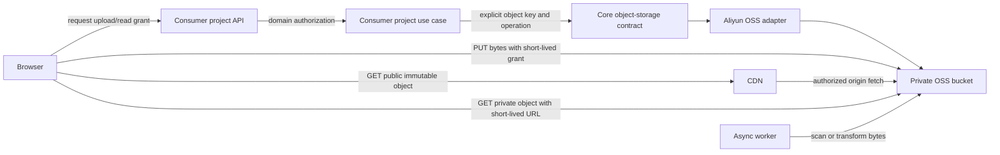

# PRD: 可复用的对象存储与文件直传直取能力

- GitHub Issue: https://github.com/ZataZhang/zata-codes-template/issues/59

> ✅ **交付前置**：无，可立即开工。
> 结构化声明见 §8 Delivery Dependencies，**那里是唯一事实源**。

> ⏸️ **验收状态**：验证阻塞 — 真实 OSS/CDN 验证受隔离环境配置阻塞，未验证条目保持未勾选；原因与后续任务见 Final Reconciliation。
> 本行是 §9 Acceptance Checklist 的投影，**那里是唯一事实源**。

本文先供人确认行为解读与范围，再供执行者按仓库架构落地。Part A 不要求读者理解实现细节。

## Feature Overview (功能一览)

以下内容是 §10 Functional Requirements 的简明投影；行为验收以 §1 的行为样例为准。

- **授权后浏览器直传**（FR-1、FR-2）：上传凭证短时、限操作和对象范围；文件字节直接到对象存储。
- **公开资源走 CDN**（FR-3、FR-4）：页面直接请求 CDN 地址，缓存策略与对象版本相配。
- **私有资源直取**（FR-5）：业务授权通过后发放短时读取地址；未经授权不产生地址。
- **后端保留控制权**（FR-1、FR-5、FR-6）：后端执行业务授权并保存对象引用，不在同步 API 中接收或转发普通文件正文。
- **项目按需启用**（FR-7、FR-8）：模板提供仅初始化时使用的能力目录；项目选择后才复制所需代码，不增加常驻运行时包。
- **保留异步处理路径**（FR-6）：扫描、转换等必须处理文件字节的任务可由后台工作进程直接访问对象存储。
- **按需配置密钥**（FR-9）：未启用对象存储时模板仍可正常启动，服务端密钥不进入浏览器代码。

# Part A · 人审层 (Review Layer)

## 1. Introduction & Goals

### Problem Statement

模板没有应用层通用对象存储能力或文件传输约定。当前可搜索到的文件上传能力服务于隔离沙箱；S3 相关代码属于数据库备份运维工具。派生项目需要自行决定上传授权、文件字节传输、公开缓存和私有访问方式，容易让应用服务器成为文件中转站，增加公网带宽、服务器负载和每次页面访问的链路长度。

前序 FreshAI 博客排查引出了这项复用需求。本 PRD 的目标是把“文件由对象存储保存、浏览器直传直取、后端只管授权和业务状态”的流程沉淀到模板，供不同项目按需启用；它不把能力限定为博客专用。

### Interpretation (解读回显)

#### 行为样例

| 验证方式 | 输入 / 操作 | 期望观察到的结果 |
|---|---|---|
| 🤖 自动验证 | 已登录用户请求上传一个符合项目规则的图片 | 应用返回短时上传授权和对象引用所需信息；浏览器把图片字节直接发给 OSS，应用 API 响应中没有文件正文 |
| 🤖 自动验证 | 页面加载公开图片 | 浏览器从配置的 CDN 地址取得对象；图片正文不经过后端 API 或 Next.js 代理；响应带有与对象版本相符的缓存策略 |
| 🤖 自动验证 | 项目更新一张已有公开图片 | 新内容使用新的对象版本或键；已有长期缓存对象不会因同 URL 覆盖而继续显示旧内容 |
| 🤖 自动验证 | 用户请求无权读取的私有文件 | 应用拒绝请求且不返回读取签名；授权用户获得短时读取地址后，从对象存储直接读取文件 |
| 🤖 自动验证 | 客户端重用已过期的上传或读取地址 | 对象存储拒绝请求；客户端必须重新通过应用授权后才能取得新地址 |
| 🤖 自动验证 | 文件需要病毒扫描、转码或缩略图处理 | 普通 API 请求不等待文件字节中转；后台工作进程从对象存储读取输入并写回处理结果 |

表中仍有效的行为行将成为验收 oracle；修改某行也会同步改变对应验收标准。

#### 我默默定了这些

- 首个对象存储适配器面向阿里云 OSS；接口为后续真实出现的 provider 留出替换点，但不建设多云插件注册系统。
- 公开静态资源经配置的 CDN 域名交付；私有资源首版通过短时 OSS 签名地址直取，不默认实现私有 CDN URL 签名。
- 业务授权、对象与业务记录的关系、上传完成后的状态转换仍归消费项目；模板能力只负责对象存储操作与签名。
- 模板能力目录中的 Skill 只在模板仓库按路径调用；组件源代码仅在消费项目明确选择时复制进去，不进入全局 Skill，也不成为项目运行时依赖。

#### 我理解为不做

- 不在本次 PRD 中迁移 FreshAI 的历史图片或改动 FreshAI 仓库。
- 不提供通用文件管理页面、通用文件表或跨项目元数据服务。
- 不自动创建 OSS Bucket、CDN 域名、RAM 权限或生产环境凭据。

我将此需求理解为：为派生项目提供一套可选的文件传输能力。业务应用验证“谁能传、谁能读”并签发短时授权；普通上传和读取的数据字节直接在浏览器与 OSS/CDN 之间传输。公开对象通过 CDN 地址和可缓存的对象版本交付；私有对象须经业务授权后取得短时读取地址。同步 API 不读取、缓存或转发普通对象正文。需要扫描或转换的任务由后台工作进程直接访问对象存储。每个项目仍自行定义 API、业务记录和访问规则。

- [ ] 我确认这段解读与行为样例准确表达了我的需求。

### What The User Gets

项目维护者可以在初始化或扩展项目时选择文件存储能力，避免把普通图片、文档和静态资源的字节流量压在应用服务器上。终端用户仍从原有业务页面上传和查看文件；公开资源可利用浏览器与 CDN 缓存，私有资源继续按项目权限规则保护。

### Measurable Objectives

- 对一次成功上传，浏览器网络记录显示上传正文发往 OSS；应用 API 只返回短时授权和业务所需元数据。
- 对公开资源，实际对象正文从 CDN 返回；后端响应中不含对象正文，且重复页面加载遵守已配置的浏览器/CDN缓存头。
- 对私有资源，未授权读取不返回签名地址；授权地址过期后不能继续读取。
- 模板启动时不需要 OSS 凭据；未启用能力的派生项目不会新增存储依赖。
- 模板 Skill 安装器、本机 Skill 同步与 just copy 产物均不包含项目能力目录；显式调用后才把所选组件代码加入目标项目。

## 2. Human Review Map (介入与风险地图)

本次没有需要你额外选择的技术方案。项目专用 Skill 的位置与“不得经由 just 安装、不得默认复制到新项目”已按前面对话确认；公开 CDN、私有 OSS 签名读取、项目自管业务授权也已作为本 PRD 的默认范围。如果这些默认行为不符合预期，请先编辑 §1 并调整行为样例，再勾选该节确认框。

**自动门禁，不需要逐项人工审阅：** 执行者验证模板分发边界、分层依赖、签名权限、OSS/CDN 真实传输路径、缓存头与过期行为，并按 §9 提供证据。

**本次明确不涉及：** 没有模板 UI、前端页面、数据库结构或 FreshAI 生产配置变更；不部署云资源或迁移既有文件。

## 3. Usage And Impact After Implementation

### 项目终端用户

在消费项目的现有页面选择文件后，页面先向该项目 API 请求上传授权，再把字节直接上传到 OSS。查看公开图片时页面直接使用 CDN 地址。用户的登录、业务页面和权限提示由消费项目继续提供。

### 内容管理员与业务 API 调用方

管理员仍在项目既有的内容管理或业务页面创建、编辑、发布资源。项目 API 负责检查管理员权限，记录对象键和业务关系；API 响应不承载完整文件正文。项目可按自身流程把草稿对象转为公开对象。

### 项目运维人员

在项目环境中配置 OSS 区域、Bucket、服务端凭据、CDN 域名及 Bucket CORS/cache 规则。密钥留在服务端环境；无需调整文件请求的应用层反向代理来承载大文件字节。

### 项目开发者 / 集成人

在模板仓库通过显式路径读取项目能力 Skill。选用该能力后，将组件源代码复制到目标项目，再由目标项目补上领域授权、业务记录和页面入口。Skill 本身不会安装到全局目录，也不会进入生成项目。

### 现有行为与兼容性

模板现有路由、数据库、登录流程和两个前端应用不因本 PRD 改变。派生项目选择加入组件前不新增 OSS 依赖。选择加入后，原有上传/下载 API 仅在该项目主动迁移对应业务入口时变化；普通 API 返回值继续按项目定义的业务契约处理。

## 4. Requirement Shape

- **Actor：** 消费项目的终端用户和管理员、项目 API 调用方、项目运维人员，以及维护/初始化派生项目的开发者。
- **Trigger：** 用户上传文件、页面展示或下载对象，或者后台任务需要扫描/转换对象。
- **Expected behavior：** 应用授权并产生短时、限操作的存储地址；浏览器直接与 OSS/CDN 交换对象字节；项目保存自身业务记录；同步 API 不作为普通文件字节代理。
- **Scope boundary：** 提供可选的 OSS 存储适配和项目初始化指引；不创建通用文件领域、业务端点、迁移或 UI。公开对象走 CDN；私有对象走短时 OSS 签名读取。异步工作进程可直接读写对象。

# Part B · 执行器层 (Build Layer)

## 5. Repository Context And Architecture Fit

### 当前实现与扩展边界

- src/backend/core/shared/interfaces/ 当前没有应用对象存储端口；src/backend/infrastructure/ 当前没有 OSS 对象存储实现。
- 沙箱 provider 的 upload_files 只向代码执行沙箱上传输入文件，不能作为用户文件存储抽象复用。
- 仓库归档中的 extract-ops-toolkit 将 S3 数据备份迁出为运维工具；它处理数据库备份与恢复，不应被应用 API 用作文件存储层。
- 后端遵循 api → core → engines → infrastructure 向内依赖，src/backend/composition/ 是依赖装配入口。本能力应由 core 端口描述对象操作，由 infrastructure 适配 OSS，再由 composition 按配置装配。
- 本仓库没有业务文件域，因此不新增通用 File ORM、Alembic migration 或通用上传/下载 API。项目根据自己的实体、用户角色和授权规则接入能力。
- **No frontend impact：** frontend-admin/（Vite + React + TypeScript；开发入口 pnpm dev；浏览器测试 pnpm test）和 frontend-public/（Next.js + TypeScript；开发入口 pnpm dev；当前 package.json 没有 UI/e2e test script，提供 pnpm typecheck/build）均无产品页面、路由或 API 客户端改动。消费项目从自己的真实页面请求授权并直接使用 URL；仓库内验证使用 Playwright 集成夹具，不改变模板前端。
- just copy 会排除根级 skills/，但未来的 project-capabilities/ 不在现有排除项中；模板 Skill 安装器只从根级 skills/ 扫描。为保证 Skill 和组件源不泄漏到派生项目，需要同步调整 copy 与 template-sync 的排除规则。
- scripts/shared/template/sync_template.sh 默认跳过 src/backend/，所以派生项目不会自动收到后端组件更新。符合一次性集成模型：新项目按需复制组件，已存在项目需要显式再次调用 Skill 或手工回迁。
- tasks/pending/ 中现有的多组织在线 Agent PRD 与本需求无关，可以独立执行。tasks/archive/ 中没有对象存储或 CDN 应用交付 PRD；唯一 S3 相关归档是运维备份工具，边界不同。

### 前端、原型与数据模型

- No frontend impact；无产品界面或交互改动，因此不制作 UI 原型。Playwright 页面只用于验证浏览器跨域传输，不作为产品页面。
- No data model changes in this PRD.

### 复用与依赖

- 能力包采用可复制的模块源文件，不发布运行时 Python 包，不引入新的应用服务。
- OSS SDK 仅在项目选择组件时加入消费项目依赖；模板默认启动不读取 OSS 配置，也不要求密钥。
- Bucket/CDN/域名和 RAM 凭据由实际部署项目提供。配置名和非密钥默认值沿用项目配置规范；密钥由环境变量注入，不提交真实值。
- 本任务无上游 PRD 依赖；不复用备份工具实现作为应用对象存储客户端。

## 6. Recommendation

### Recommended Approach

在模板仓库增加一个**模板专用项目能力 Skill**和首个“对象存储直传直取”能力包。Skill 放在根级 project-capabilities/，不放进 skills/，因此不会进入 just sync-local-skills 或 scripts/sync_template.sh --local-skills 的安装候选。模板生成和同步都显式排除该目录；执行者只在需要时从模板工作区按路径读取它。

能力包保存可复制的后端对象存储端口、阿里云 OSS 适配器、配置片段、集成说明和最小验证夹具。Skill 识别目标项目架构，按需将所选文件复制到目标项目，并指导该项目实现自己的 API、授权、ORM 关系和前端调用。复制到目标项目的是组件代码，不包含 Skill 本身，也不增加项目对外部公共运行时包的依赖。

组件只负责低层对象操作与临时授权。它不猜测用户权限、不生成业务实体、不决定对象是否公开，也不接受普通业务 API 的文件正文。项目业务用例负责授权与对象键策略；后台任务可以直接使用对象存储端口处理字节。公开对象 URL 由 CDN 域名与对象键构成；私有对象只返回短时 OSS 签名 URL。对象键采用不可变版本或唯一值，上传时带上项目选择的 Content-Type 与缓存元数据。

该方案保留现有四层边界，并让能力被明确选择后才进入项目。相比运行时共享包，它没有跨项目版本耦合；相比通用文件服务，它不预设所有项目共用一套业务数据模型或权限规则。

### Proposed Solution Summary (实现机制)

- **核心机制：** 可复制的 ObjectStorage 核心契约 + 阿里云 OSS 基础设施实现，能签发受限、短期上传/读取授权并检查对象元数据；上传使用 OSS PostObject policy 限制精确对象键、Content-Type、大小与过期时间；对象正文流量始终由浏览器与 OSS/CDN 直连。
- **声明由谁提供：** 消费项目的业务用例显式提供经过授权的对象键、用途、允许的内容类型/大小和所需过期时间。能力不从用户输入推断对象权限、不自行生成业务归属。
- **接入边界：** 项目自己的 API 用例经 core 契约调用 adapter；composition 负责注入 provider。项目自己的前端从现有页面调用上传授权 API，随后直接 POST 表单到 OSS，或把公开 CDN URL 交给浏览器加载。
- **状态与结果：** 项目数据库仍保存自己的对象键和业务关系；签名 URL 只短时存在于响应中。公开静态资源可由 CDN 和浏览器缓存；无权限或签名过期时对象读取失败。
- **刻意避免的复杂度：** 不建通用文件表、统一文件 CRUD API、独立微服务、自动项目注入器、多云 registry、私有 CDN 签名、历史文件迁移或云资源 IaC。

### Alternatives Considered

| 方案 | 结论 | 原因 |
|---|---|---|
| 普通 API 收文件并转发 OSS，再从 API/Next 返回文件 | 拒绝 | 文件字节走两段公网链路，消耗应用出口带宽和请求并发资源；与直传直取目标冲突 |
| 发布统一 Python 运行时库供所有项目依赖 | 拒绝 | 项目只需在初始化/集成时引入一次；版本发布、依赖升级和兼容承诺超出当前收益 |
| 通用文件表、文件管理 API 和通用管理 UI | 拒绝 | 模板没有共享业务域；所有权、草稿/发布状态、删除策略和授权模型由各项目决定 |
| 首版建设多云 provider registry | 拒绝 | 当前唯一已知 provider 是 Aliyun OSS；先定义可替换端口，等第二个真实 provider 出现再比较抽象需求 |

## 7. Implementation Guide

This section is a living implementation guide based on current repository analysis. If implementation discovers additional affected files, hidden dependencies, edge cases, or a better path, update this PRD before proceeding.

### Core Logic

1. 项目专用 Skill 收到目标项目路径后，先检查其后端分层、配置/密钥约定、前端实际页面、已有对象存储和授权逻辑。
2. 若未选用文件存储能力，只给出目录使用指引，不修改目标项目。若用户选择能力，则按 overlay 复制后端契约、OSS adapter、最小配置模板和项目文档。
3. 消费项目的业务 API 验证当前身份、业务归属、文件类型/大小和操作权限，再调用 storage port 请求短时上传凭证。服务端长效 OSS 凭据只在服务端。
4. 浏览器将上传正文直接发给 OSS。应用端只接收完成确认和业务元数据；由 adapter 执行 HEAD 等元数据检查，不把文件正文回传。
5. 公开读取使用 CDN 地址。上传对象的 Cache-Control 与对象键版本策略一起设置，避免同 URL 覆盖带来的陈旧缓存。
6. 私有读取先由项目 API 执行权限判断，再返回短时 OSS 读取地址。无权限时不生成地址；过期后必须重新授权。
7. 如需扫描、OCR、转码、缩略图或复制，后台工作进程通过 storage port/OSS 客户端处理对象；同步请求只负责状态和任务调度。

### Change Impact Tree

```text
.
├── project-capabilities/
│   └── SKILL.md [新增]
│       【总结】提供仅在模板工作区显式调用的项目能力目录入口，并链接到独立能力说明。
│   └── components/object-storage-delivery/README.md [新增]
│       【总结】说明直传直取边界、OSS/CDN 配置、缓存、安全与消费项目接入步骤。
│   └── components/object-storage-delivery/config.toml.example、.env.example [新增]
│       【总结】提供关闭状态的配置样例与仅供启用后注入的空密钥变量。
│   └── components/object-storage-delivery/overlay/src/backend/core/shared/interfaces/object_storage.py [新增]
│       【总结】定义不依赖 SDK 的上传授权、读取授权和对象元数据契约。
│   └── components/object-storage-delivery/overlay/src/backend/infrastructure/config/object_storage_settings.py [新增]
│       【总结】读取可选非密钥配置并从服务端环境变量加载密钥。
│   └── components/object-storage-delivery/overlay/src/backend/infrastructure/storage/aliyun_oss.py [新增]
│       【总结】用 HTTPS 服务端 OSS 凭据签发受限短时授权、查询元数据并流式处理对象。
│   └── components/object-storage-delivery/overlay/src/backend/composition/object_storage_wiring.py [新增]
│       【总结】将配置与 OSS adapter 装配为项目依赖。
│   └── components/object-storage-delivery/overlay/docs/guides/file-storage-delivery.md [新增]
│       【总结】记录项目侧授权、对象键、CORS、CDN、缓存和后台处理边界。
│
├── justfile [修改]
│   【总结】确保 just copy 排除模板专用能力目录，并新增真实对象存储 e2e 入口。
│
├── scripts/shared/template/sync_template.sh [修改]
│   【总结】在普通同步、--all 与 Skill 安装路径中排除模板专用能力目录。
│
├── tests/guards/test_project_capabilities_distribution.py [新增]
│   【总结】守住项目能力包不进入 Skill 安装候选或派生项目副本。
├── tests/fixtures/object_storage_consumer/ [新增]
│   【总结】提供仅供验证的消费项目 API/页面装配，不作为模板产品路由。
├── tasks/evidence/P1-FEAT-20261107-093048-reusable-file-storage-delivery/scripts/ [本地证据脚本，不进入代码变更集]
│   【总结】驱动独立消费项目和 Playwright 真实浏览器完成 OSS/CDN 行为验证。
│
├── docs/guides/project-capabilities.md [新增]
│   【总结】说明模板能力目录的维护和显式调用方式。
├── docs/ai-standards/index.md [修改]
│   【总结】补充项目能力目录的路由说明和仅模板维护期可见的边界。
├── tests/guards/test_project_capabilities_distribution.py [新增]
│   【总结】守住项目能力目录不进入 just copy 或本机 Skill 安装。
├── tests/guards/shared/test_sync_template_skips_project_capabilities.py [新增]
│   【总结】守住共享 template-sync 的分发排除规则。
├── tests/guards/README.md [修改]
│   【总结】登记新增分发守卫测试。
└── mkdocs.yml [修改]
    【总结】登记模板能力维护指南。
```

### Risk Classification Register

| Change point | Tier | Decisive dimension / override | Intervention | Oracle / gate |
|---|---|---|---|---|
| OSS 上传/读取签名与权限边界 | R2 | 跨越后端授权、签名 SDK、对象存储和浏览器数据路径；错误可导致未授权读写或传输重新经过应用 | Executor + independent verifier | rv-1、rv-3 |
| 公开 CDN 与对象缓存策略 | R2 | 缓存错误可能暴露受限对象或让用户持续读取旧对象 | Executor + independent verifier | rv-2 |
| 能力目录分发排除规则 | R1 | 影响模板生成物和本机 Skill 安装候选，范围可由静态检查区分 | Executor + automated gate | distribution guard |
| 项目能力 Skill 与维护说明 | R0 | 模板维护流程文档，不改变运行时契约 | Executor + automated gate | docs/build checks |

### Executor Drift Guard

实施前再次检查以下边界，避免当前模板发生变化后按旧 PRD 加错路径：

- rg -n 'upload_files|ObjectStorage|object.storage|presign|signed.url' src/backend tests，确认沙箱上传接口未被误当作对象存储契约，且没有新出现的共享 adapter。
- rg -n 'sync-local-skills|LOCAL_SKILLS_MODE|project-capabilities|--exclude=.*/skills' justfile scripts/shared/template/sync_template.sh，确认 copy/sync/skill 安装扫描路径。
- 查看 src/backend/composition/ 当前装配方式和 src/backend/infrastructure/config/settings.py 的可选/密钥配置方式。
- 复查 tasks/pending/ 和最近归档 PRD；若已出现同一对象存储能力，更新或关联现有 PRD，不重复新增服务。

### Flow / Architecture Diagram



### No data model changes in this PRD

The component stores no generic file row. A consuming project persists object keys and business relationships in its existing domain model.

### Realistic Validation Plan

```yaml
- id: rv-1
  behavior: "A consumer project's browser uploads a permitted file directly to OSS after its API authorizes the operation."
  reviewer: verifier
  real_entry: "just test-object-storage-e2e"
  expected: "The browser network record shows the upload request going to the configured OSS host; the API ticket response contains no file body; a fresh OSS client reads back bytes with the same SHA-256."
  mock_boundary: "The API route, application authorization, OSS signer, actual OSS test bucket, and browser PostObject request are real. Use an isolated object prefix and test identity. Do not mock the signer, object store, or browser request."
  tier: R2
  test_layer: e2e
  required_for_acceptance: true
  critical_value_source: "The upload authorization response produced by the running consumer project's API."
  must_cross: "Playwright consumer page -> live API authorization route -> core use case -> OSS PostObject policy signer -> browser POST to OSS -> fresh OSS SDK HEAD/GET."
  forbidden_bypasses: "No direct SDK upload from the test, mocked signer/object store, API body upload, or backend file proxy."
  fresh_state_probe: "Create a new OSS client after browser upload and GET the exact returned object key; compare SHA-256 with the browser fixture bytes."
  final_tree_evidence: "Save Playwright network evidence and fresh OSS GET digest under tasks/evidence/P1-FEAT-20261107-093048-reusable-file-storage-delivery/; rerun after any change to the contract, signer, route fixture, test page, or OSS configuration."
  negative_control: "Using the real OSS test bucket, submit the valid upload form with a file exceeding its signed content-length-range; OSS must reject it before a valid in-range upload is attempted."
  expected_fail: "The oversized direct OSS POST returns a non-success status and the fresh OSS client cannot find the rejected key; the positive in-range upload then succeeds."
- id: rv-2
  behavior: "A public object is delivered directly from the configured CDN and repeat reads follow the object's cache policy."
  reviewer: human
  real_entry: "just test-object-storage-e2e"
  expected: "The browser GET host is the configured CDN domain, the body digest matches OSS, and response cache headers match the selected immutable object policy."
  mock_boundary: "The configured CDN hostname and OSS origin are real for the isolated test object. Do not mock CDN resolution, origin fetch, response headers, or browser GET."
  tier: R2
  test_layer: smoke
  required_for_acceptance: true
  presentation: "tasks/evidence/P1-FEAT-20261107-093048-reusable-file-storage-delivery/rv-2-cdn-image.png; open the screenshot alongside rv-2-network.txt to confirm the image is visible and the request host is the configured CDN."
  critical_value_source: "The public delivery URL and Cache-Control metadata returned by the consumer project's running app and OSS/CDN."
  must_cross: "Consumer page -> project API URL metadata -> browser GET to CDN -> CDN origin fetch from private OSS -> independent digest/header probe."
  forbidden_bypasses: "No direct OSS GET used as a substitute for the CDN request; no reconstructed URL, mocked CDN response, or backend response containing object bytes."
  fresh_state_probe: "In a new browser context, load the same immutable URL and record the CDN response status, cache headers, and object digest."
  final_tree_evidence: "Save the browser network record and response metadata under tasks/evidence/P1-FEAT-20261107-093048-reusable-file-storage-delivery/; rerun after any change to URL construction, cache metadata, CDN configuration, or object-key policy."
  negative_control: "Upload a separate isolated public object through the real OSS path with Cache-Control set to no-store, then run the same CDN cache-policy assertion against that object."
  expected_fail: "The real CDN GET returns the intentionally mismatched cache policy and the oracle rejects it; the correctly configured immutable object then satisfies the cache assertion."
- id: rv-3
  behavior: "Private files are readable only after project authorization, and the issued read URL stops working after expiry."
  reviewer: verifier
  real_entry: "just test-object-storage-e2e"
  expected: "An unauthorized request returns the project's denial result without a signed URL; an authorized short-lived URL reads from OSS directly and fails after expiry."
  mock_boundary: "Use the real project API, OSS signer, isolated private OSS test object, and HTTP client. Seed only the test identity and business relationship; do not mock signer or OSS."
  tier: R2
  test_layer: e2e
  required_for_acceptance: true
  critical_value_source: "The signed read URL and expiry supplied by the running consumer project's API."
  must_cross: "Unauthorized API request -> denial; authorized API request -> core domain check -> OSS signer -> direct object GET -> wait past expiry -> fresh direct GET."
  forbidden_bypasses: "No endpoint that streams bytes, no private CDN URL, no reconstructed signature, and no test-only production authorization bypass."
  fresh_state_probe: "Use a new HTTP client after the expiry boundary to GET the same signed URL; assert OSS rejects it."
  final_tree_evidence: "Save API results, redacted URL host/expiry evidence, and direct OSS response under tasks/evidence/P1-FEAT-20261107-093048-reusable-file-storage-delivery/; rerun after any change to authorization, signing, or expiry handling."
  negative_control: "Use the fixture's unauthorized identity and, after the authorization case, repeat the exact signed GET with a fresh HTTP client after expiry."
  expected_fail: "The unauthorized API returns denial without a URL and the expired direct OSS GET returns 403; only the authorized, unexpired URL returns the object."
```

执行前先检查测试环境是否配置了隔离 OSS Bucket、CDN 域名和服务端测试凭据；缺少时停止真实集成验证并登记 Validation blocker，不得用 mock 冒充 OSS/CDN 已验证。负向对照使用测试边界的未授权身份与已过期签名，不改生产代码来制造失败。

### External Validation

| Topic | Source | Checked On | Relevant Finding | Impact On Recommendation |
|---|---|---|---|---|
| OSS 浏览器直传与临时授权 | [Alibaba Cloud: Upload files to OSS directly from clients](https://help.aliyun.com/en/oss/user-guide/uploading-objects-to-oss-directly-from-clients/) | 2026-11-07 | 浏览器可由服务端签发临时授权后直接向 OSS 上传；应用服务器不必中转文件字节；Bucket 需要匹配的 CORS 规则。 | 采用后端授权、浏览器直传的控制面/数据面分离；目标项目必须按实际来源域配置 CORS。 |
| OSS PostObject policy 限制与签名 | [Alibaba Cloud: PostObject](https://help.aliyun.com/en/oss/developer-reference/postobject), [POST V1 signature](https://help.aliyun.com/en/oss/developer-reference/signature-version-1) | 2026-11-13 | PostObject 接受 bucket、key、content-type、cache-control、success status、content-length-range 等 policy 条件；文件字段需最后提交；官方说明单次表单上传上限为 5 GB，V1 签名为 `base64(hmac-sha1(secret, base64(policy)))`。 | 采用 OSS policy 绑定精确键、类型、缓存头、大小与过期时间；服务端签发 POST 表单，浏览器直接向 bucket host 提交。 |
| OSS CORS 与公开资源读取 | [Alibaba Cloud: Configure CORS rules](https://help.aliyun.com/en/oss/user-guide/configure-cross-origin-resource-sharing) | 2026-11-07 | CORS 必须匹配页面 Origin、HTTP 方法和请求头；公开静态读取通常使用 GET/HEAD；可暴露 ETag、Content-Length。 | 能力说明包含最小化来源/方法设置，并用响应头验证缓存与上传结果。 |
| 私有 OSS 配合 CDN 回源 | [Alibaba Cloud: Allow only attached CDN-accelerated domain names to access OSS resources](https://help.aliyun.com/en/oss/allow-only-cdn-accelerated-domain-names-to-access-oss-resources) | 2026-11-07 | 可将 Bucket 设为私有，并授权绑定的 CDN 域名回源；非 CDN 直接访问仍需签名。 | 公开对象可以用私有 Bucket + CDN 回源；此 PRD 的私有对象仍走 OSS 短时签名 URL。 |
| OSS S3 兼容模式 | [Alibaba Cloud: Accessing OSS with AWS SDKs](https://help.aliyun.com/en/oss/developer-reference/use-aws-sdks-to-access-oss) | 2026-11-07 | OSS 提供 S3 兼容端点，但相关认证模式和协议行为需要按官方文档配置确认。 | 首个 adapter 采用 OSS 官方 SDK/签名语义；不为本次能力强行启用兼容模式，也不先建设多云注册系统。 |

### Prototype

No frontend product prototype is required: this PRD changes no template screen, route, or user interaction. The browser page used by rv-1–rv-3 is a test fixture and is not a product prototype. No interactive prototype file changes in this PRD.

## 8. Delivery Dependencies

### Delivery Dependencies

- Depends on tasks/issues:
  - none
- Gate type: none
- Sequence: via-main
- Notes: The pending multi-organization online-agent PRD is unrelated; this work can proceed independently.

## 9. Acceptance Checklist

### 9.1 人读呈递区（Human Review Surface）

本 PRD 没有模板产品界面改动，但公开图片的实际呈现是用户可感知结果。最终交付需呈递来自真实浏览器验证入口的截图，并同时给出网络请求与缓存观察。

| 人要确认的结果 | 呈递入口 | 约 10 秒自查 |
|---|---|---|
| 集成页显示从 CDN 加载的公开图片；刷新时对象遵守配置的缓存策略 | tasks/evidence/P1-FEAT-20261107-093048-reusable-file-storage-delivery/rv-2-cdn-image.png 与 rv-2-network.txt；运行 open tasks/evidence/P1-FEAT-20261107-093048-reusable-file-storage-delivery/rv-2-cdn-image.png 查看截图；在 PR 中内嵌截图和网络摘要 | 图片可见；网络记录中的请求 host 等于配置的 CDN 域名，第二次加载命中浏览器或 CDN 缓存 |

reviewer: verifier 的后端授权、OSS 上传、私有签名/过期拒绝、copy/sync 排除、Skill 安装扫描、静态检查和测试命令结果由执行者与 verifier 审查，不重复列入人读呈递区。

### 9.2 Acceptance Evidence Package

#### Human-Confirmed

- [ ] §9.1 的交付摘要与网络证据清楚呈现最终边界：OSS/CDN 承载普通文件字节，后端只负责项目授权和元数据；本次没有模板 UI 变化。

#### Architecture Acceptance

- [x] 能力 overlay 只定义 core 对象存储契约与 infrastructure OSS adapter；just lint --full / 架构检查通过，没有 api/core 反向导入 infrastructure。
- [x] 消费项目负责业务授权、对象键/业务关系和端点；能力包没有通用 File ORM、Alembic migration 或默认业务路由。

#### Distribution Acceptance

- [x] just copy 输出不含根级 project-capabilities/，且目标 justfile 中也没有能力目录；./scripts/sync_template.sh --list-all 不列出该目录。
- [ ] just sync-local-skills 的候选扫描只发现根级 skills/ 下的 Skills；project-capabilities/ 不在任何本机 agent Skill 目录。
- [x] 可通过模板仓库内明确路径读取 project-capabilities/SKILL.md，并按选择只复制对象存储 overlay；其他能力未选时目标项目没有对应依赖或文件。

#### Behavior Acceptance

- [ ] OSS 上传授权只作用于显式对象键、操作、内容类型/大小约束和过期时间；长效 OSS 凭据不会出现在 API 响应或前端代码。
- [ ] 普通同步 API 不接收/返回对象正文；上传确认只查询对象元数据和保存项目自有引用。
- [ ] 公开对象键采用版本化或唯一策略，上传缓存元数据与组件接入指南中的 CDN/浏览器缓存规则一致。
- [ ] 私有对象必须由消费项目先授权；签名 URL 过期后真实 OSS 请求失败。
- [ ] 异步扫描/转换可使用 adapter 读取和写入对象，普通 API 请求不等待文件字节经过服务端。

#### Documentation Acceptance

- [x] project-capabilities/SKILL.md 指向单独的对象存储组件说明；新增能力有独立文档模块，没有把所有未来组件细节塞进一个大文件。
- [x] docs/guides/project-capabilities.md、组件接入指南与 mkdocs.yml 导航一致，并明确 Skill 不进入派生项目和本机安装目录。
- [ ] OSS 权限、CORS、CDN 回源、缓存头、公开/私有对象策略、密钥注入和异步处理说明可由目标项目维护者按需执行。

#### Validation Acceptance

- [ ] just test-object-storage-e2e 通过 rv-1 至 rv-3；证据包含浏览器到 OSS/CDN 的实际请求、真实授权响应、独立 OSS GET/HEAD 或过期拒绝结果。
- [x] just test、uv run python hooks/shared/check_architecture.py 与 just lint --full 通过；新增 guard 确认能力目录不参与 just Skill 安装和模板分发。
- [ ] 最终证据记录关联最终代码树；任一签名、路由 fixture、对象键、缓存或分发规则变更后，重跑受影响 oracle。

#### Delivery Readiness

- [ ] 完整 PR 证据呈递了 §9.1 摘要和真实网络观察；若没有 PR，完成消息内联呈递同样内容，不只列证据文件路径。

## 10. Functional Requirements

- **FR-1:** 提供 provider 独立的 core 对象存储契约，并在首个能力包中提供 Aliyun OSS adapter，用于申请限时上传/读取授权和读取对象元数据。
- **FR-2:** 上传授权必须绑定项目明确提供的对象键与允许的操作；支持的内容类型/大小与过期限制由 adapter/OSS 的实际授权机制共同强制，不能仅由浏览器提示或前端校验。
- **FR-3:** 普通浏览器上传必须直接向 OSS 发送文件正文；消费项目 API 只负责授权、完成确认与业务元数据，不得收/发普通文件正文。
- **FR-4:** 公开对象通过配置的 CDN 域名直取；对象缓存策略与唯一/版本化对象键一致，避免同一长期缓存 URL 被原地覆盖。
- **FR-5:** 私有对象读取前由消费项目执行领域授权，之后仅给出短时 OSS 读取地址；未经授权不得产生该地址，过期地址不能访问对象。
- **FR-6:** 对象扫描、转换、OCR、缩略图等服务端处理通过后台工作进程直接访问 OSS；普通同步 API 不作为文件代理。
- **FR-7:** 项目能力 Skill 与组件包保留在模板仓库专用目录，不参与 just sync-local-skills / scripts/sync_template.sh --local-skills 安装，不由 just copy 或 template-sync 分发。
- **FR-8:** Skill 能按需把选定能力包复制到目标项目，并指导开发者将 provider 接入该项目现有 composition/config/API/前端入口；目标项目不依赖该 Skill 运行。
- **FR-9:** OSS 未配置时模板和未启用该能力的项目仍能正常启动；密钥只由服务端环境注入，不写入代码、前端 bundle 或默认配置值。

## 11. Non-Goals

- FreshAI 博客代码修改、对象上传和历史内容迁移、生产 Bucket/CDN 创建、域名备案、DNS/证书设置及部署。
- 通用文件实体、文件管理/选择 UI、项目无关的上传/下载 API、权限模型或跨项目元数据服务。
- 多云 adapter/自动 provider discovery、全局运行时包发布、私有 CDN URL 签名和 CDN 缓存授权策略。
- 强制将每个项目的现有静态资源移动到 OSS；项目选择组件后自行规划迁移。
- 把模型调用、沙箱文件拷贝或数据库备份代码重写为对象存储能力。

## 12. Risks And Follow-Ups

| 风险 | 处理 |
|---|---|
| 签名 URL 是 bearer capability，泄露后任何持有者可在过期前使用 | 只签名单个随机/版本化对象键和单一操作；短过期；不写日志明文，不存数据库，不暴露服务端密钥 |
| 浏览器直传受 Bucket CORS、请求头、区域域名影响 | 组件文档给出来源域/方法/headers 的最小配置；真实浏览器 smoke 验证预检和请求 |
| 私有对象被配置成公开缓存，或 CDN 缓存了错误权限响应 | OSS Bucket 默认私有；CDN 仅回源公开对象路径；私有对象首版不走共享 CDN |
| 长缓存与可变对象键产生陈旧图像 | 对象名带版本/随机唯一键；每次替换对象生成新 URL；不依赖覆盖后立即 purge |
| OSS/CDN 测试配置或凭据不可用 | RV 真实集成不以 mock 替代；缺少隔离 Bucket、CDN 测试域名或凭据时记录 Validation blocker 和后续补测任务，不能宣称端到端通过 |
| 现有派生项目不会因模板同步自动获得后端能力 | Skill 明确说明按需复制/再次应用；不声称 just sync-template 会更新现有 src/backend |
| 仓库全量测试中一个既有并发用例失败 | `just test all` 的 `test_admin_api_rejects_disabling_the_last_enabled_platform_admin` 复跑仍观察到两个并发请求均返回 200；本次未改该无关路径。单独跟进，不将该结果描述为对象存储测试失败 |

## 13. Decision Log

| ID | 决策问题 | Chosen | Rejected | Rationale |
|---|---|---|---|---|
| D-01 | 文件正文的常规传输路径 | 浏览器直连 OSS/CDN；应用后端负责业务授权和元数据 | API/Next 同步代理普通文件正文 | 代理会让文件字节重复经过应用出口并占用 API worker；直连让对象服务承载数据面 |
| D-02 | 能力如何复用到派生项目 | 模板内可选源代码 overlay，由项目初始化 Skill 按需复制；无运行时包 | 发布/安装一个所有项目共享的 Python runtime package | 用户已确认该 Skill 只在项目初始化阶段按路径使用；复制代码即可让应用独立运行并避免包版本维护 |
| D-03 | 首版存储 provider 与抽象规模 | 阿里云 OSS adapter + 最小可替换 core 契约 | 首版多云 adapter 和 provider registry | 当前唯一确认的对象存储平台是 Aliyun OSS；先支持真实需求，第二个 provider 出现后再扩展 |
| D-04 | 业务元数据和通用文件 API | 由各消费项目维护；模板不创建通用文件表或 CRUD API | 模板统一接管文件记录、所有权、发布与授权 | 模板没有业务域，且不同项目的实体关系与权限规则不一致 |
| D-05 | 私有文件首版读取交付 | 项目授权后发短时 OSS 读取 URL；CDN 用于公开对象 | 首版为私有 CDN 实现签名访问与共享缓存 | 当前明确的性能目标是公开静态资源；私有 CDN 需要额外签名与缓存策略，先避免扩大范围 |
| D-06 | 能力目录是否可安装/复制 | project-capabilities/ 只在模板仓库按路径读取；能力文件不自动安装或复制 | 放进根级 skills/ 或默认随 just copy 进入所有项目 | 用户明确要求该 Skill 只用于项目初始化，不进入全局 Skill 或每个生成项目 |
| D-07 | OSS 服务端 endpoint 传输 | 只接受不带 URL 凭据、path、query 或 fragment 的 HTTPS authority | 同时接受 HTTP 或任意 OSS URL | 上传授权和读取签名是 bearer capability，服务端连接必须加密且 endpoint 结构明确 |

### Final Reconciliation

- Interpretation: confirmed — 模板提供按需复制的 OSS 能力；消费项目继续拥有业务授权、对象与业务记录关系及上传完成状态，普通文件正文由浏览器直接传到 OSS/CDN。模板前端没有产品界面改动。
- Public behavior and contracts: corrected — 上传授权采用绑定对象键、Content-Type、Cache-Control、大小范围和过期时间的 OSS PostObject policy，因此浏览器通过 `FormData` POST；OSS endpoint 必须是 HTTPS。授权字段仍由 API 显式返回，但 bearer 字段不进入 grant 对象的自动 `repr`。这些实现差异已在前文与 Change Log 记录。
- Related PRD status: confirmed — §8 依赖仍为 none；待办中的多组织在线 Agent PRD 与本能力无执行顺序依赖，也未发现重复对象存储 PRD。
- Requirements and risks: confirmed — FR-1 至 FR-9 均仍由 Feature Overview 覆盖；未配置时不启用 adapter，未选择组件的项目不增加 OSS SDK。`just test`、架构检查、`just lint --reuse` 与 `just lint --full` 已通过；`just test all` 另有上述现存 admin 并发测试失败。本次没有修改该测试或生产路径。
- Reconciled differences:
  - 将初始的签名 PUT 方案改为 OSS PostObject policy，以由 OSS 强制限制文件大小和类型；已更新 Proposed Solution、rv-1 oracle 与 Change Log。
  - 增加 HTTPS endpoint 校验并避免 grant 自动表示泄露 bearer 值；已记录在 D-07 与 Change Log。
  - 真实消费者 fixture 和 Playwright 脚本位于验证夹具/evidence scripts，脚本不进入模板变更集；模板产品前端仍无变化。
- Validation blocker: rv-1、rv-2、rv-3 的真实入口均在安全预检处以 exit 3 停止。缺少隔离 OSS endpoint、region、Bucket、测试凭据和 `OBJECT_STORAGE_E2E_ALLOW_WRITES=1`；rv-2 还缺少 CDN base URL。没有发出 OSS/CDN 请求，也没有执行负向对照；`evidence.json` 与各自 `rv-<n>-*.txt` 仅记录了这个阻塞，不能证明真实传输行为。
- Validation follow-up: GitHub Issue #59 继续作为跟踪项。隔离环境负责人需设置 `OBJECT_STORAGE_E2E_ENDPOINT`、`OBJECT_STORAGE_E2E_REGION`、`OBJECT_STORAGE_E2E_BUCKET`、`OBJECT_STORAGE_E2E_ACCESS_KEY_ID`、`OBJECT_STORAGE_E2E_ACCESS_KEY_SECRET`、`OBJECT_STORAGE_E2E_CDN_BASE_URL`（rv-2）与 `OBJECT_STORAGE_E2E_ALLOW_WRITES=1`，Bucket 保持私有并为浏览器 Origin 配置最小 CORS、CDN 只回源公开路径；随后按顺序运行 `just test-object-storage-e2e rv-1`、`rv-2`、`rv-3`，每项先执行其真实负向对照，再记录修复后的通过证据。本机仅有 S3 协议的 MinIO（`localhost:9000`），其 POST policy 字段与 Aliyun OSS 不兼容，不能替代这些 oracle。另将 `just test all` 中既有的 admin 并发测试失败独立调查，不将其误报为本功能已通过。

## Change Log

### Initial draft
- Type: scope
- Before: No PRD.
- After: Defined an optional, template-only object-storage direct-transfer capability and project initialization Skill.
- Reason: Convert the FreshAI blog storage discussion into a reusable project-level workflow.
- Impact: Defines backend transfer boundaries, project-specific ownership, template-only capability distribution, and real OSS/CDN acceptance evidence.
- Review: Pending user review of §1 interpretation.

### Bind upload size and type in OSS policy
- Type: implementation
- Before: The implementation guide described direct browser upload, while examples and validation mechanics used a signed PUT URL without defining how OSS enforces an upload-size limit.
- After: The OSS adapter issues a short-lived PostObject policy bound to an exact key, Content-Type, size range, cache metadata, and expiry; the browser still sends bytes directly to OSS.
- Reason: OSS POST policy is the storage-side mechanism that can enforce both the exact object scope and content-length range for direct browser uploads.
- Impact: The browser upload request uses multipart/form-data POST instead of PUT. Data-transfer boundaries, project-owned authorization, permitted file behavior, and the no-proxy requirement remain the same. rv-1 now checks an oversized negative control before a valid upload.
- Review: Pending user review; this is a stronger storage-side enforcement mechanism and does not broaden scope.

### Require HTTPS for OSS endpoints
- Type: security
- Before: The adapter accepted HTTP or HTTPS endpoints, so a consumer configuration could send signed requests over an unencrypted connection.
- After: The adapter rejects OSS endpoints that are not HTTPS or that contain URL credentials, paths, query strings, or fragments.
- Reason: Upload policies and signed reads are bearer capabilities; the service connection carrying them must be encrypted.
- Impact: Consumers must configure a standard HTTPS OSS endpoint. This does not change the browser-to-OSS transfer flow.
- Review: Pending user review; this tightens transport security without changing supported OSS behavior.

### Hide bearer grants from object representations
- Type: security
- Before: Grant dataclass representations included the short-lived POST signature fields and private read URL, making accidental object logging leak bearer capabilities.
- After: Upload form fields and private read URLs are omitted from dataclass ``repr`` output.
- Reason: These values grant direct object access until expiry and should not appear in routine object diagnostics.
- Impact: Consumers still receive the same grant fields through explicit attributes and API responses; only automatic representations omit them.
- Review: Pending user review; this reduces accidental log exposure without changing the public grant contract.

### Record validation blocker and final implementation reconciliation
- Type: validation
- Before: The PRD status was `⬜ 未开工`, and the implementation changes to upload policy, endpoint validation, and bearer-grant representations were not reconciled in a final record.
- After: The implementation scope and public behavior are reconciled; the status is `⏸️ 验证阻塞` because all three realistic validations stopped before network access when isolated OSS/CDN configuration was absent. All unproven acceptance items remain unchecked.
- Reason: Preserve the actual validation result and provide a tracked resume path without representing blocked external behavior as passing.
- Impact: Issue #59 remains open for real rv-1 through rv-3 runs after isolated test resources are configured. The independent `just test all` concurrency failure is recorded separately from the passing `just test` tier.
- Review: Pending runner review; no human-confirmed item or unproven acceptance item was checked.

### Align the documented PostObject size cap
- Type: documentation
- Before: The component README described the maximum as 5 GiB, while the adapter deliberately caps it at 5,000,000,000 bytes.
- After: The README now states the adapter byte cap and distinguishes it from OSS's documented 5 GB service limit.
- Reason: Keep the project's enforceable limit clear and avoid implying the adapter accepts the full binary GiB size.
- Impact: Documentation only; upload policy behavior is unchanged.
- Review: Pending runner review.

### Verify OSS PostObject policy semantics
- Type: external validation
- Before: The implementation selected PostObject for storage-enforced size and type limits, with live OSS validation still blocked.
- After: Official OSS documentation confirms policy conditions for key, content type, cache control, size range, expiration, the final file field, and the 5 GB form-upload limit; the documented V1 signature formula matches the adapter.
- Reason: Confirm protocol semantics from the provider's primary documentation.
- Impact: No code or acceptance scope change; the source and check date are recorded in External Validation.
- Review: Pending runner review; live OSS behavior remains unverified.

### Keep the distribution guard out of derived projects
- Type: implementation
- Before: `tests/guards/test_project_capabilities_distribution.py` was copied by `just copy` and could also appear in the `sync_template.sh --all` candidate list, although it asserts the presence of template-only `project-capabilities/` and of the copy-recipe exclusion line.
- After: The guard is excluded from `just copy` and from the sync candidate list, matching the existing template-internal guard (`test_prd_skill_checker.py`).
- Reason: A derived project has neither `project-capabilities/` nor the copy recipe, so the copied guard failed there; a real `just copy` run exposed the failure.
- Impact: Template distribution only. The guard still runs in the template repository, and no runtime behavior or acceptance oracle changes.
- Review: Pending runner review; verified by a real `just copy` run whose generated project passes the guard suite except for one pre-existing, unrelated `test_local_core_tier_budget` failure.

### Record the recovery re-run result
- Type: validation
- Before: The validation blocker recorded the first blocked run but not the runner's re-execution of the three commands on the delivered commit.
- After: The record now states that `just test-object-storage-e2e rv-1`/`rv-2`/`rv-3` were re-run on commit `6a3a315` and still exit 3 before any OSS/CDN request, and lists the exact environment variables and Bucket/CDN prerequisites a human must provide. The local MinIO instance is explicitly rejected as a substitute because its S3 POST policy is incompatible with Aliyun OSS signing.
- Reason: The runner's evidence gate re-executes commands; recording the exact environment gap and the resources needed keeps the blocked state auditable and avoids treating a provider-incompatible local store as proof.
- Impact: No code, contract, or validation scope change. rv-1 through rv-3 remain unproven and unchecked.
- Review: Pending runner review; no acceptance item was checked by this entry.
