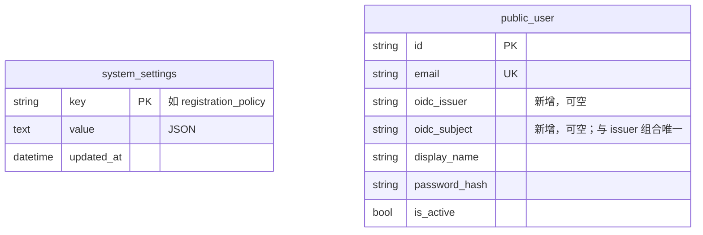
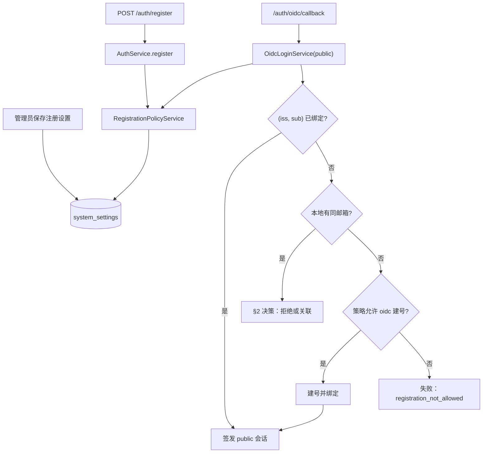

# PRD: 注册策略与普通用户企业账号（OIDC）登录

> ✅ **交付前置**：本次分支已先行交付 `P1-SECURITY-20261112-134527-admin-oidc-sign-in` 并完成当前任务；外部分支的合并依赖仍以 §8 为准。
> 结构化声明见 §8 Delivery Dependencies，**那里是唯一事实源**。

> 🧍 **验收状态**：待人工验收。
> 本行是 §9 Acceptance Checklist 的投影，**那里是唯一事实源**。

> 本 PRD 分为 Part A 人审层和 Part B 执行器层。Part A 用于确认目标行为和关键取舍；Part B 记录实现路径与验证证据。

## Feature Overview (功能一览)

> 本块是 §10 Functional Requirements 的简明投影；行为验收以 §1 行为样例为准。

- **管理员可在后台设置注册策略**（FR-1、FR-2、FR-3）：选择“密码和企业账号都可注册 / 仅企业账号可注册 / 关闭注册”，并可限定允许的邮箱域名；保存后立即生效，无需重启。
- **一份策略管所有注册入口**（FR-4、FR-7）：密码注册与企业账号自动建号都按同一份策略判断，前台注册页在关闭时直接提示不开放。
- **前台多一个“企业账号登录”入口**（FR-5、FR-8）：配置好身份中心后，前台登录页出现该按钮；登录后进入应用。
- **企业账号登录如何对应本地用户**（FR-6）：已绑定的按身份中心稳定账号 ID 识别；新邮箱按策略自动建号；邮箱已被密码账号占用时的处理见 §2 决策。
- **默认行为不变**（FR-2、FR-9）：未改策略时等同现在“开放密码注册、不限域名”；未配置身份中心时没有企业账号按钮。
- **不做**（§11）：手机号注册、邮箱验证码、应用内绑定 / 改绑、身份中心侧退出。

# Part A · 人审层 (Review Layer)

## 1. Introduction & Goals

### Problem Statement

模板的 public 域注册开关是写死的：`build_auth_components` 里普通用户的 `allow_registration=True`，部署者无法关闭注册或限制只允许公司邮箱。同时前台没有企业账号登录入口，派生项目要接统一身份中心（zata-ops 的 Keycloak）只能参考 FreshAI 自己搬。FreshAI 的注册策略（渠道 + 邮箱域名白名单，管理端可改）已经验证可用，但它依赖手机号与邮箱验证码，模板都没有，不能原样照搬。

另一个仓库可观察的事实影响本 PRD 的安全设计：模板的密码注册**不验证邮箱归属**（`AuthService.register` 只检查格式和是否占用）。因此“邮箱域名白名单”对密码注册只限制填写的地址，并不证明注册人拥有该邮箱。

### Interpretation (解读回显)

**行为样例**

| 验证方式 | 输入 / 操作 | 期望观察到的结果 |
|---|---|---|
| 👀 人审 + 自动验证 | 管理员在“注册设置”页把模式改为“仅企业账号可注册”、白名单填 `example.com` 并保存 | 页面显示保存成功；刷新后仍是该设置；前台注册页显示“当前仅支持企业账号注册”，不再显示密码注册表单 |
| 👀 人审 + 自动验证 | 前台用身份中心已验证邮箱 `new@example.com`（本地无此用户）点“企业账号登录” | 自动创建本地用户并登录，进入 `/app/dashboard` |
| 🤖 自动验证 | 同样操作，但邮箱是 `x@other.com` | 不建号、不登录，回到登录页显示通用失败提示；日志记 `reason=registration_not_allowed` |
| 🤖 自动验证 | 模式为“密码和企业账号都可注册”、白名单 `example.com`，有人用密码注册 `y@other.com` | 注册被拒绝，提示该邮箱域名不允许注册 |
| 🤖 自动验证 | 已绑定的普通用户被管理员禁用后用企业账号登录 | 拒绝；日志记 `reason=user_inactive` |
| 🤖 自动验证 | 本地已有用密码注册、未绑定的 `old@example.com`，身份中心已验证同一邮箱的用户用企业账号登录 | 拒绝自动关联，提示该邮箱已注册、请用密码登录；日志记 `reason=user_account_conflict`；原账号凭据与数据不变 |
| 🤖 自动验证 | 未改过注册策略的新部署（策略记录不存在） | 行为等同现在：密码注册开放、不限域名 |
| 🤖 自动验证 | 策略表读取失败、策略 JSON 损坏或字段无效时提交密码注册，或用尚无本地账号的 OIDC 身份尝试自动建号 | fail closed：密码注册明确返回策略不可用；OIDC 不建号、不签会话并记录 `reason=registration_policy_unavailable`。已绑定用户的既有 OIDC 登录仍可继续，不依赖新用户注册策略 |

以上行为样例将原样转入 §7.6 验收 oracle；修改某一格就是修改验收标准。

**我默默定了这些**

- 策略三种模式：`both`（默认，等同现状）、`oidc_only`、`closed`；白名单为空表示不限域名。模式取代 FreshAI 的 `email_only / phone_only`（模板没有手机号）。
- 白名单同时作用于密码注册和企业账号建号；管理端页面注明“对密码注册只校验填写的地址，不验证邮箱归属”。
- 策略存在新建的通用 `system_settings` 表（键值，值为 JSON），本 PRD 只使用 `registration_policy` 一个键；仅确认该键无记录时用默认值。数据库读取失败、JSON 解码失败或已存策略无效时 fail closed 并明确返回策略不可用，不得悄悄回落为开放注册。
- 前台新增公开接口只返回注册模式（不返回白名单），用于注册页显示状态。
- 企业账号建号的显示名取 ID Token 的 `name`，没有则取邮箱 `@` 前部分；密码字段写入不可用的随机哈希，这类用户只能用企业账号登录。
- 企业账号登录成功跳转 `/app/dashboard`；失败跳 `/login?sso_error=1`。
- 回调地址：`https://<前台域名>/api/auth/oidc/callback`；配置项 `USER_OIDC_ENABLED / ISSUER / CLIENT_ID / CLIENT_SECRET / CALLBACK_URI`（与 FreshAI 同名）；`ENABLED` 默认 `true`，是否可用再看连接参数是否齐全（用户 2026-11-12 确认默认开启）。
- 注册设置页放在管理端侧边栏“用户”下方，路由 `/registration`。
- 本地开发种子用户（`APP_BOOTSTRAP_EMAIL`）不受注册策略限制。

**我理解为不做**

- 手机号注册 / 登录、邮箱验证码、密码注册的邮箱归属验证。
- 已登录用户在应用内“绑定企业账号”或解绑；身份中心侧退出、切换账号。
- 按身份中心角色或组授予前台权限。

**解读**：本 PRD 读作“把注册是否开放、对谁开放做成管理员可改的一份策略，并让密码注册与企业账号自动建号都服从它；同时给 public 域加一条默认开启但配置不全即不可用的企业账号登录路径”，而不是“把普通用户账号交给身份中心管理”。普通用户仍由模板本地管理（启用 / 禁用、业务归属）；身份中心只负责确认“这是谁”。企业账号路径复用前一份 PRD 的同一套登录服务，只额外注入“是否可建号”的策略判断。

- [ ] 我确认这段解读与行为样例准确表达了我的需求。

### What The User Gets

- **管理员**：后台“注册设置”页，一处控制前台能否注册、能否只用企业账号注册、允许哪些邮箱域名，保存即生效。
- **前台用户**：登录页多一个“企业账号登录”，用公司统一账号登录，首次登录自动开户（在策略允许时）；注册页会明确告诉用户当前是否开放注册。
- **部署者**：不改任何配置时行为与现在一致；填 `USER_OIDC_*` 即开启企业账号登录。

### Measurable Objectives

- 行为样例 7 行全部由自动测试覆盖并通过。
- 真实浏览器中：管理员改策略后，前台注册页状态随之变化；前台经身份中心替身完成企业账号登录并进入应用。
- 策略为 `closed` 时，`POST /auth/register` 与企业账号建号都被拒绝（同一组测试中验证）。
- 现有 `tests/backend/test_auth_domains.py` 中的注册用例在默认策略下不改动即通过。

## 2. Human Review Map (介入与风险地图)

### 邮箱已被密码账号占用时，企业账号登录怎么办

这是本 PRD 最需要你拍板的一点。FreshAI 的做法是“身份中心邮箱已验证且本地有同邮箱账号，就自动关联”，在 FreshAI 里安全，是因为它的本地邮箱都经过验证码确认。模板的密码注册不验证邮箱，于是存在**账号抢注接管**的风险：攻击者先用受害人的公司邮箱注册一个密码账号（模板不会拦），受害人之后用企业账号登录时被自动关联到这个账号 —— 攻击者手里的密码仍然有效，双方共用同一账号，受害人放进去的数据攻击者都能看到。

建议：**不自动关联**。本地已有同邮箱、未绑定的账号时拒绝企业账号登录，提示“该邮箱已注册，请使用密码登录”，原账号不受影响。代价是：先用密码注册、后想改用企业账号的老用户暂时无法切换（应用内绑定入口不在本 PRD 范围，可后续单独做）。新部署若希望全员走企业账号，把注册模式设为“仅企业账号可注册”即可从源头避免冲突。

备选：自动关联，同时把原账号密码作废（改为不可用的随机哈希）。能堵住“攻击者继续用密码登录”，但模板会话按 token 存储、没有“按用户踢下线”的能力，攻击者已有的会话仍会存活到过期（最长 60 天）；补这个能力需要改动会话存储，范围明显变大。

**请确认：** 本地已存在同邮箱的未绑定账号时，企业账号登录如何处理？

- [ ] 拒绝自动关联，提示用密码登录（推荐）
- [ ] 自动关联并作废原密码（需另外接受“已有会话不会立即失效”的风险）

**验收：** 预先用密码注册 `old@example.com`，再用同邮箱的企业账号登录：推荐方案下登录被拒、原账号数据和密码不变；备选方案下登录成功、原密码登录失败。

### 注册策略的形态与存储

建议策略为“三种模式 + 邮箱域名白名单”，存在新建的通用 `system_settings` 键值表，由管理员在后台修改、立即生效（你已在对话中选择了“管理端可改”）。默认值等同现状。主要风险：白名单对密码注册只校验填写的地址；需要真正限制公司员工时，应选“仅企业账号可注册”。



**请确认：** 采用 `both / oidc_only / closed` 三种模式 + 域名白名单，新增 `system_settings` 表并给 `public_user` 加外部身份两列，是否同意？

- [ ] 同意（推荐）

**验收：** 迁移可升可降；三种模式分别对密码注册和企业账号建号做组合测试，结果与模式定义一致；管理员保存后无需重启，下一次注册请求即按新策略判断。

### 谁能读写注册策略

建议读写接口只对已登录管理员开放（admin 会话），前台公开接口只返回注册模式，不暴露白名单内容，避免把公司邮箱域名清单公开给任何访客。

**请确认：** 白名单只对管理员可见，前台只能得知“是否开放 / 仅企业账号”，是否同意？

- [ ] 同意（推荐）

**验收：** 未登录或 public 会话访问策略读写接口返回 401；公开状态接口响应中不含域名字段。

**自动门禁，不需要逐项人工审阅**：OIDC 协议校验与一次性事务（复用前一份 PRD 已验收的部件）、建号显示名与随机密码、策略输入校验（域名格式、去重、小写）、前台按钮与提示、中英文文案，均由后端测试、前端单测与 Playwright 用例把关。

**本次明确不涉及**：管理员 OIDC（前一份 PRD）、手机号、计费、批量数据操作。

## 3. Usage And Impact After Implementation

**管理员**：后台侧边栏“用户”下方新增“注册设置”。页面有一组单选（密码和企业账号都可注册 / 仅企业账号可注册 / 关闭注册）和一个邮箱域名输入框（每行一个，可留空）。保存后显示成功；格式不合法的域名会在保存时提示具体哪一项。

**前台用户**：
- 登录页：开启企业账号登录后，表单下方出现“企业账号登录”。点击 → 身份中心登录 → 回到 `/app/dashboard`。首次登录在策略允许时自动开户；不允许或邮箱已被密码账号占用时，回到登录页看到通用失败提示（邮箱已占用时提示用密码登录）。
- 注册页：模式为“仅企业账号可注册”时显示提示和“企业账号登录”按钮，不显示密码表单；“关闭注册”时显示“当前未开放注册”。邮箱域名不在白名单时，提交后提示该域名不允许注册。
- 已有用户：密码登录不受影响。

**部署者 / 运维**：在身份中心为前台登记 confidential Client（回调 `https://<前台域名>/api/auth/oidc/callback`），设置身份中心连接四项后重启（`USER_OIDC_ENABLED` 默认开启）；`GET /api/auth/oidc/status` 返回 `{"enabled": true}` 即生效。注册策略无需配置文件，在后台修改。缺少策略记录时沿用默认开放策略；策略存储读取或解码错误时，管理端和注册入口明确报告不可用且不允许新注册。

**派生项目开发者**：拉取更新后迁移自动执行；`AuthService` 构造参数由 `allow_registration: bool` 改为注入注册策略读取端口，自定义装配需同步修改（发布说明中注明）。

**兼容性**：默认策略为 `both` + 不限域名，与现状一致；`public_user` 新增两列可空；未配置 `USER_OIDC_*` 时无企业账号入口。

## 4. Requirement Shape

- **actor**：管理员；前台用户；部署者 / 运维；派生项目开发者。
- **trigger**：管理员保存注册设置；前台用户提交注册、点击企业账号登录；身份中心回调。
- **expected behavior**：每次注册（密码或企业账号）都实时读取同一份策略判断；企业账号登录按“已绑定 → 识别；未绑定 → 按策略建号或按 §2 决策处理同邮箱账号”签发现有 public 会话。
- **explicit scope boundary**：只覆盖 public 域注册与登录；不验证密码注册邮箱归属、不做应用内绑定。

# Part B · 执行器层 (Build Layer)

## 5. Repository Context And Architecture Fit

- **现有最近路径**：`src/backend/core/auth/service.py` 的 `AuthService.register`（读 `_allow_registration`）；`src/backend/composition/auth_wiring.py` 的 `build_auth_components`（public `allow_registration=True`、admin `False`）；`src/backend/api/auth_router.py`（`/auth/register|login|logout|me`）；`src/backend/api/admin/admin_user_router.py`（admin 会话保护的管理接口范例）；前一份 PRD 交付的 `src/backend/core/auth/oidc_login.py`、`packages/oidc-client/`（公开导入 `zata_oidc`）、`src/backend/infrastructure/auth/redis_oidc_transaction_store.py`、`src/backend/api/admin/admin_auth_router.py`。
- **参考实现**：FreshAI `src/backend/core/shared/registration_policy.py`（`normalize_email_domain`、`RegistrationPolicy`）、`src/backend/core/use_cases/system_settings/system_setting_service.py`、`src/backend/api/system_settings.py`（registration-policy 端点）、`frontend-admin/src/features/settings/registration/index.tsx`、`src/backend/core/use_cases/authenticate_user_oidc.py`（建号与冲突分类）。
- **架构约束**：同前一份 PRD；`system_settings` 端口放 `core/shared/interfaces/`，实现放 `infrastructure/persistence/`。
- **前端影响**：
  - `frontend-admin/`：新增 `src/routes/_authenticated/registration/index.tsx`、`src/features/registration/index.tsx`、`src/api/registration-policy.ts`；侧边栏 `src/components/layout/data/sidebar-data.ts` 在 `/users` 后加一项；`src/locales/{zh,en}.json`。
  - `frontend-public/`（Next.js）：`app/(auth)/login/login-form.tsx` 加按钮与失败提示；`app/(auth)/register/page.tsx` 按注册模式切换展示；`lib/api/auth.ts` 加 status 与注册模式请求；相应 i18n 文案（`rg -n "loginFailed" frontend-public` 定位文案文件）。
- **相关 PRD**：
  - `tasks/archive/P1-SECURITY-20261112-134527-admin-oidc-sign-in.md`：硬依赖（见 §8）。
  - `tasks/pending/P1-FEAT-20260928-115856-multi-organization-online-agent-base.md`：也改 `core/auth/` 与管理端路由，无顺序依赖，合并时注意冲突。
  - `tasks/archive/P1-FEAT-20260625-182322-dual-auth-domain-separation.md`：双域与注册仅限 public 的原始设计。

> **独立包边界（本次对话确认）**：上游管理员 OIDC PRD 同时交付 backend 外的 `packages/oidc-client/` 独立协议包（分发名 `zata-oidc`，公开导入 `zata_oidc`）。本 PRD 复用该包公开接口及应用内 `OidcLoginService`，不另建协议客户端或同名协议契约；账户匹配/绑定/建号、注册策略、组织权限、Redis 事务、会话、路由、UI 和迁移属于宿主 backend，均不迁入独立包。该包由上游 PRD 一并交付，无新增跨仓库交付前置；本 PRD 无须发布远程包。

## 6. Recommendation

**Recommended Approach**：

1. 移植 FreshAI 的 `RegistrationPolicy` 值对象与域名规范化，把渠道模式改为 `both / oidc_only / closed`。
2. 新增最小的 `system_settings` 键值存储与 `RegistrationPolicyService`（get / update），供 admin API 与认证编排共用。
3. `AuthService` 用注入的 `RegistrationPolicyProvider | None` 取代 `allow_registration: bool`（admin 域传 None 表示不开放注册）；`register` 每次实时读取策略。
4. 前一份 PRD 的 `OidcLoginService` 增加可选的建号能力（注入同一策略读取端口 + 密码哈希器）；装配一个 public 实例，挂载 `/auth/oidc/*`。

**为什么合适**：策略只有一份、在 core 层判断，两个注册入口不会各写一套规则；OIDC 登录完全复用前一份 PRD 的安全部件，只多一个注入点。

**拒绝的冗余抽象**：不做 FreshAI 的大而全 `SystemSettingService`（它承载模型默认值等无关设置）；不做策略缓存（注册是低频操作，实时读库即可保证“保存即生效”）；不新增独立的“企业账号绑定表”。

### Proposed Solution Summary (实现机制)

- 机制：注册前读取 `system_settings['registration_policy']` → `RegistrationPolicy`，按渠道（password / oidc）与邮箱域名判断；OIDC 登录沿用授权码 + PKCE 与一次性 Redis 事务。
- 输入由谁提供：策略由管理员在后台显式填写；系统不推断。身份中心连接参数由部署者通过 `USER_OIDC_*` 提供。
- 接入点：`AuthService.register`、`OidcLoginService` 的账号解析；admin API `/admin/settings/registration-policy`；公开 `/auth/registration-status`；`/auth/oidc/status|start|callback`。
- 状态变化：新增 `system_settings` 表；`public_user` 增加 `oidc_issuer`、`oidc_subject`。
- 刻意避免：手机号、邮箱验证码、会话按用户吊销、策略缓存。

**Alternatives Considered**：策略用环境变量配置 —— 改动更小但需重启，用户已选择管理端可改，拒绝。专用单行 `registration_policy` 表 —— 与通用键值表成本相当，但后续每个系统级设置都要新建表，选择通用表。

## 7. Implementation Guide

> This section is a living implementation guide based on current repository analysis. If implementation discovers additional affected files, hidden dependencies, edge cases, or a better path, update this PRD before proceeding.

### 7.1 Core Logic

**策略判断**（`RegistrationPolicy`）：
- `allows(channel, email)`：`closed` → 否；`oidc_only` 且 channel=password → 否；白名单非空且邮箱域名（小写、IDNA）不在其中 → 否；否则是。
- 确认数据库中无 `registration_policy` 记录 → 默认 `both` + 空白名单；读取异常、JSON 解码异常、记录字段无效 → 不得回落默认，返回 `RegistrationPolicyUnavailable`，并记录不含敏感值的错误类别。写入前校验并规范化域名（移植 `normalize_email_domain`），去重。

**密码注册**：`AuthService.register` 在现有校验之后、查重之前调用 `policy.allows("password", email)`；策略存储或解码失败时让注册接口明确返回 503 `registration_policy_unavailable`，不创建用户；`closed / oidc_only` 返回“当前不开放密码注册”，域名不符返回“该邮箱域名不允许注册”。admin 域 provider 为 None → 维持“当前域不支持注册”。

**企业账号登录账号解析**（public 实例，在前一份 PRD 流程的第 4 步扩展）：
1. 按 `(iss, sub)` 查到 → 要求启用 → 登录（`binding=bound`）。
2. 否则要求 `email_verified=true`（否则 `email_unverified`）。
3. 按邮箱查到本地用户 → 按 §2 决策：推荐方案下失败 `user_account_conflict`；备选方案下条件绑定 + 作废密码。
4. 本地无此邮箱 → 读取注册策略；策略不可用时不建号、不签会话，跳回登录页通用失败并记录 `registration_policy_unavailable`；`policy.allows("oidc", email)` 否 → `registration_not_allowed`；是 → 创建用户（随机不可用密码哈希、显示名规则见 §1）并写入外部身份，唯一约束冲突按 `identity_conflict` 处理（`binding=created`）。本地已有同邮箱未绑定用户时固定拒绝自动关联，失败类别为 `user_account_conflict`。

admin 实例不注入建号策略，行为与前一份 PRD 完全相同。

### 7.2 Change Impact Tree

```text
.
├── Database / Migration
│   └── alembic/versions/<YYYYMMDD-HHMMSS>-registration_policy_and_user_oidc.py
│       [新增]
│       【总结】新建 system_settings 键值表；public_user 增加可空 oidc_issuer/oidc_subject 与组合唯一约束；可降级。
│
├── Infrastructure
│   ├── src/backend/infrastructure/persistence/models/system_setting.py
│   │   [新增]
│   │   【总结】system_settings ORM：key 主键、value 文本（JSON）、updated_at。
│   ├── src/backend/infrastructure/persistence/repos/system_setting_repo.py
│   │   [新增]
│   │   【总结】按 key 读取 / upsert 设置值。
│   ├── src/backend/infrastructure/persistence/models/public_user.py
│   │   [修改]
│   │   【总结】ORM 增加 oidc_issuer、oidc_subject 与组合唯一约束。
│   ├── src/backend/infrastructure/persistence/repos/user_account_repo.py
│   │   [修改]
│   │   【总结】public 实例启用 email_attr="email"；新增“创建并绑定外部身份”的原子方法（备选方案时还需“绑定并作废密码”）。
│   └── src/backend/infrastructure/config/settings.py
│       [修改]
│       【总结】新增 USER_OIDC_*（[user_oidc] TOML 段），复用前一份 PRD 的 OidcClientSettings 类。
│
├── Domain
│   ├── src/backend/core/auth/registration_policy.py
│   │   [新增]
│   │   【总结】RegistrationPolicy 值对象（both/oidc_only/closed + 域名白名单）与 normalize_email_domain，移植自 FreshAI。
│   ├── src/backend/core/auth/registration_policy_service.py
│   │   [新增]
│   │   【总结】经 SystemSettingRepository 读取 / 更新注册策略；缺记录回落默认值，存储/解码失败返回 RegistrationPolicyUnavailable。
│   ├── src/backend/core/shared/interfaces/system_setting_repository.py
│   │   [新增]
│   │   【总结】get(key) / set(key, value) 端口。
│   ├── src/backend/core/shared/interfaces/registration_policy_provider.py
│   │   [新增]
│   │   【总结】get_registration_policy() 端口，供 AuthService 与 OidcLoginService 注入。
│   ├── src/backend/core/auth/service.py
│   │   [修改]
│   │   【总结】allow_registration: bool 改为 registration_policy_provider: RegistrationPolicyProvider | None，register 按 password 渠道与域名判断。
│   └── src/backend/core/auth/oidc_login.py
│       [修改]
│       【总结】可选注入策略与密码哈希器；未绑定且本地无同邮箱时按 oidc 渠道判断建号；同邮箱按 §2 决策处理。
│
├── Composition
│   ├── src/backend/composition/auth_wiring.py
│   │   [修改]
│   │   【总结】装配 SystemSettingRepository、RegistrationPolicyService；public AuthService 注入策略，admin 传 None；配置完整时装配 public OidcLoginService。
│   └── src/backend/composition/app_factory.py
│       [修改]
│       【总结】挂载 public OIDC 路由与 admin 注册策略路由。
│
├── API
│   ├── src/backend/api/auth_oidc_router.py
│   │   [新增]
│   │   【总结】/auth/oidc/status|start|callback，成功跳 /app/dashboard，失败跳 /login?sso_error=1（邮箱占用时 sso_error=account_exists）。
│   ├── src/backend/api/auth_router.py
│   │   [修改]
│   │   【总结】新增 GET /auth/registration-status，只返回 registration_mode。
│   ├── src/backend/api/admin/registration_policy_router.py
│   │   [新增]
│   │   【总结】GET/PUT /admin/settings/registration-policy，要求 admin 会话，非法域名 422 并指出哪一项。
│   ├── src/backend/api/schemas.py
│   │   [修改]
│   │   【总结】注册策略请求 / 响应与注册状态响应模型。
│   └── src/backend/api/dependencies.py
│       [修改]
│       【总结】新增 public OIDC 服务与注册策略服务依赖。
│
├── Frontend (frontend-admin)
│   ├── frontend-admin/src/api/registration-policy.ts
│   │   [新增]
│   │   【总结】读取 / 保存注册策略的客户端函数与类型。
│   ├── frontend-admin/src/features/registration/index.tsx
│   │   [新增]
│   │   【总结】三选一模式单选 + 域名多行输入 + 保存，展示校验错误；注明白名单对密码注册的局限。
│   ├── frontend-admin/src/routes/_authenticated/registration/index.tsx
│   │   [新增]
│   │   【总结】注册设置路由（routeTree.gen.ts 由工具重新生成）。
│   ├── frontend-admin/src/components/layout/data/sidebar-data.ts
│   │   [修改]
│   │   【总结】在“用户”后增加“注册设置”入口。
│   └── frontend-admin/src/locales/zh.json / en.json
│       [修改]
│       【总结】注册设置页文案。
│
├── Frontend (frontend-public)
│   ├── frontend-public/lib/api/auth.ts
│   │   [修改]
│   │   【总结】新增 getUserOidcStatus()、getRegistrationStatus() 与 OIDC 起始地址常量。
│   ├── frontend-public/app/(auth)/login/login-form.tsx
│   │   [修改]
│   │   【总结】enabled 时显示“企业账号登录”；按 sso_error 显示通用失败或“请用密码登录”提示。
│   ├── frontend-public/app/(auth)/register/page.tsx
│   │   [修改]
│   │   【总结】按注册模式显示密码表单 / 仅企业账号提示 / 未开放提示。
│   └── frontend-public 的 i18n 文案文件（rg -n "loginFailed" frontend-public 定位）
│       [修改]
│       【总结】按钮与提示中英文文案。
│
├── Tests
│   ├── tests/backend/test_registration_policy.py
│   │   [新增]
│   │   【总结】值对象规则、域名规范化、仅缺记录时默认值回落、存储/解码错误 fail closed 与服务读写往返。
│   ├── tests/backend/test_registration_policy_api.py
│   │   [新增]
│   │   【总结】admin 读写、401 鉴权、422 校验、公开状态不含白名单、保存后密码注册即时受控。
│   ├── tests/backend/test_user_oidc_login.py
│   │   [新增]
│   │   【总结】复用 oidc_test_support 覆盖 §1 行为样例中企业账号部分与三种模式组合。
│   ├── tests/backend/test_registration_policy_migration.py
│   │   [新增]
│   │   【总结】迁移升降往返，既有 public 用户保留。
│   ├── tests/backend/test_auth_domains.py
│   │   [修改]
│   │   【总结】仅在构造 AuthService 的测试装配处适配新参数，用例断言不改。
│   └── tests/playwright-e2e/tests/workflows/registration-policy-and-user-oidc.admin.spec.ts
│       [新增]
│       【总结】管理员改策略 → 前台注册页状态变化 → 前台企业账号首登建号进入应用；未配置 USER_OIDC_* 时企业账号部分 skip。
│
└── Docs
    ├── docs/architecture/authentication.md
    │   [修改]
    │   【总结】补充注册策略与普通用户企业账号登录、同邮箱冲突处理。
    ├── docs/guides/configuration.md / .env.example
    │   [修改]
    │   【总结】登记 USER_OIDC_*，说明注册策略在后台修改。
    └── CHANGELOG 或模板发布说明
        [修改]
        【总结】注明 AuthService 构造参数变化。
```

此清单是起点，不保证穷尽，见 7.4。

### 7.3 Risk Classification Register

| change point | tier | decisive dimension/override | intervention | oracle/gate |
|---|---|---|---|---|
| 同邮箱账号处理 | R3 | 安全（账号接管） | 人工确认 + 负向对照 | rv-2 |
| 注册策略判断（两个入口） | R2 | 授权边界；固定区 core | 人工确认 | rv-1、rv-3 |
| `system_settings` 与 `public_user` 迁移 | R2 | 固定区 schema | 人工确认 | rv-4 |
| 策略接口鉴权与白名单不外泄 | R2 | 敏感数据 / 权限 | 人工确认 | rv-3 |
| 企业账号自动建号 | R2 | 持久化 + 授权 | 执行器 + 自动门禁 | rv-1、rv-2 |
| `AuthService` 构造参数变更 | R1 | 局部契约 | 执行器 + 自动门禁 | `just test`（test_auth_domains 不改断言） |
| 前台 / 管理端页面 | R1 | 局部 UI | 执行器 + 自动门禁 | rv-1、rv-5 |

### 7.4 Executor Drift Guard

- `rg -n "allow_registration" src tests` —— 所有旧参数引用必须清零。
- `rg -n "AuthService\(" src tests` —— 所有构造处适配。
- `rg -n "OidcLoginService\(" src tests` —— admin 实例不得注入建号策略。
- `uv run python hooks/check_architecture.py`。

### 7.5 Flow Diagram



### 7.6 Realistic Validation Plan

```yaml
- id: rv-1
  behavior: "管理员改注册策略后前台注册页随之变化；前台企业账号首次登录按策略自动开户并进入应用"
  reviewer: human
  real_entry: "导出 USER_OIDC_* 指向 Playwright 本地身份中心替身后 just e2e tests/workflows/registration-policy-and-user-oidc.admin.spec.ts"
  expected: "保存“仅企业账号可注册 + example.com”后，前台 /register 显示仅企业账号提示且无密码表单；new@example.com 企业账号登录后落在 /app/dashboard，/api/auth/me 返回该用户"
  mock_boundary: "只替换身份中心；管理端页面、admin API、数据库、Redis、Next rewrite、前台页面均为真实"
  tier: R2
  test_layer: e2e
  required_for_acceptance: true
  presentation: "tasks/evidence/P1-FEAT-20261112-134527-registration-policy-and-user-oidc/rv-1-registration-settings.png、rv-1-register-oidc-only.png、rv-1-user-oidc-sign-in.webm；自查：设置页选中“仅企业账号可注册”且域名为 example.com，注册页无密码输入框"
  critical_value_source: "管理端页面实际提交的策略与前台实际渲染的注册页"
  must_cross: "管理端表单 -> /api 代理 -> PUT /admin/settings/registration-policy -> system_settings 提交 -> 前台 /register -> GET /auth/registration-status；前台按钮 -> /auth/oidc/start -> 替身 -> /auth/oidc/callback -> public_user 建号 -> Redis 会话"
  forbidden_bypasses: "直接写 system_settings、直接调用服务对象、手工设置会话 Cookie"
  fresh_state_probe: "新的浏览器上下文打开 /register；新的数据库会话查询 new@example.com 存在且 oidc_subject 非空"
  final_tree_evidence: "最终提交树上重跑；core/auth 或页面改动后重跑"
- id: rv-2
  behavior: "本地已有同邮箱密码账号时按 §2 决策处理，且不能被接管"
  reviewer: verifier
  real_entry: "uv run pytest tests/backend/test_user_oidc_login.py -k existing_email"
  expected: "回调 302 到 /login?sso_error=account_exists、无会话 Cookie、原账号 oidc 列为空且原密码仍可登录；不得自动关联或修改原账号凭据与数据"
  mock_boundary: "身份中心为 ControlledOidcIssuer；应用、路由、服务、仓库、数据库为真实"
  tier: R3
  test_layer: integration
  required_for_acceptance: true
  critical_value_source: "先经 POST /auth/register 真实创建的账号与密码"
  must_cross: "POST /auth/register -> /auth/oidc/start -> /auth/oidc/callback -> 仓库 -> POST /auth/login"
  forbidden_bypasses: "直接插库造账号、直接调用 OidcLoginService"
  fresh_state_probe: "新数据库会话读取该账号 oidc 列与 password_hash 是否变化；新 TestClient 用原密码登录"
  final_tree_evidence: "最终提交树上 just test 通过"
  negative_control: "在 tests/ 下的仓库替身中让“按邮箱查找”恒返回 None，重跑"
  expected_fail: "推荐方案用例中出现新建账号或唯一约束错误，断言失败"
- id: rv-3
  behavior: "策略读写仅管理员可用，公开状态不含白名单，保存后两个注册入口即时受控"
  reviewer: verifier
  real_entry: "uv run pytest tests/backend/test_registration_policy_api.py tests/backend/test_user_oidc_login.py -k policy"
  expected: "无会话 / public 会话读写返回 401；非法域名 422 指出该项；/auth/registration-status 响应键集合仅为 {registration_mode}；缺少策略记录时密码注册按 both + 空白名单运行；数据库读取异常、JSON 损坏或字段无效时，密码注册与公开注册状态接口返回 503 registration_policy_unavailable，OIDC 未绑定建号不创建用户且不签会话、记录同一 reason；策略恢复后正常；三种模式 × 两个渠道 × 白名单内外的组合结果与 §7.1 规则一致"
  mock_boundary: "身份中心为替身；其余真实"
  tier: R2
  test_layer: integration
  required_for_acceptance: true
  critical_value_source: "经 PUT 接口实际保存的策略"
  must_cross: "PUT /admin/settings/registration-policy -> system_settings -> 新请求 POST /auth/register 与 /auth/oidc/callback"
  forbidden_bypasses: "在测试中直接构造 RegistrationPolicy 注入服务"
  fresh_state_probe: "保存后用新 TestClient 发注册请求，并用新数据库会话读取 system_settings"
  final_tree_evidence: "最终提交树上 just test 通过"
  negative_control: "not needed — 组合用例比较具体状态码（201 vs 400 / 登录成功 vs 失败），策略未生效时必然不同"
- id: rv-4
  behavior: "迁移可升可降，既有 public 用户保留"
  reviewer: verifier
  real_entry: "uv run pytest tests/backend/test_registration_policy_migration.py"
  expected: "upgrade 后 system_settings 存在、public_user 两列可空且组合唯一；downgrade 后结构回到上一版本；用户行数与邮箱不变"
  mock_boundary: "真实 Alembic 与测试数据库"
  tier: R2
  test_layer: integration
  required_for_acceptance: true
  critical_value_source: "迁移前插入的 public 用户"
  must_cross: "alembic upgrade head -> downgrade -1 -> upgrade head"
  forbidden_bypasses: "Base.metadata.create_all 代替迁移"
  fresh_state_probe: "每一步后新连接 inspect 并计数"
  final_tree_evidence: "迁移文件最终版本上运行"
  negative_control: "not needed — 表 / 列存在与否为具体值对比"
- id: rv-5
  behavior: "管理端注册设置页的表单校验与保存反馈"
  reviewer: verifier
  real_entry: "cd frontend-admin && pnpm test -- registration"
  expected: "加载显示当前策略；非法域名显示后端返回的错误；保存成功提示"
  mock_boundary: "mock 注册策略 API 客户端"
  tier: R1
  test_layer: unit
  required_for_acceptance: true
```

失败排查：先确认迁移已执行（`system_settings` 表存在）；再查 `USER_OIDC_CALLBACK_URI` 与 Client 回调逐字一致、Next rewrite 把 `/api` 转发到后端；再看日志 `auth.oidc ... portal=public reason=`。e2e 未导出 `USER_OIDC_*` 时企业账号部分 skip，skip 不算通过。

### 7.7 Low-Fidelity Prototype

管理端 `/registration`：

```text
┌ 注册设置 ─────────────────────────────────────┐
│ 注册方式                                       │
│ (•) 密码和企业账号都可注册                     │
│ ( ) 仅企业账号可注册                           │
│ ( ) 关闭注册                                   │
│ 允许的邮箱域名（每行一个，留空表示不限）       │
│ ┌──────────────────────┐                       │
│ │ example.com          │                       │
│ └──────────────────────┘                       │
│ ⓘ 对密码注册只校验填写的地址，不验证邮箱归属；  │
│   需要严格限制时请选择“仅企业账号可注册”。     │
│                               [ 保存 ]         │
└────────────────────────────────────────────────┘
```

前台 `/register` 三态：`both` 显示现有表单（下方加企业账号按钮，若已开启）；`oidc_only` 显示“当前仅支持企业账号注册”+ 按钮；`closed` 显示“当前未开放注册”+ 去登录链接。前台 `/login` 加按钮的形态同前一份 PRD 7.7。

验收对照态：设置页默认态与校验错误态、注册页三态、登录页按钮态。均为简单表单状态，用低保真图作为目标，不新增交互原型文件。

No interactive prototype file changes in this PRD.

### 7.8 External Validation

No external validation required; repository evidence was sufficient. 注册策略移植自 FreshAI（2026-11-12 核对 `~/code/freshai` HEAD `cac961ac` 的 `src/backend/core/shared/registration_policy.py`）。

## 8. Delivery Dependencies

### Delivery Dependencies

- Depends on tasks/issues:
  - P1-SECURITY-20261112-134527-admin-oidc-sign-in
- Gate type: hard
- Sequence: via-main
- Notes: 本次系列在同一分支按依赖顺序完成并归档，尚未合并主线；其他分支仍按 via-main 检查。 复用其 OIDC 协议客户端、一次性事务存储与 OidcLoginService。与 P1-FEAT-20260928-115856-multi-organization-online-agent-base 无顺序依赖。

## 9. Acceptance Checklist

### 9.1 人读呈递区（Human Review Surface）

**主演示脚本**

1. 管理端打开“注册设置”，选“仅企业账号可注册”，域名填 `example.com`，保存成功。
2. 前台打开 `/register`：只显示“当前仅支持企业账号注册”和按钮。
3. 点“企业账号登录”，以 `new@example.com` 在身份中心替身登录（mock 身份中心）：进入 `/app/dashboard`。
4. 以 `x@other.com` 再试：回到登录页显示失败提示。

| 结果 | 呈递物 | 10 秒自查 |
|---|---|---|
| 策略修改与前台联动、企业账号开户登录（rv-1） | `tasks/evidence/P1-FEAT-20261112-134527-registration-policy-and-user-oidc/rv-1-registration-settings.png`、`rv-1-register-oidc-only.png`、`rv-1-user-oidc-sign-in.webm`（交付时内嵌） | 设置页选中第二项且域名为 example.com；注册页无密码输入框；录屏末帧为 `/app/dashboard` |

未在此展示（verifier 负责）：rv-2 同邮箱处理、rv-3 鉴权与组合规则、rv-4 迁移、rv-5 前端单测。

### 交付呈递入口

[统一实现与证据审阅页](../evidence/oidc-series-review/index.html)提供本节同源设计图、真实截图、录屏和逐项人工审阅内容。
本地图像与录屏未进入版本库；在仓库根目录运行 `open tasks/evidence/oidc-series-review/index.html` 即可审阅，无需启动应用。
完整执行结果见[证据报告](../evidence/P1-FEAT-20261112-134527-registration-policy-and-user-oidc/P1-FEAT-20261112-134527-registration-policy-and-user-oidc.evidence-report.md)，独立结论见[验证报告](../evidence/P1-FEAT-20261112-134527-registration-policy-and-user-oidc/P1-FEAT-20261112-134527-registration-policy-and-user-oidc.verifier-report.md)。


本地图片；`open tasks/evidence/P1-FEAT-20261112-134527-registration-policy-and-user-oidc/rv-1-design-intent.png`。


本地图片；`open tasks/evidence/P1-FEAT-20261112-134527-registration-policy-and-user-oidc/rv-1-registration-settings.png`。


本地图片；`open tasks/evidence/P1-FEAT-20261112-134527-registration-policy-and-user-oidc/rv-1-register-oidc-only.png`。


本地图片；`open tasks/evidence/P1-FEAT-20261112-134527-registration-policy-and-user-oidc/rv-1-user-oidc-domain-rejection.png`。

### 9.2 Acceptance Evidence Package

按风险排序：rv-2（R3）→ rv-1、rv-3、rv-4（R2）→ rv-5（R1）。

### Human-Confirmed (来自 Part A 风险地图)

- [ ] 同邮箱密码账号的处理方式符合 §2 所选方案 —— 证据：rv-2 输出
- [ ] 三种模式 + 白名单、`system_settings` 表与 `public_user` 两列符合预期 —— 证据：rv-3、rv-4 输出
- [ ] 白名单仅管理员可见、公开接口只返回模式 —— 证据：rv-3 输出
- [ ] 已查看 9.1 截图与录屏，页面与流程符合预期

### Architecture Acceptance

- [x] `uv run python hooks/check_architecture.py` 通过（证据：[执行报告](../evidence/P1-FEAT-20261112-134527-registration-policy-and-user-oidc/P1-FEAT-20261112-134527-registration-policy-and-user-oidc.evidence-report.md)、[独立 PASS](../evidence/P1-FEAT-20261112-134527-registration-policy-and-user-oidc/P1-FEAT-20261112-134527-registration-policy-and-user-oidc.verifier-report.md)）
- [x] `rg -n "allow_registration" src tests` 无命中（证据：[执行报告](../evidence/P1-FEAT-20261112-134527-registration-policy-and-user-oidc/P1-FEAT-20261112-134527-registration-policy-and-user-oidc.evidence-report.md)、[独立 PASS](../evidence/P1-FEAT-20261112-134527-registration-policy-and-user-oidc/P1-FEAT-20261112-134527-registration-policy-and-user-oidc.verifier-report.md)）

### Behavior Acceptance

- [x] §1 行为样例 7 行均有对应测试且通过（rv-2、rv-3 输出）（证据：[执行报告](../evidence/P1-FEAT-20261112-134527-registration-policy-and-user-oidc/P1-FEAT-20261112-134527-registration-policy-and-user-oidc.evidence-report.md)、[独立 PASS](../evidence/P1-FEAT-20261112-134527-registration-policy-and-user-oidc/P1-FEAT-20261112-134527-registration-policy-and-user-oidc.verifier-report.md)）
- [x] 默认策略下现有注册与登录测试断言未改动即通过（`just test` 输出）（证据：[执行报告](../evidence/P1-FEAT-20261112-134527-registration-policy-and-user-oidc/P1-FEAT-20261112-134527-registration-policy-and-user-oidc.evidence-report.md)、[独立 PASS](../evidence/P1-FEAT-20261112-134527-registration-policy-and-user-oidc/P1-FEAT-20261112-134527-registration-policy-and-user-oidc.verifier-report.md)）

### Frontend Acceptance

- [x] 管理端注册设置页与前台登录 / 注册页符合 7.7 各态（rv-1 截图、rv-5 输出）（证据：[执行报告](../evidence/P1-FEAT-20261112-134527-registration-policy-and-user-oidc/P1-FEAT-20261112-134527-registration-policy-and-user-oidc.evidence-report.md)、[独立 PASS](../evidence/P1-FEAT-20261112-134527-registration-policy-and-user-oidc/P1-FEAT-20261112-134527-registration-policy-and-user-oidc.verifier-report.md)）
- [x] `cd frontend-admin && pnpm build` 与 `cd frontend-public && pnpm build` 通过（证据：[执行报告](../evidence/P1-FEAT-20261112-134527-registration-policy-and-user-oidc/P1-FEAT-20261112-134527-registration-policy-and-user-oidc.evidence-report.md)、[独立 PASS](../evidence/P1-FEAT-20261112-134527-registration-policy-and-user-oidc/P1-FEAT-20261112-134527-registration-policy-and-user-oidc.verifier-report.md)）

### Documentation Acceptance

- [x] `docs/architecture/authentication.md`、`docs/guides/configuration.md`、`.env.example` 已更新；`AuthService` 参数变化写入发布说明（证据：[执行报告](../evidence/P1-FEAT-20261112-134527-registration-policy-and-user-oidc/P1-FEAT-20261112-134527-registration-policy-and-user-oidc.evidence-report.md)、[独立 PASS](../evidence/P1-FEAT-20261112-134527-registration-policy-and-user-oidc/P1-FEAT-20261112-134527-registration-policy-and-user-oidc.verifier-report.md)）
- [x] `uv run mkdocs build --strict` 通过（证据：[执行报告](../evidence/P1-FEAT-20261112-134527-registration-policy-and-user-oidc/P1-FEAT-20261112-134527-registration-policy-and-user-oidc.evidence-report.md)、[独立 PASS](../evidence/P1-FEAT-20261112-134527-registration-policy-and-user-oidc/P1-FEAT-20261112-134527-registration-policy-and-user-oidc.verifier-report.md)）

### Validation Acceptance

- [x] rv-1 真实浏览器 e2e 在配置替身后实际运行通过（非 skip），截图与录屏存证（证据：[执行报告](../evidence/P1-FEAT-20261112-134527-registration-policy-and-user-oidc/P1-FEAT-20261112-134527-registration-policy-and-user-oidc.evidence-report.md)、[独立 PASS](../evidence/P1-FEAT-20261112-134527-registration-policy-and-user-oidc/P1-FEAT-20261112-134527-registration-policy-and-user-oidc.verifier-report.md)）
- [x] `just test` 通过（证据：[执行报告](../evidence/P1-FEAT-20261112-134527-registration-policy-and-user-oidc/P1-FEAT-20261112-134527-registration-policy-and-user-oidc.evidence-report.md)、[独立 PASS](../evidence/P1-FEAT-20261112-134527-registration-policy-and-user-oidc/P1-FEAT-20261112-134527-registration-policy-and-user-oidc.verifier-report.md)）

### Delivery Readiness

- [x] `just lint --repo` 通过（证据：[执行报告](../evidence/P1-FEAT-20261112-134527-registration-policy-and-user-oidc/P1-FEAT-20261112-134527-registration-policy-and-user-oidc.evidence-report.md)、[独立 PASS](../evidence/P1-FEAT-20261112-134527-registration-policy-and-user-oidc/P1-FEAT-20261112-134527-registration-policy-and-user-oidc.verifier-report.md)）
- [x] PR 证据评论或完成消息携带 9.1 内容（内嵌截图 + 录屏路径）（证据：[执行报告](../evidence/P1-FEAT-20261112-134527-registration-policy-and-user-oidc/P1-FEAT-20261112-134527-registration-policy-and-user-oidc.evidence-report.md)、[独立 PASS](../evidence/P1-FEAT-20261112-134527-registration-policy-and-user-oidc/P1-FEAT-20261112-134527-registration-policy-and-user-oidc.verifier-report.md)）


## 10. Functional Requirements

- **FR-1**：新增 `system_settings` 键值表与读写端口；注册策略保存在 `registration_policy` 键下。只有确认键无记录时使用默认值；数据库读取失败、解码失败、或已存策略无效时抛出 `RegistrationPolicyUnavailable`，管理端读取/公开注册状态/新注册入口返回明确 503，不得把错误当成无记录。
- **FR-2**：注册策略包含模式（`both` / `oidc_only` / `closed`）与邮箱域名白名单；无记录时默认 `both` + 不限域名。存储/解码异常 fail closed：密码注册不创建用户；未绑定 OIDC 用户不自动建号、不签会话；已绑定 OIDC 用户可继续登录，因为此时不执行注册策略判断。
- **FR-3**：管理端提供 `GET/PUT /admin/settings/registration-policy`（需 admin 会话、域名校验）与“注册设置”页面。
- **FR-4**：`POST /auth/register` 每次按策略的 password 渠道与域名判断；`AuthService` 改为注入策略读取端口，admin 域不开放注册。
- **FR-5**：public 域提供 `GET /auth/oidc/status|start|callback`，复用前一份 PRD 的协议与事务部件，`USER_OIDC_ENABLED` 默认开启，配置不全或显式关闭时不可用且不影响密码登录。
- **FR-6**：企业账号登录按“已绑定识别 → 邮箱已验证 → 同邮箱已有未绑定用户时以 `user_account_conflict` 拒绝自动关联 → 按策略 oidc 渠道建号”解析账号，并检查账号启用。
- **FR-7**：新增 `GET /auth/registration-status`，只返回注册模式；前台注册页据此显示三态。
- **FR-8**：前台登录页按 status 显示“企业账号登录”，按 `sso_error` 显示失败提示（中英文）。
- **FR-9**：迁移为 `public_user` 增加可空 `oidc_issuer` / `oidc_subject`（组合唯一），可降级。

## 11. Non-Goals

- 手机号注册 / 登录、邮箱验证码、密码注册邮箱归属验证。
- 应用内绑定 / 解绑企业账号；身份中心侧退出、切换账号。
- 按身份中心角色或组授予前台权限。
- FreshAI 的其他系统设置（默认模型等）。

## 12. Risks And Follow-Ups

- 推荐方案下，已用密码注册的老用户无法改用企业账号登录；若有需求，后续单独做“登录后绑定企业账号”。
- 白名单对密码注册只校验填写的地址；需要严格限制时应使用 `oidc_only`（已在管理端页面提示）。
- `AuthService` 构造参数变化会影响已自定义装配的派生项目，需在发布说明中提示。

## 13. Decision Log

| ID | Decision | Chosen | Rejected | Rationale |
|---|---|---|---|---|
| D-01 | 同邮箱密码账号处理 | 拒绝自动关联，要求使用密码登录 | 自动关联并作废密码（FreshAI 做法） | 用户授权执行本 PRD 时采用推荐安全方案；模板密码注册不验证邮箱，自动关联会让抢注者接管企业账号用户。原 §2 人审勾选框保持未勾选，未代替用户完成人审记录 |
| D-02 | 策略模式 | `both / oidc_only / closed` + 白名单 | FreshAI 的 `email_only / phone_only` | 模板无手机号；“仅企业账号”是唯一能证明邮箱归属的限制方式 |
| D-03 | 策略存储 | 通用 `system_settings` 键值表 | 环境变量；专用单行表 | 用户要求后台可改即生效；通用表让后续系统设置不必各建表 |
| D-04 | 策略读取 | 每次注册实时读库 | 进程内缓存 | 注册低频，实时读取保证保存即生效且无多实例失效问题 |
| D-05 | 企业账号登录默认状态 | `USER_OIDC_ENABLED` 默认开启，配置不全即不可用 | 默认关闭 | 用户 2026-11-12 确认默认开启；与上游 admin OIDC 一致，未配置时按钮不出现 |

### Final Reconciliation

- Interpretation: 本次对话已批准独立包方案与实施范围；完成三份 PRD 的执行工作，人工验收保持开放。
- Public behavior and contracts: 注册策略三态及邮箱域名限制保存即生效；无记录默认开放，存储/解码异常拒绝放行；同邮箱密码账号不自动关联。
- Related PRD status: 管理员 OIDC、注册策略/普通用户 OIDC、组织/两级管理员在本分支按依赖顺序一起交付并归档；多组织 Agent PRD 未实施。归档不代表已合并主线，其他分支仍按 via-main 检查依赖。
- Requirements and risks: 各 rv 均获本 PRD 独立 verifier PASS，无未解决 BLOCKER。身份中心仅由本地真实 RS256 HTTP 替身替代，未宣称完成生产 Keycloak live 验证；人工视觉和业务接受仍由 Human-Confirmed 项记录。
- Reconciled differences:
  - 通用协议客户端/契约/PKCE 位于 backend 外的 packages/oidc-client，独立 wheel/sdist 可安装；账户、权限、事务、会话与前端属于宿主。
  - AuthService 以 registration_policy_provider 替换旧 allow_registration；采用宿主账户解析策略复用同一 OidcLoginService，协议契约直接来自独立包。
  - MySQL 身份字段按 UTF-8 字节精确比较；组织范围写入同一 UPDATE WHERE；平台管理员锁仅锁定管理员表，双数据库真实验证通过。
  - 仅对导入、框架展示样板与 Vitest 装配作局部 jscpd 标注，独立审查确认无业务逻辑被排除；repo 和实际全文件 lint 均通过。
  - 最终 test_tree 为 8e792c937139e42d97ba9ad5f38e2e364982b8b6。全回归 928 passed / 6 skipped 早于最后一个并发用例替换；新用例两库各 1 passed，独立验证已审计该测试增补及纯注释差异，不把旧全量日志伪称为修改后运行。
- Evidence package: tasks/evidence/P1-FEAT-20261112-134527-registration-policy-and-user-oidc/P1-FEAT-20261112-134527-registration-policy-and-user-oidc.evidence-report.md；本地统一入口 tasks/evidence/oidc-series-review/index.html。
- Validation blocker: none；独立验证结论 PASS。
- Validation follow-up: 人工审阅本节 9.1 及 Human-Confirmed 项；真实身份中心部署和 Client 注册由部署者按指南配置。

## Change Log

### 对齐上游独立 OIDC 包
- Type: architecture
- Before: 协议实现为 backend 内部模块。
- After: 复用上游 zata_oidc 包公开接口；应用业务规则仍留在 backend。
- Reason: 用户在本次对话确认跨仓库复用采用 backend 外独立包。
- Impact: 更新上游部件定位和应用边界；本 PRD 的安全行为、顺序依赖与验收状态不变。
- Review: 本次独立执行验证 PASS；人工验收仍待完成。

### 企业账号登录改为默认开启
- Type: scope
- Before: `USER_OIDC_ENABLED` 默认关闭，需显式开启。
- After: `USER_OIDC_ENABLED` 默认开启；可用 = 开关开启且连接参数齐全，配置不全或显式 false 即不可用，密码登录不受影响。
- Reason: 用户 2026-11-12 确认默认开启，与上游 admin OIDC 保持一致。
- Impact: FR-5、解读、部署者用法与配置说明更新；注册策略与同邮箱处理等安全决策不变；新增 D-05。
- Review: 用户已在对话中确认（2026-11-12）。

### 固定同邮箱密码账号的 OIDC 冲突处理
- Type: security behavior
- Before: §2 留有“拒绝自动关联”与“自动关联并作废密码”两种方案待选择。
- After: 实施时拒绝自动关联，保留原账号凭据与数据，返回 `user_account_conflict` 并提示使用密码登录。
- Reason: 用户授权执行本 PRD 时接受推荐的拒绝自动关联方案；模板密码注册不验证邮箱归属。
- Impact: 更新行为样例、账号解析、rv-2、FR-6 与 Decision Log；不自动修改原 §2 人审勾选框。
- Review: 作为本次实现决策记录；原人审 checkbox 仍待独立人工验收。

### 注册策略存储异常采用 fail-closed
- Type: security behavior
- Before: “读取失败或无记录”共用默认开放策略，可能让数据库故障或损坏配置意外开放注册。
- After: 只有确认不存在策略记录时使用默认值；数据库、解码或策略验证异常时返回 `registration_policy_unavailable`，不允许密码注册或 OIDC 自动建号；已绑定 OIDC 用户仍可登录。
- Reason: 保留部署者已配置的 `closed` / `oidc_only` 边界，故障时不能无提示开放注册。
- Impact: 更新 §2 行为样例、策略服务、FR-1/FR-2 与 rv-3 强 oracle。
- Review: 2026-11-13 按执行指导采用。

### 完成执行侧验证并归档
- Type: delivery
- Before: PRD 位于 pending，执行验收项未完成。
- After: 实现、真实入口与分发验证完成，独立 verifier PASS，执行项按证据勾选并归档为待人工验收。
- Reason: 用户已授权 Luna 执行，独立验证确认本 PRD 所有 rv 满足要求。
- Impact: 仅更新交付状态、证据索引和最终对账；不代替人工接受，不代表已提交或已合并主线。
- Review: 独立 PASS；Human-Confirmed 项保持开放。
