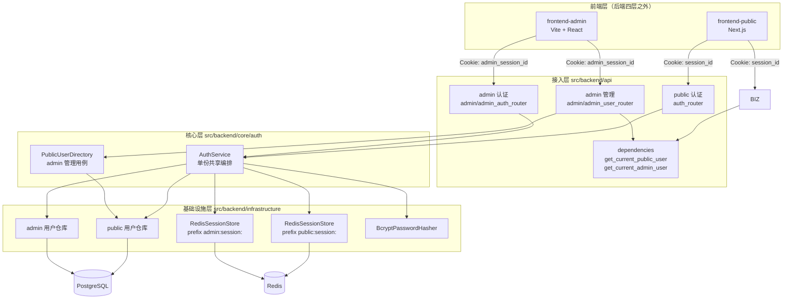
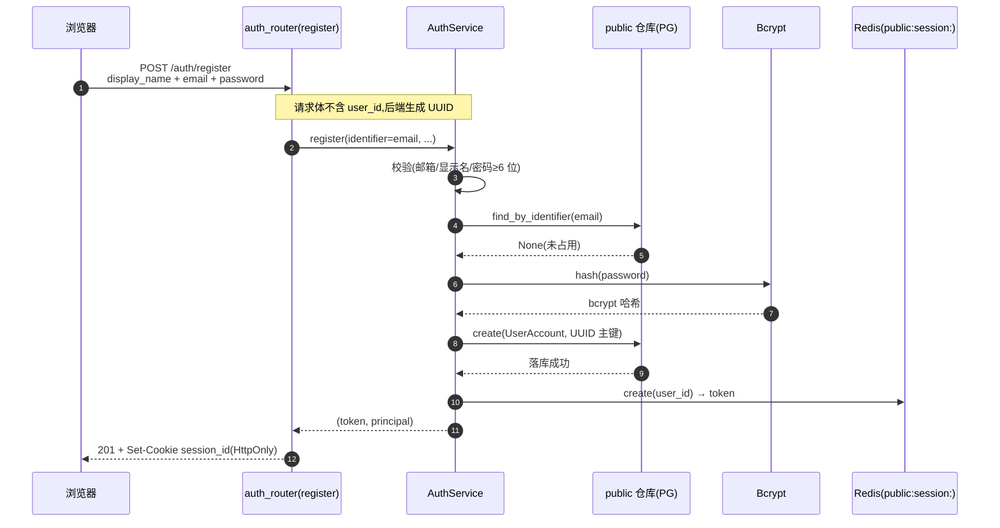
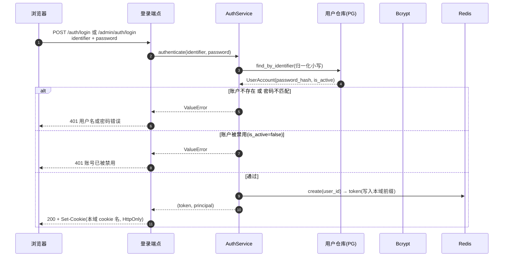
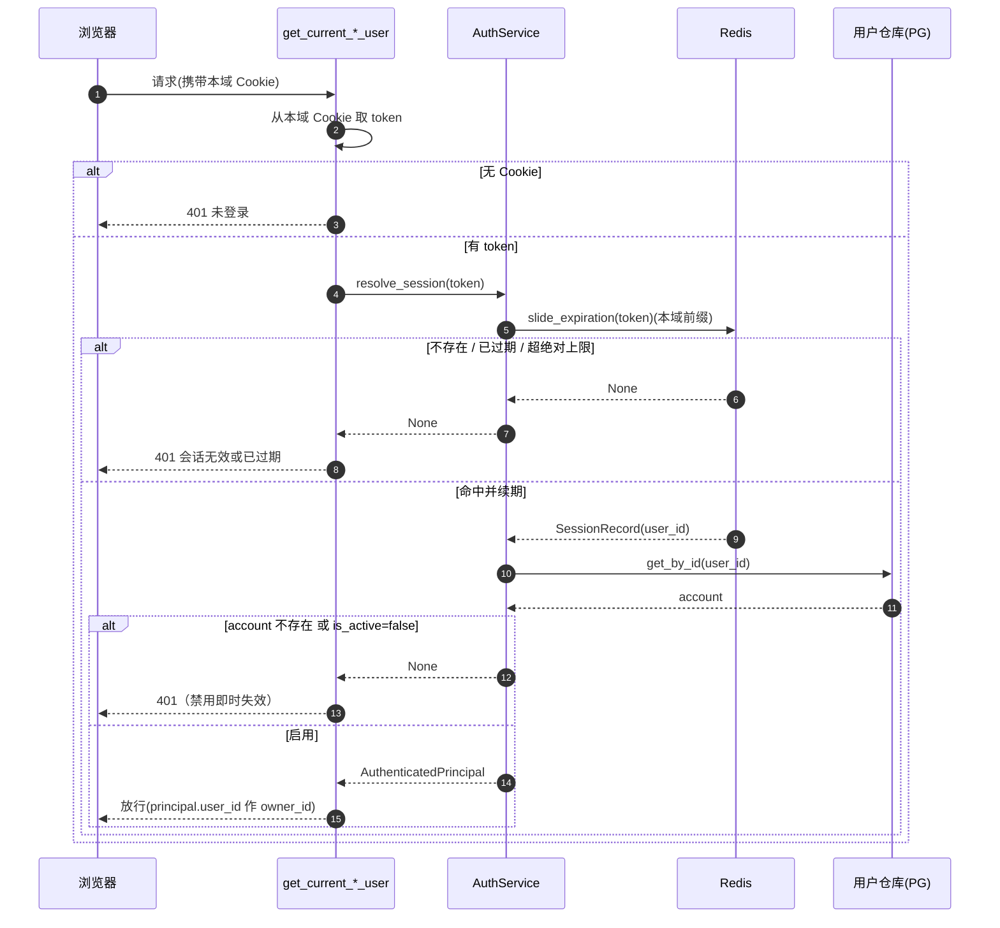
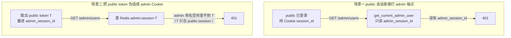
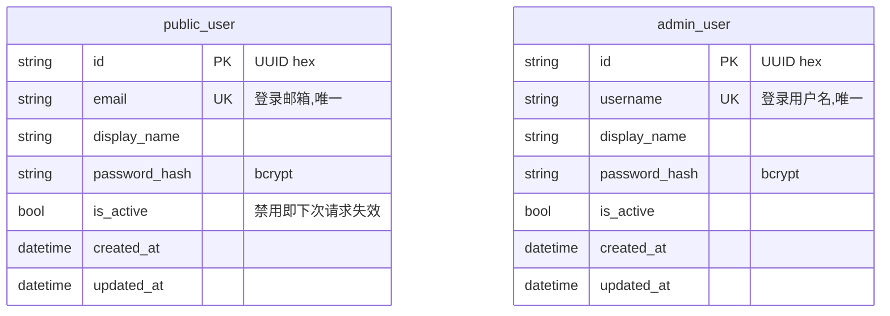

# 认证与会话逻辑

本页说明当前认证实现与修改定位:**两套物理隔离的认证域 + 服务端 Session(Redis) + HttpOnly Cookie**。它是 [系统架构](system-design.md) 中"认证与会话域"一节的展开版。

!!! info "一句话概览"
    不是 JWT、也不是 access/refresh 双 token。后端为每次登录签发一个**不透明随机 token**(uuid),存进 **Redis**,通过 **HttpOnly Cookie** 下发;受保护请求解析会话时回查 Redis。public 与 admin 是**两个独立认证域**,各有独立的用户表、Cookie 与 Redis 命名空间。

---

## 1. 整体架构



要点:

- **一份 `AuthService` 服务两域**:登录 / 登出 / 会话解析 / 注册的编排只有一份,通过注入不同的「用户仓库 + 会话存储(不同前缀)+ 是否允许注册」区分 public 与 admin,避免复制两套近似代码。
- **两域在数据层物理隔离**:不同用户表、不同 Cookie、不同 Redis 命名空间。
- 模板不内置业务资源；业务模块由派生项目添加，其资源归属 public 用户（`owner_id = public_user.id`），admin 域只做管理，不拥有业务资源。

---

## 2. 两个认证域对照

| 维度 | public 域(C 端用户) | admin 域(内部管理员) |
|---|---|---|
| 用户表 | `public_user`(开放自助注册) | `admin_user`(仅种子创建,不开放注册) |
| 主键 | UUID(`str`),用作业务 `owner_id` | UUID(`str`) |
| 登录标识 | 邮箱 `email` | 用户名 `username` |
| 端点 | `/auth/login` `/auth/register` `/auth/logout` `/auth/me` | `/admin/auth/login` `/admin/auth/logout` `/admin/auth/me`(无 register) |
| 会话 Cookie | `session_id` | `admin_session_id` |
| Redis 命名空间 | `public:session:<token>` | `admin:session:<token>` |
| 鉴权依赖 | `get_current_public_user` | `get_current_admin_user` |
| 业务能力 | `/auth/*`（无内置业务资源） | `/admin/users` 管理 public 用户 |
| 前端 | `frontend-public` | `frontend-admin` |

---

## 3. 会话机制

### 3.1 token 与存储

会话 token 是 `uuid.uuid4().hex` 生成的**不透明随机串**(不是自包含的 JWT)。它本身不含信息,必须回查 Redis 才能解析出用户。

每条会话在 Redis 中的形态:

```text
key   = "{prefix}{token}"          # 例 public:session:9df9880fde8a...
value = {"user_id", "created_at", "expires_at"}   # JSON
TTL   = 滑动窗口秒数
```

!!! note "为什么是 Session 而不是 JWT"
    - **登出与禁用**:登出删除当前域的指定 Redis 会话；禁用用户由后续请求回查 `is_active` 拒绝，并不批量删除 Redis 记录。
    - **安全**:token 放 HttpOnly Cookie,前端 JS 不能直接读取 Cookie（不代表消除所有 XSS 风险）,浏览器自动携带,前端零 token 管理。
    - **沿用现状**:项目原本就是 session 设计(内存版),本次只是落地到 Redis 并拆成双域。

### 3.2 滑动窗口续期

没有 refresh token——"保持登录"靠**滑动窗口**实现:

- **滑动窗口 15 天**:每次活跃请求(经 `/me` 或业务调用解析会话时)续期 15 天。
- **绝对上限 60 天**:自创建起最多存活 60 天,到顶即失效,需重新登录。
- 每次续期 `new_expires = min(now + 15天, created_at + 60天)`,并据此重设 Redis TTL。

### 3.3 命名空间前缀隔离

`RedisSessionStore` 只有一份实现,实例化两次、注入不同前缀:

```text
public:session:<token>     ← public 域
admin:session:<token>      ← admin 域
```

同一个 Redis 实例,但两域的 key 空间互不重叠——这是越权隔离的物理基础(见 §5)。

---

## 4. 核心流程(时序图)

### 4.1 注册(仅 public)



### 4.2 登录



### 4.3 会话解析(每个受保护请求)+ 禁用即时失效



!!! tip "禁用即时失效"
    每次解析会话都会回查用户表的 `is_active`。admin 一旦在 `/admin/users` 把某 public 用户禁用,该用户**下一次请求**就会被判 `401`,无需等会话过期。

### 4.4 登出

登出调用本域 `AuthService.logout(token)` → 删除该 Redis 会话记录,并清除 Cookie。只影响当前域。

---

## 5. 越权隔离(为什么 public 进不了 admin)



两层保障:

1. **Cookie 维度**:admin 守卫只认 `admin_session_id`,public 会话的 `session_id` 根本不被读取。
2. **命名空间维度**:即使把 public 的 token 值塞进 `admin_session_id`,admin 域查的是 `admin:session:<token>` 命名空间,而该 token 只存在于 `public:session:`——查不到,依然 `401`。

反方向同理:admin 会话访问业务 API(走 `get_current_public_user`)也是 `401`。

!!! warning "前端隔离不是安全边界"
    "哪个前端登录的"不能作为权限依据——同域部署时不同端口共享 Cookie domain。真正的边界在后端:两套独立 Cookie + 两套 Redis 命名空间 + 两套用户表。

---

## 6. 数据模型



- 会话**不落 PG**——它在 Redis。PG 只存用户。
- 模板不内置业务实体；派生项目添加的业务资源以 `owner_id`（`String` 类型、应用层关联）归属 public 用户。

---

## 7. Admin 管理 public 用户

`frontend-admin` 的 `users` 页经 `/admin/users` 管理 C 端用户:

| 操作 | 端点 | 说明 |
|---|---|---|
| 列表 | `GET /admin/users?page=&page_size=&status=&keyword=` | 分页 + 按状态(active/disabled)/关键字过滤 |
| 详情 | `GET /admin/users/{id}` | 单个用户 |
| 启用 | `POST /admin/users/{id}/enable` | 恢复登录 |
| 禁用 | `POST /admin/users/{id}/disable` | 即时失效其会话 |

这些端点全部经 `get_current_admin_user` 守卫,由 `PublicUserDirectory`(core 用例)操作 public 用户仓库。

---

## 8. 配置与运维

```bash
# .env / .env.local
REDIS_URL=redis://:password@localhost:6379/0    # 会话存储,必需

# 初始管理员种子（启动时创建，已存在则同步密码哈希）
AUTH_ADMIN_BOOTSTRAP_USERNAME=admin
AUTH_ADMIN_BOOTSTRAP_PASSWORD=change-me-please
```

- **种子 admin**：`src/backend/composition/bootstrap.py` 启动时，若配置了
  `AUTH_ADMIN_BOOTSTRAP_*` 且该用户名不存在，则创建管理员；已存在时调用 `set_password()` 同步密码哈希。两项任一为空则跳过种子。
- **Cookie 安全**:本地开发 `secure=False`(http);生产经反代终止 TLS 后应置 `True`。当前两份路由的 `_COOKIE_SECURE` 都是硬编码 `False`，没有可切换的安全配置键；生产建议不代表已经启用。Cookie 名是 `api/dependencies.py` 常量，会话窗口天数与 admin 种子来自 `AuthSettings`。两路由 `_COOKIE_MAX_AGE_SECONDS` 固定 60 天，不随会话天数配置自动变化。
- **会话窗口**:`AUTH_SESSION_SLIDING_DAYS`(默认 15)、`AUTH_SESSION_ABSOLUTE_DAYS`(默认 60)。

!!! danger "本地直接运行需注意"
    `RedisSettings` / `AuthSettings` 会从 `.env` / `.env.local` 读取。务必在其中配置可达的 `REDIS_URL`(本地可用 `docker-compose.testing.yml` 的 redis,带密码 `redis123`),否则登录 / 注册会因连不上 Redis 而 500。

---

## 9. 关键代码位置

| 关注点 | 位置 |
|---|---|
| 认证编排(共享) | `src/backend/core/auth/service.py`(`AuthService`) |
| admin 管理用例 | `src/backend/core/auth/directory.py`(`PublicUserDirectory`) |
| 领域模型 | `src/backend/core/auth/models.py`、`src/backend/core/shared/models/user_account.py` |
| 抽象端口 | `src/backend/core/shared/interfaces/{user_account_repository,password_hasher,session_store}.py` |
| Redis 会话 | `src/backend/infrastructure/auth/redis_session_store.py` |
| 密码哈希 | `src/backend/infrastructure/auth/bcrypt_password_hasher.py` |
| 用户仓库(统一) | `src/backend/infrastructure/persistence/repos/user_account_repo.py` |
| ORM 模型 | `src/backend/infrastructure/persistence/models/{public_user,admin_user}.py` |
| 鉴权依赖 | `src/backend/api/dependencies.py` |
| public 路由 | `src/backend/api/auth_router.py` |
| admin 路由 | `src/backend/api/admin/` |
| 装配 + 种子 | `src/backend/composition/{auth_wiring,bootstrap,app_factory}.py` |
| 迁移 | `alembic/versions/20260625-182322-auth_domains_init.py` |

---

## 10. 验证覆盖与边界

以下来自测试体及其夹具的静态核对，不表示本次已运行：

| 测试入口 | 真实边界与断言 | 未证明的内容 |
|---|---|---|
| `tests/backend/test_auth_domains.py` | 经 `build_client` → `TestClient(backend.main.create_app())` → production composition；验证注册 201 后 me、双向 Cookie 越权 401、public token 伪装 admin Cookie 401、admin 无注册 404、错误密码 401、禁用后原 public 会话 me 401 | 不是纯路由临时应用；也不证明真实 Redis、浏览器 Cookie 或绝对期限边界 |
| `tests/backend/test_redis_session_store.py` | `_build_store` 用 fakeredis；覆盖 create/get/delete、未知 token、续期返回有效记录、同实例不同 prefix 隔离 | 当前续期用例只断言返回记录，没有断言 TTL 变化、绝对期限封顶或到期删除 |
| 同文件 `test_real_redis_roundtrip` | `redis` 标记；显式提供 `REDIS_URL` 后针对真实 Redis 验证创建/读取/删除 | 默认 pytest 排除 redis；无 URL 时 skip，不能算真实 Redis 通过 |
| `tests/playwright-e2e/tests/setup/{auth,admin-auth}.setup.ts` | 浏览器在前端 origin 用 fetch 经 `/api/auth/login` 或 `/api/admin/auth/login` 登录，断言 200、导航结果并保存 storageState | 登录 setup 不等于完整表单交互验证；本次未运行，实际外部依赖状态未确认 |
| `tests/playwright-e2e/tests/admin/admin-users.admin.spec.ts` | 通过代理创建临时 public 用户，在用户页搜索并禁用，断言行显示已禁用 | 没有在该 spec 内断言被禁用会话再次请求 401；该断言在后端测试中 |

`tests/backend/conftest.py:_setup_backend_database` 调用 `create_tables()` 执行真实库初始化；
`build_client` 创建生产工厂应用，不是自行挑路由的临时 app。
`_use_fake_redis` 将 `backend.main.create_redis_client` 替换为每测试共享的 fakeredis，
`main.create_app()` 把这个工厂传入 composition，因此双域用同一 fake Redis 且保留前缀隔离。
`test_auth_domains.py` 带 `realdb` 标记；`entity_registry` 登记精确 ID 并清理，根
`tests/conftest.py:_realdb_residue_sentinel` 对 realdb 测试检查净主键变化。
这证明测试设计保留数据库/迁移边界，不能据此声称已有运行通过或完全无外部依赖。

在具备项目依赖与专用测试数据库的环境，可运行（本次均未执行）：

```bash
uv run pytest tests/backend/test_auth_domains.py tests/backend/test_redis_session_store.py -q -n 0
# 另行显式设置 REDIS_URL，再 opt-in 真实 Redis；不得把默认排除的测试计为通过
uv run pytest tests/backend/test_redis_session_store.py -m redis -q -n 0
```

最高可行保真度后续验证：在获准启动服务且配置数据库、Redis、一次性账号的环境，经两个前端实际登录入口，
从浏览器原样取得请求与 Cookie，验证各自 me、跨域与伪装 Cookie 的 401、登出后同 token 失效；
由 admin 禁用同一个 public 用户后，用原 public Cookie 再请求确认 401。修改期限时补充可控时钟测试，
断言初始 TTL、滑动 TTL、绝对期限、到期删除及 Cookie max-age 的对应关系。
浏览器/代理/真实 Redis 未运行时必须披露，不能用 fakeredis 结果替代。
详见[测试规范](../ai-standards/testing.md)与[端到端指南](../guides/e2e.md)。

## 11. 维护者修改地图

生产注册链：`src/backend/main.py:app/create_app` → `composition/app_factory.py:create_app`，
后者装配认证组件到 `app.state.public_auth_service/admin_auth_service`，并注册 public/admin 路由。
`api/dependencies.py:get_*_auth_service` 从这些状态取得域服务；生产路由没有 `/api` 前缀，前端代理提供该前缀。

| 要改什么 | 定位 | 直接影响与验证选择 |
|---|---|---|
| 会话窗口、绝对期限、Redis 数据格式 | `infrastructure/auth/redis_session_store.py:RedisSessionStore.create/slide_expiration/_persist/_read`；`infrastructure/config/settings.py:AuthSettings`；`composition/auth_wiring.py:build_auth_components` | 同时影响 public/admin；已有 key JSON 兼容、TTL、到期删除需验证；Cookie 固定 60 天需另查两路由，不能只改配置 |
| Cookie 名或属性 | `api/dependencies.py:PUBLIC_SESSION_COOKIE_NAME/ADMIN_SESSION_COOKIE_NAME`；`api/auth_router.py` 与 `api/admin/admin_auth_router.py` 的 `_set_session_cookie/_clear_session_cookie` | 登录/注册下发、me/守卫读取、logout 清理须一致；查前端代理和浏览器 Set-Cookie，跑域隔离与登出验证 |
| 域隔离或用户表绑定 | `composition/auth_wiring.py:build_auth_components` 的 `_PUBLIC_SESSION_PREFIX/_ADMIN_SESSION_PREFIX`、model_class、identifier_attr、allow_registration | 不能只改 Cookie：Redis prefix 和用户仓库也是边界；更改 prefix 会让既有 token 无法读取；跑真实工厂的双向/伪装 Cookie 401 及 fakeredis prefix 测试 |
| 禁用与会话有效性 | `core/auth/directory.py:PublicUserDirectory.set_user_active` → `persistence/repos/user_account_repo.py:set_active`；`core/auth/service.py:resolve_session` | 禁用提交数据库，下次解析先续期再回查账户；不删 Redis，重新启用后未过期 token 可能再次有效（按调用链推断，当前测试未覆盖）。验证原 Cookie 后续请求及重新启用策略 |
| 登录/注册/登出编排 | `core/auth/service.py:authenticate/register/logout`；两域 API 处理函数及 schemas | 登录归一化标识、校验密码/active 后创建本域 session；public 注册先提交账户再建 Redis 会话，无跨存储原子事务；Redis 失败后的账户残留需按预期验证 |
| 启动种子/配置 | `composition/bootstrap.py:seed_admin_user/seed_public_user`；`infrastructure/config/settings.py:AuthSettings/RedisSettings` | 已有种子会同步密码；生产 `create_app` 还先迁移数据库，修改不能只跑纯存储测试 |

会话解析关键顺序是 `AuthService.resolve_session` → `slide_expiration` → 本域 `repository.get_by_id` →
拒绝不存在/禁用账户或返回 principal；不是每条 HTTP 请求都会执行它，也不是每次续期都重发 Cookie。
`RedisSessionStore.create` 初始写滑动窗口，绝对期限检查发生在 `slide_expiration`；配置大于绝对期限的窗口时不要
把初始 TTL 误写成已经封顶。

配置来源：`AuthSettings/RedisSettings.settings_customise_sources` 声明环境变量、dotenv、TOML section、init 的顺序；
会话字段为 `AUTH_SESSION_SLIDING_DAYS` / `AUTH_SESSION_ABSOLUTE_DAYS`，连接为 `REDIS_URL`。
具体环境加载说明沿用[配置指南](../guides/configuration.md)，不在此推断部署值。
直接前端调用方为 `frontend-public/lib/api/auth.ts` 和 `frontend-admin/src/api/auth.ts` 的 login/logout/getCurrentSession；
改 API 时同步它们及对应 client 的 `/api` baseURL/Cookie 携带方式。
本页保留现有架构文档位置与站点导航，没有另建第二套认证权威页。
