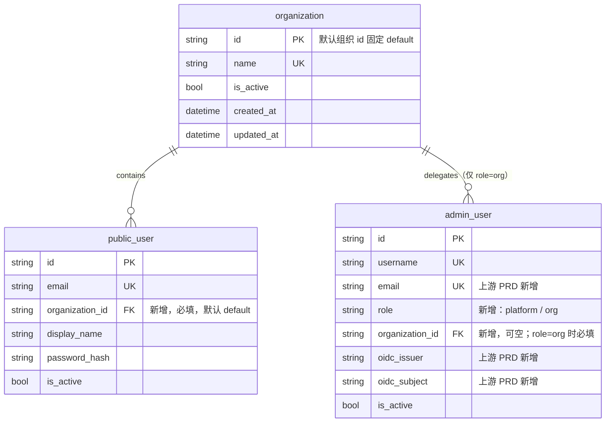
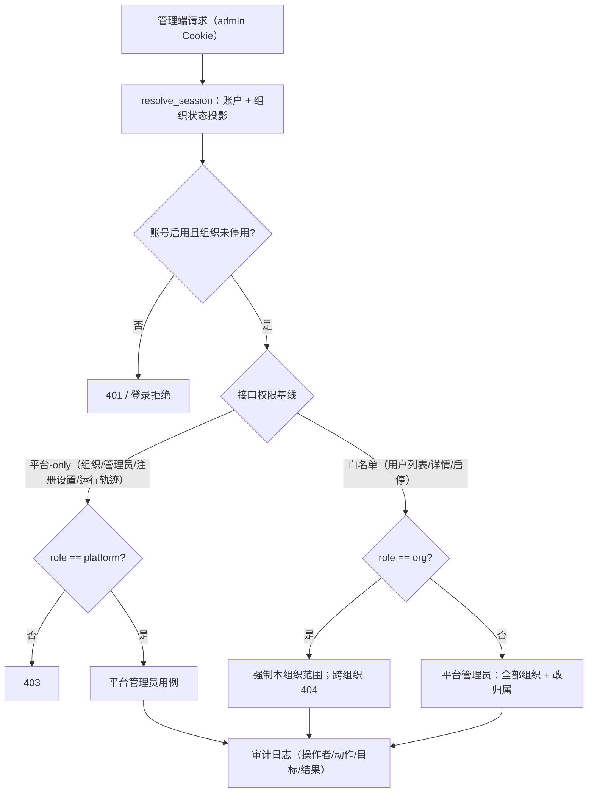

# PRD: 组织与平台/组织两级管理员

> ⛔ **交付前置**：排在 `P1-SECURITY-20261112-134527-admin-oidc-sign-in` 之后开工。本 PRD 的管理员邮箱、企业账号绑定列与解绑后的重新首绑都建立在那份 PRD 交付的结构和规则上；先做本 PRD 就得重复实现这些安全关键部件。
> 结构化声明见 §8 Delivery Dependencies，**那里是唯一事实源**。

> ⬜ **验收状态**：未开工。
> 本行是 §9 Acceptance Checklist 的投影，**那里是唯一事实源**。

> 本 PRD 分为 Part A 人审层和 Part B 执行器层。Part A 用于确认目标行为和关键取舍；Part B 记录实现路径与验证证据。
> 同系列：`P1-SECURITY-20261112-134527-admin-oidc-sign-in`（管理员企业账号登录，上游）、`P1-FEAT-20261112-134527-registration-policy-and-user-oidc`（注册策略 + 普通用户企业账号登录，与本 PRD 无顺序依赖）。`P1-FEAT-20260928-115856-multi-organization-online-agent-base` 的组织与管理员范围已移交本 PRD，它改为依赖本 PRD。

## Feature Overview (功能一览)

> 本块是 §10 Functional Requirements 的简明投影；行为验收以 §1 行为样例为准。

- **组织与归属**（FR-1、FR-2）：平台管理员在后台创建、停用组织；每个普通用户恰好属于一个组织，存量用户和新注册用户都归入显式的“默认组织”。
- **两级管理员**（FR-3）：平台管理员管全局，组织管理员只管本组织；角色与组织关联由数据库约束保证，权限由服务端会话解析，不能由请求方指定。
- **管理员页**（FR-4、FR-5）：平台管理员新建、启用、禁用管理员，并可解除绑错的企业账号；不能禁用自己，系统始终保留至少一个启用中的平台管理员。
- **组织停用即生效**（FR-6）：组织停用后，该组织的普通用户和组织管理员不能登录，已有会话下次请求即失效；重新启用即恢复。
- **用户页按组织分范围**（FR-7）：组织管理员只看到本组织用户并可启停；平台管理员看到全部用户、按组织过滤并调整归属。
- **首位平台管理员与应急入口**（FR-8）：启动种子创建首位平台管理员；改环境变量重启可重置其密码并恢复启用，作为最后的应急入口。
- **界面按角色显隐、操作留痕**（FR-9、FR-10）：登录态携带角色与组织，侧边栏和路由按角色控制；建组织、建管理员、启停、解绑、改归属都记审计日志。
- **不做**（§11）：Agent / Run / Skill 的组织归属与授权在多组织 Agent PRD；普通用户解绑、管理员自助改密、一人多组织均不做。

# Part A · 人审层 (Review Layer)

## 1. Introduction & Goals

### Problem Statement

模板目前只有一种管理员，且没有正常的创建途径：管理员只能由启动种子 `seed_admin_user` 按 `AUTH_ADMIN_BOOTSTRAP_USERNAME / PASSWORD` 创建，只建一个；`admin_user` 表只有用户名、展示名、密码哈希和启用状态，没有角色、邮箱或组织字段；管理端“用户”页只能管理普通用户，没有创建管理员的接口或页面。想要第二个管理员，只能改环境变量再重启，这是绕路而不是正式做法。

同时，已确认的多组织底座方向（`tasks/pending/P1-FEAT-20260928-115856-multi-organization-online-agent-base.md`）要求“组织管理员管本组织、平台管理员管全局”，但那份 PRD 把组织、管理员、Agent、Run、Skill、A2A 混在一个大范围里，无法先行交付权限地基。管理员企业账号登录（上游 PRD）落地后，这个缺口更明显：每个要用企业账号登录的管理员都得先有一条带邮箱的本地记录，而按现状只有种子管理员一个人能登录。

### Interpretation (解读回显)

**行为样例**

| 验证方式 | 输入 / 操作 | 期望观察到的结果 |
|---|---|---|
| 👀 人审 + 自动验证 | 平台管理员在“管理员”页新建组织管理员（邮箱 `org@example.com`、所属“示例组织”、不设密码）；该邮箱在身份中心已验证的用户第一次点“企业账号登录” | 进入管理后台；侧边栏没有“组织”“管理员”；“用户”页只显示“示例组织”的用户 |
| 🤖 自动验证 | 组织管理员调用创建组织、创建管理员、解绑接口，或读取 / 禁用其他组织的用户 | 前三者返回 403；跨组织用户按 404 处理，不泄露其存在性 |
| 🤖 自动验证 | 平台管理员禁用自己，或禁用系统中最后一个启用中的平台管理员 | 均返回 400，账号状态不变 |
| 🤖 自动验证 | 平台管理员停用“示例组织” | 该组织普通用户密码登录被拒并提示组织已停用，其已有会话下次请求返回 401；该组织组织管理员同样；平台管理员不受影响；重新启用后恢复 |
| 🤖 自动验证 | 平台管理员解绑某管理员的企业账号后，原身份中心账号再次登录；再用同邮箱的另一个身份中心账号登录 | 原账号被拒（日志 `reason=identity_not_mapped`）；新账号按上游 PRD 的首绑规则重新绑定并登录 |
| 🤖 自动验证 | 迁移完成后检查存量数据；随后新注册一个普通用户 | 存量普通用户全部归“默认组织”，存量管理员全部为平台管理员；新用户归“默认组织” |
| 🤖 自动验证 | 企业账号登录不可用（未配置或显式关闭）时，创建不设密码的管理员 | 返回 400，提示必须设置初始密码 |

以上行为样例将原样转入 §7.6 验收 oracle；修改某一格就是修改验收标准。

**我默默定了这些**

- 组织表只保留最小字段：id、名称（唯一）、启用状态、时间戳；不做层级、描述、slug。
- 默认组织 id 固定为 `default`、名称“默认组织”，由迁移创建；默认组织不可停用，避免锁死全部未分配用户。
- 新注册（密码注册、企业账号自动建号）与种子 public 用户都归默认组织；归属调整只有平台管理员能在用户页做。
- 存量管理员迁移为平台管理员；`role=org` 必须关联组织、`role=platform` 必须不关联，由数据库 CHECK 约束保证。
- 无密码管理员写入随机不可用密码哈希（与注册策略 PRD 的企业账号建号同一做法），不改 `password_hash` 列约束。
- 管理员创建后不可改角色与所属组织（需要时禁用后重建）；用户名与邮箱存储前归一化为小写。
- 组织管理员访问用户接口时强制本组织范围，查询参数里的组织 ID 不生效；跨组织用户按 404 处理。
- 注册策略接口（注册策略 PRD）若已合并，读写收紧为仅平台管理员；“运行轨迹”页保持仅平台管理员可见，Run 的组织归属与授权由多组织 Agent PRD 落地。
- 种子同步时确保该账号为平台管理员、启用中，并同步密码与邮箱；种子用户名指向已有账号时会将其提升为平台管理员——这是应急语义，需要服务器权限才能触发。
- 审计采用结构化日志（操作者、动作、目标、结果），不建审计表；日志不含密码、令牌、Client Secret。
- 停用组织不删除任何数据；前端演示页（projects / tasks / chats / apps）不做权限改动。
- 本 PRD 不新增环境变量；默认组织由迁移内置。

**我理解为不做**

- Agent、Run、Skill、资产的组织归属与授权，以及 Run 回填默认组织 —— 在多组织 Agent PRD。
- 普通用户的企业账号解绑 / 改绑、管理员自助解绑或修改密码、邀请注册、注册时选择组织、一人多组织。
- 组织删除与层级；按身份中心的组或角色同步组织与管理员权限。

**解读**：本 PRD 读作“在模板本地建立组织与两级管理员的权限地基，并把管理员的创建、启停、解绑交给平台管理员在后台完成”，而不是“把组织与管理员交给身份中心管理”。身份中心仍只负责确认“这是谁”（上游两份 PRD），本 PRD 不读取其角色或组。平台管理员默认不读取组织业务数据（沿用已确认决策）；本 PRD 给组织管理员落地的能力只有本组织用户管理，Agent / Skill 等业务能力随多组织 Agent PRD 扩展。普通用户的前台界面不变，归属由管理端管理。

- [ ] 我确认这段解读与行为样例准确表达了我的需求。

### What The User Gets

- **平台管理员**：后台新增“组织”和“管理员”两页。可以建组织、停启用组织；可以新建平台管理员或组织管理员（填邮箱，密码可选）、启停管理员、解除绑错的企业账号；用户页能看到全部用户并调整其所属组织。
- **组织管理员**：用企业账号（或初始密码）登录同一个管理后台，只看到本组织的用户并可启停；看不到组织、管理员、注册设置、运行轨迹等平台功能。
- **普通用户**：前台使用不变；被停用组织成员会看到明确的“组织已停用”提示，而不是含糊的登录失败。
- **部署者 / 运维**：首位平台管理员仍由启动种子创建；忘记密码或全部平台管理员被禁用时，改种子环境变量重启即可恢复一个可用的平台管理员。

### Measurable Objectives

- 行为样例 7 行全部由自动测试覆盖并通过。
- 真实浏览器中：平台管理员建组织、建无密码组织管理员，后者经身份中心替身完成企业账号登录，用户页只显示本组织用户。
- 组织管理员对平台-only 接口与跨组织用户的越权请求全部失败（403 / 404），且响应不泄露目标存在性。
- 迁移后存量用户与管理员的数量、归属对账一致；迁移可升可降。
- 现有 `tests/backend/test_auth_domains.py` 与管理端用户页 e2e 不改动断言即通过。

## 2. Human Review Map (介入与风险地图)

### 组织模型与用户归属

**已确认（沿用多组织 Agent PRD §2 决策一，2026-09-28 确认，原样保留）：** 首版一个普通用户归属一个组织；平台管理员接触组织业务数据必须经显式授权和审计。

在此之上新增的建议：建一张最小组织表，普通用户表加一个必填的组织归属列；迁移先创建显式的“默认组织”再把存量用户全部归入，新注册用户也归默认组织；归属调整只有平台管理员能做。组织停用后立即生效：该组织普通用户和组织管理员不能登录、已有会话下次请求即失效，重新启用即恢复；默认组织不可停用。主要风险是归属回填错误会造成跨组织数据暴露或历史数据不可读，所以迁移必须对账且可降级。



**请确认：** 采用上述组织表与归属规则（一人一个组织、默认组织兜底、停用即断登录与会话、默认组织不可停用），是否同意？

- [ ] 同意（推荐）

**验收：** 迁移后存量用户全部归默认组织、存量管理员全部为平台管理员，数量对账一致且可降级；停用组织后其成员登录被拒、已有会话失效，启用后恢复。

### 两级管理员的创建与保护

建议管理员显式分两级：平台管理员（全局）和组织管理员（必须关联一个组织），用数据库约束保证“组织管理员必有组织、平台管理员必无组织”。首位平台管理员仍由启动种子创建；之后只有平台管理员能在后台“管理员”页新建管理员——组织管理员不能授予任何人管理员权限（这一点你已在对话中确认）。新建时邮箱必填（作为企业账号首绑依据），密码可选：不设密码的管理员只能用企业账号登录；企业账号登录不可用（未配置或显式关闭）时必须设初始密码，否则拒绝创建。保护规则：不能禁用自己；系统始终保留至少一个启用中的平台管理员（在同一个数据库事务内判断，防止两个平台管理员并发互禁导致全部锁死）。种子账号是应急入口：改环境变量重启会重置其密码、恢复启用并确保平台角色。主要风险是授权规则写错等于开后门，所以越权与保护规则都有负向测试。

**请确认：** 两级角色、仅平台管理员可创建管理员、密码可选规则与两条禁用保护，是否同意？

- [ ] 同意（推荐）

**验收：** 组织管理员创建管理员返回 403；无密码且企业账号登录不可用时创建返回 400；禁用自己与禁用最后一个启用平台管理员均返回 400；种子重启后账号恢复可用。

### 企业账号解绑与组织管理员的数据范围

**已确认（2026-11-12 对话）：** 管理员绑错企业账号时，由平台管理员解除绑定。建议解绑只清空该管理员的两个外部身份列，不动邮箱和密码，记审计日志；对方下次用企业账号登录时按上游 PRD 的规则凭已验证邮箱重新首绑。组织管理员不能解绑（包括自己的），普通用户的解绑不在本 PRD。

组织管理员的数据范围建议白名单制：只有“用户”页对本组织开放（列表、详情、启用、禁用），其余管理功能（组织、管理员、注册设置、运行轨迹）仅平台管理员；跨组织用户按 404 处理，不泄露存在性。平台管理员默认不读组织业务数据（沿用已确认决策），Agent / Run / Skill 的组织授权由多组织 Agent PRD 在此基础上落地。主要风险是范围漏配：任何一个现有或新增管理接口忘了按角色限制，组织管理员就能看到平台数据，所以权限基线是“默认仅平台管理员，组织管理员逐项白名单”。

**请确认：** 解绑规则与“默认仅平台管理员、组织管理员白名单”的权限基线，是否同意？

- [ ] 同意（推荐）

**验收：** 解绑后原身份中心账号被拒登、同邮箱新账号重新首绑成功，审计日志含操作者与目标；组织管理员访问平台-only 接口全部 403，跨组织用户全部 404。

**自动门禁，不需要逐项人工审阅**：组织与管理员 CRUD 的输入校验、迁移升降级与回填对账、前端导航显隐与路由守卫、表单校验与中英文文案、架构分层检查，均由后端测试、迁移测试、前端单测与 Playwright 用例把关。

**本次明确不涉及**：Agent / Run / Skill 业务数据的组织授权、计费、批量数据操作、身份中心侧的组织与角色配置。

## 3. Usage And Impact After Implementation

**平台管理员**：用种子账号（或企业账号）登录后台，侧边栏新增“组织”“管理员”。在“组织”页新建组织（填名称）、停用或重新启用组织；默认组织没有停用按钮。在“管理员”页新建管理员：选类型（平台管理员 / 组织管理员，后者再选组织）、填用户名和邮箱、密码可留空（页面注明“留空则只能用企业账号登录”；企业账号登录不可用时留空会被拒绝）。列表显示每个管理员的类型、所属组织、企业账号绑定状态和启用状态；可以启用、禁用（自己与最后一个启用平台管理员除外）、解除企业账号绑定（有确认对话框）。在“用户”页看到全部用户及其所属组织，可按组织过滤，并把用户调整到其他组织。

**组织管理员**：打开同一个管理端登录页，用企业账号登录（或平台管理员设置的初始密码）。登录后侧边栏只有“用户”等白名单入口；用户页只显示本组织用户，可搜索、启用、禁用。直接输入平台-only 页面地址会被弹回首页；直接调平台-only 接口返回 403。

**普通用户**：前台注册、登录、使用都不变。所属组织由平台管理员在后台调整，前台无感知。所在组织被停用时，登录页提示“组织已停用，请联系管理员”，已登录的会话下次请求即失效。

**部署者 / 运维**：无新增配置。升级后迁移自动执行：创建默认组织、存量用户归入、存量管理员标记为平台管理员。应急场景（平台管理员密码全部遗失或全部被禁用）：设置 `AUTH_ADMIN_BOOTSTRAP_USERNAME / PASSWORD`（邮箱沿用上游 PRD 的 `AUTH_ADMIN_BOOTSTRAP_EMAIL`）并重启，种子会重置该账号密码、恢复启用并确保平台角色。审计排查看后端日志中的管理操作记录（操作者、动作、目标、结果）。

**派生项目开发者**：拉取更新后迁移自动执行。`AuthenticatedPrincipal` 与 `UserAccount` 新增带默认值的字段，自定义装配不传新字段也能工作；`AuthService` 构造参数不变。若已合并注册策略 PRD，其策略读写接口收紧为仅平台管理员。

**兼容性**：存量管理员全部成为平台管理员，能力与现状一致（多出的组织 / 管理员页是新增能力）；存量普通用户归默认组织，登录与使用不变；所有新增列对既有读写路径透明；企业账号登录不可用时，无密码管理员无法创建，不存在“建了登不上”的账号。

## 4. Requirement Shape

- **actor**：平台管理员；组织管理员；普通用户；部署者 / 运维；派生项目开发者。
- **trigger**：平台管理员在后台管理组织与管理员、调整用户归属；组织管理员登录并管理本组织用户；组织停用 / 启用；启动种子执行。
- **expected behavior**：组织与用户归属持久化且迁移对账一致；管理员角色由数据库约束保证；权限由服务端会话解析，平台-only 接口对组织管理员 403、跨组织用户 404；组织停用即时阻断登录与会话；管理员创建 / 启停 / 解绑按保护规则执行并留审计日志。
- **explicit scope boundary**：只覆盖组织、管理员与普通用户归属的权限地基；不做 Agent / Run / Skill 的组织授权，不做普通用户解绑与管理员自助改密。

# Part B · 执行器层 (Build Layer)

## 5. Repository Context And Architecture Fit

- **现有最近路径**：`src/backend/core/auth/service.py` 的 `AuthService`（authenticate / register / resolve_session，回查 `is_active` 使禁用即时失效）；`src/backend/core/auth/directory.py` 的 `PublicUserDirectory`（admin 管理 public 用户的用例范例）；`src/backend/core/auth/models.py` 的 `AuthenticatedPrincipal`；`src/backend/api/dependencies.py` 的 `get_current_admin_user` / `_resolve_principal`；`src/backend/api/admin/admin_user_router.py`（admin 会话保护的管理接口范例）；`src/backend/api/admin/admin_auth_router.py`（login / me 响应映射）；`src/backend/infrastructure/persistence/repos/user_account_repo.py` 的 `SqlAlchemyUserAccountRepository`（按 `model_class` + `identifier_attr` 复用两域）；`src/backend/composition/bootstrap.py` 的 `seed_admin_user`；`src/backend/composition/auth_wiring.py`。
- **上游 PRD 交付物（本 PRD 直接复用）**：`admin_user.email / oidc_issuer / oidc_subject` 列与首绑规则；`src/backend/core/auth/oidc_login.py` 的 `OidcLoginService`；`tests/backend/oidc_test_support.py` 与 `tests/playwright-e2e/support/oidc-test-issuer.ts` 身份中心替身。
- **架构约束**：四层依赖方向由 `hooks/check_architecture.py` 校验；新端口放 `core/shared/interfaces/`，实现放 `infrastructure/`，装配只在 `composition/`；core 不导入 infrastructure（现有 core 无任何日志调用，审计日志在 API 路由层用标准 `logging` 记录，与 `infrastructure/logger` 同一 logging 配置，不新增审计表）。组织状态检查不新增 `AuthService` 构造参数：由仓库在账户读取时 outerjoin 组织表，把组织状态投影到 `UserAccount`，`AuthService` 只读投影字段（避免参数继续膨胀，遵循 `docs/ai-standards/code-reuse.md`）。
- **前端影响**：`frontend-admin/`（Vite + React + TanStack Router）。最近位置：`src/features/users/index.tsx`（表格 + 搜索 + 启停对话框，新页面仿照它）、`src/routes/_authenticated/route.tsx`（beforeLoad 会话守卫）、`src/stores/auth-store.ts`（会话用户状态）、`src/components/layout/data/sidebar-data.ts` 与 `src/components/layout/app-sidebar.tsx`、`src/components/command-menu.tsx`（导航分组）、`src/api/auth.ts`（`UserSession` 类型）、`src/api/users.ts`。`frontend-public/` 无代码改动：普通用户归属由管理端管理，组织停用提示走现有登录错误展示路径。
- **相关 PRD**：
  - `tasks/pending/P1-SECURITY-20261112-134527-admin-oidc-sign-in.md`：硬依赖（见 §8）。
  - `tasks/pending/P1-FEAT-20261112-134527-registration-policy-and-user-oidc.md`：无顺序依赖。若它先合并，本 PRD 把注册策略读写收紧为仅平台管理员；其企业账号建号路径因 `UserAccount.organization_id` 默认值自动归默认组织，无需改动。
  - `tasks/pending/P1-FEAT-20260928-115856-multi-organization-online-agent-base.md`：其组织与管理员范围已移交本 PRD，改为依赖本 PRD；它保留 Agent / Run / Skill / A2A 与 Run 的组织回填。
  - `tasks/archive/P1-FEAT-20260625-182322-dual-auth-domain-separation.md`：双域设计来源，本 PRD 沿用“同一编排、注入区分域”。

## 6. Recommendation

**Recommended Approach**：

1. 新增最小 `organization` 表与 `OrganizationRepository` 端口 / 实现；迁移创建默认组织并回填存量。
2. `UserAccount` 增加 `role`、`organization_id`、`organization_name`、`organization_is_active` 带默认值字段；泛型仓库新增可选 `organization_attr` / `role_attr`，配置后在读取时 outerjoin 组织表投影组织状态与名称，创建时写入归属与角色。`UserAccount.organization_id` 默认值为领域常量 `DEFAULT_ORGANIZATION_ID`，所有 public 建号路径自动归默认组织；admin 创建路径显式传值。
3. `AuthService` 在 authenticate / resolve_session 检查 `organization_is_active is False` 即拒绝（不加构造参数）；`OidcLoginService` 账号解析同样检查（新增失败类别 `organization_inactive`）。
4. 新增 `OrganizationDirectory` 与 `AdminDirectory` 用例（仿 `PublicUserDirectory`）；管理员启停的保护规则在仓库单事务内完成；新增 `get_current_platform_admin` 依赖，组织管理员按白名单放行。
5. 前端新增“组织”“管理员”两页（仿用户页），用户页加组织列与归属编辑，导航与路由按角色显隐。

**为什么合适**：组织与管理员是同一权限地基的两面——角色约束依赖组织表，组织管理员的数据范围依赖用户归属，拆开任何一半都会留下临时兼容层。复用泛型仓库与目录用例模式，不新增第二套用户数据访问；权限判断全部在服务端会话解析之后，请求方无法指定组织。

**拒绝的冗余抽象**：不做独立 admin 仓库（泛型仓库已复用两域）；不建审计表（管理操作低频，结构化日志即审计）；不做 `AuthService` 新构造参数或包装层（组织状态经仓库投影进入现有检查点）；不做身份中心组 / 角色同步（用户已选模板本地管理）。

### Proposed Solution Summary (实现机制)

- 机制：组织与角色持久化 + 服务端会话解析出 `(role, organization_id)` + 接口级权限基线（默认仅平台管理员，组织管理员白名单）+ 组织状态在登录与会话解析两个检查点生效。
- 输入由谁提供：组织与管理员由平台管理员在后台显式创建；用户归属由平台管理员显式调整；首位平台管理员由部署者经种子环境变量提供。系统不推断任何管理员身份或组织归属（默认组织兜底除外）。
- 接入点：`api/admin/` 新路由与 `dependencies.py` 新依赖；`AuthService` / `OidcLoginService` 现有检查点；`auth_wiring` 装配；前端 `_authenticated` 路由与导航。
- 状态变化：新增 `organization` 表；`public_user.organization_id`（必填）；`admin_user.role / organization_id`（CHECK 约束）；解绑清空 `oidc_issuer / oidc_subject`。
- 刻意避免：新会话机制、审计表、身份中心角色映射、管理员角色 / 组织的事后变更。

**Alternatives Considered**：组织与组织管理员放身份中心（FreshAI 做法）——用户已明确选择模板本地管理，拒绝。命令行创建管理员——改动更小但用户已选择后台页面，拒绝。`is_platform` 布尔列——无法表达“组织管理员必须关联组织”的约束，拒绝。

## 7. Implementation Guide

> This section is a living implementation guide based on current repository analysis. If implementation discovers additional affected files, hidden dependencies, edge cases, or a better path, update this PRD before proceeding.

### 7.1 Core Logic

**会话解析与权限基线**：

1. 仓库配置 `organization_attr` 后，`find_by_identifier` / `get_by_id` / `list_accounts` outerjoin 组织表，把 `organization_id / organization_name / organization_is_active` 投影到 `UserAccount`；admin 实例另配置 `role_attr="role"`。
2. `AuthService.authenticate` 与 `resolve_session` 在现有 `is_active` 检查后增加：`organization_is_active is False` → 登录抛 `ValueError("组织已停用，请联系管理员")`、会话解析返回 None。`OidcLoginService` 账号解析同样检查，失败类别 `organization_inactive`。平台管理员 `organization_id` 为空，投影为 None，不受影响。
3. `AuthenticatedPrincipal` 增加 `role`、`organization_id`、`organization_name`（默认 None），由 `_to_principal` 从账户投影填充。
4. `get_current_platform_admin`：在 `get_current_admin_user` 之上要求 `role == "platform"`，否则 403。组织管理员白名单接口（用户列表 / 详情 / 启停）在路由或用例内强制 `principal.organization_id` 范围：列表忽略请求中的组织参数；单用户操作先按 id 读取再比对归属，不符返回 404。

**组织管理**（仅平台管理员）：创建（名称 trim 后非空、唯一，冲突 409）；列表（含成员数可选，首版不做计数）；启用 / 停用（默认组织停用返回 400）。停用不删数据，登录与会话检查点即时生效。

**管理员管理**（仅平台管理员）：

1. 创建：用户名 trim + 小写 + 唯一；邮箱 trim + 小写 + 唯一（上游 PRD 列）；`role=org` 时 `organization_id` 必填且组织存在；密码提供时按现有密码策略校验，未提供时要求 admin OIDC 已装配（读上游 PRD 的 status 判定），否则 400；无密码写随机不可用哈希。`display_name` 缺省取用户名。
2. 启用 / 禁用：禁用自己 → 400；禁用平台管理员时在同一事务内锁定目标行并计数其他启用中的平台管理员，为 0 → 400（防并发互禁）。启用无保护。
3. 解绑：清空 `oidc_issuer / oidc_subject`（条件更新，未绑定 → 400）；不动邮箱与密码；记审计日志。下次企业账号登录按上游 PRD 首绑规则重新绑定。
4. 创建后不可改角色与组织；不提供改密接口（应急走种子）。

**用户归属**：`PublicUserDirectory.list_users` 增加组织过滤（平台管理员可选、组织管理员强制本组织）；新增 `set_user_organization`（仅平台管理员，目标组织必须存在）；`get_user` / `set_user_active` 增加组织范围校验。列表过滤参数收敛为 `AccountListFilter` 对象（status / keyword / organization_id），遵循 code-reuse 标准。

**种子**：`seed_admin_user` 创建时写 `role="platform"`、`organization_id=None`；账号已存在时同步密码、邮箱（上游 PRD），并确保 `role="platform"`、`is_active=True`。

**审计日志**：组织创建 / 启停、管理员创建 / 启停 / 解绑、用户归属调整，在 API 路由层用标准 `logging` 记结构化记录（操作者 id、动作、目标 id、结果），不含密码、令牌、Client Secret。

### 7.2 Change Impact Tree

```text
.
├── Database / Migration
│   └── alembic/versions/<YYYYMMDD-HHMMSS>-organizations_and_two_tier_admins.py
│       [新增]
│       【总结】建 organization 表并插入默认组织；public_user 加必填 organization_id 并回填；admin_user 加 role/organization_id 与 CHECK 约束；可降级。
│
├── Infrastructure
│   ├── src/backend/infrastructure/persistence/models/organization.py
│   │   [新增]
│   │   【总结】organization ORM：id、name 唯一、is_active、时间戳。
│   ├── src/backend/infrastructure/persistence/models/public_user.py
│   │   [修改]
│   │   【总结】增加 organization_id 外键列（必填，索引）。
│   ├── src/backend/infrastructure/persistence/models/admin_user.py
│   │   [修改]
│   │   【总结】增加 role（默认 platform）与可空 organization_id 外键；CHECK：role=org 必有组织、platform 必无。
│   ├── src/backend/infrastructure/persistence/repos/organization_repo.py
│   │   [新增]
│   │   【总结】组织读取 / 创建 / 启停；默认组织常量与保护。
│   └── src/backend/infrastructure/persistence/repos/user_account_repo.py
│       [修改]
│       【总结】可选 organization_attr/role_attr；读取 outerjoin 投影组织状态与名称；创建写入归属与角色；组织过滤；带平台保护的启停；解绑；改归属。
│       ├── 构造参数新增 organization_attr / role_attr（未配置时行为与现状一致）
│       ├── list_accounts 过滤参数收敛为 AccountListFilter（status/keyword/organization_id）
│       ├── set_active_with_platform_guard(account_id, is_active)：单事务锁定 + 计数其他启用平台管理员
│       ├── unbind_oidc_identity(account_id)：条件清空 oidc 两列
│       └── set_organization(account_id, organization_id)
│
├── Domain
│   ├── src/backend/core/shared/models/organization.py
│   │   [新增]
│   │   【总结】Organization 领域对象与 DEFAULT_ORGANIZATION_ID 常量。
│   ├── src/backend/core/shared/models/user_account.py
│   │   [修改]
│   │   【总结】增加 role、organization_id（默认 DEFAULT_ORGANIZATION_ID）、organization_name、organization_is_active 带默认值字段。
│   ├── src/backend/core/shared/interfaces/organization_repository.py
│   │   [新增]
│   │   【总结】组织仓库端口。
│   ├── src/backend/core/shared/interfaces/user_account_repository.py
│   │   [修改]
│   │   【总结】端口增加组织过滤、带保护启停、解绑、改归属的抽象方法与结果枚举。
│   ├── src/backend/core/auth/models.py
│   │   [修改]
│   │   【总结】AuthenticatedPrincipal 增加 role/organization_id/organization_name（默认 None）。
│   ├── src/backend/core/auth/service.py
│   │   [修改]
│   │   【总结】authenticate/resolve_session 增加组织停用检查（读投影字段，构造参数不变）。
│   ├── src/backend/core/auth/oidc_login.py
│   │   [修改]
│   │   【总结】账号解析增加组织停用检查；失败类别新增 organization_inactive。
│   ├── src/backend/core/auth/organization_directory.py
│   │   [新增]
│   │   【总结】组织管理用例：创建 / 列表 / 启停，默认组织不可停用。
│   ├── src/backend/core/auth/admin_directory.py
│   │   [新增]
│   │   【总结】管理员管理用例：创建规则、启停保护、解绑；仿 PublicUserDirectory。
│   └── src/backend/core/auth/directory.py
│       [修改]
│       【总结】用户列表组织过滤、单用户组织范围校验、改归属。
│
├── Composition
│   ├── src/backend/composition/auth_wiring.py
│   │   [修改]
│   │   【总结】装配组织仓库与两个目录用例；仓库实例配置 organization_attr/role_attr；AdminDirectory 注入 admin OIDC 是否可用。
│   ├── src/backend/composition/bootstrap.py
│   │   [修改]
│   │   【总结】seed_admin_user 写 platform 角色；已存在时同步密码、邮箱并确保平台角色与启用。
│   └── src/backend/composition/app_factory.py
│       [修改]
│       【总结】挂载组织与管理员路由（rg "admin_user_router" 定位挂载处）。
│
├── API
│   ├── src/backend/api/admin/organization_router.py
│   │   [新增]
│   │   【总结】/admin/organizations 列表 / 创建 / 启用 / 停用，仅平台管理员；审计日志。
│   ├── src/backend/api/admin/admin_directory_router.py
│   │   [新增]
│   │   【总结】/admin/admins 列表 / 创建 / 启用 / 禁用 / 解绑，仅平台管理员；审计日志。
│   ├── src/backend/api/admin/admin_user_router.py
│   │   [修改]
│   │   【总结】用户列表组织过滤与组织列；新增改归属端点（仅平台管理员）；组织管理员强制本组织、跨组织 404。
│   ├── src/backend/api/admin/admin_auth_router.py
│   │   [修改]
│   │   【总结】login/me 响应增加 role/organization_id/organization_name。
│   ├── src/backend/api/dependencies.py
│   │   [修改]
│   │   【总结】新增 get_current_platform_admin 与组织 / 管理员目录依赖。
│   └── src/backend/api/schemas.py
│       [修改]
│       【总结】组织 / 管理员请求响应模型；AdminSessionResponse 与 PublicUserResponse 扩展组织字段。
│
├── Frontend (frontend-admin)
│   ├── frontend-admin/src/api/auth.ts
│   │   [修改]
│   │   【总结】UserSession 增加 role/organization_id/organization_name。
│   ├── frontend-admin/src/api/organizations.ts
│   │   [新增]
│   │   【总结】组织列表 / 创建 / 启停客户端与类型。
│   ├── frontend-admin/src/api/admins.ts
│   │   [新增]
│   │   【总结】管理员列表 / 创建 / 启停 / 解绑客户端与类型。
│   ├── frontend-admin/src/api/users.ts
│   │   [修改]
│   │   【总结】PublicUser 增加组织字段；新增改归属与组织过滤参数。
│   ├── frontend-admin/src/features/organizations/index.tsx
│   │   [新增]
│   │   【总结】组织列表 + 新建对话框 + 启停确认（默认组织无停用），仿用户页。
│   ├── frontend-admin/src/features/admins/index.tsx
│   │   [新增]
│   │   【总结】管理员列表（类型 / 组织 / 绑定状态）+ 新建对话框（类型、组织、邮箱、密码可选）+ 启停与解绑确认。
│   ├── frontend-admin/src/features/users/index.tsx
│   │   [修改]
│   │   【总结】组织列与组织过滤；平台管理员可编辑归属；组织管理员只见本组织（后端强制）。
│   ├── frontend-admin/src/routes/_authenticated/organizations/index.tsx
│   │   [新增]
│   │   【总结】组织页路由，beforeLoad 平台角色守卫（routeTree.gen.ts 由工具重新生成）。
│   ├── frontend-admin/src/routes/_authenticated/admins/index.tsx
│   │   [新增]
│   │   【总结】管理员页路由，beforeLoad 平台角色守卫。
│   ├── frontend-admin/src/components/layout/data/sidebar-data.ts
│   │   [修改]
│   │   【总结】createNavGroups 按角色过滤：组织 / 管理员 / 运行轨迹仅平台管理员；用户页两角色可见。
│   ├── frontend-admin/src/components/layout/app-sidebar.tsx
│   │   [修改]
│   │   【总结】从 auth-store 读角色传入导航构造。
│   ├── frontend-admin/src/components/command-menu.tsx
│   │   [修改]
│   │   【总结】命令菜单导航同样按角色过滤。
│   └── frontend-admin/src/locales/zh.json / en.json
│       [修改]
│       【总结】组织 / 管理员页与角色相关文案。
│
├── Tests
│   ├── tests/backend/test_organization_directory.py
│   │   [新增]
│   │   【总结】组织创建 / 唯一冲突 / 启停 / 默认组织保护。
│   ├── tests/backend/test_admin_directory.py
│   │   [新增]
│   │   【总结】创建规则（邮箱必填唯一、密码可选、无 OIDC 必须密码、org 必须组织）、禁用保护、解绑、审计日志断言。
│   ├── tests/backend/test_admin_permissions.py
│   │   [新增]
│   │   【总结】组织管理员 403 / 跨组织 404 矩阵；用户页组织范围；注册策略接口平台-only（若已合并）。
│   ├── tests/backend/test_org_active_sessions.py
│   │   [新增]
│   │   【总结】组织停用后两域登录拒绝与会话即时失效（含 OIDC 路径）；启用恢复；新用户归默认组织。
│   ├── tests/backend/test_organizations_migration.py
│   │   [新增]
│   │   【总结】迁移升降往返；存量用户 / 管理员回填对账；CHECK 约束生效。
│   ├── frontend-admin/src/features/admins/index.test.tsx
│   │   [新增]
│   │   【总结】新建表单校验（密码可选提示、org 必选组织）、解绑确认。
│   ├── frontend-admin/src/features/organizations/index.test.tsx
│   │   [新增]
│   │   【总结】列表 / 新建 / 默认组织无停用按钮。
│   ├── frontend-admin/src/components/layout/data/sidebar-data.test.ts
│   │   [新增]
│   │   【总结】两角色导航分组过滤。
│   └── tests/playwright-e2e/tests/admin/organizations-and-admins.admin.spec.ts
│       [新增]
│       【总结】平台管理员建组织与无密码组织管理员 → 新浏览器上下文企业账号登录 → 用户页仅本组织；未配置 ADMIN_OIDC_* 时 skip。
│
└── Docs
    ├── docs/architecture/authentication.md
    │   [修改]
    │   【总结】新增“组织与两级管理员”一节：角色模型、权限基线、组织停用生效、种子应急、审计。
    └── docs/architecture/system-design.md
        [修改]
        【总结】认证与会话域节补充组织归属与两级管理员边界。
```

此清单是起点，不保证穷尽，见 7.4。

### 7.3 Risk Classification Register

| change point | tier | decisive dimension/override | intervention | oracle/gate |
|---|---|---|---|---|
| 权限基线与 principal 扩展 | R3 | 安全 / 授权；固定区 core + auth | 人工确认 + 负向对照 | rv-2 |
| 管理员创建 / 启停保护 / 解绑规则 | R3 | 安全（提权与锁死）；固定区 core | 人工确认 + 负向对照 | rv-1、rv-2 |
| 组织 / 用户 / 管理员迁移与回填 | R2 | 持久化结构；固定区 schema | 人工确认 | rv-4 |
| 组织停用登录与会话失效 | R2 | 跨组件授权行为 | 执行器 + 强 oracle | rv-3 |
| 用户页组织范围过滤 | R2 | 跨租户数据边界 | 执行器 + 强 oracle | rv-2 |
| 种子应急同步 | R1 | 局部行为 | 执行器 + 自动门禁 | rv-5 |
| 前端页面与角色显隐 | R1 | 局部 UI | 执行器 + 自动门禁 | rv-1、rv-6 |
| 审计日志 | R1 | 局部可观测性 | 执行器 + 自动门禁 | rv-2 日志断言 |

### 7.4 Executor Drift Guard

- 认证与装配所有引用：`rg -n "AuthenticatedPrincipal\(|UserAccount\(|build_auth_components|seed_admin_user" src tests` —— 新字段带默认值，但测试替身若显式列字段需同步。
- 仓库端口实现与替身：`rg -n "UserAccountRepository\)" src tests` —— 端口新增抽象方法后，测试内存替身也要实现。
- 导航与守卫引用：`rg -n "createNavGroups|getCurrentSession|useAuthStore" frontend-admin/src`。
- 上游 PRD 部件定位：`rg -n "OidcLoginService|oidc_test_support|oidc-test-issuer" src tests`。
- 若注册策略 PRD 已合并：`rg -n "registration-policy|RegistrationPolicy" src/backend/api` 定位需收紧为平台-only 的端点。
- 架构检查：`uv run python hooks/check_architecture.py`；迁移唯一 head：`just new-migration` 生成后按 `tests/guards/test_migrations.py` 约定验证。

### 7.5 Flow Diagram



ER 图见 §2 决策一。

### 7.6 Realistic Validation Plan

```yaml
- id: rv-1
  behavior: "平台管理员建组织与无密码组织管理员，后者经企业账号首绑登录，用户页只显示本组织用户"
  reviewer: human
  real_entry: "ADMIN_OIDC_* 指向 Playwright 本地身份中心替身后 just e2e tests/admin/organizations-and-admins.admin.spec.ts"
  expected: "管理员页创建 org@example.com（示例组织、无密码）成功；新浏览器上下文企业账号登录后进入后台，侧边栏无组织/管理员入口；用户页仅见已被平台管理员移入示例组织的用户，不见默认组织用户"
  mock_boundary: "只替换身份中心本身（上游 PRD 的真实 RS256 替身）；管理端页面、admin API、数据库、Redis、Vite 代理、OIDC 登录链均为真实"
  tier: R3
  test_layer: e2e
  required_for_acceptance: true
  presentation: "tasks/evidence/<prd-stem>/rv-1-admin-create.png、rv-1-org-admin-users.png 与 rv-1-org-admin-sign-in.webm；自查：创建对话框类型为组织管理员且密码留空，组织管理员用户页只有示例组织用户"
  critical_value_source: "管理员页实际创建返回的管理员 ID 与组织 ID；组织管理员登录后的会话来自真实 OIDC 回调"
  must_cross: "管理员页表单 -> /api 代理 -> POST /admin/admins -> admin_user 写入 -> 新上下文 /admin/auth/oidc/start -> 替身 -> callback 首绑 -> 用户页 GET /admin/users 组织过滤"
  forbidden_bypasses: "直接写库建管理员、手工设置会话 Cookie、直接调用目录用例、跳过 /api 代理"
  fresh_state_probe: "新浏览器上下文以组织管理员会话重开用户页；新数据库会话查询该管理员 role=org、organization_id 正确、oidc_subject 非空"
  final_tree_evidence: "最终提交树上重跑；core/auth、权限依赖或页面改动后重跑"
  negative_control: "把替身声明的 email_verified 设为 false 运行同一用例"
  expected_fail: "组织管理员首绑被拒，停留登录页，用例失败"
- id: rv-2
  behavior: "组织管理员越权全部失败；管理员启停保护与解绑规则生效；管理操作留审计日志"
  reviewer: verifier
  real_entry: "uv run pytest tests/backend/test_admin_permissions.py tests/backend/test_admin_directory.py"
  expected: "组织管理员访问组织/管理员/注册设置/运行轨迹接口 403；跨组织用户读取与启停 404 且响应无目标信息；禁用自己与禁用最后一个启用平台管理员 400；未开 OIDC 创建无密码管理员 400；解绑后原身份登录被拒（identity_not_mapped）、同邮箱新身份重新首绑；审计日志含操作者/动作/目标且无密码、令牌原文"
  mock_boundary: "身份中心由 ControlledOidcIssuer 提供；FastAPI 应用、路由、权限依赖、目录用例、仓库与测试数据库为真实；Redis 按 tests/backend/conftest.py 约定"
  tier: R3
  test_layer: integration
  required_for_acceptance: true
  critical_value_source: "经真实登录取得的平台/组织管理员会话 Cookie；经 POST /admin/admins 真实创建的管理员 ID"
  must_cross: "登录 Cookie -> 权限依赖 -> 路由 -> 目录用例 -> 仓库事务 -> 新请求读取"
  forbidden_bypasses: "手工伪造 principal、直接调用用例、直接写库造管理员、从请求体采信组织 ID"
  fresh_state_probe: "每个拒绝用例后用新数据库会话读取目标行确认未变；解绑后用新 TestClient 走完整 OIDC 回调"
  final_tree_evidence: "最终提交树上 just test 通过"
  negative_control: "在测试装配处用 dependency_overrides 把 get_current_platform_admin 替换为返回组织管理员 principal，重跑 403 矩阵"
  expected_fail: "平台-only 接口变为可访问，403 断言失败"
- id: rv-3
  behavior: "组织停用即时阻断登录与会话，启用恢复；新注册用户归默认组织"
  reviewer: verifier
  real_entry: "uv run pytest tests/backend/test_org_active_sessions.py"
  expected: "停用后：该组织普通用户密码登录 400 提示组织已停用、已有会话下次请求 401；组织管理员密码与 OIDC 登录均拒（organization_inactive）；平台管理员不受影响；重新启用后全部恢复；新注册 public 用户 organization_id=default"
  mock_boundary: "身份中心为替身；其余真实"
  tier: R2
  test_layer: integration
  required_for_acceptance: true
  critical_value_source: "经 POST /admin/organizations 真实创建并停用的组织 ID"
  must_cross: "POST /admin/organizations/{id}/disable -> 登录 / 会话解析检查点 -> 新请求 401 -> enable -> 恢复"
  forbidden_bypasses: "直接写库改组织状态、直接调用 AuthService"
  fresh_state_probe: "停用后用新 TestClient 分别发登录与携带旧会话的请求；启用后再读"
  final_tree_evidence: "最终提交树上 just test 通过"
  negative_control: "not needed — 同一账号先登录成功再 401 是具体状态码对比，检查点缺失时必然不同"
- id: rv-4
  behavior: "迁移可升可降，存量用户与管理员回填对账一致，角色 CHECK 约束生效"
  reviewer: verifier
  real_entry: "uv run pytest tests/backend/test_organizations_migration.py"
  expected: "upgrade 后 organization 表存在且含默认组织；存量 public_user 全部 organization_id=default；存量 admin_user 全部 role=platform 且 organization_id 为空；role=org 无组织或 platform 有组织违反 CHECK；downgrade 后结构回到上一版本；升降过程用户与管理员行数、标识不变"
  mock_boundary: "真实 Alembic 与测试数据库（沿用 tests/realdb_test_support.py 与 tests/guards/test_migrations.py 约定，覆盖受支持数据库）"
  tier: R2
  test_layer: integration
  required_for_acceptance: true
  critical_value_source: "迁移前插入的存量用户与管理员行"
  must_cross: "alembic upgrade head -> downgrade -1 -> upgrade head"
  forbidden_bypasses: "Base.metadata.create_all 代替迁移"
  fresh_state_probe: "每一步后新连接 inspect 表结构、计数并核对归属"
  final_tree_evidence: "迁移文件最终版本上运行"
  negative_control: "not needed — 列 / 表存在与否与归属值为具体值对比"
- id: rv-5
  behavior: "种子应急：重启同步密码、恢复启用并确保平台角色"
  reviewer: verifier
  real_entry: "uv run pytest tests/backend/test_admin_directory.py -k seed"
  expected: "种子账号被禁用后，重新执行 seed_admin_user 即恢复启用、role=platform、密码更新为新值；新建种子写 platform 与邮箱"
  mock_boundary: "真实种子函数与测试数据库"
  tier: R1
  test_layer: integration
  required_for_acceptance: true
- id: rv-6
  behavior: "管理端导航与路由按角色显隐，新建管理员表单校验"
  reviewer: verifier
  real_entry: "cd frontend-admin && pnpm test -- admins organizations sidebar-data"
  expected: "org 角色导航无组织/管理员/运行轨迹，platform 角色全有；新建表单 org 类型必选组织、密码留空显示提示；默认组织行无停用按钮"
  mock_boundary: "mock API 客户端与 auth-store 角色"
  tier: R1
  test_layer: unit
  required_for_acceptance: true
```

失败排查：先确认迁移已执行（organization 表与默认组织存在）；再查 `auth_wiring` 是否给两个仓库实例配置了 `organization_attr`（未配置时组织状态投影为 None，停用不生效）；再查路由是否误用 `get_current_admin_user` 代替 `get_current_platform_admin`；OIDC 相关查上游 PRD 的 `ADMIN_OIDC_*` 与替身监听地址。e2e 未导出 `ADMIN_OIDC_*` 时 skip，skip 不算通过，交付时须给出实际运行记录。

### 7.7 Low-Fidelity Prototype

管理端 `/admins`（平台管理员）：

```text
┌ 管理员 ────────────────────────────────────────────────┐
│ [搜索用户名/邮箱]  [状态过滤]            [+ 新建管理员] │
│ 用户名 │ 邮箱 │ 类型 │ 所属组织 │ 企业账号 │ 状态 │ 操作 │
│ admin  │ …    │ 平台 │ —        │ 已绑定   │ 正常 │ 禁用 解绑 │
│ orgadm │ …    │ 组织 │ 示例组织 │ 未绑定   │ 正常 │ 禁用 解绑 │
└────────────────────────────────────────────────────────┘
新建对话框：类型 (•) 平台管理员 ( ) 组织管理员 → [选择组织]
           用户名 [____]  邮箱 [____]  密码 [____]（留空则只能用企业账号登录）
```

管理端 `/organizations`：名称 + 状态 + 操作（停用 / 启用）列表与新建对话框；默认组织行无停用按钮。用户页新增“所属组织”列与组织过滤；平台管理员行内可编辑归属。

验收对照态：管理员列表（含绑定状态列）、新建对话框（组织类型 + 密码留空提示）、组织列表（默认组织无停用）、用户页组织列。均为沿用用户页模式的表格与表单状态，用低保真图作为目标即可，不新增交互原型文件。

No interactive prototype file changes in this PRD.

### 7.8 External Validation

No external validation required; repository evidence was sufficient. 组织与管理员模型为模板本地设计（用户 2026-11-12 确认不走 FreshAI 的身份中心组映射）；上游 OIDC 部件核对见上游 PRD §7.8。

## 8. Delivery Dependencies

### Delivery Dependencies

- Depends on tasks/issues:
  - P1-SECURITY-20261112-134527-admin-oidc-sign-in
- Gate type: hard
- Sequence: via-main
- Notes: 复用其 admin_user 邮箱与 OIDC 绑定列、OidcLoginService 与身份中心替身。与 P1-FEAT-20261112-134527-registration-policy-and-user-oidc 无顺序依赖；若它先合并，本 PRD 负责把注册策略接口收紧为仅平台管理员。本 PRD 阻塞 P1-FEAT-20260928-115856-multi-organization-online-agent-base（其组织与管理员范围已移交本 PRD）。

## 9. Acceptance Checklist

### 9.1 人读呈递区（Human Review Surface）

**主演示脚本**

1. 平台管理员登录后台：侧边栏出现“组织”“管理员”（本地身份中心替身，mock 身份中心）。
2. “组织”页新建“示例组织”；“管理员”页新建组织管理员 `org@example.com`，密码留空，创建成功。
3. 平台管理员在用户页把一个普通用户移入“示例组织”。
4. 新浏览器上下文用企业账号登录 `org@example.com`：进入后台，侧边栏无“组织”“管理员”，用户页只显示“示例组织”的那一个用户。
5. 平台管理员解绑该组织管理员的企业账号：列表绑定状态变为“未绑定”，审计日志可见该操作。

| 结果 | 呈递物 | 10 秒自查 |
|---|---|---|
| 组织管理员创建与企业账号登录、本组织数据范围（rv-1） | `tasks/evidence/<prd-stem>/rv-1-admin-create.png`、`rv-1-org-admin-users.png`、`rv-1-org-admin-sign-in.webm`（交付时内嵌） | 创建对话框类型为组织管理员且密码留空；组织管理员用户页只有示例组织用户；录屏末帧为该用户页 |

未在此展示（verifier 负责）：rv-2 越权与保护规则、rv-3 组织停用生效、rv-4 迁移对账、rv-5 种子应急、rv-6 前端单测。

### 9.2 Acceptance Evidence Package

按风险排序：rv-1、rv-2（R3）→ rv-3、rv-4（R2）→ rv-5、rv-6（R1）。

### Human-Confirmed (来自 Part A 风险地图)

- [ ] 组织模型与用户归属（一人一个组织、默认组织兜底、停用即生效）符合预期 —— 证据：rv-3、rv-4 输出
- [ ] 两级管理员创建与保护规则（仅平台管理员可创建、密码可选、禁用保护）符合预期 —— 证据：rv-2 输出
- [ ] 解绑规则与组织管理员白名单范围符合预期 —— 证据：rv-2 解绑与越权用例输出
- [ ] 已查看 9.1 截图与录屏，页面与流程符合预期

### Architecture Acceptance

- [ ] `uv run python hooks/check_architecture.py` 通过；core 无 infrastructure 导入（审计日志在 API 层标准 logging）
- [ ] `AuthService` 构造参数未变；`rg -n "organization_attr" src/backend/composition` 两个仓库实例均已配置

### Behavior Acceptance

- [ ] §1 行为样例 7 行均有对应测试且通过（rv-1、rv-2、rv-3、rv-4 输出）
- [ ] 现有 `tests/backend/test_auth_domains.py` 断言未改动即通过（`just test` 输出）

### Frontend Acceptance

- [ ] 两角色导航显隐、平台-only 路由守卫、新建表单校验符合 7.7 各态（rv-6 输出、rv-1 截图）
- [ ] `cd frontend-admin && pnpm build` 通过

### Documentation Acceptance

- [ ] `docs/architecture/authentication.md` 有“组织与两级管理员”一节；`docs/architecture/system-design.md` 认证域节同步
- [ ] `uv run mkdocs build --strict` 通过

### Validation Acceptance

- [ ] rv-1 真实浏览器 e2e 在配置替身后实际运行通过（非 skip），截图与录屏存证
- [ ] 审计日志含操作者 / 动作 / 目标且无敏感值（rv-2 日志断言）
- [ ] `just test` 通过

### Delivery Readiness

- [ ] `just lint --repo` 通过
- [ ] PR 证据评论或完成消息携带 9.1 内容（内嵌截图 + 录屏路径）

## 10. Functional Requirements

- **FR-1**：新增 `organization` 表（id、唯一名称、启用状态、时间戳）与平台管理员专属的组织管理接口和页面（列表 / 创建 / 启用 / 停用）；迁移创建 id 为 `default` 的默认组织，默认组织不可停用。
- **FR-2**：`public_user.organization_id` 必填并关联组织；迁移把存量用户全部回填默认组织；密码注册、企业账号建号与种子 public 用户归默认组织；一个普通用户恰好归属一个组织。
- **FR-3**：`admin_user.role` 取 `platform` / `org`，`role=org` 必须关联组织、`platform` 必须不关联（数据库 CHECK）；存量管理员迁移为 platform；`AuthenticatedPrincipal` 携带角色与组织，权限由服务端会话解析，请求方不能指定。
- **FR-4**：平台管理员专属的管理员管理接口和页面：列表、创建（用户名与邮箱必填且唯一、组织管理员必选组织、密码可选；企业账号登录不可用时密码必填）、启用 / 禁用；不能禁用自己；同一事务内保证至少一个启用中的平台管理员；组织管理员不能创建管理员。
- **FR-5**：平台管理员可解除管理员的企业账号绑定：清空 `oidc_issuer / oidc_subject`，不动邮箱与密码，记审计日志；解绑后原身份拒登，同邮箱新身份按上游 PRD 首绑规则重新绑定。
- **FR-6**：组织停用后，该组织普通用户与组织管理员登录被拒（明确提示）、既有会话下次请求即失效（密码与 OIDC 路径一致）；重新启用即恢复；平台管理员不受影响。
- **FR-7**：用户页组织范围：组织管理员强制本组织（列表 / 详情 / 启停，跨组织 404 不泄露存在性，请求中的组织参数不生效）；平台管理员可见全部、按组织过滤、调整用户归属（目标组织必须存在）。
- **FR-8**：种子创建首位平台管理员（显式 platform 角色）；账号已存在时同步密码与邮箱并确保 platform 角色与启用状态，作为应急入口。
- **FR-9**：admin 登录与 me 响应携带 `role / organization_id / organization_name`；管理端导航、命令菜单与平台-only 路由按角色显隐与守卫。
- **FR-10**：组织创建 / 启停、管理员创建 / 启停 / 解绑、用户归属调整记结构化审计日志（操作者、动作、目标、结果），不含密码、令牌、Client Secret；不建审计表。

## 11. Non-Goals

- Agent、Run、Skill、资产的组织归属与授权，Run 回填默认组织（多组织 Agent PRD）。
- 普通用户的企业账号解绑 / 改绑；管理员自助解绑、修改密码；邀请注册、注册时选组织、一人多组织。
- 管理员角色与所属组织的事后变更（禁用后重建）。
- 组织删除、组织层级；按身份中心组 / 角色同步组织与管理员权限。
- 平台管理员读取组织业务数据的显式授权与审计流程（多组织 Agent PRD 落地）。

## 12. Risks And Follow-Ups

- 种子用户名指向已有账号时会将其提升为平台管理员并重置密码：这是应急语义，需服务器权限；文档中明确警示，避免误配种子用户名导致意外提权。
- 无密码管理员在身份中心故障时无法登录；应急入口是种子账号。管理员自助改密 / 重置密码如有需要，后续单独做。
- 降级迁移会丢失组织归属与角色列（回到单级管理员）；降级前需确认派生项目未依赖两级权限。
- 组织管理员在多组织 Agent PRD 落地前只有用户管理能力，这是预期的中间状态，不是缺陷。
- 禁用保护依赖单事务锁定与计数；并发互禁场景由 rv-2 的保护用例覆盖，若测试数据库不支持行锁需在交付证据中说明替代验证。

## 13. Decision Log

| ID | Decision | Chosen | Rejected | Rationale |
|---|---|---|---|---|
| D-01 | 组织与管理员以哪里为准 | 模板本地管理 | FreshAI 的身份中心组 / 角色映射 | 用户 2026-11-12 明确选择本地管理；身份中心只确认身份 |
| D-02 | 范围归属 | 单独拆出本 PRD | 留在多组织 Agent PRD 内 | 用户确认拆分；权限地基可先交付，多组织 PRD 范围收窄 |
| D-03 | 管理员创建方式 | 平台管理员在后台“管理员”页创建 | CLI 创建；种子支持多账号列表 | 用户确认后台页面；组织管理员也在管理后台工作 |
| D-04 | 角色建模 | `role` 列 + 组织外键 + CHECK 约束 | `is_platform` 布尔列 | 布尔无法表达“组织管理员必须关联组织”，约束会落到代码而非数据库 |
| D-05 | 组织状态检查接入方式 | 仓库 outerjoin 投影到 UserAccount，AuthService 读投影 | AuthService 新增组织仓库构造参数 | 构造参数已接近上限，投影复用现有 is_active 检查点，改动最小 |
| D-06 | 新用户归属 | 默认组织兜底（UserAccount 默认值） | 注册时选组织；邀请制 | 一人一个组织已确认；默认兜底让所有建号路径零改动生效 |
| D-07 | 审计形态 | API 层结构化日志 | 独立审计表 | 管理操作低频，日志即审计；core 无日志先例，不新增端口与表 |
| D-08 | 解绑权限 | 仅平台管理员 | 管理员自助解绑 | 用户 2026-11-12 确认；自助解绑扩大攻击面且需额外验证 |

### Final Reconciliation

- Interpretation: pending — 实施完成后与最终行为核对。
- Public behavior and contracts: pending — 实施完成后与 API/UI 证据核对。
- Related PRD status: pending — 归档前重新检查。
- Requirements and risks: pending — 按最终证据更新。
- Reconciled differences:
  - pending

## Change Log

### 对齐上游企业账号登录默认开启
- Type: doc
- Before: 多处以“未开启企业账号登录”描述无密码管理员的创建限制。
- After: 统一为“企业账号登录不可用（未配置或显式关闭）”；判定仍读上游 OIDC status，与上游默认开启后的语义一致。
- Reason: 用户 2026-11-12 确认企业账号登录默认开启，上游两份 PRD 已改为 ENABLED 默认 true。
- Impact: 仅措辞与判定口径对齐，创建规则、权限与验收行为不变。
- Review: 无需重新确认（未改已批准的行为与决策）。
