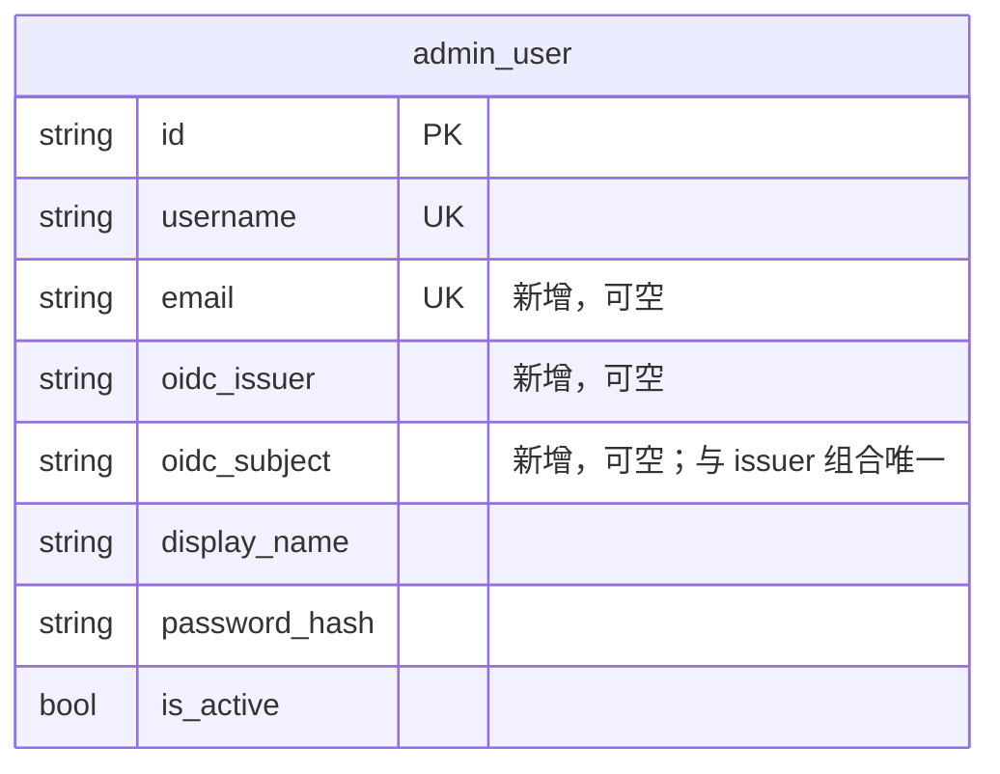
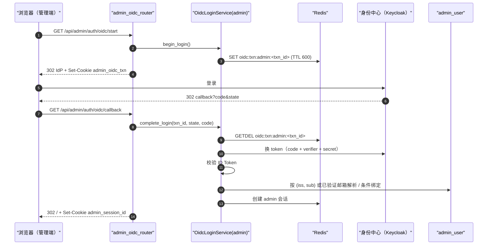

# PRD: 管理员企业账号（OIDC）登录

> ✅ **交付前置**：无，可立即开工。
> 结构化声明见 §8 Delivery Dependencies，**那里是唯一事实源**。

> ⬜ **验收状态**：未开工。
> 本行是 §9 Acceptance Checklist 的投影，**那里是唯一事实源**。

> 本 PRD 分为 Part A 人审层和 Part B 执行器层。Part A 用于确认目标行为和关键取舍；Part B 记录实现路径与验证证据。
> 同系列的后续 PRD：`P1-FEAT-20261112-134527-registration-policy-and-user-oidc`（注册策略 + 普通用户企业账号登录）、`P1-FEAT-20261112-142923-organizations-and-two-tier-admins`（组织与两级管理员，含管理员管理页与解绑入口），均排在本 PRD 之后。

## Feature Overview (功能一览)

> 本块是 §10 Functional Requirements 的简明投影；行为验收以 §1 行为样例为准。

- **管理端多一个“企业账号登录”入口**（FR-1、FR-6）：配置好身份中心后，管理端登录页出现该按钮，点击后去统一身份中心（如 Keycloak）登录，回来即进入后台。
- **只认已有管理员，从不建号**（FR-3、FR-4）：首次登录时，身份中心确认过的邮箱必须恰好对上一个启用中、尚未绑定的管理员才绑定；之后只按身份中心的稳定账号 ID 识别。
- **管理员需要一个真实邮箱**（FR-2）：初始管理员种子新增邮箱配置，作为首次绑定的依据。
- **默认开启、配置不全即不可用**（FR-5）：`ADMIN_OIDC_ENABLED` 默认开启，填好身份中心连接参数即生效；配置不全或显式关闭时按钮不出现，原有用户名密码登录照常可用。
- **失败只给通用提示，日志可排查**（FR-7）：页面不暴露失败细节；后端日志只记失败类别，不记令牌、授权码或密钥。
- **离线可测**（FR-8）：自动化测试用本地身份中心替身，不依赖真实 Keycloak。
- **不做**（§11）：普通用户企业账号登录与注册策略在后续 PRD；身份中心侧退出、切换账号均不做；管理员管理页与解绑入口由组织与两级管理员 PRD 提供。

# Part A · 人审层 (Review Layer)

## 1. Introduction & Goals

### Problem Statement

模板派生的应用准备共用一个统一身份中心（zata-ops 维护的 Keycloak，见 zata-ops `docs/guides/keycloak.md`），但模板本身只有用户名密码登录：管理端只有 `/admin/auth/login` 一条入口，`admin_user` 表只有用户名，没有邮箱，也没有记录外部身份的字段。结果是每个派生项目都要从 FreshAI 手工搬一套企业账号登录代码，而 FreshAI 的认证结构与模板不同（它没有模板的双域共享 `AuthService`），搬运容易漏掉安全约束。

### Interpretation (解读回显)

**行为样例**

| 验证方式 | 输入 / 操作 | 期望观察到的结果 |
|---|---|---|
| 👀 人审 + 自动验证 | 已开启企业账号登录；种子管理员邮箱为 `ops@example.com`。该邮箱在身份中心已验证的用户第一次点“企业账号登录”并完成登录 | 回到管理后台首页并处于登录状态；该管理员记录上写入身份中心账号标识 |
| 🤖 自动验证 | 同一身份中心账号再次登录，但身份中心里的邮箱已改成别的地址 | 仍登录同一个管理员（按稳定账号标识识别，不再看邮箱） |
| 🤖 自动验证 | 身份中心用户邮箱 `ops@example.com` 未验证 | 不登录，回到登录页显示通用失败提示；日志记 `reason=email_unverified` |
| 🤖 自动验证 | 身份中心用户邮箱没有对应任何管理员 | 不登录、不建号，显示通用失败提示；日志记 `reason=identity_not_mapped` |
| 🤖 自动验证 | 管理员已绑定身份中心账号 A，另一个账号 B 用同一邮箱登录 | 拒绝，不改绑；日志记 `reason=identity_conflict` |
| 🤖 自动验证 | 已绑定的管理员被禁用后用企业账号登录 | 拒绝；日志记 `reason=admin_inactive` |
| 🤖 自动验证 | 默认配置下缺 Client Secret（或显式 `ADMIN_OIDC_ENABLED=false`） | 登录页不出现按钮；直接访问登录入口返回“不可用”；用户名密码登录照常成功 |

以上行为样例将原样转入 §7.6 验收 oracle；修改某一格就是修改验收标准。

**我默默定了这些**

- 管理员邮箱由新增的 `AUTH_ADMIN_BOOTSTRAP_EMAIL` 写入；本 PRD 交付时种子仍是唯一建管理员的途径，“管理员管理”页面由后续组织与两级管理员 PRD 提供。
- 已有管理员不填邮箱时保持原样，只是无法用企业账号首次绑定。
- 登录过程中的一次性校验数据（state、nonce、PKCE verifier）存 Redis，10 分钟过期、用一次即删；浏览器只拿到一个随机编号 Cookie。
- 回调地址走管理端同源 `/api` 代理：`https://<管理端域名>/api/admin/auth/oidc/callback`。
- 登录成功跳回管理后台首页 `/`；不支持“登录后回到原页面”。
- 失败统一跳回 `/sign-in?sso_error=1`，页面只显示一句通用失败提示。
- 不读取身份中心的角色；管理员权限仍只看本地 `admin_user`。
- 配置项名称沿用 FreshAI：`ADMIN_OIDC_ENABLED / ISSUER / CLIENT_ID / CLIENT_SECRET / CALLBACK_URI`；`ENABLED` 默认 `true`，是否可用再看连接参数是否齐全（用户 2026-11-12 确认默认开启）。

**我理解为不做**

- 普通用户（public 前台）的企业账号登录和注册策略 —— 在后续 PRD。
- 退出时同时退出身份中心、强制重新认证 / 切换账号；管理员解绑或改绑入口（由后续组织与两级管理员 PRD 提供）。
- 身份中心侧的部署、Client 创建与主题 —— 由 zata-ops 负责。

**解读**：本 PRD 读作“给模板的 admin 认证域加一条与密码登录并列、默认开启但配置不全即不可用的 OIDC 登录路径，只用于确认已有管理员身份”，而不是“把管理员账号交给身份中心管理”。身份中心不能创建、启用或提权管理员；一个管理员只能绑定一个身份中心账号，绑定后只按 `(issuer, subject)` 识别。登录成功后签发的仍是模板现有的 admin 会话（Redis + HttpOnly Cookie），其他接口的鉴权方式不变。

- [x] 我确认这段解读与行为样例准确表达了我的需求。

### What The User Gets

- **管理员**：在管理端登录页多一个“企业账号登录”按钮，用身份中心的密码或验证码登录后直接进入后台，不用再记一套管理端密码；原用户名密码登录仍然可用。
- **部署者**：填身份中心连接四项（issuer / client_id / client_secret / callback_uri）和一个管理员邮箱即可生效（`ENABLED` 默认开启）；不填连接参数就和现在完全一样。
- **派生项目开发者**：拿到一套与模板认证结构一致、带离线测试替身的 OIDC 接入，不必再从 FreshAI 搬。

### Measurable Objectives

- 行为样例 7 行全部由自动测试覆盖并通过。
- 真实浏览器从管理端登录页点按钮，经本地身份中心替身完成登录，落到后台首页且 `/admin/auth/me` 返回该管理员。
- 未配置身份中心时，现有 `tests/backend/test_auth_domains.py` 与管理端登录 e2e 不改动即通过。
- 后端日志与浏览器响应中搜不到授权码、ID Token、Client Secret 原文。

## 2. Human Review Map (介入与风险地图)

### 管理员首次登录凭什么认人

建议只接受“身份中心已验证的邮箱，恰好匹配一个启用中、尚未绑定的管理员”这一种首次绑定方式，之后只按身份中心的稳定账号 ID 识别，永不自动建号或改绑。这与 FreshAI 和 zata-ops 接入指南一致。主要风险是：如果放宽成按用户名、未验证邮箱或允许改绑，任何能在身份中心注册账号的人都可能冒认管理员。为此需要给 `admin_user` 加一个可空、唯一的邮箱字段，并新增 `AUTH_ADMIN_BOOTSTRAP_EMAIL` 种子配置。



**请确认：** 首次绑定只认“已验证邮箱 + 唯一匹配 + 未绑定 + 启用中”，且 `admin_user` 增加邮箱和外部身份三列，是否同意？

- [x] 同意（推荐）

**验收：** 自动测试分别覆盖成功首绑、邮箱未验证、无匹配、已被别的身份绑定、管理员已禁用五种情况，只有第一种能登录；迁移可升可降，降级后表结构回到现状。

### 登录过程临时数据放 Redis

建议把 state、nonce、PKCE verifier 存在 Redis（10 分钟过期、取出即删），浏览器只持有一个随机编号的 HttpOnly Cookie；回调时编号、state 必须同时对上。FreshAI 是把这些数据签名后整个放进 Cookie，需要额外的签名密钥；模板已经有 Redis 会话，不需要再引入密钥。风险是 Redis 不可用时企业账号登录不可用 —— 但此时模板的密码登录会话同样不可用，没有新增故障面。

**请确认：** 登录临时数据存 Redis、一次性使用，是否同意？

- [x] 同意（推荐）

**验收：** 同一回调地址重放第二次被拒绝；在另一个浏览器（没有该 Cookie）打开回调地址被拒绝。

**自动门禁，不需要逐项人工审阅**：配置读取与“配置不全即不可用”、身份中心协议校验（签名、issuer、audience、过期、nonce、PKCE）、日志脱敏、管理端按钮显示与失败提示、迁移升降级，均由后端测试、迁移测试与 Playwright 用例把关。

**本次明确不涉及**：普通用户登录与注册、身份中心角色映射、退出身份中心、计费或批量数据操作。

## 3. Usage And Impact After Implementation

**管理员**：打开管理端 `/sign-in`。配置好身份中心后，用户名密码表单下方出现“企业账号登录”。点击后浏览器跳到身份中心登录页；登录完成回到管理后台首页。第一次登录要求身份中心里的邮箱已验证且等于本地管理员邮箱；之后即使身份中心改了邮箱也照常登录。失败时回到登录页，看到“企业账号登录失败，请联系管理员”一类的通用提示。未配置或显式关闭时登录页与现在完全一样。

**部署者 / 运维**：在身份中心为管理端登记一个 confidential Client（按 zata-ops 指南，回调地址填 `https://<管理端域名>/api/admin/auth/oidc/callback`），然后给后端设置：

```text
AUTH_ADMIN_BOOTSTRAP_EMAIL=<真实管理员邮箱>
# ADMIN_OIDC_ENABLED 默认 true，可省略；置 false 显式关闭
ADMIN_OIDC_ISSUER=https://auth.example.com/realms/<realm>
ADMIN_OIDC_CLIENT_ID=<client id>
ADMIN_OIDC_CLIENT_SECRET=<只放部署环境>
ADMIN_OIDC_CALLBACK_URI=https://admin.example.com/api/admin/auth/oidc/callback
```

重启后访问 `GET /api/admin/auth/oidc/status` 应返回 `{"enabled": true}`。排查看后端日志 `auth.oidc outcome=... portal=admin reason=...`。

**普通用户（public 前台）**：无变化。

**派生项目开发者**：拉取模板更新后执行迁移（应用启动时自动跑）；新增依赖 `joserfc`。不开启则行为不变。

**兼容性**：`admin_user` 新增三列均可空，既有管理员不受影响；种子流程在配置了邮箱时才写入邮箱；`ADMIN_OIDC_ENABLED` 默认开启，但连接参数未配置时不可用，未配置时行为与现状一致。

## 4. Requirement Shape

- **actor**：内部管理员；部署者 / 运维；派生项目开发者。
- **trigger**：管理员在管理端登录页点击“企业账号登录”；身份中心回调到后端。
- **expected behavior**：后端完成标准授权码 + PKCE 流程并校验 ID Token，按 `(issuer, subject)` 或严格首绑规则找到唯一启用中的管理员，签发现有 admin 会话；任何不满足都拒绝且不改动数据。
- **explicit scope boundary**：只覆盖 admin 认证域；不建号、不改绑、不读角色、不做身份中心侧退出。

# Part B · 执行器层 (Build Layer)

## 5. Repository Context And Architecture Fit

- **现有最近路径**：`src/backend/core/auth/service.py` 的 `AuthService`（两域共享编排，通过注入仓库 / 会话存储区分域）；`src/backend/composition/auth_wiring.py` 的 `build_auth_components`；`src/backend/api/admin/admin_auth_router.py`（`/admin/auth/login|logout|me`）；`src/backend/api/security/session_cookies.py`；`src/backend/infrastructure/auth/redis_session_store.py`；`src/backend/infrastructure/persistence/repos/user_account_repo.py` 的 `SqlAlchemyUserAccountRepository`（按 `model_class` + `identifier_attr` 复用于两张表）；`src/backend/composition/bootstrap.py` 的 `seed_admin_user`；`src/backend/infrastructure/config/settings.py` 的 `AuthSettings` 与 `_TomlSectionSource`。
- **参考实现**：FreshAI `src/backend/core/shared/interfaces/oidc.py`、`src/backend/infrastructure/identity/keycloak_oidc_client.py`、`src/backend/core/use_cases/authenticate_admin_oidc.py`、`src/backend/api/auth_oidc.py`、`tests/api/test_auth_keycloak_oidc.py`、`tests/playwright-e2e/support/keycloak-test-issuer.ts`。协议层可近乎原样移植；账号解析与事务存储按模板结构重写。
- **架构约束**：四层依赖方向由 `hooks/check_architecture.py` 校验 —— 新接口放 `core/shared/interfaces/`，实现放 `infrastructure/`，装配只在 `composition/`；`api/` 不直接导入 `infrastructure/`。
- **前端影响**：`frontend-admin/`（Vite + React + TanStack Router）。最近位置：`src/features/auth/sign-in/components/user-auth-form.tsx`、`src/api/auth.ts`、`src/locales/{zh,en}.json`。开发经 Vite 代理 `/api` → 后端（去掉 `/api` 前缀），生产同理。`frontend-public/` 无影响（后续 PRD 处理）。
- **相关 PRD**：
  - `tasks/pending/P1-FEAT-20260928-115856-multi-organization-online-agent-base.md`：也会修改 `core/auth/`（组织身份），但改的是会话解析后的组织范围，与登录入口无先后依赖 —— 可独立进行，合并时注意 `core/auth/` 冲突。
  - `tasks/pending/P1-FEAT-20261112-134527-registration-policy-and-user-oidc.md`：依赖本 PRD 的 OIDC 协议层与登录服务（本 PRD 阻塞它）。
  - `tasks/pending/P1-FEAT-20261112-142923-organizations-and-two-tier-admins.md`：依赖本 PRD 的邮箱与绑定列、首绑规则与测试替身（本 PRD 阻塞它）；管理员管理页与解绑入口由它提供。
  - `tasks/archive/P1-FEAT-20260625-182322-dual-auth-domain-separation.md`：双域设计来源，本 PRD 沿用其“同一编排、注入区分域”的做法。

## 6. Recommendation

**Recommended Approach**：仿照 `AuthService` 新增一个两域可复用的 `OidcLoginService`（本 PRD 只装配 admin 实例），通过注入 OIDC 网关、Redis 事务存储、用户仓库和会话存储工作；协议适配器从 FreshAI 移植。

**为什么合适**：模板已有“一份编排服务两域”的约定，后续 PRD 只需再装配一个 public 实例并加上建号策略，不会出现 FreshAI 那样 admin / user 两份近似用例。复用 `SqlAlchemyUserAccountRepository` 与 `RedisSessionStore`，不新增会话机制。

**拒绝的冗余抽象**：不引入签名 Cookie 及其密钥（Redis 已可承载一次性事务）；不引入通用“外部身份表”（一个账号只绑一个身份，两列足够）；不做插件式多身份提供方注册。

### Proposed Solution Summary (实现机制)

- 机制：标准 OIDC 授权码流程 + PKCE S256，后端作为 confidential client 换取并校验 ID Token。
- 输入由谁提供：部署者通过 `ADMIN_OIDC_*` 提供 issuer / client / secret / 回调地址；管理员邮箱由部署者通过 `AUTH_ADMIN_BOOTSTRAP_EMAIL` 提供。系统不推断任何管理员身份。
- 接入点：admin 认证域的 `api/admin/` 路由与 `auth_wiring` 装配；成功后调用现有 admin `RedisSessionStore.create` 并用现有 Cookie 工具下发。
- 状态变化：`admin_user` 增加 `email`、`oidc_issuer`、`oidc_subject`；首绑时原子写入外部身份。
- 刻意避免：新会话机制、新签名密钥、身份中心角色映射、自动建号。

**Alternatives Considered**：照搬 FreshAI 的签名 Cookie 事务 —— 需要新增 `API_SECRET_KEY` 类配置并管理轮换，模板无此密钥，收益只是省一次 Redis 读写，拒绝。

## 7. Implementation Guide

> This section is a living implementation guide based on current repository analysis. If implementation discovers additional affected files, hidden dependencies, edge cases, or a better path, update this PRD before proceeding.

### 7.1 Core Logic

1. `GET /admin/auth/oidc/status` → `{enabled}`：服务已装配（配置完整）即为 true。
2. `GET /admin/auth/oidc/start` → 生成 `txn_id`、`state`、`nonce`、`code_verifier`；Redis 写 `oidc:txn:admin:<txn_id>`（TTL 600s）；设置 HttpOnly Cookie `admin_oidc_txn=<txn_id>`（`SameSite=Lax`，`Secure` 跟随 `AUTH_COOKIE_SECURE`，Path `/`，max-age 600）；302 到身份中心授权地址。服务未装配或身份中心发现文档不可达 → 503。
3. `GET /admin/auth/oidc/callback?code&state` → 读 Cookie 拿 `txn_id`，Redis 原子取出并删除（`GETDEL`）；缺失 / state 不符 → 失败。用 `code + code_verifier` 换 token，校验 ID Token（签名经 JWKS、`iss`、`aud`、`exp`、`nonce`）。
4. 解析管理员：按 `(iss, sub)` 查找 → 有则要求启用；无则要求 `email_verified=true`，按归一化小写邮箱查找唯一管理员 → 要求启用且未绑定 → 条件更新 `UPDATE admin_user SET oidc_issuer, oidc_subject WHERE id=? AND oidc_subject IS NULL`，受影响行数为 0 视为冲突。唯一约束冲突（同一身份已绑别人）视为冲突。
5. 成功 → `session_store.create(account.id)`，设置 `admin_session_id` Cookie，清除事务 Cookie，302 到 `/`。失败 → 清除事务 Cookie，302 到 `/sign-in?sso_error=1`，记 `auth.oidc outcome=failed portal=admin reason=<类别>`。

失败类别（移植 FreshAI `OidcFailureReason` 中本 PRD 用到的部分）：`configuration_incomplete`、`provider_unavailable`、`transaction_invalid`、`token_exchange_failed`、`token_validation`、`email_unverified`、`identity_not_mapped`、`identity_conflict`、`admin_inactive`。

### 7.2 Change Impact Tree

```text
.
├── Database / Migration
│   └── alembic/versions/<YYYYMMDD-HHMMSS>-admin_oidc_identity.py
│       [新增]
│       【总结】admin_user 增加可空唯一 email 与可空 oidc_issuer/oidc_subject 及组合唯一约束，可降级。
│
├── Infrastructure
│   ├── src/backend/infrastructure/persistence/models/admin_user.py
│   │   [修改]
│   │   【总结】ORM 增加 email、oidc_issuer、oidc_subject 三列与组合唯一约束。
│   ├── src/backend/infrastructure/persistence/repos/user_account_repo.py
│   │   [修改]
│   │   【总结】按可选 email 列与 OIDC 列实现按身份查找、按邮箱查找与条件绑定。
│   │   ├── 构造参数新增 email_attr（admin 为 "email"；未配置时相关方法返回空）
│   │   ├── find_by_oidc_identity(issuer, subject)
│   │   ├── find_by_email(email)
│   │   ├── bind_oidc_identity(account_id, issuer, subject) -> 绑定结果枚举
│   │   └── set_email(account_id, email)（供种子使用）
│   ├── src/backend/infrastructure/auth/oidc_client.py
│   │   [新增]
│   │   【总结】从 FreshAI keycloak_oidc_client 移植的标准 OIDC 客户端：发现文档、JWKS 缓存、换 token、ID Token 校验。
│   │   └── 去掉 kc_action 与 prompt 参数；类名 HttpOidcClient
│   ├── src/backend/infrastructure/auth/redis_oidc_transaction_store.py
│   │   [新增]
│   │   【总结】按 key 前缀存取一次性登录事务，取出即删（GETDEL）。
│   └── src/backend/infrastructure/config/settings.py
│       [修改]
│       【总结】新增 OidcClientSettings（ADMIN_OIDC_*，[admin_oidc] TOML 段）与 AUTH_ADMIN_BOOTSTRAP_EMAIL。
│       ├── enabled / issuer / client_id / client_secret(SecretStr) / callback_uri
│       └── required_config_missing 属性（启用但缺项时非空）
│
├── Domain
│   ├── src/backend/core/shared/interfaces/oidc.py
│   │   [新增]
│   │   【总结】OIDC 网关端口、已验证身份值对象、失败类别枚举、PKCE 计算（移植自 FreshAI，去掉手机号与 kc_action）。
│   ├── src/backend/core/shared/interfaces/oidc_transaction_store.py
│   │   [新增]
│   │   【总结】一次性登录事务存储端口：save(txn_id, payload, ttl) / pop(txn_id)。
│   ├── src/backend/core/shared/interfaces/user_account_repository.py
│   │   [修改]
│   │   【总结】仓库端口增加按外部身份、按邮箱查找与条件绑定的抽象方法及绑定结果枚举。
│   ├── src/backend/core/shared/models/user_account.py
│   │   [修改]
│   │   【总结】UserAccount 增加可选 email、oidc_issuer、oidc_subject 字段（默认 None）。
│   ├── src/backend/core/auth/oidc_login.py
│   │   [新增]
│   │   【总结】两域可复用的 OidcLoginService：begin_login 生成事务与授权地址，complete_login 校验事务、解析账号、签发会话。
│   │   ├── 账号解析：已绑定 → 启用检查；未绑定 → 已验证邮箱唯一匹配 + 未绑定 + 启用 → 条件绑定
│   │   └── 不建号（建号能力由后续 PRD 通过注入策略加入）
│   └── src/backend/core/auth/__init__.py
│       [修改]
│       【总结】导出 OidcLoginService。
│
├── Composition
│   ├── src/backend/composition/auth_wiring.py
│   │   [修改]
│   │   【总结】配置完整时装配 admin OidcLoginService，否则为 None 并记一次 configuration_incomplete 警告。
│   ├── src/backend/composition/bootstrap.py
│   │   [修改]
│   │   【总结】seed_admin_user 在配置了 AUTH_ADMIN_BOOTSTRAP_EMAIL 时写入或同步管理员邮箱。
│   └── src/backend/composition/app_factory.py
│       [修改]
│       【总结】挂载 admin OIDC 路由（rg "admin_auth_router" 定位挂载处）。
│
├── API
│   ├── src/backend/api/admin/admin_oidc_router.py
│   │   [新增]
│   │   【总结】/admin/auth/oidc/status|start|callback 三个端点，负责 Cookie 与重定向，失败统一跳转。
│   ├── src/backend/api/dependencies.py
│   │   [修改]
│   │   【总结】新增 get_admin_oidc_login_service 依赖（可能为 None）。
│   └── src/backend/api/security/session_cookies.py
│       [修改]
│       【总结】复用现有 set/clear 函数为事务 Cookie 设置短 max-age（如现有函数不支持则补参数）。
│
├── Frontend (frontend-admin)
│   ├── frontend-admin/src/api/auth.ts
│   │   [修改]
│   │   【总结】新增 getAdminOidcStatus() 与 adminOidcStartUrl 常量（/api/admin/auth/oidc/start）。
│   ├── frontend-admin/src/features/auth/sign-in/components/user-auth-form.tsx
│   │   [修改]
│   │   【总结】status 为 enabled 时在表单下显示“企业账号登录”按钮（整页跳转），URL 带 sso_error 时显示通用失败提示。
│   └── frontend-admin/src/locales/zh.json / en.json
│       [修改]
│       【总结】新增按钮文案与失败提示文案。
│
├── Tests
│   ├── tests/backend/oidc_test_support.py
│   │   [新增]
│   │   【总结】移植 FreshAI ControlledOidcIssuer：内存 RS256 签发、httpx MockTransport 提供发现 / JWKS / token 端点。
│   ├── tests/backend/test_admin_oidc_login.py
│   │   [新增]
│   │   【总结】经 FastAPI TestClient 走 status/start/callback，覆盖 §1 全部行为样例、重放与跨浏览器拒绝、日志脱敏。
│   ├── tests/backend/test_admin_oidc_migration.py
│   │   [新增]
│   │   【总结】迁移 upgrade/downgrade 往返，既有管理员数据保留。
│   ├── frontend-admin/src/features/auth/sign-in/components/user-auth-form.test.tsx
│   │   [修改]
│   │   【总结】按钮按 status 显隐、sso_error 提示。
│   ├── tests/playwright-e2e/support/oidc-test-issuer.ts
│   │   [新增]
│   │   【总结】移植 FreshAI keycloak-test-issuer：本机回环端口上的真实 RS256 身份中心替身。
│   └── tests/playwright-e2e/tests/workflows/admin-oidc-sign-in.no-auth.spec.ts
│       [新增]
│       【总结】真实浏览器从登录页点按钮完成首绑登录；未配置 ADMIN_OIDC_* 时 skip。
│
└── Docs
    ├── docs/architecture/authentication.md
    │   [修改]
    │   【总结】新增“企业账号（OIDC）登录”一节：流程图、首绑规则、失败类别、配置项。
    ├── docs/guides/configuration.md
    │   [修改]
    │   【总结】登记 ADMIN_OIDC_* 与 AUTH_ADMIN_BOOTSTRAP_EMAIL。
    ├── .env.example
    │   [修改]
    │   【总结】注释形式列出新配置；ENABLED 默认 true，连接参数留空即不可用。
    └── pyproject.toml / uv.lock
        [修改]
        【总结】新增运行期依赖 joserfc。
```

此清单是起点，不保证穷尽，见 7.4。

### 7.3 Risk Classification Register

| change point | tier | decisive dimension/override | intervention | oracle/gate |
|---|---|---|---|---|
| 管理员账号解析与首绑规则 | R3 | 安全 / 授权；固定区 core + auth | 人工确认 + 负向对照 | rv-1、rv-2 |
| `admin_user` 迁移 | R2 | 持久化结构；固定区 schema | 人工确认 | rv-3 |
| 一次性事务（Redis + Cookie） | R3 | 安全（登录 CSRF / 重放） | 人工确认 + 负向对照 | rv-2 |
| OIDC 协议客户端（移植） | R2 | 安全，但为移植的已验证代码 | 执行器 + 自动门禁 | rv-2（篡改签名 / nonce 用例） |
| 配置读取与配置不全即不可用 | R1 | 局部行为 | 执行器 + 自动门禁 | rv-4 |
| 管理端按钮与失败提示 | R1 | 局部 UI | 执行器 + 自动门禁 | rv-5 |
| 日志脱敏 | R2 | 敏感数据 | 执行器 + 自动门禁 | rv-2 中的日志断言 |

### 7.4 Executor Drift Guard

- 认证相关所有引用：`rg -n "AuthService|build_auth_components|seed_admin_user|admin_bootstrap" src tests`
- 用户仓库实现与替身：`rg -n "UserAccountRepository\)" src tests` —— 端口新增抽象方法后，测试里的内存替身也要实现。
- 架构检查：`uv run python hooks/check_architecture.py`。
- 前端代理路径：`rg -n "'/api'" frontend-admin/vite.config.ts`；生产 Nginx 配置 `rg -n "location /api" -g "*.conf" .`。

### 7.5 Flow Diagram



### 7.6 Realistic Validation Plan

```yaml
- id: rv-1
  behavior: "已验证邮箱匹配唯一启用管理员时，从管理端登录页用企业账号登录后进入后台"
  reviewer: human
  real_entry: "ADMIN_OIDC_* 指向 Playwright 本地身份中心替身后 just e2e tests/workflows/admin-oidc-sign-in.no-auth.spec.ts"
  expected: "页面落在管理后台首页；/api/admin/auth/me 返回种子管理员；新开浏览器上下文携带同一会话 Cookie 仍可访问"
  mock_boundary: "只替换身份中心本身（真实 RS256 签名的发现 / JWKS / 授权 / token 端点）；后端路由、Redis、数据库、Vite 代理、前端按钮均为真实"
  tier: R3
  test_layer: e2e
  required_for_acceptance: true
  presentation: "tasks/evidence/<prd-stem>/rv-1-admin-oidc-sign-in.webm 与登录页按钮截图 rv-1-sign-in-button.png；自查：截图中用户名密码表单下方出现“企业账号登录”"
  critical_value_source: "浏览器实际跟随的 302 Location 与身份中心替身回调给出的 code/state"
  must_cross: "管理端登录页按钮 -> Vite /api 代理 -> /admin/auth/oidc/start -> 替身授权端点 -> /admin/auth/oidc/callback -> 后端换 token -> admin_user 绑定 -> Redis 会话"
  forbidden_bypasses: "直接调用 OidcLoginService、手工写 Cookie、直接写库绑定、跳过 /api 代理"
  fresh_state_probe: "新的 APIRequestContext 只携带会话 Cookie 请求 /api/admin/auth/me；另起数据库会话查询该管理员 oidc_subject 非空"
  final_tree_evidence: "在最终提交树上重跑；任何 core/auth 或路由改动后需重跑"
  negative_control: "把替身声明的 email_verified 设为 false 运行同一用例"
  expected_fail: "页面停留 /sign-in?sso_error=1，/api/admin/auth/me 返回 401"
- id: rv-2
  behavior: "所有拒绝路径不登录、不改数据，且一次性事务不可重放"
  reviewer: verifier
  real_entry: "uv run pytest tests/backend/test_admin_oidc_login.py"
  expected: "邮箱未验证 / 无匹配 / 已被他人绑定 / 管理员已禁用 / 重放回调 / 无事务 Cookie / state 不符 / ID Token 签名或 nonce 被篡改，均 302 到 /sign-in?sso_error=1、无会话 Cookie、管理员行未变；日志含对应 reason 且不含 code、id_token、client_secret 原文"
  mock_boundary: "身份中心由 ControlledOidcIssuer 经 httpx MockTransport 提供；FastAPI 应用、路由、OidcLoginService、仓库与测试数据库为真实；Redis 使用测试现有替身或真实实例（按 tests/backend/conftest.py 约定）"
  tier: R3
  test_layer: integration
  required_for_acceptance: true
  critical_value_source: "TestClient 从 /start 响应读取的 Location 中的 state 与 Set-Cookie 中的事务编号"
  must_cross: "TestClient -> 路由 -> OidcLoginService -> 事务存储 -> HttpOidcClient -> 仓库 -> 会话存储"
  forbidden_bypasses: "自行拼装 state、直接调用 _resolve 私有方法、替换 OidcLoginService"
  fresh_state_probe: "每个拒绝用例后用新的数据库会话读取管理员行，确认 oidc_issuer/oidc_subject 与 is_active 未变"
  final_tree_evidence: "最终提交树上 just test 通过"
  negative_control: "临时在测试替身仓库里让 bind_oidc_identity 忽略 oidc_subject IS NULL 条件（只改 tests/ 下替身）"
  expected_fail: "“已被他人绑定”用例变为登录成功，测试失败"
- id: rv-3
  behavior: "迁移可升可降，既有管理员保留"
  reviewer: verifier
  real_entry: "uv run pytest tests/backend/test_admin_oidc_migration.py"
  expected: "upgrade 后三列存在且可空、(oidc_issuer, oidc_subject) 与 email 唯一；downgrade 后结构回到上一版本；升降过程中既有管理员行数与用户名不变"
  mock_boundary: "真实 Alembic 与测试数据库（沿用 tests/realdb_test_support.py 约定）"
  tier: R2
  test_layer: integration
  required_for_acceptance: true
  critical_value_source: "迁移前插入的管理员行"
  must_cross: "alembic upgrade head -> downgrade -1 -> upgrade head"
  forbidden_bypasses: "Base.metadata.create_all 代替迁移"
  fresh_state_probe: "每一步后用新连接 inspect 表结构并计数"
  final_tree_evidence: "迁移文件最终版本上运行"
  negative_control: "not needed — 列存在 / 不存在是具体值对比，迁移缺失时断言必然失败"
- id: rv-4
  behavior: "配置不全时企业账号登录关闭，密码登录不受影响"
  reviewer: verifier
  real_entry: "uv run pytest tests/backend/test_admin_oidc_login.py -k config"
  expected: "默认（ENABLED=true）缺 client_secret 时 status 为 false、start 返回 503、POST /admin/auth/login 成功；显式 ENABLED=false 时同样不可用"
  mock_boundary: "真实设置加载与应用装配"
  tier: R1
  test_layer: integration
  required_for_acceptance: true
- id: rv-5
  behavior: "管理端登录页按 status 显隐按钮，失败时显示通用提示"
  reviewer: verifier
  real_entry: "cd frontend-admin && pnpm test -- user-auth-form"
  expected: "enabled=false 时无按钮；enabled=true 时按钮 href 为 /api/admin/auth/oidc/start；URL 含 sso_error=1 时显示通用失败文案"
  mock_boundary: "mock getAdminOidcStatus 返回值"
  tier: R1
  test_layer: unit
  required_for_acceptance: true
```

失败排查：先看 `ADMIN_OIDC_CALLBACK_URI` 与身份中心 Client 的回调地址是否逐字一致；再看 Vite / Nginx 是否把 `/api` 去前缀转发；再看后端日志 `auth.oidc ... reason=`。e2e 需在启动后端前导出 `ADMIN_OIDC_*`（指向替身监听地址），否则用例 skip —— skip 不算通过，交付时须给出实际运行记录。

### 7.7 Low-Fidelity Prototype

目标状态（管理端 `/sign-in`，已开启）：

```text
┌──────────────────────────────┐
│  登录                         │
│  用户名 [______________]      │
│  密码   [______________]      │
│  [          登录          ]   │
│  ─────────── 或 ───────────   │
│  [      企业账号登录      ]   │
│  (sso_error=1 时) ⚠ 企业账号登录失败，请联系管理员 │
└──────────────────────────────┘
```

验收对照态：不可用（无分隔线与按钮）、可用、失败提示三态。改动为单一按钮与提示，用低保真图作为目标即可，不新增交互原型文件。

No interactive prototype file changes in this PRD.

### 7.8 External Validation

No external validation required; repository evidence was sufficient. 协议实现移植自 FreshAI 已上线代码（2026-11-12 核对 `~/code/freshai` HEAD `cac961ac`），Keycloak 侧约定见 zata-ops `docs/guides/keycloak.md`。

## 8. Delivery Dependencies

### Delivery Dependencies

- Depends on tasks/issues:
  - none
- Gate type: none
- Sequence: via-main
- Notes: 与 `P1-FEAT-20260928-115856-multi-organization-online-agent-base` 都改 `src/backend/core/auth/`，无顺序依赖，后合者解决冲突。本 PRD 阻塞 `P1-FEAT-20261112-134527-registration-policy-and-user-oidc` 与 `P1-FEAT-20261112-142923-organizations-and-two-tier-admins`。

## 9. Acceptance Checklist

### 9.1 人读呈递区（Human Review Surface）

**主演示脚本**

1. 打开管理端 `/sign-in`：用户名密码表单下方出现“企业账号登录”（本地身份中心替身，mock 身份中心）。
2. 点击按钮：跳到身份中心替身登录页，地址带 `code_challenge_method=S256`。
3. 以种子管理员邮箱完成登录：回到后台首页，右上角显示该管理员。
4. 换一个未验证邮箱的身份再试：回到登录页并显示通用失败提示。

| 结果 | 呈递物 | 10 秒自查 |
|---|---|---|
| 企业账号登录进入后台（rv-1） | `tasks/evidence/<prd-stem>/rv-1-admin-oidc-sign-in.webm`，`rv-1-sign-in-button.png`（交付时内嵌） | 截图中按钮位于表单下方；录屏最后一帧为后台首页 |

未在此展示（verifier 负责）：rv-2 拒绝路径与日志脱敏、rv-3 迁移、rv-4 配置、rv-5 前端单测。

### 9.2 Acceptance Evidence Package

按风险排序：rv-1、rv-2（R3）→ rv-3（R2）→ rv-4、rv-5（R1）。

### Human-Confirmed (来自 Part A 风险地图)

- [ ] 首次绑定规则（已验证邮箱 + 唯一匹配 + 未绑定 + 启用）与 `admin_user` 新增三列符合预期 —— 证据：rv-2 各拒绝用例输出、rv-3 迁移往返输出
- [ ] 登录临时数据存 Redis、一次性使用符合预期 —— 证据：rv-2 重放与无 Cookie 用例输出
- [ ] 已查看 9.1 演示录屏与截图，登录页与登录结果符合预期

### Architecture Acceptance

- [ ] `uv run python hooks/check_architecture.py` 通过；`OidcLoginService` 仅依赖 `core/shared/interfaces/` 端口
- [ ] `rg -n "from backend.infrastructure" src/backend/core src/backend/api` 无新增命中

### Behavior Acceptance

- [ ] §1 行为样例 7 行均有对应测试且通过（rv-2、rv-4 输出）
- [ ] 回调重放、缺事务 Cookie、state 不符均被拒绝（rv-2 输出）

### Frontend Acceptance

- [ ] `frontend-admin` 登录页按钮显隐与失败提示符合 7.7 三态（rv-5 输出、rv-1 截图）
- [ ] `cd frontend-admin && pnpm build` 通过

### Documentation Acceptance

- [ ] `docs/architecture/authentication.md` 有 OIDC 一节；`docs/guides/configuration.md` 与 `.env.example` 列出新配置
- [ ] `uv run mkdocs build --strict` 通过

### Validation Acceptance

- [ ] rv-1 真实浏览器 e2e 在配置替身后实际运行通过（非 skip），录屏存证
- [ ] 日志与响应中无 `code`、`id_token`、`client_secret` 原文（rv-2 日志断言）
- [ ] `just test` 通过

### Delivery Readiness

- [ ] `just lint --repo` 通过
- [ ] PR 证据评论或完成消息携带 9.1 内容（内嵌截图 + 录屏路径）

## 10. Functional Requirements

- **FR-1**：管理端提供 `GET /admin/auth/oidc/status|start|callback`，完成授权码 + PKCE S256 流程并签发现有 admin 会话。
- **FR-2**：种子流程支持 `AUTH_ADMIN_BOOTSTRAP_EMAIL`，写入或同步管理员邮箱；`admin_user` 增加可空唯一 `email` 与 `(oidc_issuer, oidc_subject)` 组合唯一的外部身份列。
- **FR-3**：已绑定身份只按 `(issuer, subject)` 识别，并要求管理员启用。
- **FR-4**：首绑仅当 ID Token `email_verified=true` 且邮箱唯一匹配启用中、未绑定的管理员时原子绑定；从不建号、不启用、不改绑。
- **FR-5**：`ADMIN_OIDC_ENABLED` 默认开启；缺必填连接参数或显式置 false 时 OIDC 路径不可用且不阻断启动和密码登录。
- **FR-6**：管理端登录页按 status 显示“企业账号登录”按钮；`sso_error=1` 时显示通用失败提示（中英文）。
- **FR-7**：失败统一重定向并按类别记录日志，日志与响应不含授权码、令牌、Client Secret。
- **FR-8**：提供后端测试用身份中心替身与 Playwright 身份中心替身，测试不依赖真实身份中心。

## 11. Non-Goals

- 普通用户企业账号登录与注册策略（后续 PRD）。
- 身份中心侧退出（RP-initiated logout）、强制重新认证、切换账号。
- 管理员解绑 / 改绑入口、管理员管理页面（由 `P1-FEAT-20261112-142923-organizations-and-two-tier-admins` 提供，本 PRD 不做）。
- 读取身份中心角色或组来授予权限。
- 身份中心部署、Client 配置与登录主题（zata-ops 负责）。

## 12. Risks And Follow-Ups

- 本地登出不会结束身份中心会话，用户再次点按钮可能免密直接进入；属预期行为，文档中说明。
- 已有派生项目若管理员用户名并非邮箱，需要配置 `AUTH_ADMIN_BOOTSTRAP_EMAIL` 后重启才能首绑。

## 13. Decision Log

| ID | Decision | Chosen | Rejected | Rationale |
|---|---|---|---|---|
| D-01 | 管理员首绑依据 | 已验证邮箱唯一匹配 | 登录后手动绑定；按 `preferred_username` 匹配 | 与 FreshAI / zata-ops 指南一致，且用户名可在身份中心改动，不能作为身份凭据 |
| D-02 | 登录事务存储 | Redis 一次性 + 随机编号 Cookie | FreshAI 的签名 Cookie | 模板已有 Redis 会话且无签名密钥，避免新增密钥管理 |
| D-03 | 编排形态 | 两域可复用的 `OidcLoginService` | 按 FreshAI 为 admin / user 各写一个用例 | 沿用模板 `AuthService` 一份编排服务两域的约定，后续 PRD 只加注入策略 |
| D-04 | 企业账号登录默认状态 | `ENABLED` 默认开启，配置不全即不可用 | 默认关闭 | 用户 2026-11-12 确认默认开启；未配置时按钮不出现，安全边界仍是首绑规则而非开关，保留显式关闭能力 |

## Change Log

### 管理员管理页与解绑入口指向后续 PRD
- Type: scope
- Before: “管理员解绑 / 改绑入口、管理员管理页面”列为不做；种子被描述为唯一建管理员途径。
- After: 上述能力由 `P1-FEAT-20261112-142923-organizations-and-two-tier-admins` 提供；本 PRD 范围不变，仅更新指向与依赖声明（§5、§8 增加该下游 PRD）。
- Reason: 用户 2026-11-12 确认组织与两级管理员单独拆 PRD，管理员创建与解绑归入该 PRD。
- Impact: 本 PRD 行为、验收与实现范围不变；下游依赖关系更明确。
- Review: 无需重新确认（未改已批准的行为与决策）。

### 企业账号登录改为默认开启
- Type: scope
- Before: `ADMIN_OIDC_ENABLED` 默认关闭，需显式开启。
- After: `ADMIN_OIDC_ENABLED` 默认开启；可用 = 开关开启且连接参数齐全，配置不全或显式 false 即不可用，密码登录不受影响。
- Reason: 用户 2026-11-12 确认默认开启；未配置部署的按钮本就不出现，默认开启不新增入口，只省去部署者再翻一个开关。
- Impact: FR-5、行为样例第 7 行、rv-4、配置示例与兼容性表述更新；首绑规则、事务存储等安全决策不变；新增 D-04。
- Review: 用户已在对话中确认（2026-11-12）。
